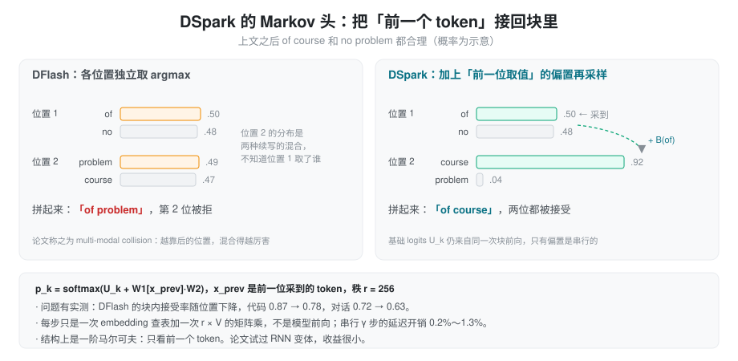
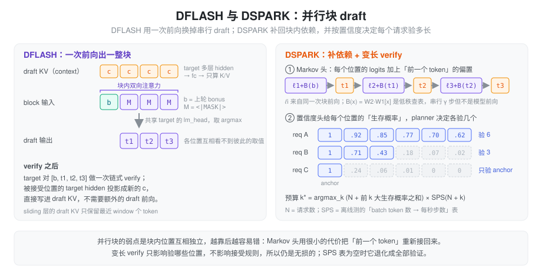

% 投机解码（七）：DSpark，补回块内依赖，按置信度决定验多长

> 系列总览见 [投机解码方案对比](./speculative_decoding.md)。上一篇：[DFlash](./spec_dflash.md)。

### 问题：并行块的两笔浪费

DFlash 把 k 个 token 压进一次 draft 前向，但留下了两个问题。DSpark（北京大学与 DeepSeek-AI，[arXiv 2607.05147](https://arxiv.org/abs/2607.05147)，2026 年 7 月）分别针对它们：

1. **块内各位置互相看不到彼此的取值。** 同一次前向里，第 2 位不知道第 1 位最后采到了什么。上文之后「of course」和「no problem」都合理时，第 2 位的分布是两种续写的混合，各自取 argmax 就可能拼出「of problem」。论文把这叫 **multi-modal collision**。它在数据上有体现：DFlash 的块内接受率随位置下降，代码任务从 0.87 降到 0.78，对话从 0.72 降到 0.63。
2. **大负载下 verify 在浪费算力。** 小 batch 时 verify 多算几个位置几乎免费；batch 一大，verify 开始真实占用算力。给一个第 2 位就大概率出错的请求验满 γ+1 个位置，后面那些位置纯属浪费，还拖慢了同 batch 的其他请求。

前者是 draft 的质量问题，后者是调度问题。DSpark 的两个组件一一对应。

### insight 一：只把「前一个 token」接回来就够了

要解决 collision，最直接的办法是退回自回归 draft，但那样就丢掉了并行块的全部好处。论文的观察是：collision 主要发生在相邻位置之间，**只看前一个 token** 就能消除大部分歧义。而「只看前一个 token」的修正不需要模型前向，一个低秩查表就够。

**Markov 头**：块前向照常给出每个位置的基础 logits U_k，然后从左到右依次采样，第 k 位加上一个只依赖第 k−1 位 token 的偏置：

\[
p_k = \text{softmax}\big(U_k + W_1[x_{k-1}]\,W_2\big)
\]

W₁ 是 V × r 的 embedding 表，W₂ 是 r × V 的投影，r = 256。采出 x_k 后再算第 k+1 位的偏置。这 γ 步是串行的，但每步只是一次查表和一次 r × V 的矩阵乘，延迟开销只有 0.2%～1.3%。论文把这种「主体并行、修正串行」的结构称为 semi-autoregressive。也试过把一阶马尔可夫换成 RNN，收益很小。

### insight 二：draft 知道自己哪里会错

要解决 verify 浪费，需要事先知道每个请求的每个位置大概会不会被接受。DSpark 让 draft 自己预测这件事。

**置信度头**：每个位置输出 c_k = σ(wᵀ[h_k; W₁[x_{k−1}]])，输入是该位置的 hidden 加上 Markov 头里前一个 token 的 embedding。训练目标不是 0/1 的接受标签，而是 draft 分布和 target 分布的重合度：

\[
c^*_k = 1 - \tfrac{1}{2}\,\lVert p_d - p_t \rVert_1
\]

这正是拒绝采样下该位置的接受概率（见 [第一篇](./spec_origins.md) 的 β）。用 BCE 训练。

**STS 校准**：置信度用于调度前还要校准。STS（sequential temperature scaling）从左到右逐位置做温度网格搜索，把 ECE 从 3%～8% 降到约 1%。不校准不影响正确性，只影响调度的准确度。

#### 训练

总损失是 0.1·CE + 0.9·TV + 1.0·conf：CE 是对真实 token 的交叉熵，TV 是 draft 与 target 分布的总变差（直接优化接受率），conf 是置信度头的 BCE。

### 调度：按吞吐决定每个请求验多长

有了校准好的置信度，第 r 个请求第 j 位的**生存概率**就是前 j 位置信度的乘积，即「验到这一位时前面还全对」的概率。调度要回答的是：这一步全 batch 一共验多少位置、分给谁。

论文的目标是最大化吞吐：

\[
\Theta = \tau \cdot \text{SPS}(B),\quad B = \sum_r (1 + \ell_r)
\]

ℓ_r 是第 r 个请求验的 draft 长度，B 是 verify 的总 token 数，τ 是预期产出的 token 数（生存概率之和），SPS(B) 是「batch 里 B 个 token 时每秒能跑几步」，离线测出。多验一个位置，τ 增加它的生存概率，SPS 下降一点，两者相乘。

求解是贪心：把全 batch 所有位置按生存概率从大到小排开，依次接纳，直到 Θ 不再上升就停。因为同一请求里生存概率随位置单调不增，接纳出来的必然是每个请求的一段前缀。小负载时 SPS 几乎是平的，几乎全验；大负载时 SPS 下降得快，只留下高置信的位置。

两个工程细节：

- **无损要求「不偷看」**。调度只能用 draft 自己的置信度，不能用 target 的任何信息。论文把它叫 causal barrier：只要验多长的决定不依赖 verify 的结果，输出分布就和不投机完全一致。
- **异步**。生产环境里调度和 draft 重叠执行，用的是 **2 步之前**的置信度，换来调度不在关键路径上。

### draft 结构

论文主实验的 draft 基本沿用 DFlash：target 多层特征经 KV 注入进入每层，块输入是 anchor 加 mask，块内双向注意力；在此之上加 Markov 头和置信度头。

DeepSeek V4 线上用的生产 drafter 是 3 层 MoE、带 mHC、滑动窗口 128，γ = 5。NVIDIA NeMo 文档里 V4.1 Flash 的配置也是 3 层、block 5、`target_layer_ids` 取 [37, 38, 39]、`markov_rank` 256。注意它取的是末尾连续三层，而不是 DFlash 那样均匀分布。

### 结果

- **离线**：Qwen3-8B GSM8K 上的 τ，EAGLE-3 5.30、DFlash 5.33、DSpark 6.17；整体比 DFlash 高 16%～18%，γ 越大优势越明显（γ = 15 时 +30%），这正是 collision 随块长加剧的反面。
- **线上（DeepSeek V4）**：

| | 中等 SLA 吞吐 | 严格 SLA 吞吐 | 单用户速度 |
| :--- | :--- | :--- | :--- |
| V4-Flash | +51% | +661% | +60%～85% |
| V4-Pro | +52% | +406% | +57%～78% |

对比基线是 V4 预览版的 MTP-1。严格 SLA 那一列，论文的说法是 DSpark 扩展了可达的吞吐前沿，所以几百个百分点不能当作同条件下的吞吐倍数来读。低负载时 DSpark 的平均 verify 长度约 4～6，而 MTP-1 固定是 2。V4 预览版发布两周后，DSpark 替换掉了 MTP-1。

局限：draft 总是生成满 γ 个 token，调度只裁剪 verify，不裁剪 draft 本身。

### 在 SGLang 里

`DSPARK` 是独立算法，worker 是 `DSparkWorkerV2`，组件拆在 `speculative/dspark_components/` 下：`dspark_draft`、`dspark_kv_inject`、`dspark_planner`、`dspark_sps`、`dspark_sts`、`dspark_verify`、`dspark_block_accept_estimator` 等；变长 verify 的布局在 `speculative/ragged_verify.py`。

**draft 模型**有两套：

- `models/dspark.py`：`DSparkDraftModel` 继承 `DFlashDraftModel`，再混入 `DSparkDraftMixin`。Markov 头有三种：`VanillaMarkov`（`markov_w1 = Embedding(V, r)`、`markov_w2 = Linear(r, V)`，和论文公式一致）、`GatedMarkovHead`、`RNNHead`，后两种还会看 hidden。gated 变体论文里没有。`run_markov_block` 就是上面那个逐位置加偏置、采样、再算下一位偏置的循环。`DSparkConfidenceHead` 是一个 `Linear(h + r, 1)`，推理时按 STS 温度做 `sigmoid(raw / T)`。
- `models/deepseek_v4_dspark.py`：`DeepseekV4ForCausalLMDSpark`，对应 V4 的生产 drafter，层是 `DeepseekV4DecoderLayer` 的子类，注意力带 sliding window。

**调度**在 `dspark_planner.py`：按生存概率排序（`compute_sort_survival`），结合 SPS 表决定总预算，每个请求的 verify 长度落在 [1, γ+1]，至少验 anchor。置信度经一个环形缓冲传递，滞后步数由 `SGLANG_DSPARK_CONFIDENCE_RELAY_LAG_STEPS` 控制，默认 2，和论文的异步设计一致；关掉 overlap 调度时没有滞后。两张离线表分别由 `--speculative-dspark-sps-table-path` 和 `--speculative-dspark-confidence-sts-path` 指定。没有 SPS 表时表是平的，「多验一个」永远不吃亏，预算退化成全验。

**变长 verify** 由 `SGLANG_RAGGED_VERIFY_MODE` 选择：

| 模式 | target 跑多少位置 | 效果 |
| :--- | :--- | :--- |
| `static`（默认） | 全部 γ+1 | 不裁剪，CUDA graph 形状固定 |
| `cap-accept` | 全部 γ+1 | 接受长度截在计划值上，不省计算；能精确统计「不截断时」的接受长度 |
| `compact` | 各请求长度之和，补齐到 graph 档位 | 真正省掉 verify 计算 |

注意默认的 `static` 模式不创建预算 planner，只用到 Markov 头；要拿到论文里大负载下的收益，需要 `compact` 加 SPS 表。非 `static` 模式要求 checkpoint 带置信度头，否则启动时报错。

**参数**：γ 依次取 `--speculative-dspark-block-size`、checkpoint 里的 block_size，都没有时默认 7，`num_draft_tokens = γ + 1`。只支持 CUDA。和 DFlash 不同，DSpark 支持 DP attention（需要 `--enable-dp-lm-head` 或打开 lm_head 分片共享），PP > 1 只在 PD 分离下支持。[Kimi K3 B200](./kimi_k3_b200.md) 的部署用的就是它，包括按窗口分配的 draft KV 池。

### 后续工作

**PCTree**（[arXiv 2608.02123](https://arxiv.org/abs/2608.02123)）把 DSpark 的单链变成树：Markov 头本来就能给「某个父 token 之下各子 token」打分，于是直接用它为每个父节点挑备选子节点，在固定 verify 预算里选最可能的路径。不需要重训，也不多跑 backbone。Qwen3-4B/8B/14B 上比同配置 DSpark 的加速比高 3.1%～29.5%；Qwen3-4B GSM8K、B = 16 时 τ 从 9.41 升到 11.16。

### 小结

DSpark 承认了并行块的两笔浪费，并各用一个很轻的部件补上：Markov 头只把前一个 token 接回块里，以几乎为零的代价消除大部分 multi-modal collision，让块可以开得更长；置信度头加 SPS 表把「验多长」变成一个按吞吐求解的调度问题，大负载下只验值得验的位置，并通过不偷看 target 保持无损。从 Blockwise 一路到这里，draft 越来越懂 target，而 DSpark 第一次让 verify 本身也按负载伸缩。
