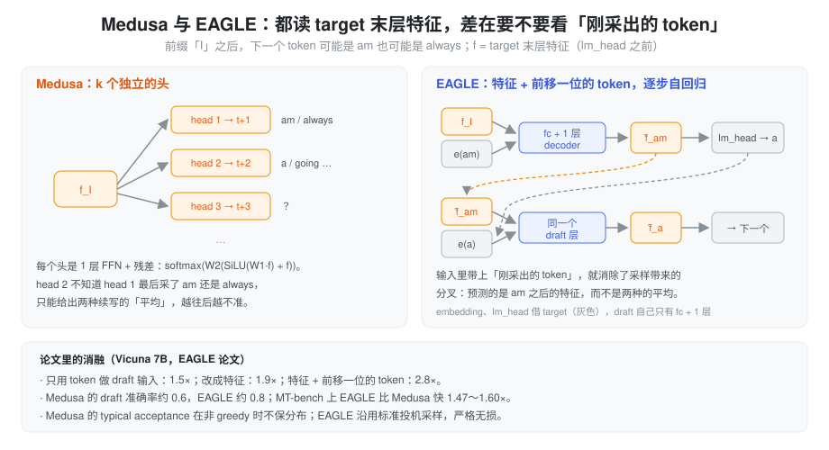
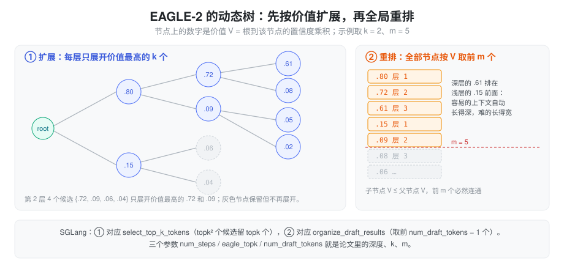

% 投机解码（三）：Medusa、EAGLE 与 EAGLE-2

> 系列总览见 [投机解码方案对比](./speculative_decoding.md)。上一篇：[n-gram 方案](./spec_ngram.md)。

### 问题：独立小模型看不到 target「此刻在想什么」

独立 draft（STANDALONE）只看得到 token 序列，它得从头理解上下文，才能猜 target 下一步说什么；而 target 刚刚算过的那一大堆 hidden state 已经包含了这些理解，却被白白扔掉。另一方面，一个能独立理解上下文的小模型至少也有好几层，γ 次串行前向并不便宜。

2024 年初的两条工作给出了同一个方向：**draft 直接长在 target 的 hidden 上**。target 的末层特征（lm_head 之前的那个向量）已经编码了「下一个 token 是什么」的大部分信息，draft 只要很薄的一层就能把它往前推。

### Medusa：在末层特征上挂 k 个头

Cai 等人的 Medusa（[arXiv 2401.10774](https://arxiv.org/abs/2401.10774)）去掉了独立 draft 模型，直接在 backbone 末层特征 h_t 上挂 k 个头，第 k 个头预测 t+k+1 位置：

\[
p^{(k)} = \text{softmax}\big(W_2^{(k)}(\text{SiLU}(W_1^{(k)} h_t) + h_t)\big)
\]

每个头只是一层带残差的 FFN，W₂ 用 lm_head 初始化、W₁ 初始化为 0，论文用 5 个头。各头的 top-s 候选做笛卡尔积组成一棵树，用 SpecInfer 的 ancestor-only mask 一次验完；树形是在校准集上按各头 top-i 准确率贪心构造的稀疏树（Vicuna-7B 上 64 个节点胜过 256 个节点的稠密树）。

- **Medusa-1**：冻结 backbone 只训头，各头损失权重 0.8^k，无损，7B 在单卡 A100 上约 5 小时。MT-Bench 上 Vicuna-7B 2.18×。
- **Medusa-2**：头和 backbone 联合训练（头的学习率是 backbone 的 4 倍），没有训练数据时用自蒸馏。Vicuna-7B 2.83×。
- **typical acceptance**：只要 p_orig(x) > min(ε, δ·exp(−H(p_orig))) 就接受。T=0 时退化为 greedy，T>0 时**不保持 target 分布**。

Medusa 的结构问题在于各头**彼此独立**：所有头都只看 h_t，第 2 个头不知道第 1 个头最后采出了什么。

### EAGLE：特征级自回归 + 前移一位的 token

Li 等人的 EAGLE（[arXiv 2401.15077](https://arxiv.org/abs/2401.15077)，ICML 2024）正是从这个缺陷出发，论文提出了两个观察：

1. **在特征层面做自回归比在 token 层面更容易**。特征序列比 token 序列规律得多。Vicuna 7B 上，用 token 做 draft 输入只有 1.5×，改成特征就到了 1.9×。
2. **采样会让下一个特征不确定**。「I」之后可能是 am 也可能是 always，单凭 f_I 无法决定下一个特征是哪一个。解法是把**前移一位的 token**（也就是刚采出来的那个）一起喂进去，预测 f_am 而不是两种续写的平均。这一步把加速比从 1.9× 拉到 2.8×。

#### draft 结构

- 输入：特征序列 (bs, L, h) 和前移一位的 token 的 embedding (bs, L, h)，拼成 2h。
- 「自回归头」：一个 FC（2h → h）加**一层** decoder，输出预测的下一个特征 f̂。
- embedding 和 lm_head **借用 target 并冻结**。f̂ 过 target 的 lm_head 采出 token，(f̂, token) 再作为下一步的输入。
- 可训参数只有 0.24B（7B）到 0.99B（70B）。

训练损失是特征回归加分类：L = L_reg + 0.1·L_cls，L_reg 是下一个特征上的 Smooth L1，L_cls 是真实特征与预测特征过 lm_head 后分布的交叉熵。数据是固定的 ShareGPT 6.8 万条对话，特征上加 U(−0.1, 0.1) 噪声，模拟推理时特征误差的累积；论文的对比表明用固定数据和用 target 重新生成的数据差别很小（2.78× vs 2.88×）。

推理时用一棵**静态**草稿树（形状凭直觉设定，所有场景通用），用 SpecInfer 式的树形 mask 和多轮投机采样验证，严格无损。MT-bench 上 2.1～3.8×，比 Lookahead 快 1.70～2.08×，比 Medusa 快 1.47～1.60×。论文也承认 batch 增大时收益下降（LLaMA2-Chat 70B 从 bs=1 的 3.01× 降到 bs=4 的 2.40×），MoE 上收益有限（Mixtral 8x7B 1.50×）。
### EAGLE-2：树的形状应该跟着上下文变

EAGLE-2（[arXiv 2406.16858](https://arxiv.org/abs/2406.16858)，EMNLP 2024）没有改 draft 模型，也不需要重训，只改了树怎么长。出发点是两个观察（Vicuna 7B、Alpaca）：

- 一个草稿 token 能不能被接受，取决于**上下文**，不只取决于它在树上的位置。静态树在「容易」的地方浪费分支，在「难」的地方又不够宽。
- draft 的置信度**校准得很好**：置信度低于 0.05 的 token 实际接受率约 0.04，高于 0.95 的约 0.98。

既然置信度可信，就可以用它估计每个节点被接受的概率：节点的价值 V 取根到它路径上置信度的乘积。树的构造分两段：

1. **扩展**：每一层只选价值最高的 top-k 个节点，各自展开 top-k 个子节点，一次前向算完这一层。
2. **重排**：所有层展开完后，把全部草稿 token 按 V 排序，留下前 m 个。子节点的 V 不会超过父节点，所以留下的节点仍然连成一棵树。

verify 不变，仍然无损。论文设置是深度 6、k = 10、m = 48～60。六个任务平均下，Vicuna 13B 从 EAGLE 的 2.95× 升到 4.04×；但 70B 模型只提升了 16～17%（LLaMA2-Chat 70B 3.01× → 3.51×），并非摘要里说的 20～40% 都成立。

### 在 SGLang 里

SGLang 里的 `EAGLE` 算法实际上就是 EAGLE 的 draft 模型加 **EAGLE-2 的树构造**，worker 是 `EAGLEWorkerV2`（`speculative/eagle_worker_v2.py`）。

**draft 模型**是 `models/llama_eagle.py`：embedding、`fc = Linear(2h, h, bias=True)`、若干 Llama decoder 层（通常 1 层），首层的 `input_layernorm` 被换成恒等映射，因为输入已经是 target 的特征，再 norm 一次反而破坏尺度。没有 final norm，lm_head 通过 `set_embed_and_head` 直接换成 target 的。

**树构造**对应 EAGLE-2 的两段：

- 扩展：`select_top_k_tokens`（`speculative/spec_utils.py`）把上一层的累积分数乘上这一层的 top-k 概率，从 topk² 个候选里留下分数最高的 topk 个，作为下一层的输入。
- 重排：`organize_draft_results`（`speculative/eagle_utils.py`）把所有层的分数拼起来，取前 `num_draft_tokens − 1` 个，再由 `build_tree_kernel_efficient` 加上 bonus 建成树和 mask。

所以 `--speculative-num-steps`、`--speculative-eagle-topk`、`--speculative-num-draft-tokens` 三个参数正好是 EAGLE-2 的深度、k、m。topk = 1 时退化成一条链，树和重排都没有意义。Llama 系默认 (5, 4, 8)，DeepSeek 等 MTP 模型默认 (3, 1, 4)。

**每个 decode step 的工作量**是 1 次 target verify + (steps − 1) 次 draft 前向 + 1 次 draft extend。第 1 层的 top-k 来自上一轮 extend 已经算好的结果，所以 draft 循环在最后一步之前就 break 了。draft extend 是这套方案最容易被忽略的成本：draft 前向时写下的 KV 和特征是沿着猜测的分支走的，可能是错的，所以 verify 之后要拿 target 的真实 hidden 和被接受的 token 对每个请求再跑一次 `num_draft_tokens` 个位置的 draft 前向，取第 `accept_len − 1` 个位置作为下一轮的起点。

### 小结

Medusa 证明了 draft 可以直接长在 target 的末层特征上，不需要独立模型；EAGLE 指出独立头的问题在于看不到刚采出的 token，于是改成「特征 + 前移一位 token」的单层自回归，并保持严格无损；EAGLE-2 用校准良好的置信度动态长树。这条路线留下的问题是：draft 被训练成「回归 target 末层特征」，而末层特征只为下一个 token 服务，往后多猜几步就越来越不准，加数据也涨不动。这是 [EAGLE-3](./spec_eagle3.md) 要解决的。与此同时，另一条路线让 target 在预训练时就自带 draft，见 [MTP](./spec_mtp.md)。
