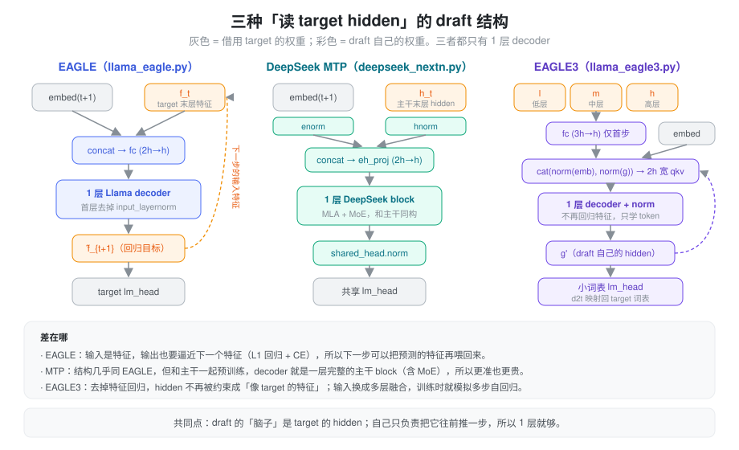

% 投机解码（四）：MTP，模型自带的 draft

> 系列总览见 [投机解码方案对比](./speculative_decoding.md)。上一篇：[Medusa、EAGLE 与 EAGLE-2](./spec_medusa_eagle.md)。

### 问题：事后训练的 draft 总差一口气

EAGLE 和 Medusa 都是在 target 训练完之后再单独训练 draft，数据只有几十万条对话，和 target 的预训练语料差了几个数量级。draft 学到的是「target 在这些数据上的行为」，换个领域就掉准。

如果 target 在**预训练时**就顺带学「往后多猜一个 token」，draft 就能见到全部预训练数据，而且和主干一起收敛。这就是 MTP（multi-token prediction）。它最初被当作一种训练目标提出，后来才发现它天然就是一个高质量的 draft。

### Meta：多个并行头，训练目标先行

Gloeckle 等人（[arXiv 2404.19737](https://arxiv.org/abs/2404.19737)）的结构是：共享 trunk，上面接 n 个**独立**的输出头，每个头是一层 transformer，所有头共享 unembedding。为了参数量对齐，加了 n−1 个头就从 trunk 里减掉 n−1 层。

论文的主要论点是训练收益：13B 模型在 HumanEval 和 MBPP 上分别多解了 12% 和 17% 的题（相对值，pass@1 14.1→15.8、26.0→30.5），且模型越大收益越明显。推理时这些头可以直接做**自投机解码**：7B、4 个头在代码上加速 3.0×，每 3 个提议平均接受 2.5 个。

结构上它和 Medusa 一样是并行独立头，第 2 个头看不到第 1 个头的输出。

### DeepSeek-V3：串行模块，保留因果链

DeepSeek-V3（[arXiv 2412.19437](https://arxiv.org/abs/2412.19437)）把并行头改成了**串行**：「依次预测额外的 token，在每个预测深度上保留完整的因果链」。第 k 个 MTP 模块的输入是上一深度的 hidden 和第 i+k 个 token 的 embedding：

\[
h'^{k}_i = M_k\big[\text{RMSNorm}(h^{k-1}_i);\ \text{RMSNorm}(\text{Emb}(t_{i+k}))\big]
\]

M_k 是 d × 2d 的投影，后面接一个 Transformer block，embedding 和输出头与主模型共享。这和 EAGLE 的 draft 几乎是同一个形状：特征加前移一位的 token，过一层，再借 target 的 lm_head。区别在于它和主干一起预训练，而且那一层就是主干同款的 MLA + MoE block。

V3 用 D = 1，即只多预测 1 个 token，损失权重 λ 在前 10T token 取 0.3，后 4.8T 取 0.1。论文消融显示，即使推理时丢掉 MTP 模块，它也能提升主模型效果。用作 draft 时，第二个 token 的接受率在 85%～90%，TPS 提升 1.8×。

### 之后的模型：一层预训练，多层后训练

DeepSeek 之后，带 MTP 层发布成了常见做法，各家的结构都沿用 V3：

| 模型 | MTP 层数 | 说明 |
| :--- | :--- | :--- |
| GLM-4.5 / 4.5-Air（[arXiv 2508.06471](https://arxiv.org/abs/2508.06471)） | 1 | 一个 MoE 层作为 MTP 层，λ 0.3 → 0.1 |
| Qwen3-Next-80B-A3B | 1 | 权重里只有 `mtp.layers.0`，结构同 DeepSeek；官方称做了训练推理一致的多步训练 |
| MiMo-7B（[arXiv 2505.07608](https://arxiv.org/abs/2505.07608)） | 预训练 1，推理 3 | 论文称多层 MTP 对预训练没有额外帮助；推理时复制出 2 层再微调，首层接受率约 90%，第 3 层仍超过 75% |
| MiMo-V2-Flash（[arXiv 2601.02780](https://arxiv.org/abs/2601.02780)） | 3 | 每层是 SWA（窗口 128）+ dense FFN，0.33B；3 层时接受长度最高 3.6、解码加速 2.6× |
| Step 3.5 Flash（[arXiv 2602.10604](https://arxiv.org/abs/2602.10604)） | 3 | 每层 SWA + dense FFN，主训练只训 MTP-1，MTP-2/3 由它初始化后联合训练 |

一个共同趋势是：**预训练时只训一层，后训练再扩成多层**。原因是多层 MTP 对主模型的训练收益不大，但对 draft 很有用：只有一层时，第 2、3 步 draft 要把同一层递归地用在自己的输出上，输入分布和训练时不一致；每一步一个专门的层就没有这个问题。MiMo-V2-Flash 和 Step 3.5 都把 MTP 层做成 SWA + dense FFN，也是为了让 draft 便宜：MoE 和全局注意力在 draft 上性价比很低。

### Gemma 4 assistant：只读 target 的 KV

Google 在 2026 年 5 月给 Gemma 4 发布了 MTP drafter（官方叫 assistant），走了一条不同的路。按 [Gemma 的说明](https://gemma.ai/tutorials/visual-guides/mtp/)，drafter **cross-attend 到 target 已经算好的 KV cache**：复用 target 最后一个 local 层的 KV 和最后一个 global 层的 KV。输入是 target 末层激活拼上 token embedding 再降维（E2B 上 1536 → 256），只在第一轮这样做，之后喂 drafter 自己的激活。E2B 的 drafter 约 76M 参数、4 层（3 sliding、1 full），另外用 2048 个聚类中心先算粗 logits，再展开 top 聚类，压低 lm_head 成本。官方宣称最高 3× 加速。

它和 DeepSeek MTP 的根本区别是：draft **没有自己的 KV**。上下文全部来自 target 的 KV，draft 层只产生 query。
### 在 SGLang 里

MTP 在 SGLang 里没有独立的算法，而是分别落到三条路径上。

**NEXTN：单层 MTP，就是 EAGLE。** `--speculative-algorithm NEXTN` 在参数解析时被 `_resolve_speculative_algorithm_alias`（`arg_groups/speculative_hook.py`）改写成 `EAGLE`，所以枚举里根本没有 NEXTN。对 DeepSeek、GLM、Bailing 等架构，draft 路径自动指向 target 自己的 checkpoint，加载时架构名被改写成 `DeepseekV3ForCausalLMNextN` 之类，只读 `model.layers.{num_hidden_layers}` 这一层。draft 模型（`models/deepseek_nextn.py`）是 `enorm`、`hnorm`、`eh_proj = Linear(2h, h, bias=False)`、一个 `is_nextn=True` 的 `DeepseekV2DecoderLayer`，最后 `shared_head.norm` 加共享的 head，与论文公式一一对应。默认 (steps 3, topk 1, draft tokens 4)：用一层 MTP 递归走 3 步，这正是上文说的「训练推理不一致」，第 2、3 步的接受率会明显低于第 1 步。

**Multi-layer EAGLE：每步一个 MTP 层。** MiMoV2 和 Step3p5 选 EAGLE 时，`arg_groups/overrides.py` 自动打开 `enable_multi_layer_eagle`，worker 换成 `MultiLayerEagleWorkerV2`，每个 MTP 层一个独立的 ModelRunner 和 KV。时间分配和普通 EAGLE 相反：draft 阶段**不做前向**，只整理上一轮 extend 时各层算好的 top-k；extend 阶段依次跑 num_steps 次，每层一次。要求 topk = 1。

**FROZEN_KV_MTP：Gemma 4 assistant。** 用户写 NEXTN 或 EAGLE，只要 draft 的架构是 `Gemma4AssistantForCausalLM`，就被提升为 `FROZEN_KV_MTP`（`FrozenKVMTPWorkerV2`，同样继承 `EAGLEWorkerV2`）。`models/gemma4_mtp.py` 的结构是 `pre_projection`（2·backbone_h → h）、一个 Gemma4 文本 trunk、`post_projection`（h → backbone_h）；所有层都标成 kv_shared，`kv_shared_layer_index` 指向 target 最后的 sliding / full 层；可选的 centroids head 默认展开 top 32 个聚类。

- draft 不分配 KV（draft pool 只是一个 64 slot 的占位池），前向时也不写 KV。
- 因为没有 draft KV 要对齐，也就**不需要 draft extend**：verify 之后只留下最后一个被接受 token 的 target hidden，作为下一轮的种子。每步是 1 次种子前向 + (steps − 1) 次 draft 前向 + 1 次 verify。
- topk > 1 时要求 triton attention 后端。

| | NEXTN | Multi-layer EAGLE | FROZEN_KV_MTP |
| :--- | :--- | :--- | :--- |
| 典型模型 | DeepSeek-V3、GLM-4.5、Qwen3-Next | MiMoV2、Step3p5 | Gemma 4 |
| draft 层 | 1 层，递归用 steps 次 | 每步 1 个专门的层 | assistant 小模型 |
| draft KV | 自有 | 每层一份 | 无，只读 target |
| verify 后 | draft extend | 依次跑各 MTP 层 | 只留种子 hidden |

### 小结

MTP 把 draft 的训练挪进了预训练：Meta 用并行头证明了多 token 预测本身就能提升模型，DeepSeek-V3 改成串行模块，结构几乎就是 EAGLE 的 draft，但见过全部预训练数据，接受率高。之后的模型普遍「预训练一层、后训练多层」，并把 MTP 层做成 SWA + dense FFN 以降低 draft 成本。Gemma 4 更进一步，让 draft 直接读 target 的 KV，省掉了 draft 自己的 KV 和 extend。不过所有这些 MTP 仍然是串行的：k 个 token 要 k 次 draft 前向。另一方面，没有自带 MTP 的模型仍需要外挂 draft，这条线的下一步是 [EAGLE-3](./spec_eagle3.md)。
