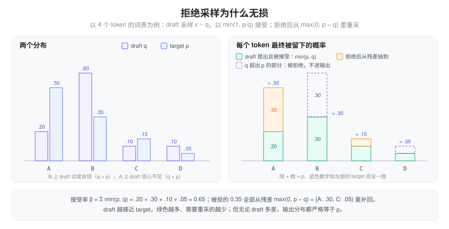

% 投机解码（一）：从 Blockwise 到 Speculative Sampling

> 系列总览见 [投机解码方案对比](./speculative_decoding.md)。本篇讲 2018～2023 年奠定基础的三篇工作，以及它们在 SGLang 里留下的东西：STANDALONE 和 verify 核。

### 问题：decode 访存受限，target 多算几个位置几乎免费

自回归 decode 每一步只出 1 个 token，却要把权重和 KV 从 HBM 完整读一遍。小 batch 时算力大量闲置，一次前向算 1 个位置还是算 5 个位置，耗时差不多（见 [Roofline](./roofline.md)）。

真正卡住的是依赖：第 t+1 个 token 要等第 t 个出来。投机解码的全部思想就是**把「生成」和「检查」拆开**：生成可以由便宜的东西来做，检查由 target 一次并行做完。早期三篇工作分别回答了三个问题：

| 工作 | 回答的问题 | 留下的东西 |
| :--- | :--- | :--- |
| Blockwise Parallel Decoding（2018） | 能不能先猜一块，再挑出对的前缀？ | draft → verify → 接受最长前缀 |
| Speculative Decoding / Sampling（2022～2023） | 采样时怎么保证分布完全不变？ | 拒绝采样 + 残差分布 + bonus token |
| SpecInfer（2023） | 一条链猜错就全废，能不能多备几条？ | token 树 + 树形 attention mask |

### Blockwise Parallel Decoding：先猜一块，再验最长前缀

Stern、Shazeer、Uszkoreit 在 2018 年（[arXiv 1811.03115](https://arxiv.org/abs/1811.03115)，NeurIPS 2018）第一次提出了这个循环。原文的说法是：并行地预测未来若干步，然后「退回到被打分模型验证过的最长前缀」。

**draft 结构**：在 decoder 输出和词表投影之间插一个 FFN，隐层宽 k × d_hidden，输出 k × d_model，切成 k 份，每份带一条连到层输入的残差，k 份共享原来的词表投影。第 i 份就是「预测第 t+i 个 token」的头。这和 6 年后的 Medusa 几乎是同一个形状。

**verify**：base 模型对 k 个提议并行打分，接受和自己 argmax 一致的最长前缀，所以每步至少前进 1 个 token，结果与 greedy 逐 token 解码完全相同。论文还把「打分」和「下一轮提议」合并到同一次调用里，模型调用次数从 2m/k 降到 m/k + 1，这正是后来 bonus token 的雏形：verify 的那次前向顺便给出下一块的起点。

**效果**：WMT14 En-De 上，k = 8 时平均每步接受 4.69 个 token，newstest2014 上 wall-clock 加速 3.31×，但 BLEU 从 29.11 掉到 27.88。掉点的原因是为了让头猜得准，作者微调了 base 模型本身。

**局限**：只能做 greedy；头要训练；动 base 模型会伤质量，需要蒸馏补救。采样场景下如何无损，这篇没有回答。

### Speculative Decoding：采样也能无损

2022 年底到 2023 年初，Google 的 Leviathan 等人（[arXiv 2211.17192](https://arxiv.org/abs/2211.17192)，ICML 2023）和 DeepMind 的 Chen 等人（[arXiv 2302.01318](https://arxiv.org/abs/2302.01318)）几乎同时给出了同一个答案。Leviathan 的出发点是：难的语言建模任务里有大量「容易的子任务」，小模型就能近似得很好。所以用一个同词表的小模型 M_q 当 draft，不需要任何训练。
#### 接受规则

记 target 在某位置的分布为 p，draft 的分布为 q，draft 采样出 x ~ q：

1. 以概率 min(1, p(x)/q(x)) 接受 x。q(x) ≤ p(x) 时必然接受；draft 「过度自信」的部分才按比例拒绝。
2. 一旦拒绝，从残差分布 p′ = norm(max(0, p − q)) 里重新采样一个 token，然后停止。
3. 如果 γ 个全部接受，再从 target 第 γ+1 个位置的分布采一个 **bonus** token。

为什么无损：x 最终被留下的概率是「draft 提出 x 且被接受」加上「被拒绝后从残差里抽到 x」，前一项是 min(p(x), q(x))，后一项正好补上 max(0, p(x) − q(x))，两者相加恰好是 p(x)。所以无论 q 多差，输出分布都是 target 的分布；q 只决定「接受得多不多」。

> 注意符号：Chen 等人的论文里 q 是 target、p 是 draft，与 Leviathan 相反，规则写作 min(1, q/p)。本文统一用 Leviathan 的记法。

#### 收益的闭式

定义单位置接受率 β = Σ min(p, q)，其期望为 α。假设各位置独立，每次 verify 期望产出

\[
\mathbb{E}[\#\text{tokens}] = \frac{1 - \alpha^{\gamma+1}}{1 - \alpha}
\]

再记 c = draft 单步耗时 / target 单步耗时，wall-clock 加速比是 \(\frac{1 - \alpha^{\gamma+1}}{(1-\alpha)(\gamma c + 1)}\)。只要 α > c 就有正收益。这个式子把整个领域后来的努力方向说清楚了：**提高 α**（draft 更懂 target）和**压低 γc**（draft 更便宜，或者让 γ 个 token 不再需要 γ 次 draft 前向）。

#### draft 选什么

| | Leviathan 等 | Chen 等（DeepMind） |
| :--- | :--- | :--- |
| target | T5-XXL 11B | Chinchilla 70B（80 层） |
| draft | T5-small 77M（现成模型） | 4B，d_model 6144，只有 8 层 |
| 结果 | En-De 3.4×（T=0，γ=7，α=0.75）；T=1 时 2.6× | XSum 约 1.92～2.01×，HumanEval 2.46× |

DeepMind 的 draft 故意做成「宽而浅」：在 Megatron 式切分下，耗时主要和层数（all-reduce 次数）成正比，所以 8 层的 4B 模型每 token 只要 1.8 ms，而 target 要 14.1 ms。两篇都观察到 K 继续加大时收益会走平甚至回落，因为一条链上越靠后越难全对。

### SpecInfer：一条链不够，就验一棵树

Miao 等人（[arXiv 2305.09781](https://arxiv.org/abs/2305.09781)，ASPLOS 2024）注意到：小模型 top-1 猜错时，target 的 token 多半就在它的 top-k 里。LLaMA-68M 对 LLaMA-7B 的 greedy 一致率，top-1 是 62～70%，top-5 升到 82～89%。

所以不要只提一条链，而是把多个候选组织成 **token 树**，一次前向验完：

- **树形 attention mask**：把树上所有节点摊平成一个序列，每个节点只看自己的祖先。这样一次前向就能同时算出所有分支上的 logits，共享一份 KV。
- **多步投机采样（MSS）**：第一个子节点被拒绝后，把 target 分布更新成残差 norm(max(0, p − q))，再试下一个兄弟节点。论文证明这样仍然保持 target 分布。

树宽 5 相比宽 1，decode 步数再降 1.2～1.5×（Alpaca greedy 上每步 3.43 vs 2.95 个 token）。代价是 verify 变宽，batch 一大就不再免费。此后的 Medusa、EAGLE 系、NGRAM 的树形 verify 都沿用这套 mask。

### 在 SGLang 里

这三篇的遗产在 SGLang 里分成两部分。

**verify 核是所有算法共用的。** greedy 走 `verify_tree_greedy`；采样默认走 `tree_speculative_sampling_target_only`（`sgl-kernel/csrc/speculative/speculative_sampling.cuh`）。它是 SpecInfer 式的「沿树往下走，拒绝就试兄弟」，但名字里的 target_only 很关键：draft 概率传进来是全 0，接受判断只看 target 的概率。

- 每层累加兄弟节点的 target 概率 prob_acc，当 `coin <= prob_acc / threshold_acc` 或单个概率 `>= threshold_single` 时接受。两个阈值默认都是 1.0，此时等价于「按 target 分布抽一个子节点，看它在不在树上」。
- 被拒的节点把 target 概率写进 draft_probs 的对应位置，最后从 relu(target − draft_probs) 里采 bonus，即把已经试过并拒绝的分支剔除。

这种做法不需要 draft 给出完整分布，EAGLE 系 draft 往往只输出 top-k，正好合用。想要经典的 p/q 拒绝采样，打开 `--speculative-use-rejection-sampling`，走 `chain_speculative_sampling_triton`，要求 topk = 1。

**STANDALONE 就是 Leviathan 式的独立小模型。** `--speculative-algorithm STANDALONE` 配一个同词表的小模型，`StandaloneWorkerV2` 继承 `EAGLEWorkerV2`，复用全部 draft / verify / extend 流程，只是不捕获 target hidden，也不和 target 共享 lm_head。默认参数是 (steps 3, topk 1, draft tokens 4)，不支持 DP attention。

### 小结

Blockwise 建立了「猜一块、验最长前缀」的循环；Speculative Sampling 用拒绝采样加残差分布证明了采样场景下也能逐分布无损，并给出 α 与 c 的收益公式；SpecInfer 把链扩展成树，用 ancestor-only mask 一次验完多个分支。此后所有工作都在这个框架里优化两件事：让 draft 更准（α↑），让 draft 更便宜（γc↓）。下一篇的 [n-gram 方案](./spec_ngram.md) 走极端便宜路线，[Medusa 与 EAGLE](./spec_medusa_eagle.md) 走「读 target 内部状态」路线。
