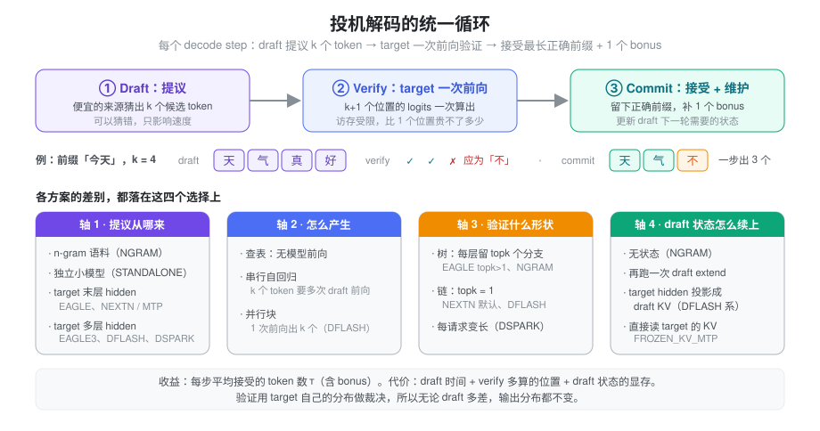
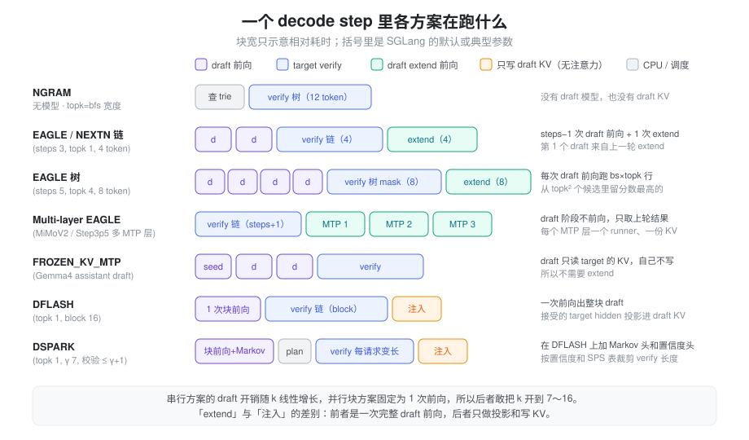

% 投机解码方案对比

### 问题：decode 一步只出一个 token

自回归 decode 每一步只为每个请求生成 1 个 token，但这一步要把全部权重、整段 KV 从 HBM 读一遍。小 batch 下 GPU 的算力大部分闲着，步时间几乎全花在访存上（见 [Roofline](./roofline.md)）。这带来一个直接的推论：让 target 在一次前向里多算几个位置，步时间几乎不变。

难点在于下一个 token 依赖上一个 token，target 自己没法一次「往前多走几步」。投机解码的做法是找一个便宜的来源先**猜**出后面 k 个 token，再让 target 用一次前向把这 k 个位置一起检查掉。猜对几个，这一步就多出几个；猜错了，最多白算几个位置，结果仍由 target 决定。

所以问题变成两个：

- **猜什么、怎么猜才又快又准**：猜得越准，一步接受的 token 越多；猜的代价越低，净收益越大。
- **猜完之后怎么收拾**：被拒绝的 token 已经写进了 KV，draft 自己也有状态，要能低成本地对齐到「真正被接受的前缀」上。

这一页是总览：统一的循环、四个设计轴、横向对比和 SGLang 的共享骨架。每个方案的 insight、draft 结构和论文细节在下面的系列文章里。

### 发展脉络

| 篇 | 方案 | 解决的问题 |
| :--- | :--- | :--- |
| [（一）起源](./spec_origins.md) | Blockwise、Speculative Sampling、SpecInfer | 猜 + 验的框架；拒绝采样保证无损；树形 verify |
| [（二）n-gram](./spec_ngram.md) | PLD、REST、Lookahead、SGLang NGRAM | 不要 draft 模型，从历史和语料里查 |
| [（三）Medusa 与 EAGLE](./spec_medusa_eagle.md) | Medusa、EAGLE、EAGLE-2 | draft 长在 target 的 hidden 上；动态树 |
| [（四）MTP](./spec_mtp.md) | Meta MTP、DeepSeek-V3、Gemma 4 assistant | 预训练时就带上 draft |
| [（五）EAGLE-3](./spec_eagle3.md) | EAGLE-3 | 去掉特征回归、多层融合，draft 能随数据变强 |
| [（六）DFlash](./spec_dflash.md) | DFlash、DDTree、DFlare | 块扩散一次前向出 k 个，KV 注入 |
| [（七）DSpark](./spec_dspark.md) | DSpark、PCTree | Markov 头补块内依赖；按置信度变长 verify |

一条主线贯穿始终：draft 读到的 target 内部信息越来越多（token → 末层 hidden → 多层 hidden → 每层注入），draft 的生成方式从串行走向并行，verify 从固定长度走向按负载伸缩。

### 抽象：draft → verify → commit

所有方案共享同一个三段式循环：

1. **Draft**：draft 给出 k 个候选 token。可以是一条链，也可以是一棵树。
2. **Verify**：target 对「上轮的 bonus token + k 个候选」做一次前向（SGLang 里叫 `TARGET_VERIFY`），一次拿到 k+1 个位置的 logits。
3. **Commit**：从头比对，接受最长的正确前缀，再用 target 在第一个错误位置上的输出补 1 个 **bonus** token。这样即使 k 个全错，这一步也照样产出 1 个 token，不会比不投机更慢（不计 draft 开销）。

#### 为什么结果不受 draft 影响

每个位置最终留下的 token 都由 target 的分布裁决，draft 只决定「哪些位置值得算」。

- **greedy**：target 的 argmax 和 draft 相同就接受，否则用 argmax 替换并停止。结果和不投机的逐 token greedy 完全一致。SGLang 用 `verify_tree_greedy` 实现，链是树的特例。
- **采样**：SGLang 默认走 `tree_speculative_sampling_target_only`，只用 target 的概率做接受判断（draft 概率传 0），阈值由 `--speculative-accept-threshold-single/-acc` 控制，默认都是 1.0。打开 `--speculative-use-rejection-sampling` 后改用经典的 draft/target 概率比拒绝采样（`chain_speculative_sampling_triton`），这条路径要求 topk = 1。拒绝采样为什么无损，见 [第一篇](./spec_origins.md)。

#### 收益怎么算

衡量 draft 质量的核心指标是**平均接受长度 τ**：每次 verify 平均每个请求产出多少 token，含 bonus。SGLang 的 `spec_accept_length` 就是它，范围是 [1, k+1]。粗略地说：

\[
\text{加速比} \approx \frac{\tau \cdot T_{\text{step}}^{\text{plain}}}{T_{\text{draft}} + T_{\text{verify}} + T_{\text{commit}}}
\]

分子靠 draft 猜得准，分母靠三件事压低：draft 本身要便宜；verify 多算的 k 个位置在访存受限时几乎免费，但 batch 一大就开始真实占算力；commit 阶段维护 draft 状态的开销。

这也解释了一个普遍现象：**投机解码在小 batch 收益大，大 batch 收益小**。batch 越大，verify 越接近算力受限，多算的位置不再免费。SGLang 的 adaptive 模式和 DSPARK 的变长 verify 都在处理这个问题。

### 四个设计轴

前面那张图的下半部分把各方案拆到四个轴上。看懂这四个轴，各方案就只是不同的组合：

| 轴 | 问的是什么 | 取值 |
| :--- | :--- | :--- |
| 提议从哪来 | draft 依据什么信息猜 | n-gram 语料；独立小模型；target 末层 hidden；target 多层 hidden |
| 怎么产生 | k 个 token 要几次前向 | 查表（0 次）；串行自回归（约 k 次）；并行块（1 次） |
| 验证什么形状 | target 一次验多少、什么拓扑 | 树（每层 topk 个分支）；链（topk = 1）；每请求变长 |
| draft 状态怎么续上 | 接受后 draft 的 KV / hidden 如何对齐 | 无状态；再跑一次 draft extend；target hidden 投影成 draft KV；直接读 target 的 KV |

两个轴之间有张力：

- **信息越多越准**：用 target 的 hidden 比用 n-gram 准得多，用多层 hidden 又比只用末层准。但这些信息只在 target 前向之后才有，draft 必须跟在 target 后面。
- **串行越准，并行越便宜**：自回归 draft 每个位置都看得到前一个猜的 token，越往后错得越慢；但 k 个 token 就要 k 次前向，k 很难开大。并行块一次前向出整块，k 可以开到 7～16，代价是块内位置互相看不到彼此的取值。DSpark 的 Markov 头就是在这两端之间取了一个折中。

### 一个 decode step 里在跑什么

把各方案放到同一条时间线上，差别集中在 verify 前后的两段：

- **NGRAM**：draft 是查 trie，没有前向；verify 后把窗口插回 trie。
- **EAGLE / EAGLE3 / NEXTN**：(steps − 1) 次串行 draft 前向，verify 后再跑一次 draft extend，把 draft 的 KV 和 hidden 对齐到被接受的前缀上。
- **Multi-layer EAGLE**：draft 阶段不做前向，extend 阶段每个 MTP 层各跑一次。
- **FROZEN_KV_MTP**：draft 不写 KV，verify 后只留一个种子 hidden，没有 extend。
- **DFLASH / DSPARK**：1 次块前向；verify 后只把被接受位置的 target hidden 投影写进 draft KV。

### 横向对比

| | NGRAM | STANDALONE | EAGLE / NEXTN | EAGLE3 | FROZEN_KV_MTP | DFLASH | DSPARK |
| :--- | :--- | :--- | :--- | :--- | :--- | :--- | :--- |
| 详见 | [二](./spec_ngram.md) | [一](./spec_origins.md) | [三](./spec_medusa_eagle.md)、[四](./spec_mtp.md) | [五](./spec_eagle3.md) | [四](./spec_mtp.md) | [六](./spec_dflash.md) | [七](./spec_dspark.md) |
| 提议依据 | 历史 n-gram | 小模型自己的 token | target 末层 hidden | target 多层 hidden | target hidden + target KV | target 多层 hidden | target 多层 hidden |
| draft 权重 | 无 | 完整小模型 | 1 层（NEXTN 是模型自带 MTP 层） | 1 层 + fc，常带小词表 | assistant 模型 | 几层 + fc，无 embed / head | 同 DFLASH + Markov 头 + 置信度头 |
| 每步 draft 前向 | 0 | steps − 1 | steps − 1 | steps − 1 | steps | 1 | 1（+ γ 次低秩查表） |
| 验证形状 | 树 | 链 / 树 | 链 / 树 | 链 / 树 | 链 / 树 | 链 | 链，每请求变长 |
| 默认 (steps, topk, tokens) | topk = bfs 宽度，12 token | (3, 1, 4) | DeepSeek 等 (3, 1, 4)；Llama (5, 4, 8) | 同 EAGLE | 用户指定 | (1, 1, 16) | (1, 1, γ+1)，γ = 7 |
| draft KV | 无 | 自有 | 自有 | 自有 | 无，只读 target 的 | 自有，可按窗口 | 自有，可按窗口 |
| verify 后维护 | 插回 trie | draft extend 前向 | draft extend 前向 | draft extend 前向 | 只留种子 hidden | 投影写 KV | 投影写 KV |
| 主要限制 | 开放式生成命中率低；不支持 DP attention | 不支持 DP attention | — | 需要专门训练的 draft | 仅 Gemma4 | 仅 CUDA；无 DP attention；PP = 1 | 需要专门训练的 draft；仅 CUDA |

怎么选，大致看三件事：

- **模型有没有自带 draft**。带 MTP 层的模型（DeepSeek、GLM、MiMo、Qwen3-Next）直接用 NEXTN，不需要额外训练；Gemma4 配 assistant 就自动走 FROZEN_KV_MTP；有现成 EAGLE3 / DFLASH / DSPARK 权重的再考虑它们。
- **batch 有多大**。小 batch 时 verify 多算的位置几乎免费，树（topk > 1）和大 block 都划算；batch 越大越应该收窄：EAGLE 用 topk = 1 的链，或者打开 `--speculative-adaptive`；DSPARK 用 `compact` 模式让 planner 自己裁。
- **输出和输入的重合度**。代码编辑、长文改写这类大段复制的场景，NGRAM 不用任何模型就能拿到很高的接受长度。

### 实现：共享的骨架

所有算法通过 `SpeculativeAlgorithm`（`speculative/spec_info.py`）分派。这个枚举只有 DFLASH、DSPARK、EAGLE、EAGLE3、FROZEN_KV_MTP、STANDALONE、NGRAM 和 NONE，NEXTN 在参数解析阶段就被改写成了 EAGLE。

- **参数处理**：`handle_server_args` 按算法调用 `arg_groups/speculative_hook.py` 里的 `_handle_eagle_family` / `_handle_dflash` / `_handle_dspark` / `_handle_frozen_kv_mtp` / `_handle_ngram`，补默认值、强制约束。EAGLE 系的默认参数来自 `_auto_choose_speculative_params`，按架构名查表。
- **worker**：`create_worker` 返回各自的 worker 类，`EAGLEWorkerV2`、`MultiLayerEagleWorkerV2`、`StandaloneWorkerV2`、`FrozenKVMTPWorkerV2`、`DFlashWorkerV2`、`DSparkWorkerV2`、`NGRAMWorker`。名字里的 V2 指 overlap 调度：跨迭代的 draft 输入、seq_lens 经 `FutureMap` 传递，关掉 overlap 时同一个 worker 同步运行。STANDALONE 和 FROZEN_KV_MTP 都是 `EAGLEWorkerV2` 的子类，复用它的 verify。
- **插件**：`SpeculativeAlgorithm.register(name, ...)` 可以注册自定义算法，builtin 名字和 NEXTN 是保留字。

三个容易误解的工程细节：

- **被拒绝的 KV 不是逐步释放的**。EAGLE 系每步为每个请求预留 `2 × alloc_len_per_decode` 个 slot，verify 后把被接受 token 的 KV 挪到 `seq_lens` 之后的连续位置（`move_accept_tokens_to_target_kvcache`），被拒绝的 slot 在下一轮直接被覆盖，请求结束时才把多分配的尾巴一起释放。draft 和 target 共用同一个 `req_to_token_pool` 和 allocator，同一个 slot 下标同时寻址两边的 KV；显存规划里每 token 的格子按 `1 + draft 层数 / target 层数` 放大。
- **adaptive 只调 steps，不调 topk**。`--speculative-adaptive` 只对 topk = 1 的 EAGLE / EAGLE3 生效，按 batch size 分桶，每桶维护接受长度的 EMA，在候选步数之间带迟滞地升降（默认 bs1 → {1, 3, 7}，bs64 → {0}）。每个步数预先建好一套 attention backend 和 CUDA graph，运行时按 batch 切换。DP attention、multi-layer EAGLE、TBO 下不可用。
- **draft KV 可以只按窗口分配**。DFLASH 和 DSPARK 的 draft 通常是 sliding window attention，任何时刻只读最近 window 个 token 的 KV。如果 draft KV 跟着 target 按上下文长度分配，长上下文下绝大部分 draft KV 永远读不到。`--speculative-draft-window-size` 打开后，`DraftWindowSlotMap`（`draft_swa_pool.py`）把 target 的 slot 映射到一个按 `请求数 × (window + page + γ)` 定大小的紧凑池，滑出窗口的 slot 立即回收；`draft_window.py` 给 draft 提供一个只含「最近 window 个已提交 slot + 当前块」的 `req_to_token` 视图。K3 上这一改动的显存账见 [Kimi K3 B200 的 DSPARK SWA 池](./kimi_k3_b200.md)。

### 小结

投机解码利用的是 decode 访存受限、多算几个位置几乎免费这个事实：便宜地猜 k 个 token，target 一次前向验掉，结果分布不变。各方案的差别都落在四个轴上：猜的依据、猜的方式、验的形状、猜完怎么续上 draft 状态。沿着发展史看，从 Blockwise 和拒绝采样搭起框架，到 EAGLE、MTP、EAGLE-3 让 draft 读到 target 越来越多的内部信息，再到 DFlash 把串行 k 次前向压成 1 次、DSpark 补回块内依赖并让 verify 按负载伸缩，每一步都是在上一步留下的瓶颈上推进。