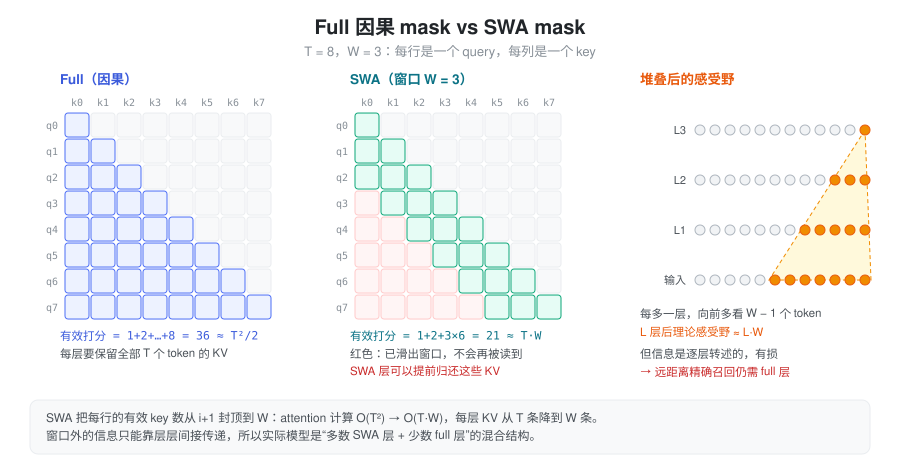
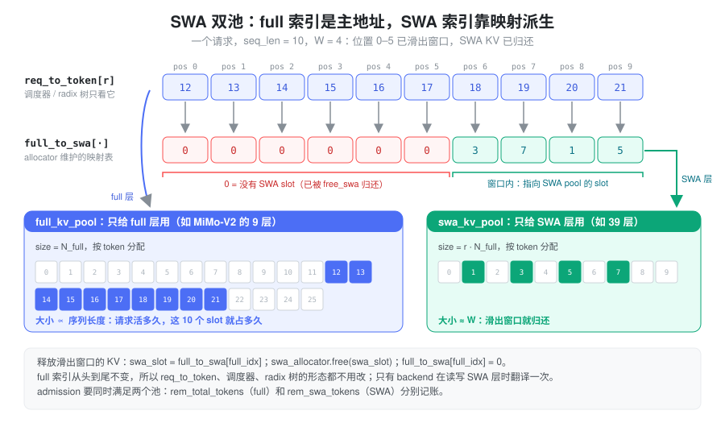
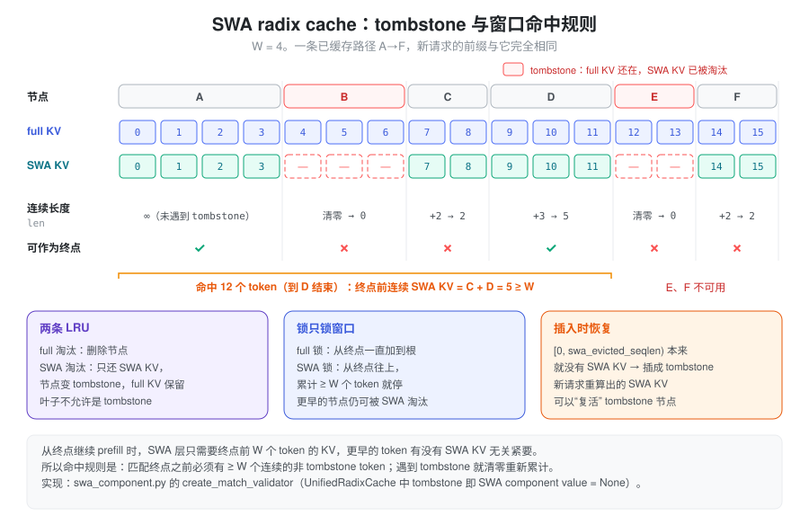

% SWA

**SWA（Sliding Window Attention）= 每个 query 只看最近 \(W\) 个 token。** 这样每层 attention 的计算量从 \(O(T^2)\) 降到 \(O(TW)\)，每层需要保留的 KV 从 \(T\) 条降到 \(W\) 条。实际模型会把 SWA 层和 full attention 层混合堆叠，推理引擎为此要管理"同一个 token、两种寿命"的 KV。下文先讲要解决的问题和设计，再对照 SGLang 的实现。

### 问题：Full Attention 的两笔账都随 T 增长

记 batch 为 \(B\)，序列长度为 \(T\)，层数为 \(L\)，头数为 \(H\)，head dim 为 \(D\)。只算 attention 核心（\(QK^\top\) 和 \(AV\)），单层的开销如下：

| | Full（因果） | SWA（窗口 \(W\)） |
|---|---|---|
| prefill 计算量 | \(\approx 2BT^2HD\) | \(\approx 4BTWHD\) |
| decode 每步读 KV | \(\propto T\) | \(\propto W\) |
| KV cache 大小 | \(B L T (d_{qk} + d_v) H_{kv}\) | \(B L W (d_{qk} + d_v) H_{kv}\) |

Full attention 的因果 mask 是一个下三角，有效打分约 \(T^2/2\) 个，所以是 \(2BT^2HD\)。SWA 的每个 query 固定看 \(W\) 个 key，两者之比约为 \(2W/T\)。比如 \(T=32\text{K}\)、\(W=128\) 时，SWA 层的 attention 计算量和 KV 都不到 full 的 1%。

代价是看不到窗口外的信息。单层 SWA 只能看 \(W\) 个 token；堆叠 \(L\) 层后，信息可以一层层往后传，理论感受野约为 \(L \cdot W\)。但这种间接传递是有损的，"大海捞针"式的远距离精确召回仍然要靠能看全局的层。

### 设计：局部交给 SWA，全局交给少数 full 层

所以实际模型几乎都是**混合结构**：大部分层是 SWA，负责局部建模；每隔几层插一层 full attention，负责全局召回。

- **GPT-OSS**：`layer_types` 中 `sliding_attention` 和 `full_attention` 交替出现。
- **MiMo-V2-Flash**：48 层中 39 层 SWA、9 层 full，窗口 128，由 `hybrid_layer_pattern` 指定。SWA 层和 full 层的 KV 头数不同（SWA 层 8 个，full 层 4 个）。
- **Llama4**：每 4 层中的前 3 层是 chunked local attention，第 4 层是全局 attention。

这类模型通常还会给 attention 加一个可学习的 sink（GPT-OSS、MiMo-V2 都有），让某个 query 在窗口内找不到相关 token 时，可以把权重"泄"到 sink 上，而不是被迫平均分给窗口内的 token。

混合结构带来了推理侧的核心问题：**同一个 token 在不同层的 KV 寿命不同。** full 层的 KV 要跟着请求一直活下去，还可能被 prefix cache 复用；SWA 层的 KV 在它滑出窗口之后就再也不会被读到。如果所有层共用一个按 token 分配的 KV pool，SWA 层就会白白占着 \(T - W\) 条无用的 KV，混合结构省下来的显存全部浪费掉。

### 抽象：一个 token，两个地址

推理引擎的解法是把两种寿命拆到两个池里：

- **full pool**：只给 full 层用，按 token 分配，跟普通的 KV pool 一样，请求活多久它就活多久；
- **SWA pool**：只给 SWA 层用，也按 token 分配，但 token 滑出窗口后就立即归还。

关键是**以 full 索引为主地址**。调度器、`req_to_token`、radix 树看到的都只有 full 索引，和非 SWA 模型完全一样。SWA 索引则通过一张映射表 `full_to_swa[full_idx]` 派生出来，只有 attention backend 在读写 SWA 层时才需要翻译一次。

于是"释放某个 token 的 SWA KV"就变成两步：把 `full_to_swa[full_idx]` 指向的 SWA slot 还给 SWA allocator，再把映射置 0。full 索引本身保持不变，上层的数据结构都不需要改。

这个抽象还顺带解决了"两个池谁先满"的问题：一个请求能否被调度，要同时看两个池的余量，两边分别记账、分别回收。

### 实现

以下路径都相对于 `python/sglang/srt/`。

#### 哪些模型、哪些层

- `configs/model_config.py` 中的 `is_hybrid_swa_model` 是一个架构白名单，包括 GPT-OSS、Llama4、MiMo-V2、Step3p5、Gemma4、DeepSeek-V4 等。白名单内的模型，再由 `get_hybrid_layer_ids` 按各自的 config 字段（`layer_types`、`hybrid_layer_pattern` 等）拆出 `swa_attention_layer_ids` 和 `full_attention_layer_ids`。
- `--disable-hybrid-swa-memory` 会关掉双池，模型退化成一个普通 pool。此时每层仍然按窗口计算 attention，只是 SWA 层的 KV 不再提前释放。Gemma2/3 在这个 fork 里就被强制走这条路。
- 每一层的窗口大小通过 `RadixAttention(sliding_window_size=...)` 传入，`-1` 表示 full attention。注意 GPT-OSS、Gemma 的 `get_attention_sliding_window_size` 返回的是 `config.sliding_window - 1`，即不含当前 token 的窗口长度。

#### 双池与映射表

- **`SWAKVPool`**（`mem_cache/swa_memory_pool.py`）：内部持有 `full_kv_pool` 和 `swa_kv_pool` 两个普通 KV pool。`layers_mapping` 把全局 layer id 映射成 `(池内层号, 是否 SWA 层)`，`get_key_buffer` 等接口据此转发到对应的池。
- **`SWATokenToKVPoolAllocator`**（`mem_cache/allocator/swa.py`）：持有 `full_attn_allocator` 和 `swa_attn_allocator`，以及映射表 `full_to_swa_index_mapping`。
  - 映射表长度为 `size + page_size + 1`，值为 0 表示"没有 SWA slot"。末尾追加的 `-1` 是哨兵，让 `last_loc = -1` 翻译后仍是 `-1`。
  - `alloc` / `alloc_extend` / `alloc_decode` 在两个 allocator 中各分配同样数量的 slot，再写入映射。
  - `free` 先释放 full slot，再调用 `free_swa`。`free_swa` 只释放映射值大于 0 的 SWA slot，然后把映射置 0。因此先 `free_swa`、后 `free` 不会重复释放。
  - `available_size()` 返回两个池余量的较小值。调度器的准入检查（`managers/schedule_policy.py`）也分别维护 `rem_total_tokens` 和 `rem_swa_tokens` 两份预算。

#### 显存怎么分：`--swa-full-tokens-ratio`

这个参数（默认 0.8）是**每层的 token 数之比**：SWA pool 的 token 容量 ÷ full pool 的 token 容量，与 SWA 层和 full 层的层数无关，也不是两者占用显存的比值。

`model_executor/pool_configurator.py` 中的 `HybridSWAPoolConfigurator` 按下面的方式求解两个池的大小（省略了投机解码 draft 层的项）：

\[
\text{cell} = F \cdot L_{\text{full}} + r \cdot S \cdot L_{\text{swa}}, \qquad
N_{\text{full}} = \left\lfloor \frac{\text{可用显存}}{\text{cell}} \right\rfloor, \qquad
N_{\text{swa}} = r \cdot N_{\text{full}}
\]

其中 \(F\)、\(S\) 分别是 full 层和 SWA 层单个 token、单层的 KV 字节数（`num_kv_heads × (head_dim + v_head_dim) × dtype_size`），两个结果都向下对齐到 page。记 page 大小为 \(P\)，如果 \(N_{\text{swa}} \le W + P\)，说明 SWA pool 连一个请求都放不下，启动时直接报错。

以 MiMo-V2-Flash 估算（假设两类层的 head dim 相同，于是 \(S = 2F\)）：

- 默认 \(r=0.8\)：cell \(= 9F + 0.8 \times 39 \times 2F = 71.4F\)，SWA pool 占了约 **87%** 的 KV 显存；
- 改成 \(r=0.05\)：cell \(= 12.9F\)，full pool 的 token 容量变成原来的约 5.5 倍。

那 \(r\) 至少要多大？对正在运行的请求，SWA 层只需保留约 \(W + I + P\) 个 token，其中 \(I\) 是下一节的释放间隔（默认 128）。假设平均序列长度为 \(\bar{T}\)，full pool 满载时大约有 \(N_{\text{full}}/\bar{T}\) 个请求，所需的 \(r\) 约为 \((W + I + P) / \bar{T}\)，长上下文场景下只有百分之几。多出来的 SWA 容量用来给 radix cache 保留已缓存前缀的 SWA KV：\(r\) 越小，full pool 的并发越高，但 prefix cache 越容易因为 SWA KV 被淘汰而无法命中。

一些模型会改写默认值，例如 DeepSeek-V4 和 Inkling 改成 0.1（`arg_groups/overrides.py`，仅当用户没有显式设置时生效）。另外，这个 fork 有一条 `SWAChunkCapPoolConfigurator` 路径：在关闭 radix cache、开启 chunked prefill 并设置了 `max_running_requests` 时，SWA pool 按"每请求窗口 + 余量"× 请求数直接封顶，剩下的显存全部给 full pool，此时 ratio 不生效。

#### 运行时：把滑出窗口的 KV 还回去

每个请求在 `req.kv.swa_evicted_seqlen` 中记录"SWA KV 已经释放到哪个位置"。在 `[0, swa_evicted_seqlen)` 范围内，full 层的 KV 仍在，SWA 层的 KV 已经归还。

- **入口**：`ScheduleBatch.maybe_evict_swa`（`managers/schedule_batch.py`），在 `alloc_for_extend` / `alloc_for_decode` 以及投机解码的分配路径里调用。
- **decode**：不是每步都释放。只有当滑出窗口的 token 累积到 `SGLANG_SWA_EVICTION_INTERVAL`（默认 128）个以上时，才调用一次 `_evict_swa`，以摊薄释放开销。这也是上面估算中要加上 interval 的原因。
- **chunked prefill**：chunk cache 模式下，每个 chunk 开始前把上一个 chunk 窗口以外的部分释放掉。开启 overlap 调度时要晚一个 chunk，因为上一个 extend batch 可能还在 GPU 上读这些 KV。
- **真正的释放逻辑**在 `mem_cache/common.py` 的 `free_swa_out_of_window_slots`：
  - 下界是 `cache_protected_len`，即已经交给 radix 树管理的前缀，那部分由树负责回收；
  - 上界在 chunk cache 下是 `pre_len - W`，在 radix cache 下是 `pre_len - max(W, page_size)`，保证最后一个叶子不会整段变成 tombstone；
  - 结果对齐到 page 后，对 `req_to_token[req, old:new]` 调用 `free_swa`，再推进 `swa_evicted_seqlen`。

#### Prefix cache：tombstone 与窗口命中规则

普通 radix cache 的规则是：只要前缀在树里，就能复用。SWA 让这条规则变复杂了，因为树上一个节点可能处于"full KV 还在、SWA KV 已经被淘汰"的状态，这种节点称为 **tombstone**。

从匹配终点继续 prefill 时，SWA 层需要看到终点之前 \(W\) 个 token 的 KV；更早的 token 是否还有 SWA KV 无关紧要。所以命中规则是：**匹配终点之前，必须有至少 \(W\) 个连续的非 tombstone token。** 不满足时，匹配回退到上一个满足条件的位置。

围绕这个规则，树的其他操作也都分成 full 和 SWA 两份：

- **两条 LRU**：full 淘汰会删掉节点；SWA 淘汰只释放节点的 SWA KV，把它变成 tombstone，full KV 继续留着。叶子节点不允许是 tombstone，否则就会出现"永远命中不了却占着 full KV"的节点。
- **锁也只锁窗口**：请求使用某条前缀时，full 锁一直加到根节点；SWA 锁只从终点往上加到累计 \(W\) 个 token 为止，更早的节点仍然可以被 SWA 淘汰。
- **插入时恢复**：请求结束后写回树时，`[0, swa_evicted_seqlen)` 这一段本来就没有 SWA KV，会被插成 tombstone 前缀；如果新请求重新算出了某个 tombstone 节点的 SWA KV，就用它把节点"复活"。

这个 fork 里，开启 radix cache 的混合 SWA 模型走的是 `UnifiedRadixCache`（`mem_cache/unified_radix_cache.py`），由 `mem_cache/registry.py` 以 `[FULL, SWA]` 两个 component 组合构造。SWA 的逻辑在 `mem_cache/unified_cache/components/swa_component.py`：tombstone 表示为该 component 的 value 为 `None`，命中规则在 `create_match_validator` 中实现，遇到 tombstone 时把累计长度清零，累计到 `sliding_window_size` 才算有效。早期独立实现的 `SWARadixCache`（`mem_cache/swa_radix_cache.py`，用 `swa_tombstone` 字段和 `full_lru_list` / `swa_lru_list`）仍保留在代码里，设计相同，但已经没有工厂函数会构造它。纯 SWA 模型（没有 full 层）则用 `PureSWARadixCache`。

#### Attention backend：读写前翻译一次索引

backend 拿到的 `page_table`、`out_cache_loc` 都是 full 索引。对 SWA 层，需要先用 `SWAKVPool.translate_loc_from_full_to_swa`（就是 `full_to_swa_index_mapping[idx]`）翻译成 SWA 索引：

- **FlashAttention**：每个 batch 准备 metadata 时，一次性算出 `swa_page_table` 和 `swa_out_cache_loc`。SWA 层用它们读写 KV，并把 `window_size=(sliding_window_size, 0)` 传给 kernel。
- **FlashInfer**：为 SWA 层和 full 层各准备一个 wrapper。SWA wrapper 把 `seq_lens` 截断到 `W + 1`，只把窗口内的那段 KV 索引翻译后交给 kernel。
- **Triton**：`update_sliding_window_buffer` 按 `min(seq_len, W)` 构造窗口内的 `window_kv_indices`，再做翻译。

写 KV 时，backend 把 full 和 SWA 两个位置打包成 `KVWriteLoc` 交给 pool。SWA 层要求 `swa_loc` 已经翻译好，pool 内部不再翻译，这样一个 batch 只需翻译一次，所有 SWA 层共用。

### 小结

SWA 用固定窗口换掉了 full attention 随长度增长的计算和 KV，再用少数 full 层补回全局召回。推理侧的关键抽象是"一个 token、两个地址"：full 索引是唯一的主地址，SWA 索引通过 `full_to_swa_index_mapping` 派生，释放 SWA KV 只需归还 slot 并把映射置 0。这样调度器、`req_to_token`、radix 树都不用改变形态，只需要多维护一份 SWA 预算。`--swa-full-tokens-ratio` 决定两个池的 token 容量之比：它设得越大，越多 SWA KV 能留给 prefix cache；设得越小，full pool 的并发越高。prefix cache 则通过 tombstone 和"终点前 \(W\) 个 token 连续有效"的命中规则，让两种寿命的 KV 共存在同一棵树上。
