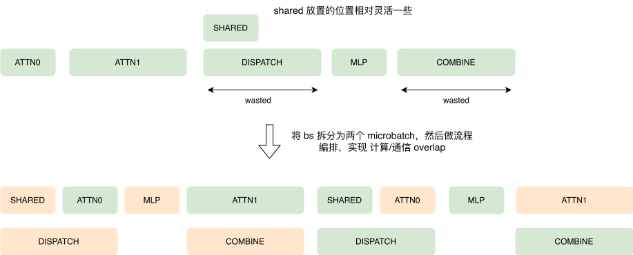
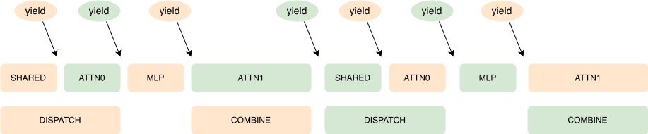
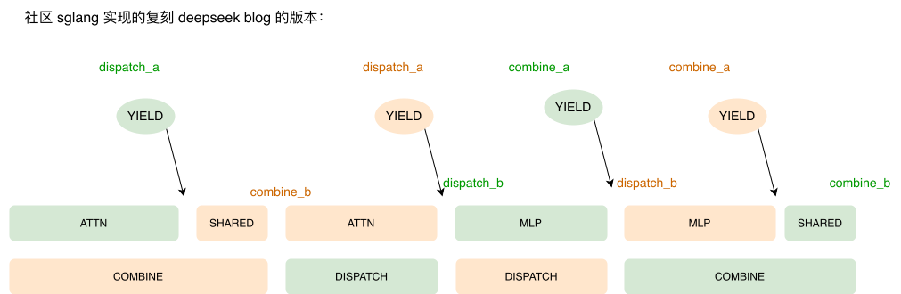

% TBO



### 何时有收益

双流有优势和劣势，只有当 __优势 > 劣势的时候才有收益__

- **优势**：dispatch 和 combine 被计算 overlap 掉的时间
- **劣势**：计算会裂化

### 引擎建模

#### Yield

yield 在这里的语义是 “让权”，如果一个 microbatch 执行 yield，就表示可以让另一个 microbatch 执行了。


以 deepseek 的 decode 阶段多机的 overlap 为例，我们可以在下图中设置 “让权点”：



通过这种方式可以巧妙地实现通用的双流框架，大家可以观察到：

- 两个 microbatch 的编排流程是完全一致的，可以使用一个 变量 来表示两者的交错方式
- 对于通信流，dispatch 和 combine 都是使用异步的调用方式，每次当我们在一个 microbatch 中 **launch 完当前阶段所有需要的 kernel 之后** 即可 让权给 另一个 microbatch
    - 这样可以在单流中实现双流的逻辑，通过异步的 dispatch/combine 实现通信流

```python
return OperationsStrategy(
    deep_gemm_num_sms=None,
    tbo_delta_stages=2,
    operations=[
        attn0,
        Yield,

        attn1,
        Yield,

        dispatch_a,
        shared,
        Yield,

        dispatch_b,
        mlp,
        combine_a,
        Yield,

        combine_b,
        Yield,
    ],
)
```


在看一下 DeepSeek prefill 阶段的多机 TBO：




```python
return OperationsStrategy(
    deep_gemm_num_sms=total_num_sms - DeepEPConfig.num_sms,
    tbo_delta_stages=0,
    operations=[
        attn,
        dispatch_a,
        Yield,

        dispatch_b,
        mlp,
        combine_a,
        Yield,

        shared,
        combine_b,
    ],
)
```

```
Normal 模式:
  _a = 准备数据 + 打 event 标记
  _b = 提交通信 + 等通信完成

Low-Latency 模式:
  _a = 提交通信（直接调用 _dispatch_core/_combine_core）
  _b = 等通信完成
```

这两者其实不影响整体逻辑：通信 kernel 会在 `_a` 开始 launch，然后再 `_b` 等待结束，并且作为 计算流 和 通信流 的同步点。

假设有两个 microbatch A 和 B，在预填充阶段可能出现以下执行顺序：

```
A.combine_a → B.dispatch_a → A.combine_b → B.dispatch_b
```

虽然 `B.dispatch_b` 出现在 `A.combine_a` 与 `A.combine_b` 之间，但这并不影响执行逻辑。因为 `combine_a` 和 `dispatch_a` 本质上是向同一个流提交 kernel 执行的事件，它们决定了 kernel 在流中的执行顺序。实际上，`B.dispatch_b` 必须等待 `A.dispatch_b` 完成后才能开始执行，因为同一个流中的内核必须严格按照提交顺序依次执行。

#### Workflow



##### Split

##### Overlapped Execution


```python
def execute_overlapped_operations(inputs_arr, operations_arr, delta_stages):
    executor_a = _StageExecutor("a", stages_a, inputs_a)
    executor_b = _StageExecutor("b", stages_b, inputs_b)
    
    # Phase 1: A 先行 delta_stages 步
    for _ in range(delta_stages):
        executor_a.next()
    
    # Phase 2: 并行执行
    for _ in range(executor_a.num_stages - delta_stages):
        executor_a.next()  # 异步执行 A 的下一个 stage
        executor_b.next()  # 异步执行 B 的下一个 stage
    
    # Phase 3: B 完成
    for _ in range(delta_stages):
        executor_b.next()
    
    return [executor_a.output, executor_b.output]
```

