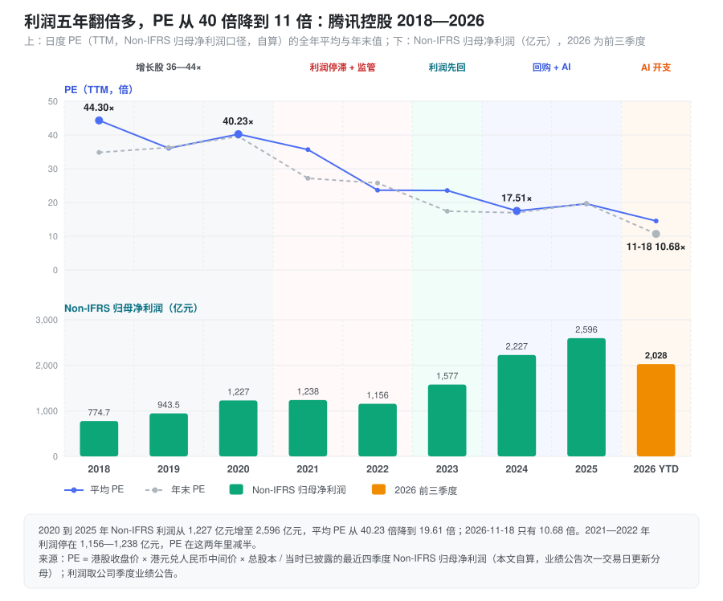
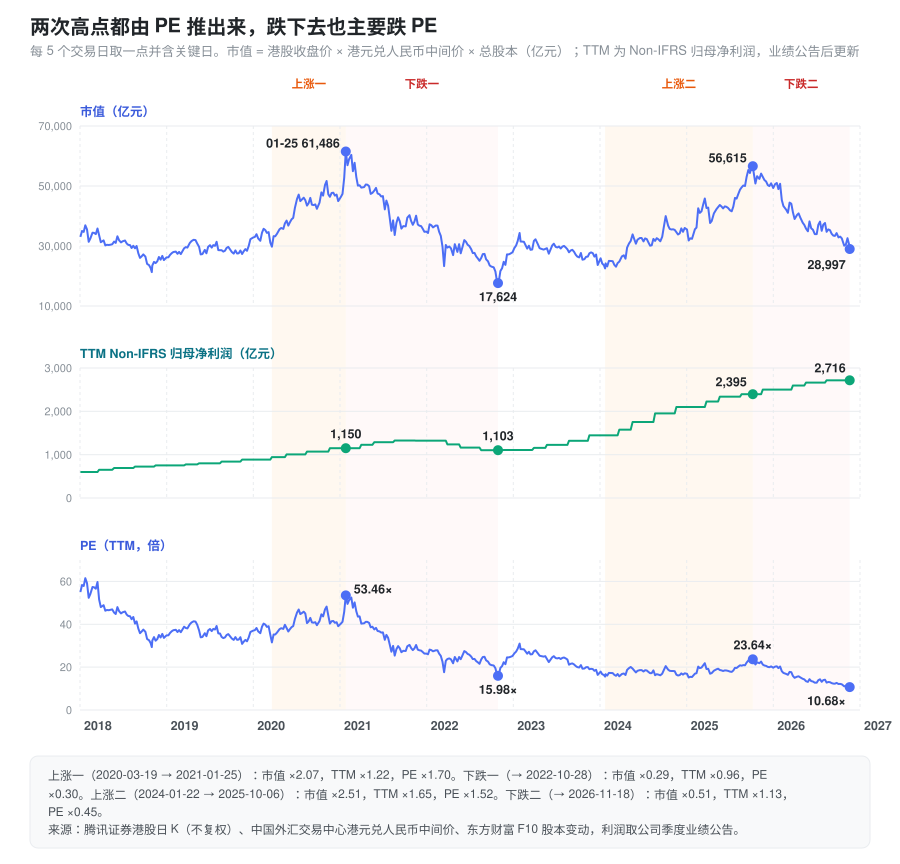
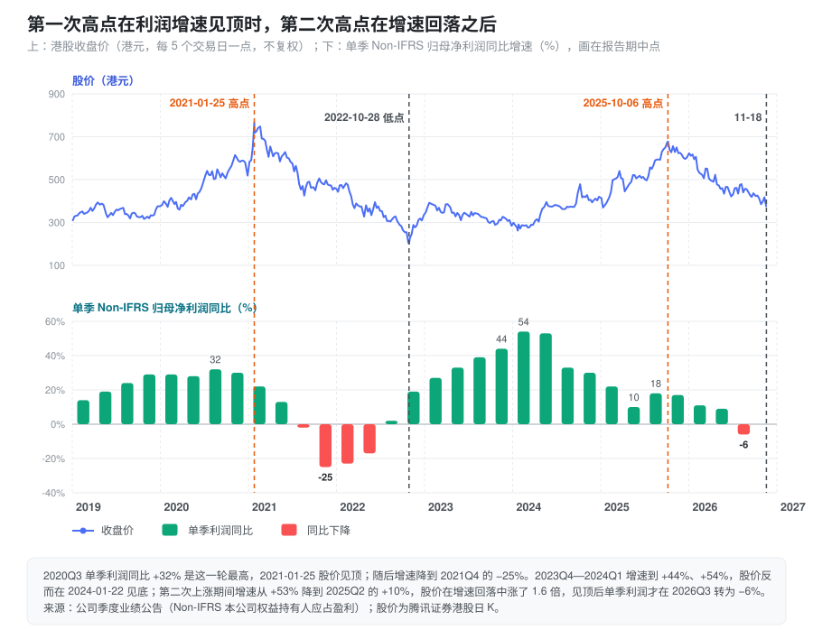
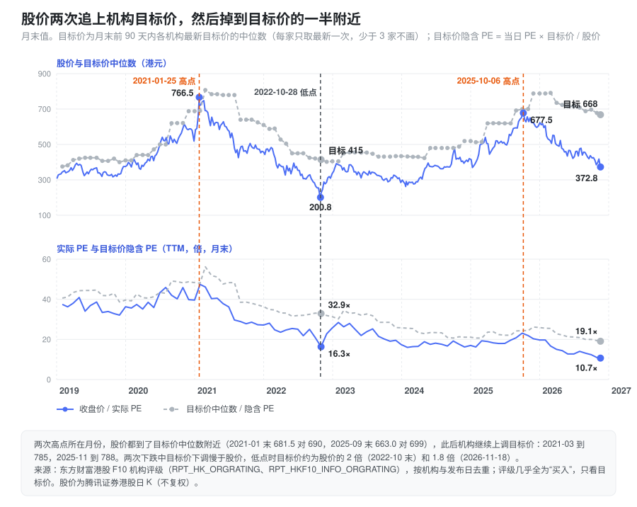
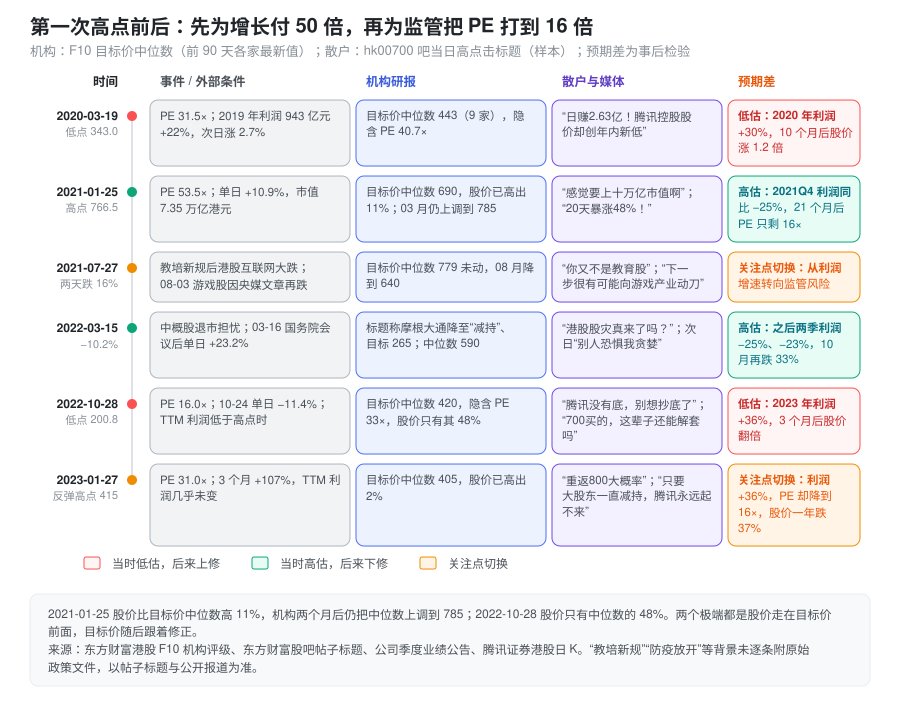
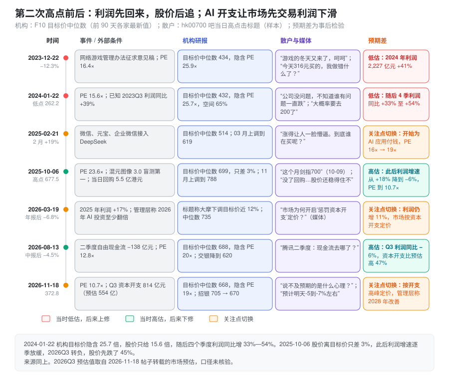

% 腾讯控股：两次高点前后的定价复盘（2018—2026）

### 核心判断

- 两次上涨都主要靠 PE。2020-03-19 到 2021-01-25，市值增至 2.07 倍，其中 TTM Non-IFRS 归母净利润 ×1.22、PE ×1.70；2024-01-22 到 2025-10-06，市值增至 2.51 倍，利润 ×1.65、PE ×1.52。第二次上涨里利润的贡献明显更大。
- 两次下跌也主要跌 PE，但利润的处境不同。第一次（2021-01-25 → 2022-10-28）利润停滞，TTM ×0.96，PE 从 53.46 倍跌到 15.98 倍，市值只剩 29%。第二次（2025-10-06 → 2026-11-18）TTM 利润还在增长（×1.13），PE 从 23.64 倍降到 10.68 倍，市值 ×0.51。
- 两个高点相隔四年多，股价接近（766.5 与 677.5 港元），TTM 利润却从 1,150 亿元增至 2,395 亿元。差不多的价格，2021 年对应 53 倍，2025 年只对应 24 倍。
- 机构目标价两次都落在股价后面。高点时股价已经到达或超过目标价中位数，机构此后仍在上调；低点时股价只有目标价中位数的 48%（2022-10-28）和 56%（2026-11-18）。
- 第二次下跌的直接原因是 AI 资本开支。2026 年三季度资本开支 814 亿元，单季 Non-IFRS 利润同比 −6%，是 2022Q2 以来首次同比下降。2026-11-18 的 10.68 倍低于 2022 年低点的 15.98 倍。

### 研究范围与数据边界

- **标的**：腾讯控股（00700.HK，港交所主板普通股，港币柜台）。统计从 2018 年开始，2018-01 的前高只作背景。
- **两次高点**：按收盘价取 2021-01-25（766.5 港元，盘中最高 775.5 港元在 2021-02-18）和 2025-10-06（677.5 港元，盘中最高 683.0 港元在 2025-10-02）。这是本文对“两次高点”的理解。
- **截止日**：2026-11-18 收盘，包含当晚公布的 2026 年三季度业绩；提取日 2026-11-19。11-19 盘中股价再跌超 6%，未计入统计。
- **行情**：腾讯证券港股日 K，不复权。全收益另算，计入现金股息和两次实物分派：2022-01-20 除权的京东股份（每 21 股派 1 股，约合每股 13.40 港元）、2023-01-05 除权的美团股份（每 10 股派 1 股，约合每股 18.13 港元）。
- **利润**：公司季度业绩公告中的“本公司权益持有人应占盈利”，主口径为 Non-IFRS。IFRS 利润含大额投资损益，例如 2021Q4 949.6 亿元、2022Q4 1,062.7 亿元，远高于同季 Non-IFRS 的 248.8 亿元和 297.1 亿元，主要来自京东、美团股份分派等投资收益，不适合做估值分母。
- **PE（TTM）自算**：港股收盘价 × 港元兑人民币中间价 × 总股本 / 当时已披露的最近四季度 Non-IFRS 归母净利润。腾讯在港股收盘后发布业绩，分母从公告后的下一个交易日起更新，没有用事后利润回填。总股本按东方财富 F10 股本变动逐日取值，回购注销已经反映（2021 年末 96.08 亿股，2026-10 为 90.93 亿股）。汇率取中国外汇交易中心中间价。全年平均 PE 是有效交易日日度 PE 的算术平均，各年都没有非正利润样本。
- **机构**：东方财富港股 F10 的两张机构评级表，按机构和发布日去重后共有 892 条带目标价的记录。评级几乎全是“买入”，所以只看目标价。**未能取得券商对各年度利润的历次预测，也没有一致预期**，因此本文没有预测轨迹图，用目标价及其隐含 PE 代替。
- **散户**：港股不披露股东户数。散户样本取东方财富 hk00700 吧关键日按点击量排前的帖子标题；样本不代表全部投资者，部分高点击帖是媒体转载。
- **事件背景**：教培新规、中概股退市担忧、防疫放开、网络游戏管理办法征求意见稿、接入 DeepSeek 等，以当日帖子转载的新闻标题为证据，未逐条核对原始文件。
- 本文只解释“什么条件下给出什么定价”，不构成投资建议。

### 一、PE 与利润：年度对照

| 年份 | 有效交易日 | 平均 PE（TTM） | 最低 PE / 日期 | 最高 PE / 日期 | 年末 PE | 平均 PE（IFRS 口径） |
| --- | ---: | ---: | --- | --- | ---: | ---: |
| 2018 | 246 | 44.30 | 29.36 / 10-30 | 61.50 / 01-23 | 34.83 | 40.53 |
| 2019 | 246 | 36.08 | 30.86 / 11-14 | 41.59 / 04-17 | 36.28 | 34.38 |
| 2020 | 248 | 40.23 | 31.54 / 03-19 | 48.41 / 07-09 | 39.59 | 41.15 |
| 2021 | 247 | 35.66 | 25.37 / 08-19 | 53.46 / 01-25 | 27.16 | 28.15 |
| 2022 | 246 | 23.65 | 15.98 / 10-28 | 28.74 / 02-10 | 25.76 | 14.68 |
| 2023 | 246 | 23.55 | 16.36 / 12-22 | 30.98 / 01-27 | 17.43 | 15.28 |
| 2024 | 246 | 17.51 | 15.58 / 01-22 | 20.75 / 05-14 | 16.96 | 20.79 |
| 2025 | 246 | 19.61 | 14.84 / 01-13 | 23.64 / 10-06 | 19.72 | 22.97 |
| 2026 YTD | 217 | 14.53 | 10.68 / 11-18 | 20.78 / 01-06 | 10.68（11-18） | 16.66 |

| 年份 | 收入（亿元） | Non-IFRS 归母净利润（亿元） | 同比 | IFRS 归母净利润（亿元） | 平均 PE | 年末收盘（港元） | 关键业务变化 |
| --- | ---: | ---: | ---: | ---: | ---: | ---: | --- |
| 2018 | 3,126.9 | 774.7 | +19.0% | 787.2 | 44.30 | 314.0 | 2018Q2—Q4 单季利润同比 +20%、+15%、+13%（背景：游戏版号暂停，未核验） |
| 2019 | 3,772.9 | 943.5 | +21.8% | 933.1 | 36.08 | 375.6 | 金融科技及企业服务收入与游戏相当 |
| 2020 | 4,820.6 | 1,227.4 | +30.1% | 1,598.5 | 40.23 | 564.0 | 疫情下线上需求、游戏、小程序交易额翻倍 |
| 2021 | 5,601.2 | 1,237.9 | +0.9% | 2,248.2 | 35.66 | 456.8 | 监管与未成年人游戏限制；四季度利润同比 −25% |
| 2022 | 5,545.5 | 1,156.5 | −6.6% | 1,882.4 | 23.65 | 334.0 | 收入首次同比下降，降本增效、收缩非核心业务 |
| 2023 | 6,090.1 | 1,576.9 | +36.4% | 1,152.2 | 23.55 | 293.6 | 视频号与广告 AI 模型；毛利 +23%；国际游戏占 30% |
| 2024 | 6,602.6 | 2,227.0 | +41.2% | 1,940.7 | 17.51 | 417.0 | 收入 +8%，利润 +41%；回购 1,120 亿港元 |
| 2025 | 7,517.7 | 2,596.3 | +16.6% | 2,248.4 | 19.61 | 599.0 | 《三角洲行动》，国际游戏年收入超 100 亿美元；资本开支 792 亿元 |
| 2026 前三季度 | 6,085.8 | 2,028.4 | +4.1% | 1,777.3 | 14.53 | 372.8（11-18） | Hy3、Hy4、WorkBuddy；三季度资本开支 814 亿元 |

2026 年的同比是与 2025 年前三季度比较。业务变化取自各期业绩公告的“业务回顾及展望”；2025 年资本开支 792 亿元和“金融科技及企业服务收入与游戏相当”来自股吧转载的新闻标题，未核对公告原文。

利润与 PE 的关系可以分成三段：

1. **2018—2020 年**：利润每年增长 19%—30%，PE 在 36—44 倍之间。市场把腾讯当作稳定的高增长股，估值跟着增速走。
2. **2021—2022 年**：利润两年几乎没有增长（1,227 → 1,238 → 1,156 亿元），平均 PE 从 40 倍降到 24 倍。估值收缩先于利润下滑，2021 年上半年利润还在增长，PE 已经从 53 倍往下走。
3. **2023—2026 年**：利润三年增长 1.25 倍（2022 年 1,156 亿元到 2025 年 2,596 亿元），平均 PE 却从 23.65 倍降到 19.61 倍，2026 年再降到 14.53 倍。利润恢复没有带回 2020 年的估值，市场不再按高增长股定价。

IFRS 口径的 PE 在 2021—2023 年明显低于 Non-IFRS 口径，是因为分母含投资收益；2024 年以后反过来高于 Non-IFRS 口径，是因为 IFRS 利润低于 Non-IFRS 利润：Non-IFRS 剔除了股权激励、并购相关摊销和投资损益等项目。两种口径的方向一致，下文只用 Non-IFRS。

### 二、节点与涨跌拆解

年度表把两次高点切开了：2021-01-25 和 2025-10-06 都只是年内的一天。下面按关键日期列出价格、市值、TTM 利润和 PE。

| 日期 | 节点 | 收盘（港元） | 市值（亿元） | TTM 利润（亿元，最后一季） | PE（TTM） | IFRS PE | 恒生指数 |
| --- | --- | ---: | ---: | --- | ---: | ---: | ---: |
| 2018-01-23 | 前高 | 474.6 | 36,905 | 600.0 | 61.50 | — | — |
| 2018-10-30 | 前低 | 252.2 | 21,302 | 725.5 | 29.36 | — | — |
| 2020-03-19 | 上涨一起点 | 343.0 | 29,756 | 943.5（2019Q4） | 31.54 | — | 21,709 |
| 2021-01-25 | **第一次高点** | 766.5 | 61,486 | 1,150.2（2020Q3） | 53.46 | 50.35 | 30,159 |
| 2021-07-27 | 教培新规后 | 446.0 | 35,620 | 1,287.8 | 27.66 | — | — |
| 2022-03-15 | 中概股恐慌 | 298.0 | 23,312 | 1,321.2 | 17.64 | — | — |
| 2022-10-28 | **第一次低点** | 200.8 | 17,624 | 1,103.2（2022Q2） | 15.98 | 9.99 | 14,863 |
| 2023-01-27 | 反弹高点 | 415.0 | 34,330 | 1,108.2 | 30.98 | — | — |
| 2024-01-22 | 上涨二起点 | 262.2 | 22,540 | 1,447.2 | 15.58 | 11.59 | 14,961 |
| 2024-10-07 | 刺激政策后 | 478.4 | 40,032 | 1,951.8 | 20.51 | — | — |
| 2025-01-07 | 列入 1260H 清单 | 379.6 | 32,375 | — | 15.41 | — | — |
| 2025-10-06 | **第二次高点** | 677.5 | 56,615 | 2,395.1（2025Q2） | 23.64 | 27.22 | 26,958 |
| 2026-08-13 | 中报后 | 441.0 | 34,732 | 2,715.7 | 12.79 | — | — |
| 2026-11-18 | 截止日 | 372.8 | 28,997 | 2,715.7（2026Q2） | 10.68 | 12.31 | 23,295 |

按“市值 = TTM 利润 × PE”拆解各段（市值以人民币计，所以含汇率变化；股价变化另含股本变化）：

| 区间 | 市值 | TTM 利润 | PE | 股价 | 全收益 | 其他 |
| --- | ---: | ---: | ---: | ---: | ---: | --- |
| 2018-01-23 → 2018-10-30 | ×0.58 | ×1.21 | ×0.48 | −46.9% | −46.7% | 恒指 −25.3% |
| 2018-10-30 → 2020-03-19 | ×1.40 | ×1.30 | ×1.07 | +36.0% | — | 恒指 −11.7% |
| **上涨一** 2020-03-19 → 2021-01-25 | ×2.07 | ×1.22 | ×1.70 | +123.5% | +124.1% | 港元兑人民币 −7.9%；恒指 +38.9% |
| **下跌一** 2021-01-25 → 2022-10-28 | ×0.29 | ×0.96 | ×0.30 | −73.8% | −72.9% | 港元兑人民币 +9.2%；恒指 −50.7%；IFRS TTM ×1.45 |
| 2022-10-28 → 2023-01-27 | ×1.95 | ×1.00 | ×1.94 | +106.7% | +117.4% | 含美团实物分派；恒指 +52.7% |
| 2023-01-27 → 2024-01-22 | ×0.66 | ×1.31 | ×0.50 | −36.8% | — | 恒指 −34.1% |
| **上涨二** 2024-01-22 → 2025-10-06 | ×2.51 | ×1.65 | ×1.52 | +158.4% | +162.9% | 股本 −3.2%；恒指 +80.2% |
| **下跌二** 2025-10-06 → 2026-11-18 | ×0.51 | ×1.13 | ×0.45 | −45.0% | −44.3% | 港元兑人民币 −6.3%；恒指 −13.6% |
| 高点到高点 2021-01-25 → 2025-10-06 | ×0.92 | ×2.08 | ×0.44 | −11.6% | −1.3% | — |
| 2019-12-31 → 2026-11-18 | ×0.90 | ×3.07 | ×0.29 | −0.7% | +12.5% | 恒指 −17.4% |

几点观察：

- **上涨一的 PE 贡献远大于利润。** 10 个月里 TTM 利润只增 22%，PE 从 31.5 倍升到 53.5 倍。最后一个月是加速段：2021-01-25 单日 +10.9%，当日港股通净买入腾讯 67.6 亿港元（据股吧转载标题）。
- **下跌一里利润几乎没动，PE 跌掉七成。** IFRS 利润在这段时间反而增长 45%，说明市场完全没有给投资收益定价。恒指同期也跌了一半，腾讯的跌幅（−73.8%）比恒指多 23 个百分点。
- **上涨二是利润和 PE 一起涨。** 利润 ×1.65 的贡献略大于 PE ×1.52；回购使股本减少 3.2%，每股利润增速略高于总利润。
- **下跌二是利润增长、PE 下跌。** TTM 利润还增长了 13%，PE 却降到 0.45 倍，跌幅比恒指多 31 个百分点。
- **两个高点之间股价跌 11.6%，全收益只跌 1.3%**：差额来自股息与京东、美团两次实物分派。利润翻倍被 PE 减半完全抵消。

### 三、股价先动还是利润先动

| 季度 | 单季 Non-IFRS 利润（亿元） | 同比 | 披露日 | 披露后首个交易日涨跌 |
| --- | ---: | ---: | --- | ---: |
| 2020Q1 | 270.8 | +29% | 2020-05-13 | +0.2% |
| 2020Q2 | 301.5 | +28% | 2020-08-12 | −2.0% |
| 2020Q3 | 323.0 | +32% | 2020-11-12 | +4.3% |
| 2020Q4 | 332.1 | +30% | 2021-03-24 | −2.8% |
| 2021Q1 | 331.2 | +22% | 2021-05-20 | −3.4% |
| 2021Q2 | 340.4 | +13% | 2021-08-18 | −3.4% |
| 2021Q3 | 317.5 | −2% | 2021-11-10 | −1.2% |
| 2021Q4 | 248.8 | −25% | 2022-03-23 | −5.9% |
| 2022Q1 | 255.5 | −23% | 2022-05-18 | −6.5% |
| 2022Q2 | 281.4 | −17% | 2022-08-17 | +3.1% |
| 2022Q3 | 322.5 | +2% | 2022-11-16 | −0.8% |
| 2022Q4 | 297.1 | +19% | 2023-03-22 | +8.2% |
| 2023Q1 | 325.4 | +27% | 2023-05-17 | −0.9% |
| 2023Q2 | 375.5 | +33% | 2023-08-16 | +1.2% |
| 2023Q3 | 449.2 | +39% | 2023-11-15 | +0.7% |
| 2023Q4 | 426.8 | +44% | 2024-03-20 | +0.8% |
| 2024Q1 | 502.7 | +54% | 2024-05-14 | +4.0% |
| 2024Q2 | 573.1 | +53% | 2024-08-14 | −1.4% |
| 2024Q3 | 598.1 | +33% | 2024-11-13 | −0.1% |
| 2024Q4 | 553.1 | +30% | 2025-03-19 | −3.8% |
| 2025Q1 | 613.3 | +22% | 2025-05-14 | −0.2% |
| 2025Q2 | 630.5 | +10% | 2025-08-13 | +0.7% |
| 2025Q3 | 705.5 | +18% | 2025-11-13 | −2.3% |
| 2025Q4 | 646.9 | +17% | 2026-03-18 | −6.8% |
| 2026Q1 | 679.1 | +11% | 2026-05-13 | −0.5% |
| 2026Q2 | 684.2 | +9% | 2026-08-12 | −4.5% |
| 2026Q3 | 665.2 | −6% | 2026-11-18 | 截止日后 |

涨跌为腾讯收盘价相对公告前一交易日的变化（公告均在港股收盘后发布）。2024-05-14 的次一交易日是 05-16（05-15 港股休市）。

- **第一次高点**出现在利润增速最高的季度（2020Q3，+32%）之后。见顶时已披露的最后一季仍是 +32%，股价没有等到增速放缓的数据；放缓先在 2021Q1（+22%）出现，转负在 2021Q3。
- **第一次低点**（2022-10-28）在利润同比连续三季下降之后，当时已披露的 2022Q2 是 −17%。低点之后两周披露的 2022Q3 回到 +2%。
- **第二次上涨的起点**（2024-01-22）利润同比已经连续 5 个季度为正，最近一季 +39%。股价比利润晚了约一年。
- **第二次高点**出现在增速回落中：2025Q2 只有 +10%，股价仍在涨。见顶后，2025Q4 年报和 2026Q2 中报的次日分别跌 6.8% 和 4.5%，两次的利润增速都还是正的，市场反应的是资本开支和现金流。

### 四、机构观点：目标价怎样跟着股价走

本文没有取得券商的历次利润预测，只能看目标价。做法是：在每个月末，取前 90 天内各机构最新一次目标价的中位数（每家只计一次，少于 3 家不计），再用“当日 PE × 目标价 / 股价”换算成目标价隐含的 TTM PE。这个隐含 PE 用的是当时已披露的利润，不是机构自己的预测利润，所以只能说明“机构认为合理的市值”相当于当时利润的多少倍。

| 日期 | 收盘（港元） | 机构数 | 目标价中位数（港元） | 区间 | 空间 | 实际 PE | 目标价隐含 PE |
| --- | ---: | ---: | ---: | --- | ---: | ---: | ---: |
| 2020-03-19 | 343.0 | 9 | 443 | 410—473 | +29% | 31.54 | 40.7 |
| 2020-12-31 | 564.0 | 10 | 688 | 650—727 | +22% | 39.59 | 48.3 |
| 2021-01-25 | 766.5 | 10 | 690 | 650—807 | −10% | 53.46 | 48.1 |
| 2021-03-31 | 610.0 | 12 | 784 | 700—900 | +29% | 40.30 | 51.8 |
| 2021-08-19 | 421.2 | 8 | 754 | 640—800 | +79% | 25.37 | 45.5 |
| 2022-03-15 | 298.0 | 6 | 590 | 560—620 | +98% | 17.64 | 34.9 |
| 2022-10-28 | 200.8 | 12 | 420 | 391—480 | +109% | 15.98 | 33.4 |
| 2023-01-27 | 415.0 | 10 | 405 | 395—460 | −2% | 30.98 | 30.3 |
| 2024-01-22 | 262.2 | 10 | 432 | 388—475 | +65% | 15.58 | 25.7 |
| 2024-10-07 | 478.4 | 8 | 480 | 460—488 | +0% | 20.51 | 20.6 |
| 2025-04-08 | 440.4 | 10 | 619 | 520—700 | +41% | 16.87 | 23.7 |
| 2025-10-06 | 677.5 | 9 | 699 | 660—708 | +3% | 23.64 | 24.4 |
| 2025-12-31 | 599.0 | 10 | 788 | 729—820 | +32% | 19.72 | 25.9 |
| 2026-03-31 | 484.0 | 8 | 735 | 672—820 | +52% | 15.02 | 22.8 |
| 2026-08-13 | 441.0 | 9 | 688 | 510—790 | +56% | 12.79 | 20.0 |
| 2026-11-18 | 372.8 | 3 | 668 | 666—733 | +79% | 10.68 | 19.1 |

2026-11-18 只有 3 家机构在 90 天窗口内，代表性有限。

几家覆盖连续的机构，目标价轨迹如下（港元）：

| 机构 | 第一次高点前后 | 第一次低点前后 | 第二次高点前后 | 截止日附近 |
| --- | --- | --- | --- | --- |
| 招银国际 | 2020-11 669 → 2021-03 735 → 2021-05 753 | 2021-08 640 → 2022-10-31 398 | 2025-09-24 705 → 2025-11 760 | 2026-08 705 → 2026-11-19 670（截止日次日） |
| 第一上海 | 2020-08 660 → 2021-03 800 | 2021-08 700 → 2022-08 450 | 2025-07 660 → 2025-11 790 | 2026-03 780 → 2026-08 733 |
| 国海证券 | 2021-10 起覆盖，687 | 2022-03 577 → 2022-10-19 422 | 2025-08 708 → 2025-10-14 773 → 2025-11 791 | 2026-03 720 → 2026-10-14 666 |
| 兴证国际 | 2020-08 582 → 2021-03 730 | 2021-08 630 → 2022-11 369 | — | — |

这些数据说明三件事：

- **高点时，股价跑到了目标价前面。** 2021-01-25 股价比中位数高 11%；2025-10-06 只差 3%。两次机构都在之后上调：中位数在 2021-03 到 784，在 2025-11 到 788。上调发生在股价已经开始下跌之后。
- **下跌中，目标价下调比股价慢得多。** 第一次下跌中股价跌了 74%，招银国际目标价从 753 降到 398，降幅 47%。第二次下跌到 2026-11-18，股价跌 45%，中位数只从 788 降到 668，降幅 15%。
- **目标价隐含 PE 是一条稳定下行的线。** 从 2021 年的 48—52 倍降到 2022 年的 33 倍、2024 年初的 26 倍、2026-11 的 19 倍。机构给的估值倍数也在下修，只是慢于市场。两次低点时，实际 PE 都只有目标价隐含 PE 的一半左右（2022-10-28 为 16.0 对 33.4，2026-11-18 为 10.7 对 19.1）。

股吧转载的标题里还有两次明显偏离中位数的观点：2022-03-15“摩根大通削腾讯控股目标价 53.5% 至 265 港元，降至‘减持’评级”；2026-03-19“摩根士丹利下调腾讯港股目标价近 12%，AI 领域投资短期料拖累利润率”。F10 评级表里没有这两条记录，未计入中位数。

### 五、散户与媒体：股吧样本

样本取自东方财富 hk00700 吧，按当日帖子点击量排序，摘录排名靠前的原文标题（含媒体转载）。不改写原意，看多和看空都摘；**样本不代表全部投资者**。港股没有股东户数数据，无法用户数变化旁证散户进出。

| 日期 | 节点 | 当日帖子数 | 代表性标题（点击量） |
| --- | --- | ---: | --- |
| 2020-03-19 | 疫情低点 | 47 | “年入3773亿！日赚2.63亿! 腾讯控股股价却创年内新低”（2,427）；“腾讯Q4财报超预期 单季营收破千亿元”（1,661） |
| 2021-01-25 | 第一次高点 | 201 | “腾讯市值突破7万亿！……百亿资金南下疯抢核心资产”（19,221）；“20天暴涨48%！南下资金第一抱团股出现”（18,768）；“感觉要上十万亿市值啊”（1,125） |
| 2021-01-26 | 高点次日 | 120 | “看涨期权狂飙90300%！腾讯又‘封神’！”（24,807）；“一个腾讯市值凭啥抵过六大行”（5,686）；“快走了，不走就成滚刀肉。这里是超级高的位置”（916） |
| 2021-07-27 | 教培新规后 | 191 | “腾讯会消失吗，就像新东方一样”（1,174）；“有必要吗？你又不是教育股”（856）；“游戏严重影响青少年成长，……下一步很有可能向游戏产业动刀”（559） |
| 2021-08-03 | 游戏股大跌 | 134 | “游戏板块今早暴跌 腾讯发文称推出游戏未保‘双减双打’新措施”（3,264）；“什么是价值投资，我590入场770没卖现在438亏损近30%”（1,473） |
| 2022-03-15 | 中概股恐慌 | 657 | “腾讯一度跌超8% 网传大规模裁员要来了？摩根大通下调目标价”（11,749）；“港股遭遇史上猛烈抛售潮？港股股灾真来了吗？”（6,629） |
| 2022-03-16 | 单日 +23.2% | 396 | “活久见。。。”；“别人恐惧我贪婪，抄底港股开始了”；“国务院研究了宏观经济、中概股等问题，释放了哪些信号？”（1,364） |
| 2022-10-24 | 单日 −11.4% | 629 | “恒指的命运，从腾讯跌破二百五说起……”（1,113）；“700买的，这辈子还能解套吗”（980）；“腾讯没有底，别想抄底了”（590） |
| 2023-01-27 | 反弹高点 | 35 | “两年之后看腾讯，重返800大概率”（771）；“只要大股东一直减持，腾讯永远起不来，必定跌到100块”（639） |
| 2023-12-22 | 游戏新规草案 | 1,120 | “游戏的冬天又来了，呵呵”（10,018）；“腾讯今日加大回购力度：斥资10亿港元单日回购359万股”（6,885）；“今天316元买的，我做错什么了？”（2,876） |
| 2024-01-22 | 第二次上涨起点 | 94 | “无语了，公司没问题，不知道谁有问题一直跌”（541）；“这个时候应敢于抄底”（478）；“大概率要去200了”（425） |
| 2025-01-08 | 1260H 清单 | 196 | “腾讯回应被列入美国1260H清单——显然是一个错误 对业务没有影响”（1,522）；“南向资金今日净买入148.73亿港元 腾讯控股获净买入84.96亿港元”（2,387） |
| 2025-02-21 | 接入 DeepSeek | 100 | “腾讯元宝更新 DeepSeek能读懂图片了”（6,361）；“港股这一路暴涨，涨得让人一脸懵逼。到底谁在买呢？”（2,960） |
| 2025-10-06 | 第二次高点 | 38 | “混元图像 3.0 全球‘盲测’登顶第一”（2,889）；“老是靠回购才勉强红，想一想后面静默期得跌成什么样”（601）；“上700，冲”（406） |
| 2026-03-19 | 年报后 −6.8% | 479 | “腾讯绩后股价大跌6%，AI投入计划翻倍或减少股份回购”（6,163）；“腾讯绩后股价大跌！市场为何开启‘惩罚资本开支’定价？”（3,524） |
| 2026-08-13 | 中报后 | 347 | “腾讯二季度：现金流去哪了？”（4,495）；“二季度自由净现金流出138亿 腾讯AI投资压力有多大？”（3,316） |
| 2026-11-18 | 截止日 | 572 | “腾讯控股：第三季度资本支出814.3亿元 预估554亿元”（11,790）；“腾讯控股：第三季度录得负自由现金流691亿元”（6,071）；“说不及预期的是什么心理？现金流也在第三季度转正了”（1,878） |

2022-10-28 当天该吧只抓到 5 条帖子、2025-01-07 没有抓到帖子，可能是该吧当时的数据缺口，因此用相邻交易日代替。

从样本看，散户情绪和机构的差别主要在两个地方。第一，高点附近散户谈论的是市值和资金（“7万亿”“南下资金第一抱团股”“剑指700”），机构谈的是目标价是否上调；两者在高点时都偏乐观。第二，低点附近散户的高点击帖是“没有底”“解套”“去200”，同期机构目标价仍给出 65%—109% 的空间。第二次下跌中，讨论焦点从游戏、监管转到“资本开支”“现金流”“回购缩水”，这和财报日的股价反应一致。

### 六、事件与预期差

预期差 = 当时的主流预期 − 后来的事实。“当时的主流预期”用目标价中位数及其隐含 PE、财报次日的股价反应和股吧样本近似；“后来的事实”用此后披露的利润和股价。两张时间线分别覆盖两次高点前后。

| 日期 | 事件与市场反应 | 当时的定价 | 事后检验 | 方向 |
| --- | --- | --- | --- | --- |
| 2020-03-19 | 2019 年报（利润 +22%）次日涨 2.7%，恒指跌 2.6% | PE 31.5 倍，低于目标价隐含的 40.7 倍 | 2020 年利润 +30%，10 个月后股价涨 123% | 低估 |
| 2021-01-25 | 单日 +10.9%，市值 7.35 万亿港元 | PE 53.5 倍，高于目标价隐含的 48.1 倍 | 2021 年利润 +0.9%，2021Q4 同比 −25%；21 个月后 PE 16.0 倍 | 高估 |
| 2021-07-26/27 | 教培新规后两天跌 16%；08-03 游戏股再跌，腾讯推出未成年人保护新措施 | PE 从 32.9 倍跌到 27.7 倍；目标价中位数到 08 月才从 779 降到 640 | 此后担忧从教培扩展到游戏，PE 到 2022-10-28 再降 42% | 关注点切换 |
| 2022-03-15/16 | 两天先跌 10.2%，03-16 国务院会议后涨 23.2% | PE 17.6 倍；中位数 590，空间 98% | 2021Q4、2022Q1 利润同比 −25%、−23%，股价到 10 月再跌 33% | 高估 |
| 2022-10-24/28 | 10-24 单日 −11.4%，10-28 收于 200.8 | PE 16.0 倍；目标价隐含 33.4 倍 | 2023 年利润 +36%；3 个月后股价 +107% | 低估 |
| 2023-01-27 | 3 个月涨 107%，TTM 利润未变 | PE 31.0 倍，已超过目标价中位数 2% | 2023 年利润 +36%，PE 却降到 16 倍，一年后股价 −37% | 关注点切换 |
| 2023-12-22 | 网络游戏管理办法征求意见稿，单日 −12.3%，成交超 300 亿港元 | PE 16.4 倍 | 2024 年利润 +41%；新规未按草案冲击收入 | 低估 |
| 2024-01-22 | 第二次上涨起点，已知 2023Q3 利润 +39% | PE 15.6 倍，目标价隐含 25.7 倍 | 随后四季度利润同比 +33% 至 +54%；股价 21 个月 +158% | 低估 |
| 2025-02 | 微信、元宝、企业微信接入 DeepSeek，2 月涨 19% | PE 16.2 → 19.3 倍；目标价 03 月从 514 上调到 619 | 2025 年利润 +17%，但上涨主要来自 PE | 关注点切换 |
| 2025-10-06 | 第二次高点；当日回购 5.5 亿港元 | PE 23.6 倍，离目标价中位数只差 3% | 此后利润增速从 +18% 降到 2026Q3 的 −6%，PE 降到 10.7 倍 | 高估 |
| 2026-03-19 | 2025 年报：利润 +17%，管理层称 2026 年 AI 投资至少翻倍；次日 −6.8% | PE 15.0 倍（03 月末）；中位数 735 | 2026 年前三季度利润只增 4% | 关注点切换 |
| 2026-08-13 | 中报后 −4.5%，二季度自由现金流 −138 亿元 | PE 12.8 倍；目标价隐含 20.0 倍 | 2026Q3 利润同比 −6%，资本开支 814 亿元高于预估 47% | 高估 |
| 2026-11-18 | 三季报：收入 2,073 亿元（+8%），资本开支 814 亿元，Q3 回购约 70 亿港元 | PE 10.7 倍；目标价隐含 19.1 倍 | 尚待检验；管理层称 2027 年资本开支仍在高位，2028 年财务趋势改善 | 关注点切换 |

2026Q3 的“预估 554 亿元”及收入、经营利润的预估值来自股吧转载的市场预估，口径未核验。2026-11-18 的“自由现金流 −691 亿元”与同日一条帖子“现金流也在第三季度转正了”说法相反，本文没有核对公告中的现金流量表，只采用资本开支数字。

预期差在两轮里都发生了反向：

- **第一轮**：2020 年市场低估了利润增长，到 2021-01 又把 50 倍以上的 PE 给了一个随后两年不增长的利润。2021 年下半年起，定价的变量从“增速”换成“监管能把利润压到哪里”，PE 在利润还没下滑时就先跌了。2022 年底的低点是这个担忧被定价到极端：16 倍 PE 对应的是之后一年增长 36% 的利润。
- **第二轮**：2023—2024 年利润已经回来，市场却继续按 16—18 倍定价，这是第二轮里最大的低估。2025 年市场开始为 AI 应用付钱，PE 抬到 23.6 倍。2026 年定价变量又换了一次，从“AI 能带来多少收入”换成“AI 要花多少钱”。2026 年前三季度利润仍在增长，PE 已经被压到比 2022 年低点更低。

### 七、定价阶段

| 阶段 | 区间 | 利润在变什么 | 估值在变什么 | 市场在为什么付钱 | 结束信号 |
| --- | --- | --- | --- | --- | --- |
| 1. 高增长股 | 2018—2020-03 | 年增 19%—22% | 29—44 倍（2018-01 高点 61.5 倍） | 游戏与社交广告的稳定增长 | 2020 年疫情下线上需求加速 |
| 2. 疫情红利与资金抱团 | 2020-03-19 → 2021-01-25 | TTM +22%，单季增速到 +32% | 31.5 → 53.5 倍 | 线上化长期提速、南向资金 | 2021-01-25 单日 +10.9% 后见顶，股价超过目标价 |
| 3. 监管重估 | 2021-01 → 2022-10-28 | 两年几乎不增长，2021Q4 起连续三季同比下降 | 53.5 → 16.0 倍 | 监管对利润上限的担忧、外资退出、中概股退市风险 | 2022Q3 利润同比转正；11 月防疫放开、游戏版号恢复（背景，未核验） |
| 4. 估值修复，利润未跟上 | 2022-10-28 → 2023-01-27 | TTM 不变 | 16.0 → 31.0 倍 | 政策转向的预期 | 利润恢复慢于股价，2023 年 PE 回落 |
| 5. 利润先回，估值不回 | 2023-01 → 2024-01-22 | 利润增速 +27% → +44% | 31.0 → 15.6 倍 | 市场仍在折价：游戏新规草案、宏观与港股流动性 | 2024Q1 利润 +54%，回购 1,120 亿港元 |
| 6. 回购与 AI 重估 | 2024-01-22 → 2025-10-06 | TTM ×1.65，增速从 +54% 回落到 +10%—18% | 15.6 → 23.6 倍 | 高回购的现金回报，2025 年起叠加 AI 应用预期 | 2025 年报宣布 AI 投资翻倍 |
| 7. AI 资本开支 | 2025-10-06 → 2026-11-18 | TTM ×1.13，2026Q3 同比 −6% | 23.6 → 10.7 倍 | 资本开支高峰、自由现金流转负、回购可能缩水 | 尚未结束 |

### 八、当前价格隐含了什么

2026-11-18 收盘 372.8 港元，市值 28,997 亿元（33,897 亿港元），TTM Non-IFRS 利润 2,715.7 亿元，PE 10.68 倍。换几个角度看这个价格：

| 假设的“合理” PE | 依据 | 对应利润（亿元） | 相对当前 TTM |
| --- | ---: | ---: | ---: |
| 15.58 倍 | 2024-01-22 低点 | 1,861 | −31% |
| 15.98 倍 | 2022-10-28 低点 | 1,815 | −33% |
| 19.1 倍 | 当前目标价中位数隐含 | 1,518 | −44% |
| 23.64 倍 | 2025-10-06 高点 | 1,227 | −55% |

计算方式为当前市值 / 假设 PE。如果市场仍按过去两次低点的 16 倍左右定价，当前价格相当于假设“正常化”利润比 TTM 低三成左右，约等于 2023 年的利润（1,577 亿元）到 2024 年的利润（2,227 亿元）之间。换句话说，市场在为 AI 资本开支带来的折旧上升、利润率下降定价，而且下降幅度比 2026Q3 的 −6% 大得多。

另一种解读是 PE 本身被压低：资本开支高峰期自由现金流为负，回购可能缩水，市场把腾讯从“高回购的现金牛”重新归入“重资产投入期”，给的倍数低于历史低点。两种解读对应的跟踪指标不同：

- **利润解读**：看 Non-IFRS 利润同比是否继续为负、经营利润率是否持续下降、折旧摊销占收入的比例。
- **倍数解读**：看资本开支是否如管理层所说在 2027 年见顶、自由现金流何时转正、回购金额能否回到 2024—2025 年的 800—1,120 亿港元。

### 九、尚待验证的问题

1. **资本开支见顶时间。** 管理层在三季报电话会上称 2027 年资本开支仍在高位、2028 年 AI 投入产出效率改善。如果 2027 年资本开支再超预期，第二次下跌的“关注点切换”可能还没结束。
2. **云与 AI 收入能否抵消折旧。** 三季报称云收入同比增长 35%，WorkBuddy 日活超 1,000 万。需要看云、AI 订阅和 GPU 租赁收入的规模能否追上折旧的增长。
3. **算力限制。** 截止日当晚，高管称最新收紧的限制会让短期算力与训练承压（据股吧转载标题）。这会同时影响资本开支节奏和 AI 产品进度，方向不确定。
4. **核心业务韧性。** 游戏（长青游戏日活创新高）和营销服务（视频号）是现金流来源。2026Q3 收入 +8%，低于 2025 年各季的 11%—15%，需要确认放缓是否来自核心业务。
5. **回购政策。** 2026 年截至 10 月回购 324 亿港元，低于 2024 年的 1,120 亿和 2025 年的 800 亿港元。帖子称“明天开始每天十亿回购”，未核验。回购节奏是第二次上涨的支撑之一。
6. **资金面。** 两次高点都伴随南向资金集中买入（2021-01-25 当日 67.6 亿港元，2026-11-18 南向连续 4 天净买入）。这类资金的持续性无法从本文数据判断。

### 结论

两次高点的共同点是：股价都跑到了机构目标价前面，此后都由 PE 收缩带动下跌。第一次高点在利润增速最高的季度之后，第二次高点在增速已经回落到 10%—18% 之后。不同点在利润：第一次下跌时利润停滞两年，PE 从 53 倍跌到 16 倍，市值只剩 29%；第二次下跌时利润还在增长，PE 从 24 倍跌到 11 倍，市值剩 51%。

四年里利润翻倍、股价几乎回到原地，说明腾讯的定价已经从“为增长付高倍数”变成“为现金回报付低倍数”。2026 年 AI 资本开支打断了现金回报这条线，PE 因此跌破了 2022 年的低点。接下来价格怎样走，取决于资本开支能否在 2027 年见顶、AI 收入能否把利润率拉回来；在这两件事有数据之前，10—16 倍是市场在两种解读之间给出的区间，本文不把它当作买卖依据。
