% Topology

### 带宽层级

从“离计算核心最近”到“最远”，带宽逐级跌落，这条层级是所有通信优化的物理背景：

| 层级 | 介质 | 量级（单卡，双向） | 典型延迟 |
|---|---|---|---|
| 片上 | SRAM / Shared Memory | ~ 数十 TB/s | ns |
| 板上 | HBM（如 H100 HBM3） | ~ 3 TB/s | 数百 ns |
| 节点内 | NVLink / NVSwitch | 0.6 ~ 1.8 TB/s | ~ 1 µs |
| 节点间 | InfiniBand NDR / RoCE | ~ 0.05 TB/s（400 Gb/s/port） | 数 µs |

节点内（NVLink）和节点间（IB）带宽差着约 **一个数量级**。这就是为什么：**通信量最大、最频繁的并行（Tensor Parallel）几乎总是限制在单节点 8 卡以内**，而通信量较小的并行（Data / Pipeline / Expert Parallel）才跨节点展开。跨节点做 TP 会让 IB 成为瓶颈，得不偿失。

### NVLink mesh

早期的 NVLink 直连是“网格（mesh）”结构：每张卡通过若干条 NVLink 直接连到其它卡。当卡数增多时，任意两卡之间的链路数不均衡，且无法做到全速全连接。

现代服务器（DGX/HGX）用 **NVSwitch** 取代了纯 mesh：所有 GPU 都接到交换芯片上，任意两卡之间都能跑满单卡的全部 NVLink 带宽，且带宽与访问模式无关（all-to-all 也不掉速）。这让节点内的集合通信可以近似当作“无阻塞”来建模。

#### bandwidth

需要注意区分单向（unidirectional）和双向带宽（bidirectional）：

| 规格 | 双向总带宽 | 单向带宽（填公式用这个） |
|---|---|---|
| NVLink 3（A100） | 600 GB/s | 300 GB/s |
| NVLink 4（H100） | 900 GB/s | 450 GB/s |
| NVLink 5（B200） | 1800 GB/s | 900 GB/s |

NCCL 文档和 `nccl-tests` 的 busbw 换算也是基于单向带宽——`nccl-tests` 输出的 `busbw` 列实际上是把测量到的 algobw 乘以 `(P-1)/P`（AllGather 系数），对应的就是单向链路利用率。

**厂商标称带宽 vs 有效带宽。**

上表是硬件峰值，真实集合通信通常只能达到其 **70%~85%**：协议开销、同步、流水线未填满、以及算法本身的 `(P-1)/P` 系数都会打折。做容量规划时用实测 `busbw`，不要直接用标称值。

### Fat Tree

节点内靠 NVSwitch，**节点间**则靠数据中心网络。GPU 集群普遍采用 **胖树（Fat Tree）** 这种多级 Clos 拓扑，目标是让任意两个节点之间都有接近满速、无阻塞的带宽。

胖树的核心思想是“**越往上，链路越粗**”，从而消除传统树形网络在根部的带宽瓶颈：

- **Leaf（接入层 / ToR）**：直接连接一组服务器的网卡（下行），并通过上行链路连到 Spine。
- **Spine（汇聚/核心层）**：连接所有 Leaf，负责跨机架转发。
- **无阻塞（non-blocking）**：当每个 Leaf 的上行总带宽 ≥ 下行总带宽（收敛比 1:1）时，网络理论上可以支持所有节点同时满速通信而不发生拥塞。

**收敛比（Oversubscription Ratio）** 是成本与性能的权衡点。1:1 无阻塞最贵；许多通用集群用 1:2 或 1:4 的上行收敛来省交换机和光模块。但 LLM 训练/推理的集合通信是**突发且同步**的（所有节点同时 AllReduce），对收敛比极其敏感——AI 专用集群通常坚持 1:1 无阻塞。

#### Rail-optimized 拓扑

大规模 GPU 集群还会用 **rail-optimized（轨道优化）** 布线来进一步优化跨节点集合通信：

- 每台服务器有 8 张 GPU、8 张网卡，第 \(i\) 号网卡属于第 \(i\) 条“轨道（rail）”。
- **所有服务器上第 \(i\) 号 GPU 都连到同一组 rail 交换机。**

这样，同号 GPU 之间的跨节点通信（这正是 TP/EP 切分后最常见的通信模式）只需经过**一跳 leaf 交换机**，无需上到 spine，既降低延迟又减轻核心层压力。不同 rail 之间的通信才需要经由 spine 或节点内 NVLink 中转。

### 拓扑如何映射到并行

把上面的层级和具体的并行策略对应起来，就是分布式部署的排布原则：

| 并行 | 通信原语 | 频次 | 推荐放置层级 |
|---|---|---|---|
| Tensor Parallel (TP) | AllReduce / RS+AG | 每层多次，极频繁 | 节点内 NVLink |
| Expert Parallel (EP) | All2All | 每个 MoE 层一次 | 节点内优先，必要时跨节点（rail） |
| Data Parallel (DP) | 推理期几乎无（无梯度同步） | 低 | 跨节点 IB |
| Pipeline Parallel (PP) | P2P（相邻 stage 传激活） | 每 microbatch 一次 | 跨节点 IB |

记住这条经验法则：**通信越频繁、数据量越大，越要往带宽高的层级放。** TP 是通信最重的并行，所以它“抢占”最宝贵的 NVLink；PP 只在 stage 边界传一次激活，放到较慢的 IB 上也无妨。
