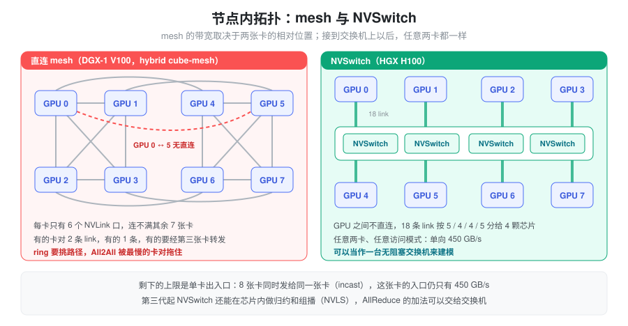
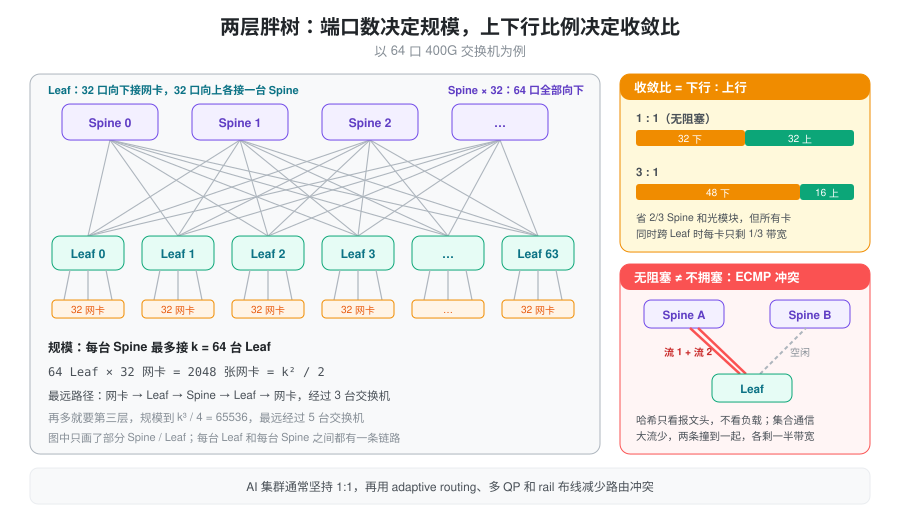
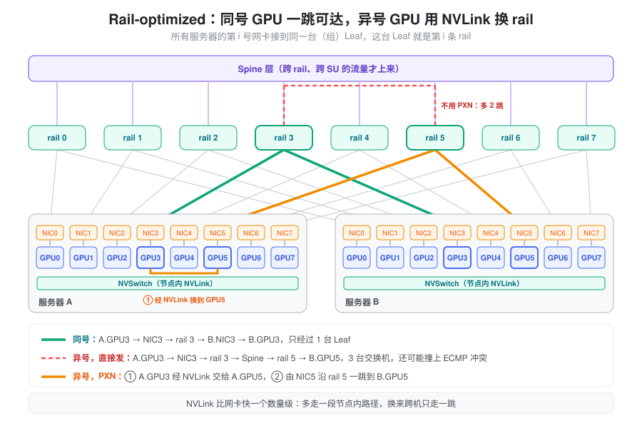
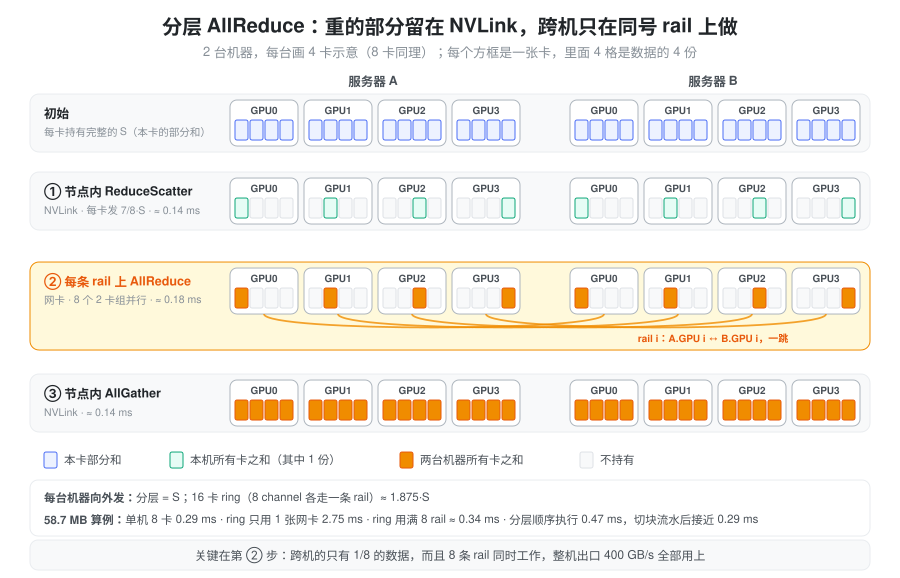

% Topology

### 要解决的问题：同一个 AllReduce，为什么换个摆法就慢好几倍

一个 TP 组每层要做两次 AllReduce。以 hidden = 7168、4096 个 token、BF16 为例，一次 AllReduce 的数据量是

\[
S = 7168 \times 4096 \times 2\ \mathrm{B} \approx 58.7\ \mathrm{MB}
\]

同样是这 58.7 MB，8 张卡在一台 H100 机器里做，大约 0.29 ms。把 TP 扩到 16 张卡、跨两台机器：如果每台机器的 8 张网卡同时用上，约 0.34 ms，只慢一点；如果所有跨机流量挤在一张网卡上，要 2.75 ms，慢了将近 10 倍（算例见后文）。decode 时数据只有几百 KB，带宽项只剩几微秒，每多一次跨机收发带来的网络延迟反而成了大头。机器、卡、代码都没变，变的只是“这些卡在网络里的位置”和“流量走了哪几条路”。

要预判这种差异，就要知道三件事：数据走了哪些链路，哪一段最窄，要走几跳。这就是拓扑（topology）要回答的问题。本页依次讲：

1. 带宽层级：每一层每张卡能分到多少带宽，单向 / 双向和 busbw 怎么换算。
2. 节点内：NVLink 为什么从 mesh 演进到 NVSwitch，switch 里还能做归约。
3. 节点间：胖树怎么按交换机端口数算出规模，收敛比和路由冲突。
4. Rail-optimized：为什么第 \(i\) 号 GPU 都接同一组交换机，NCCL 的 PXN 怎样利用它。
5. 分层集合通信：AllReduce 怎样拆成“节点内 + 每条 rail 上”的几步。
6. 并行策略怎样映射到这些层级，SGLang 怎样排 rank。

NVLink、NVSwitch、网卡、光模块这些部件在物理上是什么、装在哪里，见 [GPU Interconnect](./gpu_interconnect.md)；本页只关心它们连成的图。

### 核心抽象：一次通信 = 在一张分层的图上走路径

把集群看成一张图：节点是 GPU 和交换机，边是链路，每条边有带宽和延迟。一次通信的耗时可以粗略写成

\[
T \approx \underbrace{k \cdot \alpha}_{\text{步数} \times \text{每步延迟}} + \frac{\text{瓶颈链路上的字节数}}{\text{瓶颈链路带宽}}
\]

拓扑决定了公式里的每一项：

- **瓶颈链路是哪一段。** 节点内是 NVLink，跨节点通常是网卡；它们差约一个数量级。
- **瓶颈链路上要过多少字节。** 这由集合通信算法决定，分层算法的目的就是让慢链路少过字节。
- **每步延迟和跳数。** 多经过一台交换机、多一次网卡收发，就多一份延迟；数据量小的时候这一项占主导。

这个图有一个重要的性质：它是**分层嵌套**的。8 张（或 NVL72 里 72 张）卡构成一个 NVLink 域，若干台机器的同号网卡接在同一组 Leaf 下，所有 Leaf 再接到 Spine。越往外，域越大，每卡能分到的带宽越少。所有通信优化，归结起来都是两件事：**把重的流量留在里层**，以及**让必须出去的流量在外层并行地走多条路**。

### 带宽层级

从离计算核心最近到最远，每张卡能用的带宽逐级跌落。下表统一用**每卡单向**带宽，这也是代入通信公式时该用的数：

| 层级 | 介质 | 每卡单向带宽 | 典型延迟 |
| --- | --- | --- | --- |
| 片上 | SRAM / Shared Memory | 数十 TB/s（全部 SM 合计） | ns |
| 显存 | HBM | H100 约 3.35 TB/s，B200 约 8 TB/s | 数百 ns |
| 节点内（Scale-up） | NVLink + NVSwitch | H100 450 GB/s，B200 900 GB/s | µs 量级 |
| Host ↔ GPU | PCIe 5.0 ×16 | 约 63 GB/s | µs 量级 |
| 节点间（Scale-out） | RDMA 网卡（IB / RoCE） | 400G 网卡 50 GB/s，800G 网卡 100 GB/s | 数 µs |

两点要记住：

- **节点内外相差约一个数量级。** H100 配 400G 网卡是 450 : 50 = 9 倍；B200 配 400G 网卡是 18 倍，换 800G 网卡回到 9 倍。
- **网卡带宽是“每卡”的。** 一台 8 卡机器有 8 张网卡，整机出口是 8 × 50 = 400 GB/s。只有当 8 张卡同时往外发、各走各的网卡时，才能用满这 400 GB/s。后面的 rail 和分层算法都是为了做到这一点。

PCIe 不在 GPU 之间的通信路径上（有 NVLink 时），它主要承载 Host ↔ GPU 和 网卡 ↔ GPU 的流量，见 [Host Device Interconnect](./host_device_interconnect.md)。

#### 单向、双向与 busbw

厂商常标双向带宽：H100 的 NVLink 是 900 GB/s 双向，即 450 GB/s 单向。集合通信里每张卡一边发一边收，两个方向各自独立，所以估算时间时用单向带宽。

| 规格 | 双向总带宽 | 单向带宽（填公式用这个） |
| --- | --- | --- |
| NVLink 3（A100，12 条 link） | 600 GB/s | 300 GB/s |
| NVLink 4（H100，18 条 link） | 900 GB/s | 450 GB/s |
| NVLink 5（B200，18 条 link） | 1800 GB/s | 900 GB/s |

`nccl-tests` 输出两列带宽。`algbw` 是“数据量 \(S\) / 耗时”，它和卡数 \(n\) 有关，不便和硬件对比。`busbw` 是把 algbw 乘上一个与原语有关的系数，换算成“每张卡在链路上实际收发的速率”，可以直接和单向链路带宽比较：

| 原语 | 每卡发送量 | busbw / algbw |
| --- | --- | --- |
| AllReduce | \(2\frac{n-1}{n}S\) | \(2\frac{n-1}{n}\) |
| AllGather / ReduceScatter | \(\frac{n-1}{n}S\) | \(\frac{n-1}{n}\) |
| AlltoAll | \(\frac{n-1}{n}S\) | \(\frac{n-1}{n}\) |
| Broadcast / Reduce | \(S\) | 1 |

上表的 \(S\) 都按 nccl-tests 的约定，取单卡上完整 buffer 的大小。

标称带宽是硬件峰值，实测 busbw 通常只有它的 70%–85%：协议开销、同步、流水线没填满都会打折。做容量规划时用实测 busbw，不要直接用标称值。本页后面的估算统一按 80% 打折：H100 NVLink 取 360 GB/s，400G 网卡取 40 GB/s。

### 节点内：从 NVLink mesh 到 NVSwitch

#### Mesh 的问题：链路数分不匀

GPU 的 NVLink 端口数是固定的。V100 有 6 条 NVLink，8 张卡不可能两两直连（那需要每卡 7 个口），所以 DGX-1 用了一种叫 hybrid cube-mesh 的连法：8 卡分成两组 4 卡，组内两两相连，组间再连几条“对角线”。结果是不同卡对之间的链路数不一样：

- 有的卡对之间有 2 条 link，有的只有 1 条；
- 有的卡对之间根本没有直连，要经过第三张卡转发。

这对集合通信很不友好。Ring 算法必须找一条每段都有直连的环；All2All 要求任意两卡都能直接通信，没有直连的卡对只能绕路，速度被最慢的卡对拖住。带宽取决于“这两张卡在 mesh 里的相对位置”，程序很难建模。

#### NVSwitch：每张卡只和交换机相连

NVSwitch 换了一种思路：GPU 不再互相直连，每张卡的全部 NVLink 都接到交换芯片上，由交换芯片转发。以 HGX H100 为例，每颗 GPU 的 18 条 link 分别接到 4 颗 NVSwitch 上，任意两卡之间都能用满单卡的 450 GB/s。

这带来两个可以直接写进模型的性质：

- **与访问模式无关。** 8 张卡同时 All2All，每卡发出的总带宽仍是 450 GB/s。节点内可以近似当作一个无阻塞的交换机。
- **与卡对无关。** GPU 0 → GPU 1 和 GPU 0 → GPU 7 带宽相同，ring 怎么排都一样。SGLang 的 `is_full_nvlink()` 检查的就是这个前提：组内每一对卡都要有 NVLink 直达，否则不启用 custom AllReduce。

单卡的出口带宽仍是上限。8 张卡同时把数据发给同一张卡（incast），这张卡的入口只有 450 GB/s，其余卡要排队。

#### NVLS：在交换芯片里做归约

第三代起的 NVSwitch 支持 NVLink SHARP（NCCL 里叫 NVLS）：交换芯片可以读取多张卡的数据、在芯片内做加法，再把结果组播回去。普通 ring AllReduce 每卡要发送 \(2\frac{n-1}{n}S\)；用 NVLS 时，归约和组播都在 switch 里完成，每卡大约只需发送 \(S\)、接收 \(S\)。理论上 AllReduce 的有效带宽可以接近翻倍，实测提升要小一些，而且只在数据量大时明显。

NVLS 需要额外的显存来注册多播缓冲，SGLang 默认不开。`python/sglang/srt/entrypoints/engine.py` 的 `_set_envs_and_config()` 里，`NCCL_NVLS_ENABLE` 只在传了 `--enable-nccl-nvls` 或 `--enable-symm-mem` 时才被设为 1。

#### NVL72：同一张图放大到一个机柜

GB200 NVL72 把这张“所有 GPU 接到 switch 上”的图放大到 72 卡：18 颗 NVLink Switch 芯片，每颗 GPU 的 18 条 link 各接一颗。对拓扑而言它和 HGX 是同一种结构，只是 scale-up 域从 8 卡变成 72 卡。代价是这 72 卡分布在 18 个操作系统节点上，“节点”和“NVLink 域”不再是一回事，部署时要按 NVLink 域而不是按节点来划分 TP / EP。物理结构见 [GPU Interconnect](./gpu_interconnect.md)。

### 节点间：胖树

节点内靠 NVSwitch，节点间则靠数据中心网络。GPU 集群的计算网络普遍采用**胖树（Fat Tree）**，也就是多级 Clos 网络。目标是让任意两张网卡之间都有接近满速的路径。

#### 一台交换机连不了所有人，所以要分层

单台交换机的端口数有限。以 64 口 400G 的 InfiniBand 交换机为例，最多直接接 64 张网卡。要连更多网卡，就得把交换机分层：

- **Leaf（接入层）**：一半端口向下接网卡，一半端口向上接 Spine。
- **Spine（汇聚层）**：全部端口向下，每个口接一台 Leaf。

用 \(k\) 口交换机搭两层胖树：每台 Leaf 接 \(k/2\) 张网卡，每台 Spine 最多接 \(k\) 台 Leaf，所以最多 \(k\) 台 Leaf、\(k \cdot k/2 = k^2/2\) 张网卡。三层胖树再往上加一层，规模变成 \(k^3/4\)。

| 交换机端口数 \(k\) | 两层最多网卡数 | 三层最多网卡数 |
| --- | --- | --- |
| 64 | 2048 | 65536 |
| 128 | 8192 | 524288 |

计算网络里每张 GPU 一张网卡，所以表里的数就是 GPU 数。两层网络的最远路径是 网卡 → Leaf → Spine → Leaf → 网卡，经过 3 台交换机；三层是 5 台。规模越大，层数越多，跳数和光模块数也越多。

#### 收敛比

**收敛比（oversubscription ratio）**是 Leaf 的下行总带宽和上行总带宽之比。上面的“一半向下、一半向上”就是 1:1，无阻塞：所有网卡同时满速往外发，上行也装得下。如果 Leaf 的 64 个口用 48 个接网卡、16 个接 Spine，收敛比就是 3:1，省了三分之二的 Spine 和光模块，但所有网卡同时跨 Leaf 通信时，每卡只能分到三分之一的带宽。

通用数据中心的流量是随机的、不会同时爆发，收敛比 3:1 甚至更高也能用。LLM 的集合通信不一样：所有卡在同一时刻开始同一个 AllReduce 或 All2All，流量同时爆发。所以 AI 计算网络通常坚持 1:1。

#### 无阻塞不等于不拥塞：路由冲突

1:1 只保证“上行总带宽够”，不保证每条流都能分到一条空闲的路。以太网通常用 ECMP 选路：交换机对报文头做哈希，从多条等价上行链路里选一条。普通业务有成千上万条小流，哈希结果大致均匀。集合通信只有少量大流（每对网卡几条 QP），很容易出现两条大流被哈希到同一条上行链路、而另一条链路空闲的情况，这条流的带宽就被砍半。

解决办法是让交换机按链路负载动态选路（InfiniBand 的 adaptive routing，以太网侧如 Spectrum-X），或者让 NCCL 为每对网卡建多条 QP、把一条大流拆成多条。下一节的 rail-optimized 布线则从另一个角度减少问题：让大部分流量根本不需要经过 Spine。

### Rail-optimized：让同号 GPU 只隔一跳

#### 布线规则

8 卡服务器有 8 张计算网卡，第 \(i\) 号网卡和第 \(i\) 号 GPU 挂在同一个 PCIe Switch 下。Rail-optimized 布线规定：**所有服务器的第 \(i\) 号网卡，都接到同一组 Leaf 上**，这组 Leaf 叫第 \(i\) 条 rail。

以 64 口 Leaf、1:1 收敛为例，每台 Leaf 下行 32 口，正好接 32 台服务器的同号网卡。8 台 Leaf（rail 0–7）加 32 台服务器，构成一个 256 卡的基本单元，NVIDIA 的参考架构里叫 SU（Scalable Unit）。多个 SU 再经 Spine 互联。

这样连有两个结果：

- **同号 GPU 之间只隔一台 Leaf。** 服务器 A 的 GPU 3 发给服务器 B 的 GPU 3：网卡 3 → rail 3 的 Leaf → 网卡 3，一跳，不上 Spine。
- **异号 GPU 之间要么上 Spine，要么先换号。** A 的 GPU 3 发给 B 的 GPU 5，网卡 3 和网卡 5 在不同的 Leaf 上，必须经过 Spine。

#### PXN：先走 NVLink 换到对的 rail

第二种情况有更好的走法。NCCL 2.12 起的 PXN（PCIe × NVLink）机制：A 的 GPU 3 先通过 NVLink 把数据交给本机的 GPU 5，再由 GPU 5 用网卡 5 发出去，沿 rail 5 一跳到达 B 的 GPU 5。NVLink 比网卡快一个数量级，多走这一段几乎不花时间，却省掉了 Spine 上的两跳，也避开了 Spine 上的路由冲突。

PXN 还有一个副作用：节点内的多张卡可以把发往同一个远端 GPU 的消息先汇到一张卡上，合并后再发，减少网卡上的小消息数量。All2All 这类“每卡都要和每卡通信”的模式受益最大。可以用 `NCCL_PXN_DISABLE=1` 关掉它做对比。

这和 DeepEP normal 模式的思路一致：token 先经 RDMA 发到目标节点上同号 rail 的 GPU，再经 NVLink 转给真正持有专家的 GPU。区别只是“换号”发生在发送端还是接收端。

### 分层集合通信：让 8 张网卡同时工作

#### 算例：跨两台机器的 16 卡 AllReduce

回到开头的 58.7 MB AllReduce，2 台 H100 机器、16 张卡。按前面的约定，NVLink 取 360 GB/s，网卡取 40 GB/s。

**单机 8 卡（对照）。** 每卡发送 \(2\cdot\frac{7}{8}S\)，全走 NVLink：

\[
T = \frac{1.75 \times 58.7\ \mathrm{MB}}{360\ \mathrm{GB/s}} \approx 0.29\ \mathrm{ms}
\]

**16 卡 ring，只用一张网卡。** 16 张卡排成一个环，环上每段都要传 \(2\cdot\frac{15}{16}S\)。环只在两处跨机，如果跨机都走同一张网卡，这一段就是瓶颈：

\[
T = \frac{1.875 \times 58.7\ \mathrm{MB}}{40\ \mathrm{GB/s}} \approx 2.75\ \mathrm{ms}
\]

**16 卡 ring，8 张网卡并行。** NCCL 实际会建多个 channel，每个 channel 是一个独立的环，负责 \(1/C\) 的数据。让 8 个环的跨机段分别走 8 张不同的网卡（也就是 8 条 rail），每张网卡只承担 1/8 的流量，跨机段时间降到约 0.34 ms，与此同时 NVLink 段约 0.3 ms，两者流水重叠，总时间约 0.34 ms。

差 8 倍的正是“整机出口 400 GB/s 有没有用满”。这也是为什么网卡和 GPU 的对应关系（哪张卡用哪张网卡）配错了，跨机通信会成倍变慢。

#### 分层算法

另一种做法把 AllReduce 显式拆成三步：

1. **节点内 ReduceScatter**（NVLink）：每台机器内 8 张卡互相归约，GPU \(i\) 拿到第 \(i\) 份、大小 \(S/8\) 的部分和。约 0.14 ms。
2. **跨节点 AllReduce**（每条 rail 一个组）：两台机器的 GPU \(i\) 组成一个 2 卡组，对各自的 \(S/8\) 做 AllReduce。8 个组同时进行，各走各的 rail，都是一跳。约 0.18 ms。
3. **节点内 AllGather**（NVLink）：把 8 份结果拼回完整的 \(S\)。约 0.14 ms。

和 8 rail 的 ring 相比，跨机字节少了：ring 每台机器向外发约 \(1.875S\)，分层算法只发 \(S\)。三步顺序执行总共约 0.47 ms，比 ring 慢；把数据切块流水起来，三步可以重叠，接近 0.29 ms。

节点数多了以后，两种算法在带宽上相差不大（每卡跨机字节都趋近 \(S/4\)），真正的差别在**步数**。Ring 有 \(2(n-1)\) 步，\(n\) 是总卡数，每一步都要等最慢的跨机边；分层算法跨机部分的步数只随节点数增长，换成树形（NCCL 的 Tree 算法用双二叉树）还能降到对数级。所以数据量大时 ring 的带宽效率更好，数据量小、节点多时 tree 的延迟更低。NCCL 会按数据量和拓扑自动在 Ring、Tree、NVLS 等算法之间选择，`NCCL_ALGO` 可以强制指定，`NCCL_DEBUG=INFO` 能看到它建出的 ring / tree。

### 拓扑如何映射到并行

把上面的层级和并行策略对应起来，就是部署时的排布原则：

| 并行 | 通信原语 | 频次与数据量 | 放在哪一层 |
| --- | --- | --- | --- |
| Tensor Parallel (TP) | AllReduce / RS + AG | 每层两次，激活全量 | NVLink 域内 |
| Expert Parallel (EP) | All2All（dispatch / combine） | 每个 MoE 层两次，按路由分散 | NVLink 域内优先；跨节点时依赖 rail + PXN |
| Context Parallel (CP / DCP) | AllGather / P2P | 每层，KV 或部分结果 | NVLink 域内优先 |
| Pipeline Parallel (PP) | P2P（相邻 stage 传激活） | 每个 micro-batch 一次 | 可跨节点 |
| Data Parallel (DP) | 推理期几乎没有 | 低 | 跨节点 |

经验法则是：**通信越频繁、数据量越大，越往里层放**。TP 每层两次全量 AllReduce，抢占 NVLink；PP 只在 stage 边界传一次激活，放到网卡上也无妨。EP 处在中间，它的 All2All 天然要和每张卡通信，所以 EP 跨节点时，网卡和 GPU 的对应关系、rail 布线和 PXN 都会直接影响它的速度。

在 NVL72 上，NVLink 域是 72 卡，这条法则的边界也随之外移：TP、EP 可以在 72 卡内展开，而不必卡在 8 卡。

#### SGLang 怎么排 rank

SGLang 的 rank 编排正好贴合这条法则。`python/sglang/srt/distributed/parallel_state.py` 的 `initialize_model_parallel()` 里：

- TP 组是**连续**的 rank：第 \(g\) 组是 `[g * tp_size, (g + 1) * tp_size)`。
- PP 组是**跨步**的 rank：`range(pp_group_idx, world_size, world_size // pp_size)`，即各个 stage 里 tp_rank 相同的那些卡。

`python/sglang/srt/entrypoints/engine.py` 的 `_calculate_rank_ranges()` 再把 rank 分到节点上：每台机器分到连续的一段 tp_rank，本机 GPU 编号是 `tp_rank % tp_size_per_node`。

于是 `--tp 8 --pp 2 --nnodes 2` 时，每台机器是一个完整的 TP 组，TP 通信全在 NVLink 上；两台机器之间只有 PP 的 P2P，而且是 A 机 GPU \(i\) 对 B 机 GPU \(i\)，正好落在同一条 rail 上。`--tp 16 --nnodes 2` 则会让 TP 组跨机，开头算例里的跨机 AllReduce 就会出现在每一层。

PD 分离的 KV 传输同理：`--disaggregation-ib-device` 可以按 GPU 指定网卡，让每张 GPU 用和它同一个 PCIe Switch 下的网卡，也就是自己那条 rail。

#### 查看实际拓扑

- `nvidia-smi topo -m`：GPU 与 GPU、GPU 与网卡之间的连接类型。`NV18` 是 18 条 NVLink；`PIX` / `PXB` 表示网卡和 GPU 在同一个 PCIe Switch 下，是这张 GPU 应该用的网卡。
- `ibstat` / `ibv_devinfo`：网卡端口速率和状态。
- `NCCL_DEBUG=INFO NCCL_DEBUG_SUBSYS=INIT,GRAPH`：NCCL 探测到的拓扑、每个 channel 用的网卡、建出的 ring / tree。
- `nccl-tests` 的 `all_reduce_perf`：分别在单机 8 卡和跨机 16 卡上跑，对比 busbw 和本页表里的数，可以判断是否用满了 rail。

### 小结

拓扑把“通信要多久”变成一个可以计算的问题：数据走哪几段链路，最窄的那段多宽，要走几跳。GPU 集群的图是分层嵌套的：最里层是 NVSwitch 构成的无阻塞 NVLink 域，每卡数百 GB/s；外层是由 rail 和胖树组成的网卡网络，每卡几十 GB/s，规模由交换机端口数和层数决定。因此优化只有两个方向：把通信最重的 TP、EP 留在 NVLink 域内，让必须跨机的流量按 rail 分散到 8 张网卡上、并尽量只走一跳。Rail-optimized 布线、PXN、分层 AllReduce 和 SGLang 的 rank 编排，都是这两条原则在不同层次上的实现。
