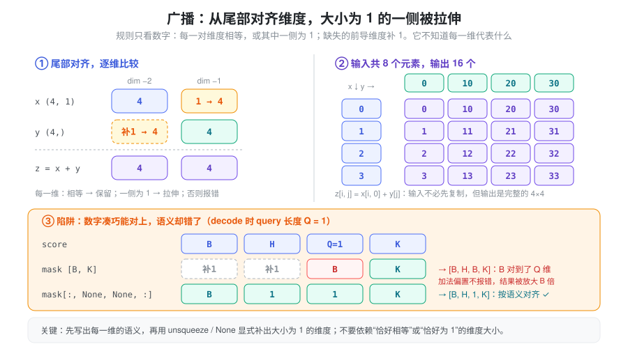
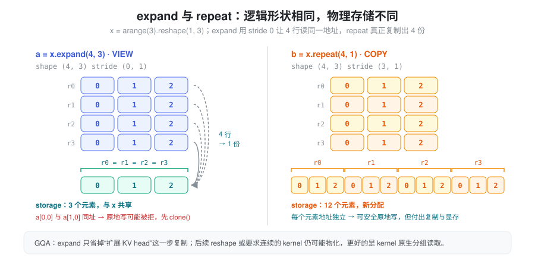
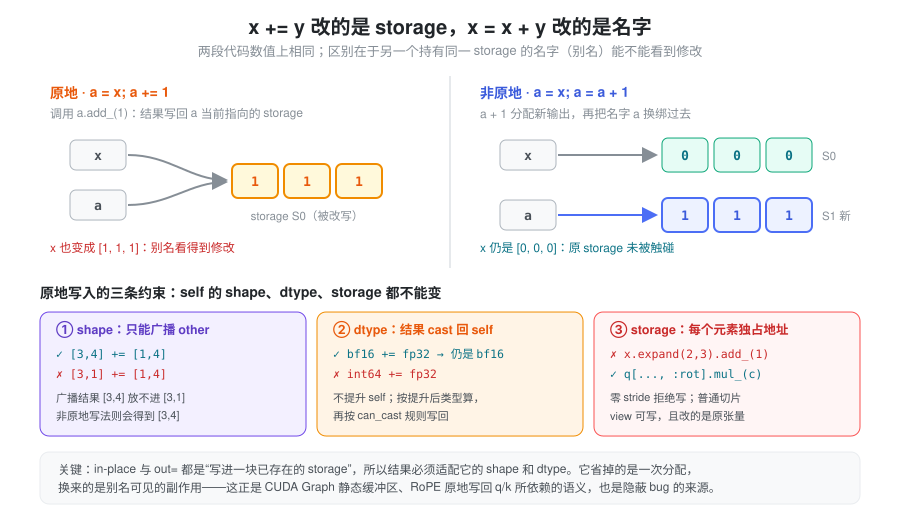
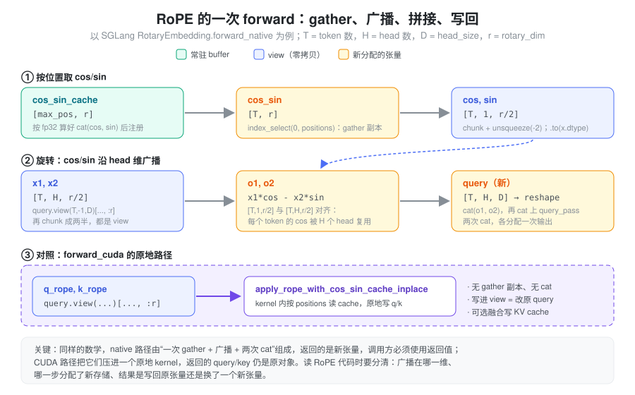

% Torch 广播与索引

- `score + mask` 没有报错，为什么 decode 时 attention 结果整批都不对？
- 都是“把 KV head 扩展到 query head 数”，`expand()` 和 `repeat()` 为什么显存差了好几倍？
- `cache[slots].copy_(values)` 跑完了，为什么 KV cache 里什么都没写进去？
- bf16 的 attention score 加上一个 mask 之后，怎么变成了 fp32、显存还翻了一倍？
- 同样是做 RoPE，为什么一条路径必须接住返回值，另一条路径“返回的还是原来的 query”？

广播和索引代码通常只有一行，却可能隐藏三种完全不同的成本：只改变张量元数据、读取并复制数据、生成远大于输入的计算结果。它们还会悄悄改变语义——维度对错了不一定报错，写错了位置也不一定报错，dtype 变了更不会报错。在 LLM 推理里，attention mask、RoPE、GQA 的 head 扩展、beam 重排和 KV cache 更新都会遇到这些问题。

布局和共享存储的基础见 [Tensor Memory](./torch_tensor_memory.md)。本篇关注：**表达式的 shape、读写语义、结果类型和实际成本是否符合预期。**

### 抽象：每个表达式回答四个问题

读一行广播、索引或逐元素计算代码，可以把它拆成四个彼此独立的问题：

- **形状从哪来**：输出的每一维由哪个输入的哪一维决定？广播只做数字对齐，语义要靠代码自己保证。
- **存储是谁的**：结果是原张量的 view（共享存储、可能零 stride）、新分配的输出，还是被原地写入的已有张量？
- **数据往哪流**：`buffer[idx]` 出现在等号右边是读出（gather 成新张量），出现在左边是写回（scatter 到原存储）；`x += y` 写进 `x` 的存储，`x = x + y` 只是把名字换绑到新输出。
- **类型由谁决定**：输出 dtype 由参与运算的各输入按类型提升规则共同决定；原地写入时则必须能转换回目标张量的 dtype。

四个问题分别对应四类错误：形状推错导致静默的语义错误或输出规模爆炸；存储判断错导致多余复制或非法原地写；读写方向判断错导致“写了个寂寞”或别名被意外修改；类型判断错导致精度损失或悄悄放大的显存与带宽。下面逐一展开。

### 广播：对齐的是维度，不是语义

广播从尾部对齐维度；每一对维度的大小必须相等，或者其中一侧为 `1`，缺失的前导维度按 `1` 处理。它不会判断某一维到底表示 batch、token 还是 head。规则见官方 [Broadcasting semantics](https://docs.pytorch.org/docs/stable/notes/broadcasting.html)。



```python
import torch

x = torch.zeros(4, 1)
y = torch.zeros(4)
z = x + y
assert z.shape == (4, 4)  # y 被视为 (1, 4)，不是 (4, 1)
```

这里两个输入共八个元素，输出却有十六个。广播本身无需先复制输入，但消费广播结果的算子仍要完成相应规模的计算；普通 eager 加法也会分配输出。编译融合可能省去中间结果的存储，不能据此忽略计算规模。

图中第三部分是推理里最典型的陷阱：score 为 `[batch, head, query, key]`，每个请求的 key mask 为 `[batch, key]`。直接相加时，mask 的 batch 维对到了 query 维；decode 时 query 长度恰好为 1，于是不报错，输出却被广播成 `[B, H, B, K]`。应显式写成 `mask[:, None, None, :]` 变成 `[batch, 1, 1, key]`，不要依赖“恰好相等”或“恰好为 1”的维度大小。

### expand 与 repeat：逻辑复用和物理复制

| 操作 | 如何扩展 | 存储与写入 |
| --- | --- | --- |
| `expand()` | 把大小为 `1` 的维度扩展，用零 stride 表达重复访问 | 共享原存储，多个逻辑元素可能指向同一地址 |
| `repeat()` | 把数据按指定次数复制 | 分配新存储，元素独立 |
| `expand(...).clone()` | 先逻辑扩展，再物化 | 得到可独立写入的副本 |



```python
x = torch.arange(3).reshape(1, 3)
a = x.expand(4, 3)
b = x.repeat(4, 1)
assert a.stride() == (0, 1)
assert b.stride() == (3, 1)
```

两者逻辑形状相同，区别全在 stride：`a` 的四行都读取同一行内存。对它执行需要逐元素独立写入的原地操作是不安全的，可能被 PyTorch 拒绝；应先 `clone()`。零 stride 和写入限制见 [Tensor.expand](https://docs.pytorch.org/docs/stable/generated/torch.Tensor.expand.html)，复制语义见 [Tensor.repeat](https://docs.pytorch.org/docs/stable/generated/torch.Tensor.repeat.html)。

在 GQA 中，把 KV head 扩展到 query head 数量时，`expand()` 可以省去某一步复制，但后续 `reshape()` 是否物化、kernel 是否支持零 stride，仍需检查。不能仅凭代码出现 `expand()` 就认定整个路径零拷贝。支持 GQA 的 attention kernel 可以直接处理 head 分组，避免显式扩展。

### 索引读取与索引赋值需要分开理解

基础切片读取通常是 view，高级索引读取通常是 copy；但高级索引位于赋值左侧时，会写回原张量，不是先生成一个副本再修改副本。见 [Tensor Views](https://docs.pytorch.org/docs/main/tensor_view.html)。

![同一个 buffer[idx] 的读与写](../docs/WikiImage/torch_broadcast_indexing_read_write.svg)

```python
cache = torch.zeros(8, 2)
slots = torch.tensor([1, 4])
values = torch.ones(2, 2)

selected = cache[slots]   # 高级索引读取：副本
selected.fill_(7)        # cache 不会跟着变
cache[slots] = values    # 高级索引赋值：写回 cache
```

原因在于 Python 的求值方式：`cache[slots] = values` 会被翻译成一次 `__setitem__`，PyTorch 据此调用 `index_put_` 直接修改原存储；而 `cache[slots].copy_(values)` 先执行 `__getitem__` 得到 gather 出的临时副本，再对副本 `copy_`，cache 不变。读写方向由 `buffer[idx]` 在表达式中的位置决定，而不是由后面跟着什么方法决定。这正对应 KV cache 中“gather 得到的 K/V”和“向 slot 写入新 K/V”的区别。

如果写入下标重复，不能把并发写入想象成 Python 循环里稳定的“最后一次覆盖”。`index_put_` 在 `accumulate=False` 时对重复下标的行为未定义；累加也需另行考虑浮点归约顺序。见 [Tensor.index_put_](https://docs.pytorch.org/docs/stable/generated/torch.Tensor.index_put_.html)。

### 动态索引还可能带来同步

整数下标张量的元素数量已由元数据给出；布尔 mask 的选中数量则取决于数据内容。因此不能把所有高级索引都理解成同样的固定成本操作。

CUDA 上的 `torch.nonzero()` 会引入 host-device 同步，布尔 mask 索引需要先知道选中数量，也会有类似效果。decode 热路径中的 `mask.nonzero()`，可能既生成动态长度结果，又让 CPU 等待 GPU，还会妨碍 CUDA Graph 捕获。见 [torch.nonzero](https://docs.pytorch.org/docs/stable/generated/torch.nonzero.html) 和 [CUDA 异步执行](./torch_cuda_execution.md)。

### In-place 与 out=：写进一块已存在的存储

非原地运算 `x = x + y` 做两件事：分配新输出，再把 Python 名字 `x` 换绑过去，原 storage 不受影响。原地运算 `x += y`（即 `x.add_(y)`）则把结果写回 `x` 当前指向的 storage。两者数值相同，差别只在**别名**：如果还有别的张量与 `x` 共享这块 storage——另一个名字、一个切片 view、一个被缓存起来的输入——原地写会让它们一起变。



“写进已存在的存储”决定了原地运算的三条约束，它们都在说：self 的 shape、dtype 和存储布局不能因为这次运算而改变。

- **shape**：广播只能作用在另一侧。`[3, 4] += [1, 4]` 可以，`[3, 1] += [1, 4]` 会报错，因为广播结果 `[3, 4]` 放不进 `[3, 1]`；同样的表达式写成非原地形式则静默得到 `[3, 4]`。
- **dtype**：self 不会被提升。运算仍按提升后的公共类型进行，再转换回 self 的 dtype，且必须满足 `torch.can_cast`：`bf16_x += fp32_y` 合法，结果仍是 bf16；`int64_x += fp32_y` 报错，因为浮点不能隐式写回整数。见 [Type promotion](https://docs.pytorch.org/docs/stable/tensor_attributes.html#type-promotion-doc)。
- **存储**：被写入的每个逻辑元素必须对应独立地址。`expand()` 出的零 stride view 会被拒绝（“more than one element of the written-to tensor refers to a single memory location”）；普通切片 view 可以写，且写的就是原张量。

`out=` 参数遵循同样的规则：输出写进调用方给定的张量，结果 dtype 必须能转换过去，shape 不符时会被调整大小（并给出警告）或报错。它和原地运算的共同价值在于**地址不变**——CUDA Graph 的静态输入缓冲区依赖 `buf.copy_(new)` 而不是 `buf = new`，正是这个原因（见 [Kernel 与编译执行](./torch_kernel_compile.md)）。

原地运算省掉的是一次输出分配，不减少计算量，也不减少对输入的读取；它还可能迫使调用方额外 `clone()` 来保护仍要使用的旧值。判断是否该用原地写，应先回答“还有谁持有这块 storage”。

### 隐式拷贝与隐式类型转换

除了显式的 `clone()`、`contiguous()`，下面这些写法也会分配新存储，而代码上未必看得出来：

| 写法 | 为什么会复制 | 推理里常见的位置 |
| --- | --- | --- |
| `torch.cat` / `torch.stack` | 输出需要一块能同时容纳所有输入的新连续存储，无法用一组 stride 拼出 | RoPE 的 `rotate_half`、拼接 `rot` 与 `pass` 部分 |
| 布尔 mask 读取 `x[mask]` | gather 成新张量，长度依赖数据，还可能同步 | 过滤无效 token |
| `.to(dtype)`、混合 dtype 运算 | 新 dtype 需要新存储；提升后的输出按更宽的类型分配 | mask 与 score 相加、cos/sin 转换 dtype |
| 非连续输入交给要求连续的 kernel | 算子内部可能先物化一份连续副本 | `transpose` 后的 QKV 交给自定义 kernel |

还有一个反向的隐式行为：逐元素算子的输出通常沿用输入的布局。对转置后的 `[8, 4]` 张量执行 `x + 1`，输出 stride 仍可能是 `(1, 8)`，即 **算子输出不保证连续**。

类型提升在表达式里的位置值得单独留意：Python 标量和 0 维张量通常不会把同类别的张量提升到更宽的类型（`bf16_tensor * 2.5` 仍是 bf16）；两个不同 dtype 的多维张量相遇时，结果取更宽的那个（`bf16 + fp32` 得到 fp32）；布尔张量与 Python 浮点数相乘，结果取默认浮点类型（通常是 fp32）。因此只要表达式中混入了一个 fp32 张量，后续所有中间结果都可能变成 fp32——数值更精确，但显存和带宽也随之翻倍。格式范围、累加精度和 `autocast` 的规则见 [dtype 与数值精度](./torch_numerical_precision.md) 和 [Tensor 数据类型](./torch_dtype.md)。

### 在 SGLang 中：Attention Mask 的广播与类型

attention score 的形状是 `[B, H, Sq, Sk]`，mask 一般不按这个形状存：按样本区分、各 head 共享时是 `[B, 1, Sq, Sk]`，所有样本共用一张因果 mask 时是 `[1, 1, S, S]`，相加或交给 SDPA 时再广播到 head 和 batch 维。mask 有两种表示，语义相反、容易混用：

- **布尔 mask**：交给 SDPA 的 `attn_mask` 时 `True` 表示允许参与 attention；
- **加性 mask**：一个浮点张量，允许的位置为 `0`，屏蔽的位置为一个很大的负数，直接加到 score 上。

加性 mask 的“很大的负数”不宜随手写 `-inf`：如果某一行全部被屏蔽（例如 padding 出来的 query 行），softmax 会得到 `-inf - (-inf)`，整行变成 NaN；用 `torch.finfo(dtype).min` 则得到一行有限的均匀分布，padding 行的输出事后丢弃即可。此外加性 mask 本身有 dtype，和 score 的 dtype 不一致就会触发类型提升。

`layers/attention/vision.py` 中的 `VisionSdpaAttention` 把这几点都用上了：

- **用广播构造 mask。** `_generate_mask_cache()` 把 `row_indices` 设为 `[1, 1, 1, s]`、`col_indices` 设为 `[1, 1, s, 1]`、每个样本的长度 `seq_lens` 设为 `[b, 1, 1, 1]`，一句 `(row_indices < seq_lens) & (col_indices < seq_lens)` 就广播出 `[b, 1, s, s]` 的布尔 mask——第二维的 `1` 留给 head 维广播。`flatten_batch` 时则先建 `[1, s, s]` 全 False，再用切片赋值把每段 `[start:end, start:end]` 置 True。该函数带 `lru_cache`，以 `cu_seqlens` 的 tuple 为键；生成这个 tuple 需要 `cu_seqlens.cpu().tolist()`，若 `cu_seqlens` 在 GPU 上，这是一次同步。
- **SDPA 路径直接传布尔 mask**，`is_causal=False`，广播由 SDPA 内部处理。
- **单精度 softmax 路径改成加性 mask。** `softmax_in_single_precision` 为真时执行 `attention_mask = (~attention_mask) * torch.finfo(q.dtype).min`，再 `attn_weights + attention_mask`。这里有两次隐式行为：布尔张量乘 Python 浮点数得到默认浮点类型（fp32）的 `[b, 1, s, s]`；它与 bf16 的 `attn_weights` 相加时既沿 head 维广播，又把整个 `[b, h, s, s]` 的结果提升为 fp32。随后 `softmax(..., dtype=torch.float32).to(q.dtype)` 再转回。对这条“单精度 softmax”路径来说提升符合意图，但它的代价是一个完整的 fp32 score 张量，这是把 mask 放进加法而不是交给融合 kernel 的成本。

### 在 SGLang 中：RoPE 的广播与写回

RoPE 把每个 token 位置对应的 cos/sin 作用到 q、k 的前 `rotary_dim` 维上。它同时用到了本篇的每一个概念：按位置 gather、沿 head 维广播、`cat` 的隐式分配，以及原地写回。实现在 `layers/rotary_embedding/`：`base.py` 的 `RotaryEmbedding`，以及 `utils.py` 中的基础函数。



- **cos/sin 表与 gather。** `_compute_cos_sin_cache()` 用 fp32 算出 `cat((cos, sin), dim=-1)`，形状 `[max_pos, rotary_dim]`，作为非持久 buffer 注册为 `cos_sin_cache`。`forward_native()` 用 `cos_sin_cache.index_select(0, positions)` 取出本批 token 的行，这是一次 gather 副本，形状 `[T, rotary_dim]`，随后 `chunk(2, dim=-1)` 切出 cos、sin 两个 view。
- **沿 head 维广播。** `utils.py` 的 `apply_rotary_emb()` 中，`x` 是 `[num_tokens, num_heads, head_size]`，cos/sin 是 `[num_tokens, head_size // 2]`；`cos.unsqueeze(-2)` 把它变成 `[T, 1, r/2]`，与 `[T, H, r/2]` 的 `x1`、`x2` 广播相乘——每个 token 的一行 cos 被所有 head 复用，不需要 `repeat`。同一行的 `.to(x.dtype)` 先把 cos/sin 转成 q 的 dtype，避免 fp32 表把整个旋转结果提升成 fp32。同文件的 `apply_rotary_pos_emb_native_eager()` 则相反，显式 `q.float()` 后在 fp32 中计算再转回：计算精度是代码选择的，不是自动发生的。
- **`cat` 的隐式分配。** Neox 风格下 `torch.chunk(x, 2, dim=-1)` 得到两个 view，`o1 = x1 * cos - x2 * sin` 等是新输出，`torch.cat((o1, o2), dim=-1)` 再分配一次；`forward_native()` 又用 `torch.cat((query_rot, query_pass), dim=-1)` 拼回不旋转的部分。`rotate_neox()`、HF 风格的 `rotate_half()` 也都以 `cat` 结尾。所以 native 路径**返回的是新张量**，调用方必须使用返回值。
- **CUDA 路径原地写回。** `forward_cuda()` 在不使用 fallback kernel 时，取 `query.view(batch_size, -1, self.head_size)`，若 `head_size != rotary_dim` 再切 `[..., : self.rotary_dim]`——都是 view；然后调用 `apply_rope_with_cos_sin_cache_inplace()`（来自 `sglang.kernels.ops.attention.rope`），在一个 kernel 内按 `positions` 读 `cos_sin_cache`、原地写回 q/k，没有 gather 副本也没有 `cat`。因为写的是 view，改动直接落在原 `query`/`key` 上，函数最后 `return query, key` 返回的仍是原对象。传入 `fused_set_kv_buffer_arg` 时，这个 kernel 还会顺带把 k/v 写进 KV cache。

在 CUDA 上，`forward_native()` 只在特定条件下使用：设置了 deterministic 的 `rl_on_policy_target` 或运行在 MUSA 上时，`RotaryEmbedding` 把它选为 forward，并用 `torch.compile` 包装 `apply_rotary_emb`，让其中那串逐元素运算和 `cat` 有机会融合；CPU、NPU 等后端在部分条件下也会回落到它。

### 在 SGLang 中：KV cache 的一读一写

SGLang 的 KV cache 正是图中那个“按 slot 编号的大 buffer”，读写两侧分别落在不同模块（基于当前 `python/sglang/srt/`）：

- **写：索引赋值，必要时换成专用 kernel。** `mem_cache/memory_pool.py` 中 `MHATokenToKVPool.set_kv_buffer()` 从 `loc_info` 解出本步新 token 的 slot（即 `forward_batch.out_cache_loc`），交给 `_set_kv_buffer_impl()`。CUDA/HIP 上行宽满足条件时调用 `store_cache` kernel；否则回落到最朴素的 `k_cache[indices] = k`、`v_cache[indices] = v`——赋值左侧的高级索引，直接写原存储。CUDA Graph 捕获模式下还会把 V 的写入放到另一条 stream 上，与 K 的写入并行，再用 `wait_stream` 接回。同文件里还有一处细节：fp8 KV 以 `torch.uint8` 存储，注释说明原因是 `index_put` 不支持 `float8_e5m2`。
- **读：先切片得到下标，再 gather。** `layers/attention/torch_native_backend.py` 逐请求执行 `per_req_tokens = req_to_token[req_pool_idx, start_kv:end_kv]`——这是普通切片，拿到的是 slot 编号的 view；随后 `k_cache[per_req_tokens]` 是高级索引读取，复制出该请求的 K/V，再用 `movedim` 调整维度顺序（view，不复制）。这一读一写的复制成本，是这个后端只适合做对照与兜底的原因之一（见 [Kernel 与编译执行](./torch_kernel_compile.md)）。
- **GQA 不显式扩展。** 同一后端用 `use_gqa = layer.tp_q_head_num != layer.tp_k_head_num` 判断是否分组，并把它作为 `enable_gqa` 传给 SDPA，由 attention 实现处理 head 分组，而不是先 `expand`/`repeat` KV head。

高性能后端（FlashInfer、FlashAttention 等）则把 `kv_indices` 或 page table 直接交给 kernel，在 kernel 内部按下标读取，避免先 gather 出完整 K/V；KV 池的组织方式见 [Memory Pool](./memory_pool.md) 与 [Paged Attention](./paged_attention.md)。

### 读代码时的检查顺序

1. 写出输入、输出每一维的语义，而不只看数字。
2. 判断广播后的结果规模；可以先用 `torch.broadcast_shapes()` 检查。
3. 区分 view、复制读取与写回原张量；看 `buffer[idx]` 在等号的哪一侧。
4. 遇到原地运算或 `out=`，确认还有谁共享这块 storage，以及结果能否放进它的 shape 和 dtype。
5. 写出每个中间结果的 dtype，找出混入的 fp32 张量和 `cat`、`.to()` 这类隐式分配。
6. 检查零 stride、重复下标和动态输出长度。
7. 检查后续 kernel 是否要求物化，是否出现隐式同步。

### 小结

广播、索引和逐元素运算的每一行代码都同时回答了四个问题：形状从哪来、存储是谁的、数据往哪流、类型由谁决定。广播减少输入复制，并不自动减少输出规模，也不检查维度语义；`expand` 省掉复制，却换来零 stride 和写入限制；同样的 `buffer[idx]`，在等号左边是写回原存储，在右边是 gather 出的副本；`x += y` 让别名看到修改，`x = x + y` 只是换绑名字；一个混入的 fp32 张量就能让整条表达式变宽。Attention mask 和 RoPE 把这些规则集中在了几行代码里：把 shape 推导、存储读写和 dtype 一起看，才能判断推理代码是否既正确又高效。
