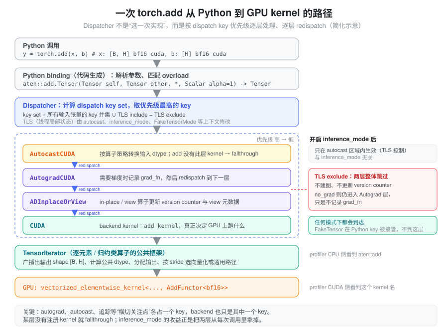
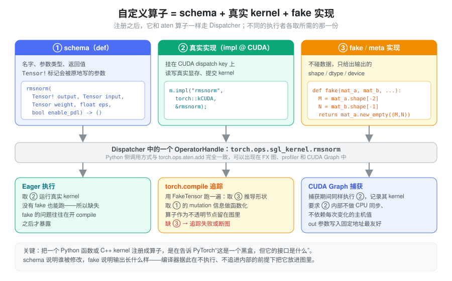

% Torch 算子调度

- profiler 里一行 `torch.add(x, b)` 先出现 CPU 侧的 `aten::add`，GPU 侧却是一个叫 `vectorized_elementwise_kernel<...>` 的东西，这中间发生了什么？
- 同一个 `x + b`，在 autocast 里、`inference_mode` 里、`torch.compile` 追踪时，各自走的是同一段代码吗？
- 一个自己写的 CUDA kernel，为什么不能直接从 Python 调用了事，而要“注册成 torch 算子”，还要额外写一个不碰数据的 fake 实现？

这些问题都落在同一个位置：**Python 调用与 GPU kernel 之间的那层调度。** 本篇只讲这一层——一次调用如何被识别成哪个算子、经过哪些处理、最终选中哪个实现。融合、`torch.compile` 的 guard、SDPA 后端选择等“kernel 层”话题见 [kernel 与编译执行](./torch_kernel_compile.md)。

### 问题：一个算子要同时服务很多“执行者”

`add` 这个数学运算只有一个，但对它的调用可能来自完全不同的上下文：

- 训练时需要记录反向图（autograd）；推理时希望这部分开销为零；
- autocast 区域内，输入要先按算子策略转换 dtype；
- 张量可能在 CPU、CUDA、其他加速器上，各自需要不同实现；
- `torch.compile` 追踪时根本不想算真实数据，只想知道输出的 shape 和 dtype；
- vmap、functionalization、tensor 子类等机制也想“插一脚”。

朴素做法是在每个算子实现里写一串 `if requires_grad ... if autocast ... if device == cuda ...`。PyTorch 有两千多个算子，这样做既无法维护，也让每加一种机制都要改遍所有算子。需要的是一种办法：**让这些横切关注点（cross-cutting concerns）与算子本身的计算解耦，各自独立地挂进去。**

### 抽象：算子是一张按 dispatch key 索引的表

PyTorch 的解法分两步。

第一步，**把算子从实现中剥离出来，变成一个有名字、有签名的对象。** 每个 ATen 算子由 schema 描述，例如：

```text
aten::add.Tensor(Tensor self, Tensor other, *, Scalar alpha=1) -> Tensor
```

`aten` 是命名空间，`add` 是算子名，`.Tensor` 是 overload 名——同名算子按参数类型区分，`add.Scalar`、`add.out` 都是别的 overload。schema 还用 `Tensor(a!)` 一类标注说明哪个参数被原地修改、输出是否与输入别名。Python 的 `torch.add`、`Tensor.__add__`、`torch.ops.aten.add.Tensor` 最终都落到同一个算子对象上。

第二步，**每个算子不是一个函数，而是一张“dispatch key → kernel”的表。** autograd、autocast、CUDA、CPU、Meta 等各是一个 dispatch key，有固定的优先级。每次调用时，Dispatcher 计算本次的 key 集合：

```text
key set = 所有输入张量自带的 key 的并集  ∪  线程局部 include  −  线程局部 exclude
```

张量自带的 key 来自它的 device 和属性（CUDA 张量带 `CUDA`、`AutogradCUDA` 等）；线程局部状态（TLS）则由 autocast、`inference_mode`、FakeTensor mode 这类上下文管理器修改。Dispatcher 取集合中**优先级最高**的 key 去查表、调用对应 kernel。

关键在于后半句：被调用的那层 kernel 做完自己的事，通常会**把自己的 key 排除掉，再 redispatch**，于是调用落到下一个 key。整个过程像剥洋葱：



几个直接推论：

- **autograd 不是算子内部的逻辑，而是一层包装。** `AutogradCUDA` 层的 kernel 负责记录 `grad_fn`，然后 redispatch；真正的加法在下面的 `CUDA` 层。
- **某层不关心某个算子，就注册 fallthrough。** autocast 只为 matmul、conv 等列表内的算子提供 kernel，`add` 在这一层直接穿过。
- **backend 只是众多 key 中的一个。** 设备选择与 autograd、autocast 用的是同一套机制，只是优先级最低、离数据最近。
- **新机制可以只加一个 key。** FakeTensor 通过 `Python` key 截获调用，它的优先级低于 autograd、高于 backend，所以在追踪时仍会经过 autograd 层，但不会进入真实 CUDA kernel。

### inference_mode 省掉的就是两层洋葱

有了 key 的视角，`no_grad` 与 `inference_mode` 的差别就很具体了（语义层面的区别见 [推理模式与状态](./torch_inference_mode.md)）：

| 上下文 | Autograd 层 | ADInplaceOrView 层 | 产生的张量 |
| --- | --- | --- | --- |
| 默认 | 进入，可能记录 `grad_fn` | 进入，in-place/view 时维护 version counter 与 view 关系 | 普通张量 |
| `no_grad` | 仍进入，检查 grad mode 后不记录 | 仍进入 | 普通张量 |
| `inference_mode` | 通过 TLS exclude 整体跳过 | 同样跳过 | inference tensor，不带 version counter |

所以 `inference_mode` 的收益来自每次调用少走两层 kernel、少维护一些元数据；它不改变 backend kernel，GPU 上执行的计算完全相同。在 batch 很小、算子很多的 decode 中，这类 CPU 侧开销才有可能显著；在 GPU 已经满载的 prefill 中通常不明显。

### backend 层：一个 op 不等于一个 kernel

调度到 `CUDA` key 之后，事情还没有结束。backend kernel 内部又分几种情况：

- **逐元素与归约算子走 TensorIterator。** 它统一处理广播出输出 shape、按类型提升规则确定计算 dtype、分配输出、合并可以合并的维度，再根据 stride 和对齐情况选择向量化路径或通用的按索引计算路径。所以输入非连续、dtype 混合，并不一定报错，但可能走慢一点的路径或多一次类型转换。广播语义见 [广播与索引](./torch_broadcast_indexing.md)，类型提升见 [dtype 与数值精度](./torch_numerical_precision.md)。
- **矩阵乘法调用厂商库。** `aten::mm`、`aten::addmm` 的 CUDA 实现通常转给 cuBLAS / cuBLASLt，profiler 里看到的是 `sm90_xmma_gemm_...`、`cutlass_...` 一类名字，而不是 `mm`。
- **组合算子（composite）由其他算子拼成。** 有些 ATen 算子没有自己的 backend kernel，而是调用其他算子实现，例如 `linear` 会分解为转置与 `addmm`/`matmul` 等。一次 Python 调用于是展开成若干 `aten::` 子调用，每个可能各对应零个或多个 kernel。
- **元数据算子没有 kernel。** `view`、`transpose`、`expand` 只改 shape/stride（见 [张量内存](./torch_tensor_memory.md)），在 GPU 上什么都不跑；反之 `.contiguous()`、`.to()` 在需要时会悄悄插入 `aten::copy_`。

结论是：**Python 一行代码 → 一个或多个 ATen 算子 → 零个、一个或多个 GPU kernel。** 估计 GPU 工作量要看 profiler，不能看代码行数。

### 在 profiler 里认出这条路径

`torch.profiler` 在 Dispatcher 处埋点，因此 CPU 一侧按算子名嵌套显示，CUDA 一侧是真正的 kernel 名，两者通过 launch 关联。读 trace 时可以把名字当作调度路径的“化石”：

| 看到的名字 | 说明 |
| --- | --- |
| `aten::linear` 下嵌套 `aten::t`、`aten::addmm` | 组合算子在分解；外层的 CPU 时间包含内层 |
| `aten::to` / `aten::_to_copy` / `aten::copy_` | 发生了 dtype 或设备转换、或为满足布局要求的复制 |
| `aten::empty` / `aten::empty_strided` | 分配输出；频繁出现说明中间张量多 |
| `aten::item` / `aten::_local_scalar_dense` | 读取设备值到主机，通常意味着同步（见 [CUDA 异步执行](./torch_cuda_execution.md)） |
| `sgl_kernel::rmsnorm`、`sglang::...` | 自定义算子，和 `aten::` 一样经过 Dispatcher |
| CPU 侧有算子、CUDA 侧没有 kernel | 元数据算子，或 kernel 由下层其他算子发出 |

判断 dispatch 开销是否是瓶颈，看的是 GPU kernel 之间的空隙，而不是 `aten::` 行的 CPU 耗时本身。CUDA Graph 在 replay 时完全不经过 Python 和 Dispatcher——整条洋葱路径只在 capture 时走一遍，这正是它能消除这部分开销的原因（见 [Cuda Graph](./cuda_graph.md)）。

### 自定义算子：把黑盒接入调度表

写了一个 CUDA/Triton kernel，用 pybind11 暴露成普通 Python 函数，eager 下当然能跑。问题出在其他“执行者”身上：`torch.compile` 追踪时会尝试钻进这个函数，遇到 Triton JIT、文件 I/O 或主机端逻辑就断图或失败；就算它不钻进去，也无法知道这个函数的输出 shape、改写了哪个参数，因而无法把它安全地放进图里。

注册成 torch 算子就是给这个黑盒补上一张“调度表条目”，由三部分组成：



1. **schema**：名字和签名。`Tensor!`（或 Python 侧的 `mutates_args`）声明哪个参数会被原地写——编译器做 functionalization、判断依赖关系都靠它，写错会导致结果被错误重排或复用。
2. **真实实现**：挂在 `CUDA` 等 backend key 上，eager 执行和 CUDA Graph 捕获时调用。
3. **fake 实现**：挂在 Meta/Fake 路径上，只根据输入元数据构造输出（通常是 `new_empty`/`empty_like`），不读写真实数据。`torch.compile` 用 FakeTensor 追踪时调用它推导 shape，算子本身作为不透明节点留在图里。

接口有三档：C++ 的 `TORCH_LIBRARY`/`TORCH_LIBRARY_FRAGMENT` 加 `m.def`/`m.impl`；Python 的底层 `torch.library.Library` 加 `define`/`impl`/`_register_fake`；以及高层的 `torch.library.custom_op` 装饰器。高层接口会自动处理 autograd、functionalization 等更多 key，便利但每次调用的 Python 侧开销更大。见 [Custom Operators](https://docs.pytorch.org/tutorials/advanced/custom_ops_landing_page.html)。

### 在 SGLang 中：两套注册路径

SGLang 同时用了 C++ 和 Python 两种方式（基于当前 `python/sglang/` 代码）。

**C++ kernel：`sgl_kernel` 命名空间。** `kernels/aot/csrc/common_extension.cc` 中的 `TORCH_LIBRARY_FRAGMENT(sgl_kernel, m)` 逐个注册 kernel，例如：

```cpp
m.def("rmsnorm(Tensor! output, Tensor input, Tensor weight, float eps, bool enable_pdl) -> ()");
m.impl("rmsnorm", torch::kCUDA, &rmsnorm);
```

schema 用 `Tensor! output` 和 `-> ()` 声明这是写入调用方提供的输出缓冲区的算子，只注册了 `kCUDA` 实现，没有 autograd 公式——它只为推理服务。Python 包装 `kernels/aot/python/sgl_kernel/elementwise.py` 先 `torch.empty_like(input)` 分配输出，再调用 `torch.ops.sgl_kernel.rmsnorm.default(...)`：直接取 `.default` overload，省去按参数匹配 overload 的步骤。这些 C++ 算子的 fake 实现在 Python 侧按需补上，例如 `srt/layers/quantization/fp8_utils.py` 用 `register_fake_if_exists("sgl_kernel::fp8_scaled_mm")` 注册一个只返回 `mat_a.new_empty((M, N), dtype=out_dtype)` 的函数；`register_fake_if_exists`（`srt/utils/patch_torch.py`）在算子不存在时跳过，以适配不同的 kernel 构建。

**Python 函数：`sglang` 命名空间。** `srt/utils/common.py` 定义了 `sglang_lib = Library("sglang", "FRAGMENT")` 和 `direct_register_custom_op()`：用 `torch.library.infer_schema` 从类型注解推出 schema，`define` 后把函数直接 `impl` 到 `CUDA` key（NPU、XPU、MUSA 上换成对应 key），有 fake 实现时再 `_register_fake`。源码注释说明了为什么不用 `torch.library.custom_op`——后者要处理复杂的调度逻辑，开销明显，而直接注册到 backend key 只多一次 Dispatcher 查表。日常使用的是 `srt/utils/custom_op.py` 里的 `@register_custom_op` 装饰器，它在内部调用 `direct_register_custom_op`，并可以根据 `out_shape` 自动生成 fake（对指定参数 `empty_like`），原地算子则不需要输出。装饰后返回的是 `torch.ops.sglang.<op_name>` 本身，所以之后的调用都经过 Dispatcher。

这条路径最重要的用户是 attention。`srt/layers/radix_attention.py` 中：

```python
@register_custom_op(mutates_args=["output"])
@register_split_op()
def unified_attention_with_output(query, key, value, output, save_kv_cache, layer_id, ...) -> None:
```

attention 的实现依赖运行时的 `ForwardBatch`、KV cache 索引和后端选择，不适合被 Dynamo 追踪展开。注册成算子后，它在 FX 图里只是一个写入 `output` 的节点；`register_split_op()` 再把 `sglang.unified_attention_with_output` 加入 `SPLIT_OPS`，`compilation/backend.py` 的 `split_graph()` 在这些节点处把图切开，attention 之间的部分分别编译、捕获，形成 piecewise CUDA Graph。对 flashinfer 这类在内部做 JIT 编译或动态加载的外部函数，`register_custom_op_from_extern()`（同在 `custom_op.py`）做的是同样的事：把它包成不透明算子，用 fake 实现传播 shape/dtype。

### 小结

Dispatcher 把“一个算子”变成“一张按 dispatch key 索引的表”：autograd、autocast、追踪、backend 各占一层，每次调用按 key 优先级剥洋葱、逐层 redispatch，最后才落到真正的 kernel，而 backend kernel 本身又可能拆成多个 GPU kernel 或零个。理解了这张表，就能解释 `inference_mode` 省下了什么、profiler 里的 `aten::` 名字意味着什么，以及为什么自定义 kernel 要以“schema + 真实实现 + fake 实现”的形式注册——只有进了这张表，它才能和 `torch.compile`、CUDA Graph 等其他执行者协作，SGLang 的 `sgl_kernel` 与 `sglang` 两个算子命名空间正是这样接入的。
