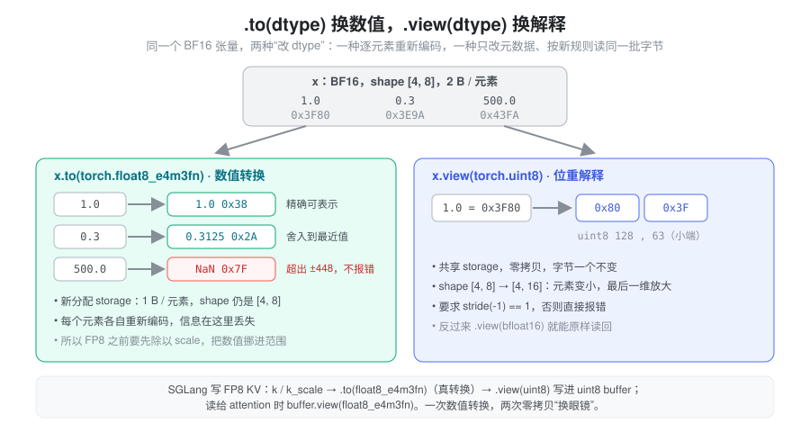
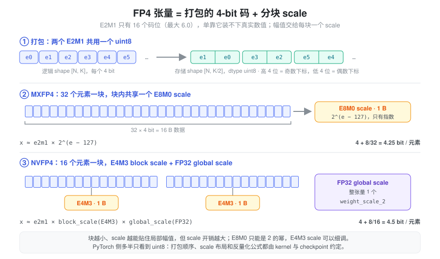

% Torch 数据类型与低精度表示

- 开了 `--kv-cache-dtype fp8_e4m3`，为什么 KV pool 里的 `k_buffer` 打印出来是 `torch.uint8`？
- NVFP4 权重的 shape 为什么是 `[N, K/2]`，旁边还多了 `weight_scale`、`weight_scale_2` 两个参数？
- `.to(torch.float8_e4m3fn)` 和 `.view(torch.float8_e4m3fn)` 只差一个方法名，结果却完全不同？

LLM 推理里，dtype 首先是一笔**账**：decode 阶段基本受显存带宽限制，每个元素少一个字节，KV cache 就能多放一倍 token，每步要读的字节也少一半。所以工程上会把 KV 和权重一路压到 FP8、FP4。但字节数一少，问题随之而来：8 bit 甚至 4 bit 本身装不下真实数值的范围，必须额外携带 scale；而 PyTorch 的 dtype 体系对这些格式只部分支持，很多算子不能直接在上面运行，推理引擎只好把它们当成“字节”存下来，再自己约定怎么解释。

本篇讨论的是 dtype 作为**存储表示**的一面：每个元素占几个 bit、这些 bit 怎么解释、低精度张量为什么要连同 scale 一起看。格式的范围与尾数精度、类型提升细则、累加精度见 [dtype 与数值精度](./torch_numerical_precision.md)；量化算法与粒度见 [Quantization](./quantization.md)。

### 抽象：dtype = 位宽 + 解释规则

一个张量的 dtype 同时规定了两件事：

- **位宽**：每个元素在 storage 里占多少 bit，`x.element_size()` 返回字节数。它决定显存容量和带宽账。
- **解释规则**：同样 8 个 bit，按 `uint8` 读是整数 56，按 `float8_e4m3fn` 读是 1.0。它决定这些 bit 代表什么数值。

把两件事分开，“改 dtype”就有了两种完全不同的含义：改写 bit 让它在新规则下表示近似相同的**数值**，或者 bit 一个不动、只换一套**解释规则**。前者是 `.to(dtype)`，后者是 `.view(dtype)`。

到了 FP8/FP4，又多出第三件事：**数值还依赖 dtype 之外的元数据**。一个 FP8 张量的真实值是 `fp8_value × scale`，scale 不在 dtype 里，而是另一个张量或 Python 浮点数。读低精度代码时，“这个张量是什么 dtype”远远不够，还要问“它的 scale 在哪里、按什么粒度、谁负责乘回去”。

### `.to(dtype)` 与 `.view(dtype)`：换数值，还是换眼镜



`.to(dtype)` 是**数值转换**：逐元素按新格式重新编码，通常分配新 storage；精度不够的地方舍入，超出范围的地方变成 `inf`/`NaN` 或被截断，取决于目标格式和实现。`.view(dtype)` 是**位重解释**：不碰任何字节，只改张量元数据里的 dtype。元素大小不同时，最后一维按字节比例伸缩，因此要求 `stride(-1) == 1`（否则报错），这和 [张量内存](./torch_tensor_memory.md) 里 view 的判据一致——能只改元数据表达，才是 view。

```python
x = torch.tensor([1.0, 0.3, 500.0], dtype=torch.bfloat16)

y = x.to(torch.float8_e4m3fn)   # 数值转换：新 storage，element_size() == 1
y.float()                       # tensor([1.0000, 0.3125, nan])  500 超出 E4M3 的 ±448

b = x.view(torch.uint8)         # 位重解释：共享 storage，shape [3] -> [6]
b                               # tensor([128, 63, 154, 62, 250, 67])，即 0x3F80 等的小端字节
```

两个值得记住的细节：

- **超出范围的转换不报错。** 上例 `500.0` 在 `float8_e4m3fn` 下变成 `NaN`（这个格式没有 `inf`，最大有限值 448，见 `torch.finfo`）。这正是 FP8 必须配 scale 的原因：先除以 scale 把数值挪进可表示范围，再转换。
- **`.view(dtype)` 是低精度工程的胶水。** 打包格式、`index_put` 支持不全的 dtype、要交给只认 `int8/uint8` 指针的 kernel 的数据，都靠它在“字节”和“有语义的数值”之间零拷贝切换。它从不改变数值，也就从不修正数值；拿错规则 view，得到的只是另一串合法但无意义的数。

### 字节账：KV cache 容量与 decode 带宽

对于逐 token 存放的 MHA/GQA KV cache，每个 token 的大小是：

\[
\text{bytes/token} = 2 \times L \times H_{kv} \times d_{head} \times \text{bytes/elem}
\]

以 `L=32`、`H_kv=8`、`d_head=128` 的模型为例，每个 token 有 65536 个 K/V 元素：

| KV 存储格式 | 每元素 | 每 token | 相对 BF16 |
| --- | --- | --- | --- |
| BF16 | 2 B | 128 KiB | 1× |
| FP8（per-tensor scale） | 1 B | 64 KiB | 2× token |
| FP4 + 每 16 元素 1 B scale | 0.5625 B | 36 KiB | ≈3.6× token |

同一块显存能装下的 token 数随之放大；decode 每步要从 HBM 读出的 KV 字节也按同样比例减少。这就是 KV 量化的全部收益来源，也提醒两件事：scale 本身要计入账本（块越小开销越大）；如果读取路径先把 FP4 反量化成 BF16 张量再算 attention，带宽收益会在这一步部分还回去。容量如何从显存余量换算成 token 数见 [Memory Pool](./memory_pool.md)，带宽与算力的关系见 [Roofline](./roofline.md)。

### 存储精度不是计算精度

dtype 描述的是**存储**。FP8/FP4 张量几乎从不以“FP8 累加”的方式参与计算：典型路径是 Tensor Core 读低精度输入、在 FP32 中累加、乘回 scale 后输出 BF16；或者先反量化成 BF16 再走普通 kernel。同一个 FP8 KV cache，换一个 attention 后端，计算精度就可能不同。三种精度的区分与验证方法见 [dtype 与数值精度](./torch_numerical_precision.md)。

### 类型提升：高精度这边很宽松，低精度这边很严格

高精度 dtype 之间，PyTorch 会**静默**做类型提升：`bf16_tensor + fp32_tensor` 的结果是 FP32，后面一串算子随之在 FP32 上运行，显存与带宽翻倍却不会有任何提示。这是推理代码里最常见的隐式转换，排查方法是在 residual、mask、辅助张量创建处检查输出 dtype 或用 `torch.result_type()` 预判（规则细节见 [dtype 与数值精度](./torch_numerical_precision.md)）。

到了 FP8，方向反过来：它们**不参与**类型提升，大部分普通算子也没有实现。

```python
y = torch.zeros(4).to(torch.float8_e4m3fn)
y + 1.0              # RuntimeError: "add_stub" not implemented for 'Float8_e4m3fn'
y + torch.zeros(4)   # RuntimeError: Promotion for Float8 Types is not supported
```

这不是缺陷，而是设计立场：FP8 张量被当作**只供专用 kernel 消费的存储格式**，而不是普通的数值类型。要在 PyTorch 里对它做逐元素运算，必须显式 `.to(torch.bfloat16)`（并记得乘回 scale）。FP4 更进一步——`torch.float4_e2m1fn_x2` 每个元素就是一个打包了两个 FP4 值的字节，`element_size()` 为 1，几乎只能拿来存储和 view。不同 PyTorch 版本对这些 dtype 的算子覆盖有差异，上面的行为以 2.9 为准。

### FP8：低精度数据 + scale

FP8 有两种常用格式，差别只在 8 bit 怎么分给指数和尾数：

| 格式 | 符号/指数/尾数 | 最大有限值 | 特点 |
| --- | --- | --- | --- |
| `float8_e4m3fn` | 1 / 4 / 3 | 448 | 尾数多一位，推理权重、激活、KV 常用；无 `inf` |
| `float8_e5m2` | 1 / 5 / 2 | 57344 | 范围大、精度更粗，与 FP16 指数位相同 |

448 这个上限说明了一切：激活值、K/V 的幅值随层和通道变化，随便就会越界。所以 FP8 张量的语义永远是**一对**：

\[
x \approx x_{fp8} \times s, \qquad x_{fp8} = \operatorname{fp8}(x / s)
\]

scale `s` 可以是整张量一个（per-tensor）、每行一个（per-token / per-channel）或每个 tile 一个（per-block）——粒度越细，越能贴合局部幅值，scale 的存储与读取开销也越大（粒度对比见 [Quantization](./quantization.md)）。

读代码时要紧盯 scale 的**方向约定**：多数代码存的是“反量化 scale”，即量化时除以它、反量化时乘以它；但也有实现存倒数。方向弄反不会报错，只会悄悄让数值错一个数量级。

### FP4：打包的码 + 分块 scale

FP4（E2M1：1 位符号、2 位指数、1 位尾数）只有 16 个码位，正值是 0、0.5、1、1.5、2、3、4、6。一个 per-tensor scale 根本撑不住这么少的码位——只要张量里有一个离群值，其余元素就全挤在 0 附近。所以 FP4 格式从定义上就是**分块缩放**（block-scaled）的：每一小段连续元素共享一个 scale，scale 负责“这一块整体有多大”，4-bit 码只负责块内的相对大小。



两个约定要同时记住：

- **打包。** 最小寻址单位是字节，所以两个 FP4 码挤进一个 `uint8`，存储张量最后一维是逻辑维度的一半：逻辑 `[N, K]` 的权重在 checkpoint 和显存里是 `[N, K/2]` 的 `uint8`。shape 对不上逻辑维度，不是 bug，是格式。
- **scale 的格式与块大小。** 主流两种：

| 格式 | 块大小 | block scale | 额外 scale | 平均位宽 |
| --- | --- | --- | --- | --- |
| MXFP4（OCP Microscaling） | 32 | E8M0：只有 8 位指数，值为 2 的幂 | 无 | 4.25 bit |
| NVFP4 | 16 | FP8 E4M3 | 每张量一个 FP32 global scale | 4.5 bit |

E8M0 scale 只能是 2 的幂，乘法退化成指数加法，硬件最便宜，但贴合度粗；NVFP4 用更小的块和带尾数的 E4M3 scale 换精度，而 E4M3 自己范围有限（最大 448），于是再叠一层 FP32 global scale 兜住整体幅值，即 `x ≈ e2m1 × block_scale × global_scale`。

这类格式在 PyTorch 里几乎没有“原生”语义：码是 `uint8`，E8M0 scale 常以 `uint8` 存（偏置 127 的指数，127 表示 1.0），要用时 `.view(torch.float8_e8m0fnu)` 再转 FP32。真正理解这些字节的是 kernel——打包顺序、scale 的 swizzle 布局、谁来乘回 scale，全部是 checkpoint 与 kernel 之间的约定。

### 在 SGLang 中：dtype、存储 dtype 与 scale 各在哪里

以下基于 `python/sglang/srt/` 当前代码。

**KV cache 的 dtype 由一个字符串决定。** `--kv-cache-dtype`（`server_args.py`）可选 `auto`、`bf16`、`fp8_e4m3`、`fp8_e5m2`、`mxfp8`、`nvfp4`、`fp4_mx_block16` 等。`mem_cache/kv_cache_dtype.py` 的 `configure_kv_cache_dtype()` 把它解析成 torch dtype：`fp8_e4m3` → `torch.float8_e4m3fn`（ROCm 上是 `fnuz` 变体），`nvfp4`/`fp4_mx_block16` → `torch.float4_e2m1fn_x2`（要求 PyTorch 2.8+）；`auto` 则在模型量化配置声明 FP8 KV 时选 FP8，否则跟随模型 dtype。

**逻辑 dtype 与存储 dtype 是两个字段。** `KVCache.__init__`（`mem_cache/memory_pool.py`）里，FP8 dtype 的 `store_dtype` 被设为 `torch.uint8`，注释写明原因：`Tensor.index_put` 没有为 `float8_e5m2` 实现。这就是开头第一个问题的答案。于是 `MHATokenToKVPool.set_kv_buffer()` 的写路径正好是一次 `.to()` 加一次 `.view()`：

```python
if cache_k.dtype != self.dtype:          # BF16 进来
    if k_scale is not None:
        cache_k.div_(k_scale)            # 先除以 scale，挪进 FP8 范围
    cache_k = cache_k.to(self.dtype)     # 数值转换：BF16 -> FP8
if self.store_dtype != self.dtype:
    cache_k = cache_k.view(self.store_dtype)   # 位重解释：FP8 -> uint8，零拷贝
```

读路径 `_get_key_buffer()` 再 `self.k_buffer[...].view(self.dtype)` 换回 FP8 交给 attention 后端。整个过程中 FP8 的字节只被写一次，dtype 却换了三次“眼镜”。

**FP8 KV 的 scale 是 per-tensor 的 Python 浮点数。** `layers/quantization/kv_cache.py` 的 `BaseKVCacheMethod` 给 attention 层挂 `k_scale`/`v_scale`，`process_weights_after_loading()` 在缺省时回退为 1.0，并明确报错 “Only support per-tensor scaling factor for fp8 KV cache”；同时生成 `k_scale_float`/`v_scale_float`。`layers/attention/flashinfer_backend.py` 把后者传给 kernel，注释给出了理由：用 Python float 是为了避免 device-to-host 拷贝打断 CUDA Graph capture（见 [CUDA Graph](./cuda_graph.md)）。若 checkpoint 没提供 scale，`load_kv_cache_scales()` 会告警 “Defaulting to scaling factors of 1.0”——这时 FP8 KV 只靠 448 的范围硬扛。

**FP4 KV 多出一份 scale buffer。** `MHATokenToKVPoolFP4` 的 K/V buffer 是 `(slots, heads, head_dim // 2)` 的 `uint8`，旁边另有 `k_scale_buffer`/`v_scale_buffer`，形状 `(slots, heads * head_dim // 16)`。量化与反量化由 `layers/quantization/kvfp4_tensor.py` 完成：`FP4MXBlock16KVQuantizeUtil` 是“16 元素块 + 仅指数 scale”的 MX 风格变体（注释特意指出 MXFP4 规范的块大小是 32），`NVFP4KVQuantizeUtil` 则是 “global FP32 + block FP8 E4M3” 两级缩放。`layers/quantization/fp4_kv_cache_quant_method.py` 中的 `NVFP4KVCacheMethod`、`FP4MXBlock16KVCacheMethod` 把两种 recipe 接到通用 KV pool 上；当 `needs_plain_kv_dequant_read()` 为真时，读路径先把整层 KV 反量化成普通张量——这正是前文说的“带宽收益在读取时部分还回去”的地方，选择后端时值得留意。

**MoE 权重：MXFP4 与 NVFP4 的参数形状就是格式说明书。**

- `layers/quantization/mxfp4.py` 的 `Mxfp4MoEMethod` 创建 `w13_weight`，形状 `(E, 2·I, hidden // 2)`、dtype `uint8`；`w13_weight_scale` 形状 `(E, 2·I, hidden // 32)`、同为 `uint8`，初值 `_UE8M0_ONE = 127`（E8M0 下的 1.0）。走 DeepGEMM 时，它把权重 `.view(torch.int8)`，把 scale `.view(torch.float8_e8m0fnu).to(torch.float32)`——注释说明 2 的幂经 FP32 往返是精确的。
- `layers/quantization/modelopt_quant.py` 的 `ModelOptFp4LinearMethod` 文档串列出了 NVFP4 checkpoint 的三件套：`weight` 为打包 `uint8`、最后一维减半，`weight_scale` 为 FP8-E4M3 的块 scale，`weight_scale_2` 为 FP32 标量 global scale，“per block of 16 elements”；MoE 版本是 `ModelOptNvFp4FusedMoEMethod`。

一张 NVFP4 线性层因此至少对应三个张量、四个 dtype（uint8 码、E4M3 块 scale、FP32 global scale、BF16 激活与输出），这些都不能从 `weight.dtype` 一眼看出来。

### 读低精度代码时的检查清单

1. **逻辑 dtype 与存储 dtype**：这个 buffer 声明的是 `uint8`，它真正装的是什么格式？
2. **打包**：最后一维是不是被压了一半？谁负责解包，高低 4 位分别对应哪个下标？
3. **scale**：粒度（per-tensor / per-token / per-block）、存储 dtype、方向（乘还是除）、缺省值是不是 1.0？
4. **`.to()` 还是 `.view()`**：这一步是在转换数值，还是只换解释？有没有误把 FP8 当 uint8 做了数值转换？
5. **计算路径**：kernel 直接读低精度，还是先反量化成 BF16 张量？后者会额外占显存和带宽。

### 小结

dtype 是“位宽 + 解释规则”。`.to()` 改写字节以保留数值，`.view()` 保留字节而换掉解释——低精度工程靠前者量化、靠后者在 PyTorch 不支持的格式与 `uint8` 之间零拷贝穿梭。FP8 和 FP4 的数值从来不只住在 dtype 里：FP8 要配 scale，FP4 还要打包与分块 scale，PyTorch 往往只看到一串 `uint8`。所以在 SGLang 里读到 `store_dtype = torch.uint8`、`hidden // 2`、`weight_scale_2` 这些看似奇怪的细节时，把它们还原成“码 + scale + 约定”三件事，就能算清容量和带宽账，也能判断精度可能在哪里丢失。
