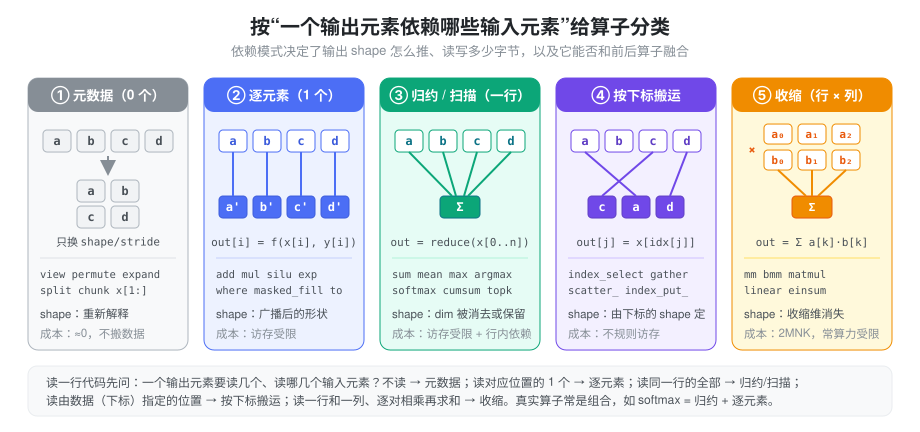
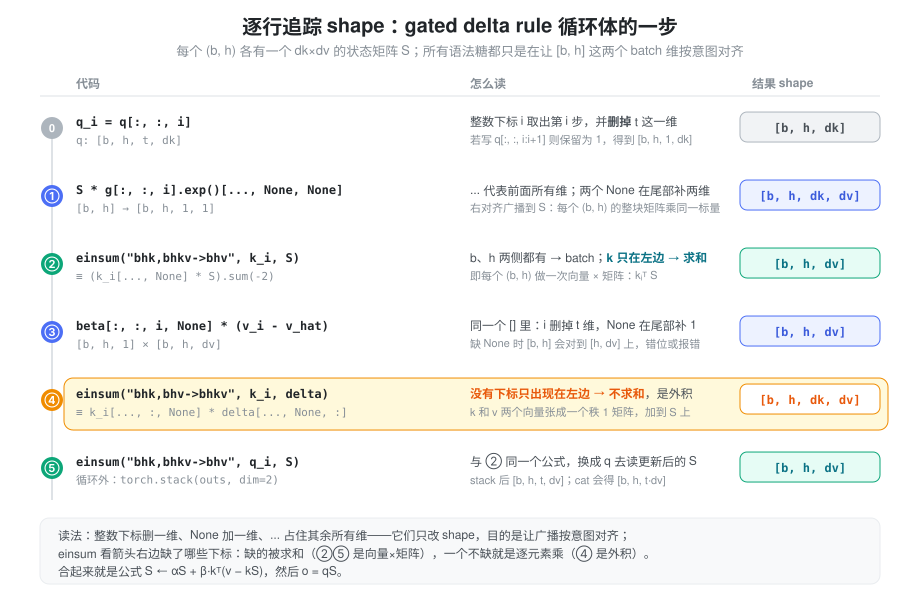
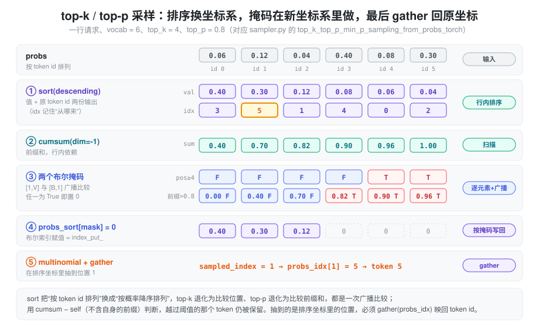

% Torch Ops

- 同样是一行 PyTorch，`x.view(...)` 几乎不花时间，`x + bias` 要扫一遍显存，`x @ w` 却能占满整块 GPU——差别从哪来？
- `x.sum(-1)` 之后再和 `x` 相除为什么报 shape 错误，加上 `keepdim=True` 就好了？
- `torch.gather(x, 1, idx)` 的输出 shape 到底由谁决定？top-p 采样里排完序抽到的 index，为什么不是 token id？
- `einsum("ti,taoi->tao", ...)` 这种下标串怎么读？哪些维度被求和了？
- `g[:, :, i].exp()[..., None, None]`、`beta[:, :, i, None]` 这类写法，到底在做什么？

PyTorch 有上千个算子，逐个记 API 不现实。更有效的方式是先问一句：**一个输出元素依赖哪些输入元素？** 这个依赖模式几乎决定了一个算子的全部工程属性——输出 shape 怎么推、读写多少字节、是访存受限还是算力受限、能不能和相邻算子融合。本篇先建立这套分类，再用 SGLang 里的 RMSNorm、采样、MoE 路由和 MLA 把它们落到真实代码。

张量的 storage/stride 模型见 [Tensor Memory](./torch_tensor_memory.md)，广播与读写方向的细节见 [Broadcast & Indexing](./torch_broadcast_indexing.md)。本篇关注的是更上一层：**算子做了什么计算，以及这类计算的代价。**

### 抽象：按依赖模式把算子分成五类



| 类别 | 一个输出依赖 | 输出 shape | 典型代价 |
| --- | --- | --- | --- |
| ① 元数据 | 不计算，复用原元素 | 重新解释 | 近乎为零，只改 shape/stride |
| ② 逐元素 | 对应位置的 1 个元素（广播后） | 广播后的形状 | 读一遍、写一遍，访存受限 |
| ③ 归约 / 扫描 | 某一维上的一整行 | 该维被消去、保留为 1 或不变 | 访存受限，且行内有依赖 |
| ④ 按下标搬运 | 由下标张量指定的位置 | 由下标的 shape 决定 | 不规则访存，常伴随复制 |
| ⑤ 收缩 | 一行与一列逐对相乘再求和 | 收缩维消失 | `2·M·N·K` FLOPs，常算力受限 |

这套分类的用处在于：真实算子大多是它们的组合。`softmax` 是“归约（max、sum）+ 逐元素（减、exp、除）”；`F.linear` 是“收缩 + 逐元素（bias）”；top-p 采样是“排序 + 扫描 + 逐元素 + 按下标写回 + gather”。拆开以后，每一步的 shape 和成本都能单独推。

它也解释了为什么推理优化总在谈“融合”：①不产生 kernel，⑤本身就算得很满，**真正浪费带宽的是②③串成的长链**——每一步都要把整个中间张量写回显存再读出来。RMSNorm、SiLU×Mul、RoPE 都是这种链，也都有对应的融合 kernel。

### ① 元数据算子：只换透镜

这一类不碰数据，只产生一组新的 shape/stride/offset。原理见 [Tensor Memory](./torch_tensor_memory.md)，这里只整理常用的几组：

| API | 作用 | 是否复制 |
| --- | --- | --- |
| `view(*shape)` | 重新解释维度 | 从不；stride 不兼容时直接报错 |
| `reshape(*shape)` | 同上 | 能 view 就 view，否则复制 |
| `flatten(s, e)` | 合并 `[s, e]` 维 | 同 `reshape` |
| `permute` / `transpose` / `.T` | 交换维度 | 不复制，但结果通常非连续 |
| `unsqueeze` / `squeeze` / `x[:, None]` | 插入或去掉大小为 1 的维 | 不复制 |
| `expand` | 把大小为 1 的维扩展 | 不复制，stride 为 0 |
| `split` / `chunk` / `x[a:b]` | 切出子区间 | 不复制 |

注意 `view()` 的条件不是“必须 contiguous”，而是“新 shape 能用现有 stride 表达”：fused QKV `split` 出的 `k` 不连续，但 `k.view(-1, KV, D)` 依然成功。`x[..., None]` 与 `x.unsqueeze(-1)` 等价，`...` 代表其余所有维度。

元数据算子本身免费，代价会推迟到下游：一个 `transpose` 后的张量交给只接受连续输入的 kernel，那个 kernel 前面就会多出一次 `contiguous()` 复制。

### ② 逐元素算子：广播与类型提升

`add`、`mul`、`exp`、`silu`、`where`、`masked_fill`、`.to(dtype)` 都属于这一类：输出的第 `i` 个元素只依赖输入的第 `i` 个元素。两个输入 shape 不同时先**广播**——从最右一维开始对齐，每对维度相等或其中一个为 1，缺失的前导维视为 1：

```python
x: (bs, seq, hidden)
bias: (hidden,)          # 视为 (1, 1, hidden)
x + bias -> (bs, seq, hidden)
```

逐元素算子的计算量很小，一次 `x + bias` 读两个输入、写一个输出，时间几乎完全花在访存上，因此**多个逐元素算子连在一起，耗时约等于中间张量的读写次数之和**。另外两个隐式行为需要留意：广播只做数字对齐、不检查语义（mask 的 batch 维可能对到 query 维）；混入一个 fp32 张量会把输出提升成 fp32。这两点详见 [Broadcast & Indexing](./torch_broadcast_indexing.md)。

### ③ 归约与扫描：dim 和 keepdim

归约沿某一维把一整行压成一个数：`sum`、`mean`、`max`、`argmax`、`norm`。参数 `dim` 指定被压掉的维度，`keepdim=True` 则把它保留为大小 1。以 `x = torch.arange(12).view(3, 4)` 为例：

| 表达式 | 输出 shape | 值 |
| --- | --- | --- |
| `x.sum(0)` | `(4,)` | `[12, 15, 18, 21]` |
| `x.sum(-1)` | `(3,)` | `[6, 22, 38]` |
| `x.sum(-1, keepdim=True)` | `(3, 1)` | `[[6], [22], [38]]` |
| `x.cumsum(-1)` | `(3, 4)` | `[[0, 1, 3, 6], [4, 9, 15, 22], ...]` |

`keepdim` 的意义在于**归约结果通常还要广播回原张量**。`x / x.sum(-1)` 中，`(3, 4)` 与 `(3,)` 按右对齐会把 3 对到 4 上，报错；`x / x.sum(-1, keepdim=True)` 中 `(3, 1)` 沿最后一维广播，才是“每行除以自己的和”。归一化、softmax、RMSNorm 都是这个“归约 → keepdim → 广播回去”的模式。

**扫描**（`cumsum`、`cumprod`）不压缩维度，但第 `j` 个输出依赖同一行的前 `j` 个输入，因此同样有行内依赖。**`sort`、`topk`** 也归在这一类：它们需要看完一整行才能决定顺序，并且同时返回两份输出——值，以及**这些值在原张量中的下标**。下标是后面 gather 回原坐标的钥匙，采样一节会看到它的用法。

归约的另一个工程属性是精度：累加顺序会影响结果，低精度累加会丢失信息。`sum(..., dtype=torch.float32)` 可以只在累加时升精度，不必先把整个输入转成 fp32，见 [Numerical Precision](./torch_numerical_precision.md)。

### ④ 按下标搬运：gather、scatter 与 index

这一类的输出位置由**数据**决定：`out[j] = x[idx[j]]`。下标可以乱序、重复，无法用 stride 表达，所以读取总会复制。

- `index_select(x, dim, idx)` / `x[idx]`：沿某一维按一维下标取整片，输出在该维的长度等于 `len(idx)`。
- `torch.gather(x, dim, idx)`：逐元素取，**输出 shape 等于 `idx` 的 shape**。`dim=1` 时 `out[i][j] = x[i][idx[i][j]]`，即每一行各取各的。上例 `torch.gather(x, 1, [[3, 0], [1, 1], [2, 0]])` 得到 `[[3, 0], [5, 5], [10, 8]]`。
- `scatter_(dim, idx, src)`：gather 的逆，`self[i][idx[i][j]] = src[i][j]`，原地写回；`scatter_add_` 对重复下标累加。
- `x[idx] = v` / `x[mask] = v`：等号左侧的索引是 `index_put_`，原地写回；右侧才是 gather 出副本。
- `torch.cat` / `torch.stack`：每个输入被搬到新输出的不同区段，也属于“搬运”，总要分配新存储。

gather/scatter 的成本主要是不规则访存：相邻输出可能来自相距很远的输入地址，难以合并访问。高性能 kernel 的常见做法是把下标表直接交给计算 kernel、在内部寻址，而不是先 gather 出完整张量。

### ⑤ 收缩：matmul、bmm 与 einsum

收缩是“两个张量沿某一维逐对相乘再求和”，这一维在输出中消失。它是推理里绝大部分 FLOPs 的来源，形状规则也最需要记清：

| API | 输入 shape | 规则 |
| --- | --- | --- |
| `torch.mm(a, b)` | `[M, K] × [K, N]` | 严格二维 |
| `torch.bmm(a, b)` | `[B, M, K] × [B, K, N]` | 严格三维，batch 维必须相等 |
| `a @ b` / `torch.matmul` | 任意维 | 最后两维做矩阵乘，前面的 batch 维**按广播规则**对齐；一维输入会被临时补维 |
| `F.linear(x, w, b)` | `[..., K]`、`w: [N, K]` | 计算 `x @ w.T + b`，权重按 `[out, in]` 存 |
| `torch.einsum(eq, ...)` | 任意 | 用下标串描述，见下 |

`einsum` 的读法只有一条规则：**出现在箭头右边的下标保留，只出现在左边的下标被求和**。例如 `"bshd,bthd->bhst"` 中 `b`、`h` 两侧都有，是 batch 维；`s`、`t` 分别来自 q 和 k，保留下来成为 score 矩阵；`d` 只在左边，被收缩——这正是 `q @ k.T` 按 head 分组的写法。

收缩的计算量是 `2·M·N·K`，数据量是 `M·K + K·N + M·N`，当 `M` 很小（decode 时 token 数少）时它会从算力受限退化为访存受限，见 [Gemm 计算量](./gemm_computation.md) 和 [Roofline](./roofline.md)。另外，转置一般不需要物化：`w.T` 只是 stride 互换的 view，cuBLAS 通过“转置”标志直接读取，这也是 `F.linear` 能把权重按 `[out, in]` 存放而不付复制代价的原因。

### 语法糖：只改 shape 的那些写法

参考实现和模型代码里最让人“一头雾水”的，往往不是算子本身，而是夹在算子之间、只为了让 shape 对齐的写法。它们几乎都属于 ① 元数据类，不搬数据，目的只有一个：**让下一步的广播或收缩按意图对齐维度**。设 `x: [b, h, t, d]`：

| 写法 | 结果 shape | 含义 |
| --- | --- | --- |
| `x[:, :, i]` | `[b, h, d]` | 整数下标：取第 `i` 个，并**删掉**这一维 |
| `x[:, :, i:i+1]` | `[b, h, 1, d]` | 切片：取一段，**保留**这一维（长度 1） |
| `x[:, :, -1]` | `[b, h, d]` | 负下标从末尾数，`-1` 是最后一个 |
| `x[..., 0]` | `[b, h, t]` | `...` 占住前面所有维，等价于 `x[:, :, :, 0]` |
| `x[..., None]` | `[b, h, t, d, 1]` | `None` 在该位置插入一个长度 1 的维，等价 `unsqueeze(-1)` |
| `x[:, :, i, None]` | `[b, h, 1]` | 同一个 `[]` 里从左到右处理：`i` 删掉 t 维，`None` 在末尾补 1 |
| `x[..., ::2]` | `[b, h, t, d/2]` | 步长切片，stride 翻倍，仍是 view |
| `x[:, :, [0, 2]]` | `[b, h, 2, d]` | 列表/张量下标是高级索引，**会复制**（④ 类） |

几条容易混的规则：

- **整数删维，切片留维。** `x[:, :, i]` 与 `x[:, :, i:i+1]` 取的是同一批数据，但前者少一维。后续要和保留了 t 维的张量广播时，用错一种就会错位。
- **`...` 只能出现一次**，它替代“足够多的 `:`”，让同一行代码对任意前导维都成立。`x[..., :d]`、`x[..., d:]`（SiLU×Mul 的切半）就是靠它不关心前面有几维。
- **`None` 是为了广播而补的 1。** 一个 `[b, h]` 的标量门要乘到 `[b, h, dk, dv]` 的矩阵上，必须先变成 `[b, h, 1, 1]`——广播从右对齐，不补的话 `[b, h]` 会对到 `[dk, dv]` 上。
- **einsum 不求和时就是带广播的逐元素乘。** `"bhk,bhv->bhkv"` 右边一个下标都没少，所以没有收缩，等价于 `k[..., :, None] * v[..., None, :]`，即外积。
- **`stack` 新建维，`cat` 拼已有维。** t 个 `[b, h, dv]` 用 `stack(dim=2)` 得到 `[b, h, t, dv]`；用 `cat(dim=2)` 得到 `[b, h, t·dv]`。

另有几处与 shape 无关、但读代码常遇到的小写法：`b, h, t, dk = k.shape` 是把 `torch.Size`（一个 tuple）解包成整数；`x.shape[:-1] + (d,)` 是 tuple 拼接，构造“除最后一维外不变”的新 shape；`k.new_zeros(...)` / `x.new_empty(...)` 创建与 `k` **同 dtype、同 device** 的新张量，省去手写 `dtype=, device=`；`F.normalize(x, dim=-1)` 是沿最后一维做 L2 归一化（`x / ‖x‖₂`）；`dk ** -0.5` 是 Python 标量运算 `1/√dk`，与张量相乘时不会改变张量的 dtype。

### 例子：逐行读 gated delta rule 参考实现

[Linear Attention](./linear_attention.md) 里的 `gated_delta_rule_ref` 是上面这些语法糖的集中体现。先把数学写在旁边——每个 `(b, h)` 有一个 `dk × dv` 的状态矩阵 `S`，每一步：

```
S ← α·S                       α = exp(g)，标量衰减
v̂ = kᵀS                       用当前记忆“预测” k 对应的 v
Δ = β·(v − v̂)                 预测误差
S ← S + k ⊗ Δ                 沿 k 方向写回误差（外积）
o = qᵀS                       用 q 读出
```

代码里所有的下标、`None`、einsum，都只是在给这几行公式补上 `[b, h]` 两个 batch 维：

```python
for i in range(t):
    q_i, k_i, v_i = q[:, :, i], k[:, :, i], v[:, :, i]        # [b,h,dk] / [b,h,dv]，删掉 t 维
    S = S * g[:, :, i].exp()[..., None, None]                 # [b,h] -> [b,h,1,1]，广播到 [b,h,dk,dv]
    v_hat = torch.einsum("bhk,bhkv->bhv", k_i, S)             # 收缩 k：向量 × 矩阵 -> [b,h,dv]
    delta = beta[:, :, i, None] * (v_i - v_hat)               # [b,h,1] × [b,h,dv] -> [b,h,dv]
    S = S + torch.einsum("bhk,bhv->bhkv", k_i, delta)         # 不收缩：外积 -> [b,h,dk,dv]
    outs.append(torch.einsum("bhk,bhkv->bhv", q_i, S))        # 同 ②，-> [b,h,dv]
return torch.stack(outs, dim=2), S                            # t 个 [b,h,dv] -> [b,h,t,dv]
```



逐行看：

- **取第 i 步**：`q[:, :, i]` 用整数下标删掉 t 维，于是 `q_i`、`k_i` 是 `[b, h, dk]`，`v_i` 是 `[b, h, dv]`——每个 `(b, h)` 一个向量。
- **① 衰减**：`g[:, :, i]` 是 `[b, h]`，`.exp()` 是逐元素；`[..., None, None]` 在末尾补两个 1 变成 `[b, h, 1, 1]`，右对齐广播到 `S` 的 `[b, h, dk, dv]`，即“每个 head 的整个矩阵乘同一个标量”。KDA 的门是逐通道向量 `[b, h, dk]`，只需补一个 `None` 变成 `[b, h, dk, 1]`，就变成按行衰减。
- **② 预测**：`"bhk,bhkv->bhv"` 中 `k` 只出现在左边，被求和；等价写法是 `(k_i[..., None] * S).sum(-2)` 或 `(k_i.unsqueeze(-2) @ S).squeeze(-2)`。
- **③ 误差**：`beta[:, :, i, None]` 先删 t 维再补 1，得到 `[b, h, 1]`，与 `[b, h, dv]` 广播；漏掉 `None` 的话 `[b, h]` 会去对齐 `[h, dv]`，不是报错就是悄悄错位。
- **④ 写回**：`"bhk,bhv->bhkv"` 右边一个下标都没少，没有求和，是外积 `k_i[..., :, None] * delta[..., None, :]`，得到一个秩 1 的 `[dk, dv]` 矩阵加到 `S` 上。
- **⑤ 读出与收集**：和 ② 同一个公式，用 `q_i` 读更新后的 `S`；循环结束后 `stack(dim=2)` 在第 2 维新建 t 维，与输入 `v: [b, h, t, dv]` 对齐。

两点工程细节也藏在这几行里。第一，`S = S * ...`、`S = S + ...` 都是**换绑名字**，不是原地写：调用方传进来的初始 `S` 不会被修改，函数返回新的终态。SGLang 的 decode kernel 则相反，直接原地改写 state pool 里的状态。第二，这个 `for` 循环无法向量化掉，因为第 `i` 步的 `S` 依赖第 `i-1` 步；eager 下每一步要发射七八个小 kernel，并且每步都把整个 `[b, h, dk, dv]` 状态读写好几遍。这正是 prefill 用 chunkwise 算法、decode 用 fused recurrent kernel 的原因，见 [Linear Attention](./linear_attention.md)。参考实现的价值在于语义清楚，适合做 kernel 的对照，而不是用来跑。

遇到类似的代码，可以先在小 shape 上把每一行的 `.shape` 打印出来，再对照公式确认：哪一维是 batch、哪一维被求和、哪一处 `None` 是为了广播。

### RMSNorm 与 SiLU×Mul

`layers/layernorm.py` 的 `RMSNorm.forward_native()` 是“归约 → keepdim → 广播回去”的标准写法（省略 residual 等分支）：

```python
x = x.to(torch.float32)
variance = x.pow(2).mean(dim=-1, keepdim=True)    # ② + ③，[T, 1]
x = x * torch.rsqrt(variance + self.variance_epsilon)  # ②，[T, 1] 广播到 [T, H]
x = (x * self.weight).to(orig_dtype)              # ②，weight [H] 广播
```

按分类拆开，它只有一次归约，其余全是逐元素；但在 eager 模式下每一步都会把一个 `[T, H]` 的中间张量写回显存——fp32 转换、平方、相乘、乘权重、转回，加上 residual 分支还有两次加法。`forward_cuda()` 在 CUDA 上调用 `rmsnorm` / `fused_add_rmsnorm` kernel，把整条链放进一个 kernel：每行读一次 `x`（和 residual），在寄存器里完成归约和缩放，写一次输出。计算量没变，访存从近十遍降到一两遍。

`layers/activation.py` 的 `SiluAndMul` 是另一条短链：`forward_native()` 写成 `F.silu(x[..., :d]) * x[..., d:]`——两次切片是 ①，`silu` 和乘法是 ②，中间产生一个 `silu` 结果张量；`forward_cuda()` 先 `torch.empty` 出 `[..., d]` 的输出，再由 `silu_and_mul(x, out)` 一次完成。两者的区别不在于算法，而在于中间张量有没有落到显存。

### top-k / top-p 采样——排序换坐标

采样把几乎所有类别都用了一遍。`layers/sampler.py` 中 `Sampler.forward()` 的前半段：

- `logits.div_(sampling_info.temperatures)`：`temperatures` 在 `SamplingBatchInfo` 里被 `.view(-1, 1)` 成 `[B, 1]`，沿 vocab 维广播，每个请求除以自己的温度；原地写，不分配新的 `[B, V]`。
- `logits[:] = torch.softmax(logits, dim=-1)`：softmax 本身要分配输出，但结果被拷回 `logits` 的原存储并复用为 `probs`（源码注释 “In-place op to save memory”），避免同时持有两份 `[B, V]`。

默认的 `flashinfer` 后端把 top-k/top-p 交给融合 kernel；`pytorch` 后端走 `top_k_top_p_min_p_sampling_from_probs_torch()`，正好可以逐步看清每一类算子在做什么：



```python
probs_sort, probs_idx = probs.sort(dim=-1, descending=True)
probs_sum = torch.cumsum(probs_sort, dim=-1)
probs_sort[torch.arange(V).view(1, -1) >= top_ks.view(-1, 1)] = 0.0
probs_sort[(probs_sum - probs_sort) > top_ps.view(-1, 1)] = 0.0
sampled_index = torch.multinomial(probs_sort, num_samples=1)
batch_next_token_ids = torch.gather(probs_idx, dim=1, index=sampled_index)
```

关键一步是 `sort`：它把“按 token id 排列”换成“按概率降序排列”的坐标系，在新坐标系里 top-k 变成“位置 ≥ k”，top-p 变成“不含自身的前缀和 > p”，都只是一次 `[1, V]` 或 `[B, V]` 与 `[B, 1]` 的广播比较，每个请求可以有不同的 k 和 p。用 `probs_sum - probs_sort` 而不是 `probs_sum` 判断，保证第一个越过阈值的 token 仍被保留。`multinomial` 不要求概率归一化，所以置 0 之后不必重新除和。

最后 `multinomial` 返回的是**排序坐标里的位置**，必须用 `sort` 返回的 `probs_idx` 做一次 gather 才能得到 token id——忘掉这一步就会采到“第 1 名”而不是“token 5”。同文件的 `top_p_normalize_probs_torch()` 走的是反方向：在排序坐标里处理完，再 `scatter_(-1, probs_idx, probs_sort)` 把概率写回 token id 坐标。sort/gather 与 scatter 互为逆操作，这是“换坐标 → 处理 → 换回”模式的两种收尾方式。

这条路径的代价也一目了然：对 `[B, V]` 做一次完整排序（V 常为十几万），再加数个同规模的中间张量和布尔掩码，这正是它被标为 “slower fallback” 的原因。

### MoE 路由——topk、scatter 与 masked_fill

`layers/moe/topk.py` 的 `grouped_topk_gpu()`（DeepSeek 风格的分组路由）先选专家组、再在组内选专家，全程用的是归约和按下标写入：

```python
group_scores = scores.view(num_token, num_expert_group, -1).max(dim=-1).values  # ① + ③
group_idx = torch.topk(group_scores, k=topk_group, dim=-1, sorted=False)[1]    # ③
group_mask = torch.zeros_like(group_scores)
group_mask.scatter_(1, group_idx, 1)                                            # ④
score_mask = group_mask.unsqueeze(-1).expand(...).reshape(num_token, -1)        # ①
tmp_scores = scores.masked_fill(~score_mask.bool(), 0.0)                        # ②
topk_weights, topk_ids = torch.topk(tmp_scores, k=topk, dim=-1, ...)            # ③
```

几个值得注意的写法：`view` 把 `[n, e]` 拆成 `[n, group, e/group]`，使“每组的最高分”变成最后一维上的普通 `max`；`scatter_` 把“选中了哪几组”的下标表转成 0/1 掩码，下标形式和掩码形式之间的转换在路由、采样里反复出现；`expand(...).reshape(...)` 把组级掩码展开回专家级——`expand` 是零 stride view，但随后的 `reshape` 无法合并零 stride 维度，会在这里物化一份 `[n, e]`。`renormalize` 分支里的 `topk_weights.sum(dim=-1, keepdim=True, dtype=torch.float32)` 则是归约时只升累加精度、再广播回去相除。

### 收缩的两种写法

`layers/moe/fused_moe_native.py` 的 `fused_moe_forward_native()`（`unquant.py` 只在 torch.compile 且 batch size 为 1 时启用它）用 einsum 表达专家计算：

```python
w13_weights = layer.w13_weight[topk_ids]                      # ④ gather：[t, a, 2·o, i]
x1 = torch.einsum("ti,taoi -> tao", x, w1_weights)            # ⑤ 收缩 i
expert_outs = torch.einsum("tao, taio -> tai", (x1 * x3), w2_weights)  # ⑤ 收缩 o
expert_outs = torch.einsum("tai,ta -> ti", expert_outs, topk_weights)  # ⑤ 收缩 a（加权求和）
```

下标 `t` 是 token、`a` 是被选中的第几个专家、`i`/`o` 是 hidden 与中间维。读法按“右边没有的下标被求和”：第一式收缩 `i`，第三式收缩 `a`，后者正是“按路由权重把 top-k 个专家的输出加起来”。这种写法简洁，但第一行按 `topk_ids` gather 出了每个 token 专属的一份专家权重，只在 token 数为 1 时才划算——这也是它只用于 bs=1 的原因。

`models/deepseek_common/attention_forward_methods/forward_mla.py` 中 MLA 的权重吸收则是 `bmm` 的典型用法：

```python
q_nope_out = torch.bmm(q_nope.transpose(0, 1), self.w_kc)   # [H, T, d] × [H, d, r] -> [H, T, r]
q_nope_out = q_nope_out.transpose(0, 1)                     # 回到 [T, H, r]
```

`bmm` 要求 batch 维在最前，所以先用 `transpose` 把 head 维挪到第 0 维——这是 ① 类的 view，不复制，`bmm` 直接按 stride 读取。每个 head 一个独立的矩阵乘，正好对应“每个 head 有自己的 `W_UK`”。加载权重时 `deepseek_weight_loader.py` 里的 `w_kc.transpose(1, 2).contiguous().transpose(1, 2)` 则是反过来的技巧：shape 仍是 `[H, d, r]`，但后两维的 stride 从 `(r, 1)` 变成 `(1, d)`，即改成列优先存放（源码未注释具体原因，通常是为了匹配下游 bmm kernel 偏好的布局）。shape 相同的两个张量，stride 不同，对 kernel 而言就是两种不同的输入。

### 读代码时的检查顺序

1. 把每一行算子归到五类之一，组合算子拆成几步。
2. 对归约，确认 `dim` 和 `keepdim`，以及结果要不要广播回去。
3. 对 gather/scatter/topk/sort，确认当前处于哪个坐标系（原始 id 还是排序后位置），最后有没有映射回去。
4. 对 einsum/matmul，写出每个下标的含义，找出被求和的维度；箭头右边一个不少就是外积/逐元素乘。
5. 对整数下标、`None`、`...`，写出每一行之后的 shape，确认广播对齐的是想要的维度。
6. 数一数②③链上有多少个落到显存的中间张量——这就是融合能省下的部分。

### 小结

算子的本质区别在于“一个输出元素依赖哪些输入元素”：不依赖（元数据）、依赖一个（逐元素）、依赖一整行（归约/扫描）、依赖数据指定的位置（按下标搬运）、依赖一行与一列（收缩）。这五种模式分别对应零成本、访存受限、带行内依赖的访存受限、不规则访存和算力受限，也分别对应 shape 的五种推导方式。RMSNorm 是②③串成的链，所以要融合；采样用 sort 换坐标、在新坐标里做广播比较、再 gather 回 token id；MoE 路由在下标和掩码之间来回转换；MLA 用 transpose + bmm 把“每个 head 一个矩阵”表达成一次批量收缩；gated delta rule 里的整数下标、`None` 和 einsum 则都只是给公式补上 batch 维、让广播按意图对齐。读懂依赖模式，就能在不查文档的情况下推出 shape、估出成本，并看出哪里值得写一个融合 kernel。
