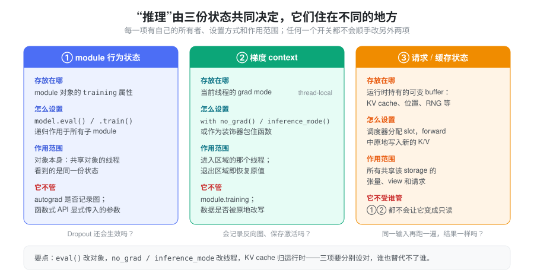
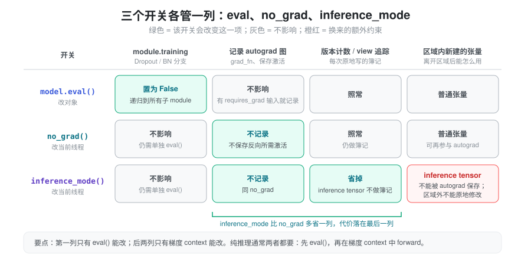
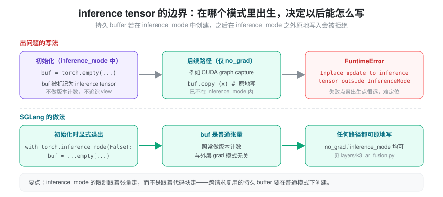

% Torch 推理模式与状态

- 已经 `model.eval()` 了，为什么显存里还在为反向保存激活？换个问法：`eval()` 和 `no_grad()` 到底谁管谁？
- 把 `no_grad()` 换成更“快”的 `inference_mode()` 后，某个持久 buffer 在 CUDA graph capture 时原地写入，为什么突然报错？
- 模式开关都设了，同一份输入跑两遍结果却不一样，问题出在哪？

“模型在做推理”是业务语义，PyTorch 不会据此自动关闭训练行为和 autograd，也不会把缓存冻结成只读。这三个问题分别落在三份互相独立的状态上。本篇先建立“三份状态、三个所有者”的模型，再看每个开关的边界，最后对照 SGLang 中它们各自在哪里被设定。

### 抽象：三份状态，三个所有者

“推理是否正确、是否省资源”由三份状态共同决定，关键在于**它们住在不同的地方**：

- **module 行为状态**挂在对象上：每个 `nn.Module` 的 `training` 属性。`model.eval()` 改的是这个对象，所有持有它的线程看到同一份值。
- **梯度 context** 挂在线程上：grad mode 是 thread-local 的，进入 `no_grad()` / `inference_mode()` 区域时设置，离开时恢复。
- **请求 / 缓存状态**挂在运行时上：KV cache、位置计数、随机数状态等可变 buffer 由推理框架持有，forward 中会被原地写入。



有了这个模型，排查就有了统一判据：**出问题的那项状态归谁管，就去那里修。** Dropout 还在生效，看对象状态或函数式参数；显存里有反向图，看当前线程的梯度 context；结果不可复现，看可变 buffer 和随机性。任何一个开关都不能替代另外两项。

### eval、no_grad 与 inference_mode 各管什么

| 手段 | 控制什么 | 主要边界 |
| --- | --- | --- |
| `model.eval()` | 将 module 及子 module 的 `training` 状态置为 false | 不关闭梯度记录，也不冻结参数 |
| `torch.no_grad()` | 禁止区域内的反向自动微分图记录 | 不自动切换 module 的训练状态 |
| `torch.inference_mode()` | 关闭梯度记录，并减少 view tracking 和版本计数等开销 | 其中创建的 inference tensor 与后续 autograd 的交互限制更严格 |



`eval()` 是否改变输出，由各 module 的实现决定，例如标准 Dropout 和 BatchNorm 会依据训练状态切换行为。纯 Linear 本身没有相同的训练/推理分支。梯度模式和 module 模式互相独立，见 [Autograd mechanics](https://docs.pytorch.org/docs/stable/notes/autograd)。

纯推理的常见写法是两者都设：

```python
model.eval()
with torch.inference_mode():
    output = model(inputs)
```

`inference_mode()` 比 `no_grad()` 多省掉的，是对 inference tensor 的版本计数和 view 追踪；代价是这些张量离开区域后受限：不能被需要 autograd 保存它的计算使用，也不能在 inference mode 之外被原地修改。因此如果结果随后要参与训练或梯度计算，通常优先考虑 `no_grad()`，并确认后续计算需要哪些张量；必要时应在区域外创建普通副本（例如 `clone()`），而不是假定 `detach()` 可以解除所有限制。见 [inference_mode](https://docs.pytorch.org/docs/stable/generated/torch.autograd.grad_mode.inference_mode.html)。

这条限制**跟着张量走，而不是跟着代码块走**：张量在哪个模式下“出生”，决定了它之后能怎么被写。推理服务中最容易踩到的，是初始化阶段在 inference mode 中创建的持久 buffer，后来在只开了 `no_grad()` 的路径上被原地写入。



### 函数式 API 未必读取 model.training

`model.training` 只被读取它的代码使用。标准 `nn.Dropout` 会依据 module 状态工作，但直接调用函数式算子时，其行为由参数决定——这相当于把“对象状态”这一项绕过去了。

SDPA 即使在 `eval()` 下，也按传入的 `dropout_p` 应用 dropout；应显式传入推理所需值：

```python
# forward 中，self.p 是配置的训练 dropout 概率
out = torch.nn.functional.scaled_dot_product_attention(
    q, k, v,
    dropout_p=self.p if self.training else 0.0,
)
```

`torch.nn.functional.dropout()` 也需要正确传递 `training`。不能只看到模型已 `eval()` 就认为所有自定义函数路径都关闭了 dropout。见 [SDPA](https://docs.pytorch.org/docs/stable/generated/torch.nn.functional.scaled_dot_product_attention) 和 [functional.dropout](https://docs.pytorch.org/docs/stable/generated/torch.nn.functional.dropout.html)。

### 推理模式不会让状态变成只读

第三份状态不受前两个开关管辖。`inference_mode()` 不会把模型和缓存变成只读对象；KV cache、位置计数、随机数状态以及自定义模块的状态，仍可能在 forward 中变化。原地操作也照常生效：

```python
view = cache[:, :valid_length]
view.zero_()  # view 与 cache 共享存储，原 cache 也被修改
```

这在没有梯度的推理中依然会发生。`no_grad()` 和 `inference_mode()` 控制自动微分，不替你管理 aliasing 和业务状态。使用原地更新节省内存前，应确认没有其他请求、张量别名或未完成的 stream 工作继续读取原内容。`detach()` 同样不复制数据，也不能将一个共享缓冲区变成独立的请求副本。布局与共享关系见 [Tensor Memory](./torch_tensor_memory.md)，异步生命周期见 [显存管理](./torch_memory_management.md)。

因此“同一份输入重复执行”是否得到同一结果，需要同时确认：

- dropout 与其他随机分支是否关闭；
- cache 是否按预期清空、复用或追加；
- position、mask 与有效序列长度是否一致；
- 多请求是否误用同一个可变缓冲区；
- kernel 的数值与确定性行为是否一致，见 [Nondeterminism](./nondeterminism.md)。

评估无 cache 的完整前向与带 cache 的逐 token 前向时，模式开关相同还不够，需要对齐这些状态和位置语义。

### 线程边界：context 不跨线程，对象状态跨线程

两类开关的作用范围恰好相反。梯度模式是 thread-local 的：主线程进入 `inference_mode()` 后，不能假定另一个工作线程也继承了相同 context，应在执行推理的线程中设置。`model.eval()` 则改变 module 对象的状态，如果多个线程共享对象，其状态也被共享——一个线程调用 `train()`，其他线程立即受影响。见 [no_grad](https://docs.pytorch.org/docs/stable/generated/torch.no_grad.html) 和 [inference_mode](https://docs.pytorch.org/docs/stable/generated/torch.autograd.grad_mode.inference_mode.html)。

实践上，把梯度 context 设在“真正执行 forward 的那个循环”的入口，而不是进程启动处；把 `eval()` 放在模型加载完成时一次性设好。

### 在 SGLang 中，三份状态分别由谁设定

以下路径均指 `python/sglang/srt/` 下。

**对象状态：加载完即 eval。** 绝大多数模型加载器在 `model_loader/loader.py` 中以 `return model.eval()` 结束 `load_model()`，之后 `training` 不再改变。

**梯度 context：包在调度循环上。** `managers/scheduler.py` 的 `event_loop_normal()` 与 `event_loop_overlap()` 都用 `@DynamicGradMode()` 装饰，因此 context 落在运行调度循环的线程上，循环内所有 forward 都继承它。`DynamicGradMode`（`utils/common.py`）把两种模式合成一个开关：

```python
def __enter__(self):
    if _ENABLE_TORCH_INFERENCE_MODE:      # SGLANG_ENABLE_TORCH_INFERENCE_MODE
        self._inference_mode_context = torch._C._InferenceMode(self.mode)
        self._inference_mode_context.__enter__()
    else:                                 # 默认
        self.prev = torch.is_grad_enabled()
        torch.set_grad_enabled(False)
```

即默认走 `no_grad` 语义，设置环境变量 `SGLANG_ENABLE_TORCH_INFERENCE_MODE` 后才切到 inference mode。此外，模型的 `*ForCausalLM.forward` 自身通常也带 `@torch.no_grad()`（例如 `models/llama.py` 的 `LlamaForCausalLM.forward`）；`model_executor/runner/prefill_cuda_graph_runner.py` 的 `_run_forward()` 注释说明，绕过外层 forward 直接调用内层时需要补上这个装饰器，否则部分 `torch.compile` 的 `out=` 调用会因 autograd 报错。

**inference tensor 的边界：持久 buffer 显式退出 inference mode。** 因为梯度 context 可能是两种之一，跨步复用的 buffer 必须在两种模式下都能被原地写。`layers/k3_ar_fusion.py` 的 `_create_buffer()` 就用 `with torch.inference_mode(False):` 创建对称内存 buffer，注释写明原因：若在 inference mode 中创建，它会成为 inference tensor，之后在 no_grad 路径（CUDA graph capture）上的原地写入会被拒绝。`distributed/device_communicators/triton_symm_mem_ag.py` 中也有同样的写法。

**请求 / 缓存状态：归运行时，不归 module。** KV cache 不是模型参数或 module buffer，而是 `ModelRunner.token_to_kv_pool`（如 `mem_cache/memory_pool.py` 的 `MHATokenToKVPool`，持有 `k_buffer` / `v_buffer`）。attention backend 持有同一个 pool 的引用，在 forward 中通过 `set_kv_buffer()` 原地写入调度器分配的 slot（`ForwardBatch.out_cache_loc`）；`RadixAttention` 层只提供 `layer_id` 等元信息。哪个请求占哪些 slot、何时释放，由调度器和内存池决定，梯度开关对此毫无影响，见 [Memory Pool](./memory_pool.md)。

### 小结

推理初始化时，应将 module 行为、梯度 context 和请求级缓存分别设定清楚：`eval()` 改对象，`no_grad()` / `inference_mode()` 改当前线程，可变缓存归运行时管理。三者共同决定正确性，其中任何一个开关都不能替代另外两项；而 `inference_mode()` 的额外限制附着在它创建的张量上，持久 buffer 应在普通模式下创建。
