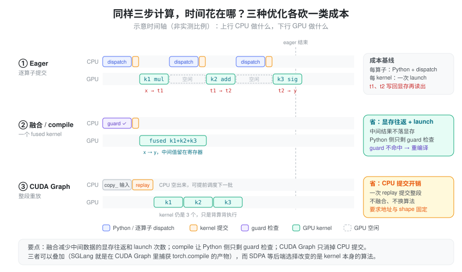
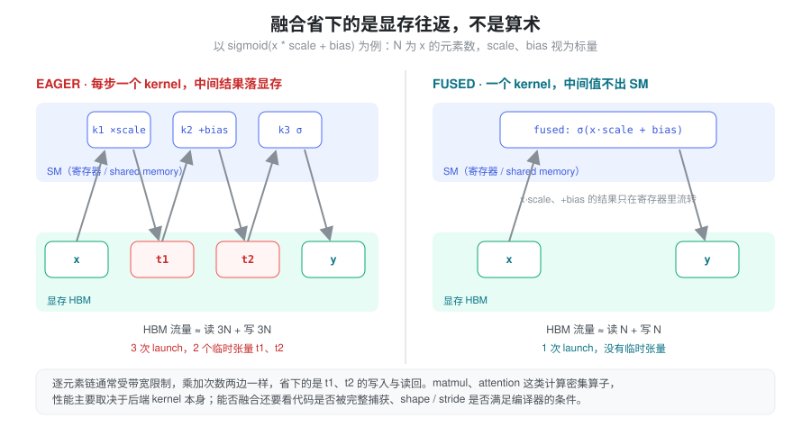
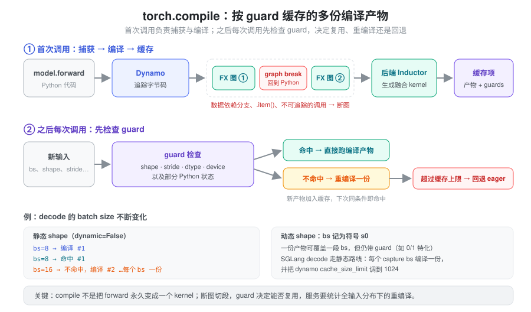

% Torch kernel 与编译执行

- `torch.sigmoid(x * scale + bias)` 只有一行，为什么 profiler 里是三个 kernel、两个临时张量？
- 开了 `torch.compile` 首次请求慢得离谱，换个 batch size 又慢一次——编译不是“一次就好”吗？
- CUDA Graph 和 `torch.compile` 都号称“加速 decode”，它们省的是同一样东西吗？

这些问题的共同根源是：**Python 代码描述的是计算的语义，GPU 实际执行的是另一回事。** 同一条 Torch 表达式，在不同设备、dtype、shape、stride 或编译状态下，可能走不同执行路径。阅读推理代码时，API 告诉我们算什么；判断性能还需要观察实际 kernel、临时数据与 CPU 提交成本。

### 抽象：语义、分派、kernel 三层，以及三类成本

把一次调用拆成三层来看：

- **语义层**：`x * scale`、`F.scaled_dot_product_attention(...)` 规定结果是什么；
- **分派层**：Python 解释执行、dispatcher 按 device/dtype/layout 选算子实现、SDPA 这类接口再挑后端；
- **kernel 层**：真正提交给 GPU 的 kernel，以及它们读写显存的方式。

性能损耗也相应地落在三处：**中间结果在显存里来回搬**（kernel 层）、**Python 与逐算子分派的 CPU 开销**（分派层）、**每个 kernel 一次的提交开销**（CPU→GPU 边界）。几种常见优化各自只砍其中一类——融合减少显存往返和 launch 次数，`torch.compile` 让 Python 侧只剩 guard 检查，CUDA Graph 把整段提交压缩成一次 replay，后端选择则换掉 kernel 本身的算法。



这张图的意义在于给出判据：先确认瓶颈落在哪一类成本上，再选对应手段。对一个 GPU 已经满载的长 matmul 开 CUDA Graph，几乎不会有收益；对一串 CPU 提交跟不上的小 kernel 换 attention 后端，也解决不了问题。

### 表达式、算子和 kernel 不是一一对应

```python
def pointwise(x, scale, bias):
    return torch.sigmoid(x * scale + bias)
```

在普通 eager 执行中，这段代码通常由多个算子完成，产生中间结果，并分别提交工作。编译器在条件允许时可以融合逐元素计算，减少中间结果写入与 kernel launch。



关键在于：**逐元素链的乘加次数在融合前后一样，省下的是 `t1`、`t2` 写回显存再读出的流量。** 这类计算通常受带宽限制，所以减少 HBM 往返就是主要收益；matmul、attention 这类计算密集算子则主要取决于后端 kernel 本身。

反过来，一个高层算子也可能调用多个 kernel，或者为了适配布局先复制再计算；`view()` 等元数据操作甚至可能没有计算 kernel。不要用 Python 代码行数估计 GPU 工作量。编译过程见 [Dynamo Core Concepts](https://docs.pytorch.org/docs/stable/user_guide/torch_compiler/compile/programming_model.dynamo_core_concepts.html)。

性能问题可以按证据区分为：

| 现象 | 应优先检查 |
| --- | --- |
| GPU kernel 之间有明显空隙 | CPU 调度、提交开销、同步等待 |
| 大量短逐元素 kernel 和临时张量 | 融合机会、重复类型转换与复制 |
| 长时间 matmul 或 attention kernel | shape、dtype、后端、计算与带宽效率 |
| 特定 batch/长度突然变慢 | 后端切换、重编译、padding 与 workspace |

具体瓶颈应由 profiler 和对照测量确认，不能一概把 decode 归为某一种瓶颈。

### SDPA：统一接口后面有多个后端

`scaled_dot_product_attention()` 可根据输入和环境选择 FlashAttention、memory-efficient attention 或 math 等实现。可用性取决于设备、dtype、head dimension、mask、布局及版本；同一 API 不保证每次走同一后端。这是“分派层”最典型的例子：语义不变，算法换了。

排查时可以用 `sdpa_kernel()` 限定后端，确认目标路径是否可用：

```python
from torch.nn.attention import SDPBackend, sdpa_kernel
import torch.nn.functional as F

# q、k、v 由调用方提供；若不满足后端约束，可能告警或报错
with sdpa_kernel(backends=[SDPBackend.FLASH_ATTENTION]):
    out = F.scaled_dot_product_attention(q, k, v, dropout_p=0.0)
```

限定后端适合诊断和可控场景，不应跳过数值、shape 范围和性能验证就全局强制。支持的后端与输入约束见 [SDPA 官方文档](https://docs.pytorch.org/docs/stable/generated/torch.nn.functional.scaled_dot_product_attention)。

接口语义也需要核对：SDPA 布尔 `attn_mask` 中 `True` 表示允许参与 attention，而 `MultiheadAttention.key_padding_mask` 中 `True` 表示忽略该位置。对于 cache decode，query 和 key 长度不等时，还需要确认 `is_causal` 的对齐方式；不能把任意非方阵场景都当成所需的“右下角对齐”因果 mask。该接口默认非方阵 causal bias 为左上对齐，构造 mask 时要匹配真实位置关系。细节同见上述文档。

SGLang 的 `layers/attention/torch_native_backend.py`（`TorchNativeAttnBackend`，直接调用 SDPA 的后端）给出了两种处理：decode 路径每个请求只有一个新 query，它本来就能看到全部历史 KV，所以默认 `causal=False`；extend 路径（`_run_sdpa_forward_extend`）则对每个请求先 `torch.empty` 出长度等于 KV 长度的 query 缓冲区，把真实 query 写到 `[prefix_len:]` 位置，再以方阵调用 SDPA 并设置 `is_causal`，这样左上对齐与真实位置就一致了；代价是前缀位置的冗余计算。它同时用 `k_cache[per_req_tokens]` 逐请求 gather K/V——高级索引读取会产生副本（见 [广播与索引](./torch_broadcast_indexing.md)），加上按请求的 Python 循环，源码注释自己也写着 “Need optimize the performance later”——它适合做对照与兜底，而不是高性能路径。

### torch.compile：捕获、guard 与重编译

`torch.compile()` 尝试捕获可编译的计算图，再由后端生成优化实现。它不是把任意 Python forward 永久编译成一个固定 kernel，更准确的心智模型是：**一个按 guard 索引的编译产物缓存。**



- **graph break**：遇到不能捕获的代码时，默认可回到 Python 执行，再继续捕获下一段图，跨段优化受限。
- **guard**：已编译结果带有适用条件，可能包括输入 shape、stride、dtype、device 和部分 Python 状态。
- **recompile**：条件不满足时，可能重新编译一个适用版本；动态形状能减少部分 shape 变化引起的重编译，但不能解决所有 guard 变化。超过缓存上限后会回退到 eager。

数据依赖的 Python 分支、主机标量读取和自定义函数调用，是值得优先排查的区域；具体支持能力随版本演进。见 [torch.compile](https://docs.pytorch.org/docs/stable/generated/torch.compile)、[Dynamic Shapes](https://docs.pytorch.org/docs/stable/user_guide/torch_compiler/torch.compiler_dynamic_shapes.html) 和 [重编译排查](https://docs.pytorch.org/docs/main/user_guide/torch_compiler/compile/programming_model.recompilation.html)。

在请求 batch、prefill 长度和 decode token 数不断变化的服务中，必须统计整个输入分布，而不只测一个固定 shape。可用 `TORCH_LOGS="graph_breaks,recompiles"` 辅助定位断图与重复编译。

### CUDA Graph：重放命令，与计算融合分别理解

CUDA Graph 将一段 GPU 工作捕获后重复提交，主要减少 CPU 提交开销。它本身不自动把多个 kernel 融合成一个；编译器融合与 graph replay 可以互相配合——前者改变“有哪些 kernel”，后者改变“怎么把它们交给 GPU”。

手工捕获的图通常要求重放时使用稳定的地址和适用的形状。典型模式是先分配固定缓冲区，每次把新内容写入缓冲区，再 replay；不能只把 Python 变量重新绑定到另一个张量，就认为图会读取新地址。

不同输入规模可以通过分桶和 padding 适配，但需要屏蔽无效位置，并计入额外计算与常驻显存。多份图、私有内存池和静态缓冲区也可能提高占用。更详细的捕获与重放原理见 [Cuda Graph](./cuda_graph.md) 和 [PyTorch CUDA Graphs](https://docs.pytorch.org/docs/stable/notes/cuda#cuda-graphs)。

### compile 产物被装进 CUDA Graph

SGLang 的 decode 路径把上面几层叠在一起，读代码时可以对照三类成本（基于 `python/sglang/srt/` 当前代码）：

- **分桶捕获。** `model_executor/runner/base_cuda_graph_runner.py` 的 `get_batch_sizes_to_capture()` 算出要捕获的 batch size 列表 `capture_bs`；运行时 `_pad_to_bucket()` 用 `bisect_left` 把真实 batch 向上补到最近的桶，超过最大桶的 batch 由 `can_run_graph()` 拒绝、回退非 graph 路径。
- **静态缓冲区 + `copy_`。** `DecodeCudaGraphRunner`（`model_executor/runner/decode_cuda_graph_runner.py`）replay 前执行 `self.buffers.input_ids[: self.raw_num_token].copy_(forward_batch.input_ids)`、`positions` 同理——正是“写入固定地址，而不是换绑变量”。
- **compile 是可选的一层。** `--enable-torch-compile`（`server_args.py`，标注为实验特性，默认关闭）打开后，只对不超过 `--torch-compile-max-bs`（默认 32）的桶编译，即 `compile_bs`。`capture()` 对每个桶进入 `compilation/torch_compile_decoration.py` 的 `patch_model()`：命中 `compile_bs` 时返回 `torch.compile(torch.no_grad()(model.forward), mode=..., dynamic=...)`，否则返回原 `model.forward`，然后再交给 CUDA Graph 捕获。
- **静态 shape、放宽缓存。** CUDA 上 `dynamic` 为 False（只有 HIP 且设置 `SGLANG_TORCH_DYNAMIC_SHAPE` 时为动态），每个桶各编译一份；`set_torch_compile_config()` 因此把 dynamo 的 `cache_size_limit` 调到 1024，避免桶多时触发上限回退。默认 `mode` 是 `max-autotune-no-cudagraphs`（可由 `SGLANG_TORCH_COMPILE_MODE` 覆盖），即不让 Inductor 自己再套 CUDA Graph，graph 统一由 runner 捕获。

所以开启 compile 后启动变慢、显存占用变化，是“桶数 × 编译 + 捕获”的一次性成本；稳定运行时，每步 decode 只剩拷入输入和一次 replay。

### 验证顺序：正确性、冷启动、稳定运行

1. 固定输入，比较 eager 与优化路径的数值输出、mask 和 KV cache 更新。
2. 分别记录编译、预热和 capture 成本，避免混入稳定吞吐。
3. 覆盖真实 batch、序列长度、dtype 与布局范围，观察断图和重编译。
4. 使用 profiler 检查实际 kernel 数量、复制和同步；计时方式见 [CUDA 异步执行](./torch_cuda_execution.md)。
5. 同时记录延迟、吞吐和峰值显存，判断收益是否适合实际服务。

### 小结

Python 表达式只规定语义；实际成本由分派路径和最终 kernel 决定。把损耗拆成“显存往返、Python/分派开销、kernel 提交开销、算法本身”四类，就能对上手段：融合减少中间数据与部分提交，`torch.compile` 用 guard 缓存换掉 Python 解释，CUDA Graph 减少重复提交，后端选择改变算法路径。它们解决的问题不同、可以叠加（SGLang decode 正是 compile 产物装进 CUDA Graph），收益也需要分别验证：图捕获了什么、后端执行了什么、数据如何流动。
