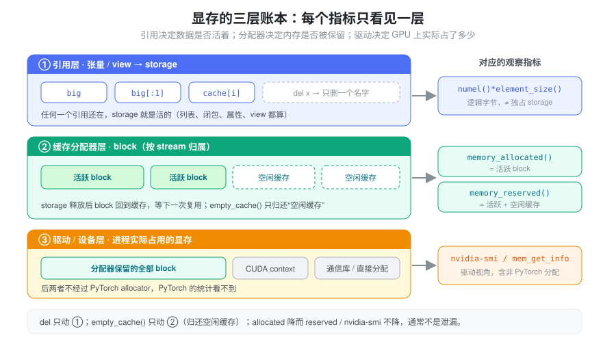
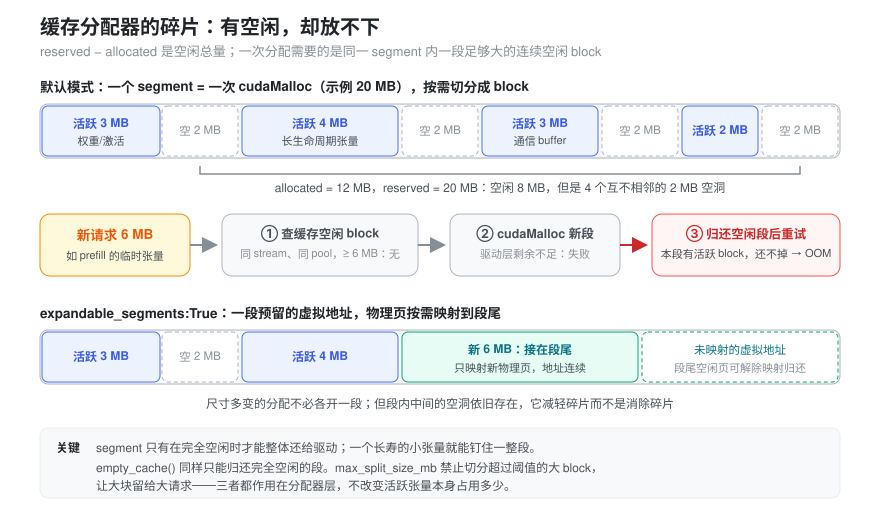
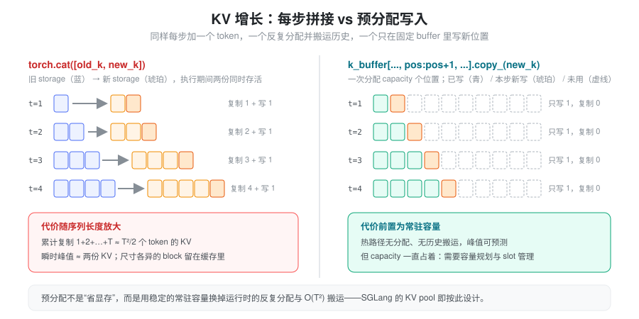
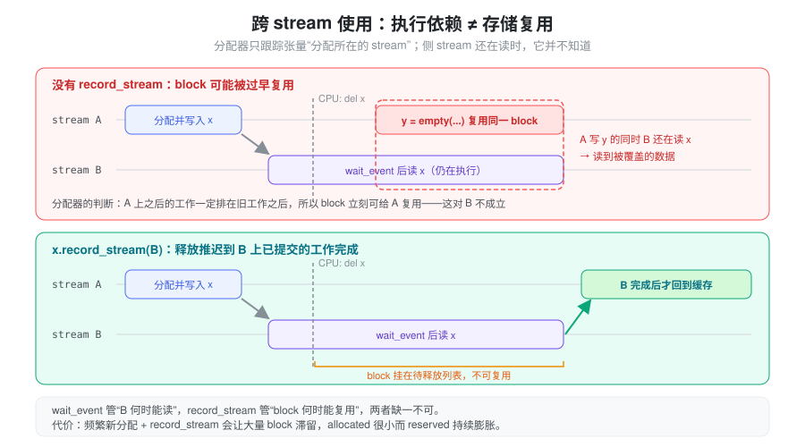

% Torch 显存管理与生命周期

- `del` 掉了一个大张量，`nvidia-smi` 上的显存却一点没降——是泄漏了，还是根本不该降？
- 调用 `torch.cuda.empty_cache()` 后显存“降下来了”，为什么下一步 decode 反而更慢，OOM 也没解决？
- 活跃张量只有十几 GB，`memory_reserved()` 却涨到几百 GB，最后报 OOM——这些显存被谁占着？

推理服务的显存不只是权重和 KV cache。中间输出、kernel workspace、allocator 缓存、CUDA Graph 的私有内存池，都可能影响峰值。上面三个问题的答案都不一样：有的是对象仍被引用，有的只是分配器缓存，有的是缓存块因跨 stream 使用而迟迟不能复用。本篇先建立一个分层模型，把“谁持有数据”“谁保留了内存”“峰值在哪里”拆开回答，再看 SGLang 如何在这个模型上规划 KV cache 容量。张量布局与共享 storage 的基础见 [Tensor Memory](./torch_tensor_memory.md)。

### 抽象：显存是三层账本

一块显存从“被张量使用”到“回到 GPU”，要经过三层，每层各记一本账：

1. **引用层（Python 对象 → storage）**：张量只是 storage 的透镜；只要还有任何张量、view、列表、闭包或缓存引用这块 storage，它就是活的。`del x` 只是删掉一个名字。
2. **缓存分配器层（PyTorch caching allocator）**：storage 的内存来自分配器管理的 block。storage 不再被引用时，block 通常**回到分配器的缓存**，等下一次同 stream、尺寸合适的分配复用，而不是立刻还给驱动——因为向驱动申请和释放显存既慢，又可能引入同步。
3. **驱动/设备层**：驱动看到的是进程实际向 GPU 申请到的内存，其中除了分配器保留的部分，还有 CUDA context、通信库缓冲区以及绕开 PyTorch allocator 的直接分配。

关键的一点：**每个观察指标只看到其中一层**，不能拿一层的数字去回答另一层的问题。



| 观察项 | 含义 | 不能直接推出什么 |
| --- | --- | --- |
| `x.numel() * x.element_size()` | 张量逻辑元素的数据字节数 | 不代表其独占的 storage 大小 |
| `torch.cuda.memory_allocated()` | 当前张量等活跃分配占用的 CUDA 内存 | 不包含所有进程级 GPU 占用 |
| `torch.cuda.memory_reserved()` | 缓存分配器管理的内存 | 不代表这些内存都被活跃张量使用 |
| `nvidia-smi` | 驱动视角的进程显存占用 | 不能单独判断 Python 张量泄漏 |

逻辑字节数与 storage 也对不上：一个 view 可能只暴露几个元素，却让整块大 storage 持续存活；`expand()` 的逻辑元素数又可能远大于实际存储。共享 storage 的多个张量也不能简单相加来估算独立占用。

指标定义见 [memory_allocated](https://docs.pytorch.org/docs/stable/generated/torch.cuda.memory.memory_allocated.html) 和 [memory_reserved](https://docs.pytorch.org/docs/stable/generated/torch.cuda.memory.memory_reserved.html)。CUDA context、部分通信库或绕开 PyTorch allocator 的直接分配，会造成驱动统计与 PyTorch 统计之间的差异。

### 引用层：del 删除的是引用，不是强制释放显存

```python
import torch

big = torch.empty(1024, 1024, device="cuda")
small = big[:1]  # view 仍引用整块 storage
del big         # storage 仍需为 small 保留
small_copy = small.clone()
del small       # 不再通过这个 view 持有原 storage
```

同一张量放进列表、对象属性、闭包或缓存后，删除局部变量不会消除其他引用。`detach()` 只断开 autograd 关系，仍共享 storage；需要独立数据时才考虑 `clone()`，并计入复制成本。见 [Tensor.detach](https://docs.pytorch.org/docs/stable/generated/torch.Tensor.detach.html)。

当最后一个相关引用消失且异步使用安全结束后，内存通常先回到 PyTorch 缓存分配器，供下一次分配复用，而不是立即还给 CUDA 驱动。这就是第一个问题的答案：`memory_allocated()` 下降了，`memory_reserved()` 和 `nvidia-smi` 不降是正常现象。

“最后一个引用消失”的时刻也分两种。CPython 主要靠**引用计数**：计数归零时对象立即析构，storage 立即交回分配器，时机是确定的。但如果张量被困在**循环引用**里——对象互相引用、闭包捕获了自身所在的对象、保存下来的异常 traceback 仍挂着各层栈帧的局部变量——计数永远不会归零，只能等循环垃圾回收器（`gc`）在某个不确定的时刻扫到它。于是会出现“逻辑上早已不用、`allocated` 却要过一阵才降”的现象；排查时先 `gc.collect()` 再看 `allocated`，就能区分“真的还有引用”和“只是在等 GC”。

反过来，GC 本身也有成本：对象越多，一次全量回收越慢，还会在请求路径上造成延迟抖动。SGLang 在两处利用 `gc.freeze()`（把当前存活对象移出后续回收扫描范围）：CUDA Graph capture 前，`model_executor/runner/base_cuda_graph_runner.py` 的 `freeze_gc()` 先 `gc.collect()` 再冻结，capture 结束后解冻并回收（`--enable-cudagraph-gc` 可关闭冻结），以加快捕获；服务运行时，`utils/common.py` 的 `freeze_gc(context)` 可在预热后由 HTTP 接口触发，冻结 tokenizer/scheduler/detokenizer 进程中的长寿对象，日志里检测到长时间 GC 时也会提示这样做。

### 分配器层：empty_cache 不是清理活跃张量

`torch.cuda.empty_cache()` 只作用于第二层：把分配器缓存中**当前未使用**的 block 还给驱动。它不能释放仍被张量持有的内存，也不能修复引用泄漏。每个 decode step 调用它，会损失缓存复用的价值并增加分配开销；不应作为常规优化手段。

它可能在特定碎片化场景或让其他进程使用空闲显存时有帮助，但不能用“调用后显存下降”证明活跃数据变少。见 [empty_cache](https://docs.pytorch.org/docs/stable/generated/torch.cuda.memory.empty_cache.html)。

在 SGLang 中，它出现在“生命周期边界”而不是热路径上：例如 `Scheduler.flush_cache(empty_cache=True)`（`managers/scheduler.py`）先重置 radix cache、`req_to_token_pool` 和 KV allocator 等业务缓存，再调用 `current_platform.empty_cache()` 归还分配器缓存；模型加载和权重导出路径也类似。`utils/common.py` 的 `empty_device_cache()` 注释写得很直白：它不清理 SGLang 的 KV/radix/请求缓存，也不释放活跃张量，只转发到后端 allocator。

### 分配器内部：segment、block 与碎片

“reserved 远大于 allocated 却 OOM”需要再往分配器层里看一层。分配器向驱动申请的单位叫 **segment**（一次 `cudaMalloc`），张量拿到的是从 segment 里切出来的 **block**。几条规则决定了它的行为（以 PyTorch CUDA caching allocator 的默认实现为准）：

- **尺寸取整**：请求按 512 字节取整，所以极小的张量也至少占一个最小 block。
- **两个池**：不超过 1 MB 的请求走 small pool，从 2 MB 的 segment 里切；更大的请求走 large pool，较小的大请求共享 20 MB 的 segment，更大的请求则单独申请按 2 MB 取整的 segment。
- **切分与合并**：找到的空闲 block 比需要的大时被切开，剩余部分留作空闲 block；释放后与同一 segment 内**相邻**的空闲 block 合并。
- **按 stream 归属**：空闲 block 只给同一 stream 上的后续分配复用，这正是上文 `record_stream()` 要解决的问题。
- **段级归还**：segment 只有在其中所有 block 都空闲时才能整体 `cudaFree`。

于是碎片就出现了：reserved 与 allocated 之差是空闲总量，但这些空闲可能散落在多个 segment 的“空洞”里，没有一个空洞大到能容纳新请求；而每个 segment 又因为夹着活跃 block 而无法归还驱动。分配器找不到合适 block 时，会先尝试 `cudaMalloc` 新 segment，失败后归还完全空闲的缓存 segment 再重试，仍然失败才抛 OOM。



`PYTORCH_CUDA_ALLOC_CONF` 中有两个旋钮直接针对这个问题，都需要在进程首次 CUDA 分配之前设置：

- `expandable_segments:True`：segment 改为预留一段虚拟地址，物理页按需映射到段尾、空闲时解除映射。尺寸不断变化的分配（如逐步增长的 batch）可以在同一段里“长大”，而不是每种尺寸各开一段。它不会填平段内中间的空洞，减轻而非消除碎片。
- `max_split_size_mb:N`：超过 N MB 的空闲 block 不再被切分给小请求，防止大块被零碎请求蚕食。

`expandable_segments` 并非没有代价：它基于 CUDA 虚拟内存管理（VMM），这类内存不能走传统的 CUDA IPC 导出。SGLang 的 `weight_cache/daemon.py` 在启动时检查 `PYTORCH_CUDA_ALLOC_CONF` / `PYTORCH_ALLOC_CONF`，发现 `expandable_segments:True` 就提前报错，否则依赖 `_share_cuda_` 的权重 IPC 导出会在中途失败；`distributed/device_communicators/custom_all_reduce_v2.py` 则为 VMM 指针单独准备了注册路径。改分配器配置前，要确认进程内是否有依赖 IPC 句柄的组件。配置项说明见 [CUDA memory management](https://docs.pytorch.org/docs/stable/notes/cuda.html#optimizing-memory-usage-with-pytorch-cuda-alloc-conf)。

### 峰值：每步拼接 vs 预分配

显存问题经常不是“稳态占用太高”，而是“某一瞬间的峰值”。考虑每步拼接 KV：

```python
# 示意：old_k 为 [batch, head, sequence, dim]
k = torch.cat([old_k, new_k], dim=2)
```

这个实现容易理解，但每步都构造新结果并复制旧内容；在 `cat` 执行期间，旧、新存储同时存活，瞬时占用接近两份 KV。若每次增加一个 token，累计复制规模随序列长度 \(T\) 近似增长为 \(O(T^2)\)。这与 attention 本身的计算复杂度是不同的成本。尺寸不断变化的分配还会让分配器缓存里留下大量大小不一的 block，增加碎片。

预分配容量后，只写入新位置，可以减少反复分配和历史数据搬运：

```python
# 示意：capacity、position、new_k 的 shape 均由调用方保证正确
k_buffer[:, :, position:position + 1, :].copy_(new_k)
```



预分配并不消除内存代价：它用较稳定的常驻容量换取更少的运行时分配。多请求服务还需要容量规划、slot 管理和释放策略，见 [Memory Pool](./memory_pool.md)。

此外，`torch.empty()` 创建的缓冲区内容未初始化；任何会被读取的位置都必须先写入。padding、graph bucket 和部分有效的 KV buffer 尤其需要确认有效区域。见 [torch.empty](https://docs.pytorch.org/docs/stable/generated/torch.empty.html)。

### 跨 stream 生命周期：依赖与复用分别处理

分配器的 block 是按 stream 归属管理的：一个张量在 stream A 上分配，释放后，分配器只保证**stream A 上之后排队的工作**不会和旧数据冲突，所以可以立刻把这块 block 交给 stream A 上的下一次分配。它并不知道 stream B 还在读这块内存。

因此在侧 stream 使用一个 CUDA 张量，要解决两个问题：消费者何时可以读取，以及 allocator 何时可以复用存储。

- `wait_stream()` 或 Event 处理 producer/consumer 的执行顺序。
- `record_stream()` 通知 allocator：该张量的存储还在指定 stream 上使用，不能仅根据原 stream 的进度就复用。



`record_stream()` 不替代数据依赖；显式维护正确的 stream 同步也可以管理生命周期，但要求调用方更仔细地安排释放。见 [Tensor.record_stream](https://docs.pytorch.org/docs/stable/generated/torch.Tensor.record_stream.html)。

`record_stream()` 的代价是**延迟释放**：block 要等到被记录 stream 上已提交的工作完成后才能回到可复用状态。SGLang 的 DP attention two-batch-overlap 路径恰好踩到过这一点：`dp_gather_partial_async()`（`layers/dp_attention.py`）在通信 stream 上做 gather，并对输入输出调用 `record_stream(comm)`。紧随其后的 `_TBO_PERSIST_BUF` 注释记录了一次真实故障——每层、每个 micro-batch 都新 `torch.empty` 一块尺寸各异的 gather/combine buffer，又被通信 stream 的 `record_stream` 拖住，结果活跃工作集只有约 10GB，`reserved` 却涨到约 270GB，在 ROCm 上触发资源耗尽。修复方式是改用按 key 复用、只增不减的持久 buffer（`get_tbo_persistent_buffer()`）。`layers/moe/token_dispatcher/moriep.py` 的 dispatch 路径则出于同样原因刻意不调用 `record_stream`，改由同一调用内的 `wait_event` 保证安全。这正是第三个问题的典型答案：**allocated 小、reserved 大**，问题出在分配器层，而不在引用层。

### 结合 SGLang：KV cache 容量从哪里来

推理引擎会主动利用上面的分层模型来规划显存。SGLang 的思路是：先加载权重，再测“驱动层还剩多少”，扣掉给运行时临时分配预留的余量，剩下的一次性分配给 KV cache。

- `get_available_gpu_memory()`（`utils/common.py`）在 CUDA 上先调用 `empty_device_cache()`，再用 `torch.cuda.mem_get_info()` 读驱动视角的空闲显存。先清缓存，是为了让分配器缓存里空闲的 block 也被算作“可用”；多卡时取所有 rank 的最小值。
- `KVCacheConfigurator._profile_available_bytes()`（`mem_cache/kv_cache_configurator.py`）用这个空闲值减去 `pre_model_load_memory * (1 - mem_fraction_static)` 作为运行时余量（激活、workspace、CUDA Graph 等），剩余部分作为 KV pool 预算；若已加载的权重超出静态预算，会报错并给出建议的 `--mem-fraction-static`。
- 预算确定后，`MHATokenToKVPool._create_buffers_normal()`（`mem_cache/memory_pool.py`）按层一次性 `torch.zeros` 出 `k_buffer` / `v_buffer`；之后每步 forward 只经 `set_kv_buffer()` 按槽位 `loc` 写入，不再为 KV 增长做分配。

所以 `--mem-fraction-static` 调的并不是“PyTorch 能用多少显存”，而是**常驻 KV 容量与运行时临时峰值之间的分界**：设得过高，prefill 的临时 attention score、通信 buffer 或 graph capture 可能在余量里放不下而 OOM；设得过低，KV 槽位少，并发和 prefix 复用受限。槽位如何分配、回收与共享见 [Memory Pool](./memory_pool.md)。

### CUDA Graph 私有内存池：被图钉住的显存

CUDA Graph 把 kernel 连同它们读写的**地址**一起录下来，replay 时原样复用（见 [Cuda Graph](./cuda_graph.md)）。这对分配器提出了一个硬要求：capture 期间分配的中间张量，即使在 Python 里早已释放，它们的地址在图存活期间也不能交给别人——否则下次 replay 会覆盖新主人的数据。PyTorch 的做法是在 capture 期间把分配导向一个**私有内存池**：图内的分配与释放只在池内进行，池里的 block 不会被图外的普通分配复用，直到图被销毁。

这直接改变了显存账：

- capture 结束后，图内的临时张量在引用层已经不存在，`memory_allocated()` 不再计入它们；但私有池里的 block 仍被保留，`memory_reserved()` 和驱动视角都包含它们。这是 **allocated 小、reserved 大**的又一个合法来源，与泄漏无关，`empty_cache()` 也还不掉。
- 每多捕获一个 batch-size 桶就可能多占一份。多张图可以通过 `torch.cuda.graph(..., pool=handle)` 共享同一个池（handle 来自 `torch.cuda.graph_pool_handle()`），前提是这些图不会并发 replay，彼此可以复用中间缓冲。

SGLang 把这一点推到进程级：`model_executor/runner_utils/pool.py` 的 `get_or_create_global_graph_memory_pool()` 在首次使用时创建一个全局 graph pool handle，`runner_backend/full_cuda_graph_backend.py` 的 `capture_session()` 取到它，再在每次捕获时以 `pool=self._pool` 传给 graph context。该文件的注释说明了设计理由：prefill 和 decode 两类 graph 永远不会同时 replay，共用一个池，只需保留两者中较大的那份 capture 占用，而不是两份相加。

在容量规划上，capture 发生在 KV pool 分配**之后**，因此 graph 池必须装进 `mem_fraction_static` 留出的运行时余量里——这正是余量设得过小时 capture 阶段 OOM 的原因。`model_runner_components/cuda_graph_setup.py` 会在 capture 前后各测一次驱动层空闲显存，并打印 `Capture ... CUDA graph end ... mem usage=... GB`，这个差值就是图（含私有池）实际吃掉的显存，可以直接拿来校准余量。部分配置下还可开启 post-capture KV sizing（`SGLANG_ENABLE_POST_CAPTURE_KV_SIZING`，条件见 `ServerArgs.post_capture_kv_sizing_planned()`）：`model_runner_components/kv_pool_runtime.py` 的 `compute_post_capture_kv_resize()` 在 capture 完成后重新读取空闲显存、扣除余量，再按实测预算调整 KV pool 大小，相当于用实测值代替事先估计的 graph 预留。

### 定位 OOM 要观察运行阶段与峰值

```python
torch.cuda.synchronize()
torch.cuda.reset_peak_memory_stats()
# 执行需要测量的一段推理工作
torch.cuda.synchronize()
allocated = torch.cuda.memory_allocated()
reserved = torch.cuda.memory_reserved()
peak = torch.cuda.max_memory_allocated()
```

这里 `peak` 是重置后活跃分配的最高值，包含测量开始时已存在的分配，并不是本次 forward 的增量。

分别测量模型加载、预热、graph capture、prefill 和 decode。只看 forward 完成后的占用，可能错过临时 attention score 或 workspace 的峰值；只看 reserved 又可能误判泄漏。按三层账本排查：

1. `allocated` 持续增长 → 引用层：查谁还持有张量（列表、缓存、闭包、跨请求复用的对象）。
2. `allocated` 稳定但 `reserved` 远大于它 → 分配器层：查尺寸多变的临时分配、碎片和 `record_stream` 造成的延迟释放。
3. `reserved` 稳定但 `nvidia-smi` 更高 → 驱动层：查 CUDA context、通信库和绕开 allocator 的分配。

#### 读懂 OOM 报错

较新版本 PyTorch 的 OOM 报错本身就是一份三层账本，大致形如：

```text
torch.OutOfMemoryError: CUDA out of memory. Tried to allocate 2.00 GiB.
GPU 0 has a total capacity of 79.15 GiB of which 1.20 GiB is free.
Including non-PyTorch memory, this process has 77.90 GiB memory in use.
Of the allocated memory 70.10 GiB is allocated by PyTorch,
and 6.50 GiB is reserved by PyTorch but unallocated. ...
```

逐项对号入座（数字仅为示意）：

| 报错字段 | 对应层 | 说明 |
| --- | --- | --- |
| `Tried to allocate` | 本次请求 | 这一次需要的连续大小，不是总缺口 |
| `of which ... is free` | 驱动层 | 整张卡还剩多少，包括其他进程留下的 |
| `this process has ... in use` | 驱动层 | 本进程总占用，含 context、NCCL 等非 PyTorch 部分 |
| `allocated by PyTorch` | 引用层 | 活跃张量，即 `memory_allocated()` |
| `reserved ... but unallocated` | 分配器层 | 缓存中空闲但没能满足本次请求的部分 |

判读方式：`reserved but unallocated` 已经大于 `Tried to allocate` 仍然失败，说明空闲在、但被切碎了，应往碎片方向排查（报错末尾也会提示 `expandable_segments`）；它很小而 `allocated` 很大，则是活跃数据真的太多，要找峰值来源或调低常驻占用；`in use` 明显大于 allocated 与 reserved-unallocated 之和，差额在驱动层，PyTorch 统计看不到。

#### memory snapshot：看见每个 block 是谁分配的

计数器只告诉你“多少”，snapshot 告诉你“是谁、在哪一行、什么时候”：

```python
torch.cuda.memory._record_memory_history(max_entries=100_000)
# 运行可复现问题的一段推理
torch.cuda.memory._dump_snapshot("oom_snapshot.pickle")
torch.cuda.memory._record_memory_history(enabled=None)  # 停止记录
```

把 pickle 拖进 [pytorch.org/memory_viz](https://pytorch.org/memory_viz)，可以看到随时间变化的活跃分配曲线（每个分配附带 Python/C++ 调用栈），以及按 segment 展开的 block 布局——碎片在这里是直接可见的空洞。也可以在捕获 OOM 时立即 dump，定格出错瞬间的状态。记录调用栈有可观的开销，只适合诊断，不要常开；它也只能看到 PyTorch allocator 追踪的分配，驱动层差额仍需其他手段。用法见 [Understanding CUDA Memory Usage](https://docs.pytorch.org/docs/stable/torch_cuda_memory.html)。

### 小结

把显存看成三层账本——引用层决定数据是否还活着，分配器层决定内存是否被保留以便复用，驱动层决定 GPU 上实际被占了多少——就能把“谁仍持有数据”“分配器保留了多少”“执行期间峰值在哪里”分开回答。`del` 只动第一层（且循环引用要等 GC），`empty_cache()` 只动第二层且只能归还完全空闲的 segment，`record_stream()` 和 CUDA Graph 私有池则让第二层的 block 在一段时间内不能被别人复用。“有空闲却 OOM”几乎都落在第二层：空闲总量够，但没有一块连续空闲够大。SGLang 这类推理引擎的做法是在启动时测出驱动层余量、一次性预分配 KV、热路径只写不分配，从而把峰值限定在可预测的运行时余量里；稳定的 KV 容量和受控的临时分配，通常比反复清缓存更有助于推理性能和容量预测。
