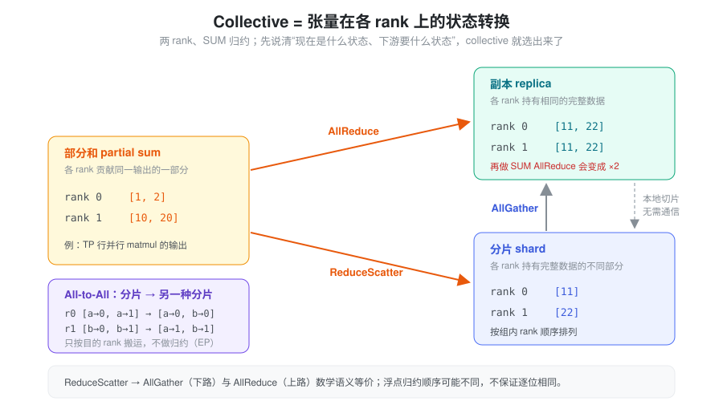
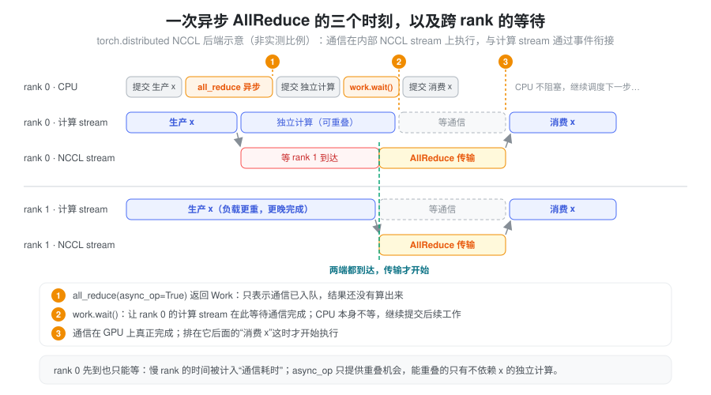
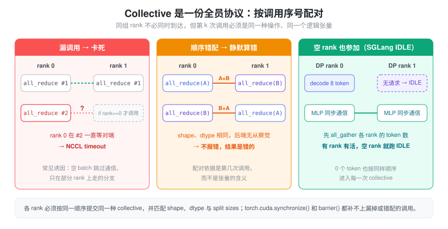

% Torch 多 GPU 通信与执行

- `all_reduce()` 返回之后，结果已经算完了吗？
- 开了 `async_op=True`，为什么没有通信计算重叠，甚至读到了错误结果？
- 每张 GPU 单独运行都正常，合起来为什么卡在 NCCL timeout？

单卡程序只有一条依赖链：同一个 stream 上的 kernel 按提交顺序执行。多卡之后，一个张量的“完整值”不再属于任何一张卡，每次通信同时牵扯三件事：**数据要从什么状态变成什么状态、所有 rank 是否按同一份协议参加、本卡上什么时候可以读写通信 buffer。** 只满足其中一两件，程序仍可能卡死、静默算错或失去重叠。

### 抽象：一次通信 = 状态转换 + 全员协议 + stream 依赖

把任意一次 collective 拆成三个独立的问题来看：

- **状态转换（算什么）**：输入在各 rank 上是副本、分片还是部分和，下游需要哪种状态。它决定该用 AllReduce、AllGather、ReduceScatter 还是 All-to-All。
- **全员协议（和谁、第几次）**：同组所有 rank 必须按同一顺序调用同一种 collective，形状与布局彼此匹配。它决定程序会不会卡住或把错误的张量加在一起。
- **stream 依赖（何时可用）**：通信在 GPU 的某条 stream 上异步执行，本卡的生产者、通信与消费者之间要有正确的先后关系，buffer 在通信期间不能被覆盖或复用。它决定读到的值对不对、能不能与计算重叠。

前一个问题是“数学”，后两个问题是“工程”。排查多卡问题时，先判断出错的是哪一层：结果数值不对、作业卡住、还是只在开了 overlap 后随机出错，分别对应不同的检查清单。

### 执行模型：进程、GPU、通信组与 stream

CUDA 分布式程序常用“一进程一 GPU”：每个进程独立运行 Python 代码、持有本地张量，通过 `torch.distributed` 交换数据。各进程没有共享的 Python 控制流，一个 rank 提交通信也不会替其他 rank 提交。

| 概念 | 含义 | 容易混淆的地方 |
| --- | --- | --- |
| Global rank | 进程在整个作业中的编号 | 不等于本机 GPU 编号 |
| Local rank | 进程在当前节点中的编号 | 通常用于选择本进程的可见 CUDA device |
| World size | 整个作业的进程数量 | 不一定等于 TP 或 EP 的大小 |
| Process group | 一组参与通信的 rank | TP、EP、DP 可以使用不同的组 |
| Group rank | 进程在某个通信组内的编号 | 拼接和分片布局要按该组的 rank 顺序理解 |
| CUDA stream | 本设备上的执行队列 | 不能直接给另一台 GPU 建立跨设备通信协议 |

`torchrun` 提供 `RANK`、`LOCAL_RANK`、`WORLD_SIZE` 等环境变量；典型绑定方式是先 `torch.cuda.set_device(local_rank)`，再初始化 NCCL process group。设备编号受 `CUDA_VISIBLE_DEVICES` 影响。见 [torchrun 文档](https://docs.pytorch.org/docs/stable/elastic/run.html)。

NCCL 是 NVIDIA GPU 通信库，负责 collective 和点对点通信的执行；`torch.distributed` 提供通信接口，ProcessGroupNCCL 负责把调用接到 NCCL。实际传输可能经过 NVLink/NVSwitch、PCIe 或跨节点网络，路径取决于硬件拓扑与配置。增加 GPU 数量，通常也会增加通信与协调成本。

### Collective：先判断张量在各 rank 上是什么状态

区分三种输入状态，比记 API 名字更有用：

- **副本**：各 rank 持有相同的完整数据。
- **分片**：各 rank 持有完整数据中不同的一部分。
- **部分和**：各 rank 对同一个输出贡献一部分数值，需要相加才能得到完整结果。



这样看，选 collective 就变成在图上找一条边：部分和要变副本走 AllReduce，要变分片走 ReduceScatter；分片要变副本走 AllGather；副本要变分片只需本地切片。对相同副本再做 SUM AllReduce，会把值乘以组大小，不会自动得到平均值——这是“状态判断错了”最常见的后果。

下面以两 rank、SUM 归约为例。布局均按通信组内的 rank 编号排列。

| 操作 | Rank 0 输入 | Rank 1 输入 | Rank 0 输出 | Rank 1 输出 |
| --- | --- | --- | --- | --- |
| AllReduce | `[1, 2]` | `[10, 20]` | `[11, 22]` | `[11, 22]` |
| AllGather | `[1, 2]` | `[10, 20]` | `[1, 2, 10, 20]` | `[1, 2, 10, 20]` |
| ReduceScatter | `[1, 2]` | `[10, 20]` | `[11]` | `[22]` |
| All-to-All | `[a→0, a→1]` | `[b→0, b→1]` | `[a→0, b→0]` | `[a→1, b→1]` |
| Broadcast，root=0 | `[1, 2]` | 接收 buffer | `[1, 2]` | `[1, 2]` |

在兼容的布局和归约操作下，**ReduceScatter 后接 AllGather，与 AllReduce 在数学语义上等价**。浮点归约的执行顺序可能不同，不能据此要求逐位相同（见 [数值精度](./torch_numerical_precision.md)）。All-to-All 则是重分布：每个 rank 向不同目的 rank 发送不同内容，不做数值归约。见 [NCCL collective 语义](https://docs.nvidia.com/deeplearning/nccl/user-guide/docs/usage/collectives.html)。

常见 PyTorch 对应接口：

```python
dist.all_reduce(x, op=dist.ReduceOp.SUM)     # 原地更新 x
dist.all_gather_into_tensor(full, shard)    # 等长分片，预分配 full
dist.reduce_scatter_tensor(shard, partial) # 归约后按组内 rank 分片
dist.all_to_all_single(received, packed)   # 沿 dim 0 拆分、交换、拼接
```

以上只是接口示意，buffer 的形状与大小要满足各 API 的要求；不要假设所有接口都支持任意不等长输入。通信还要求各 rank 的 dtype、元素数量、归约操作以及发送接收布局彼此匹配。

### 同步：CPU 返回、stream 可消费、GPU 完成是三个时刻

直接使用 NCCL 时，通信提交到调用者指定的 stream；常规阻塞 communicator 的调用返回通常表示工作已入队，设备仍异步执行。见 [NCCL CUDA stream 语义](https://docs.nvidia.com/deeplearning/nccl/user-guide/docs/usage/streams.html)。

使用 `torch.distributed` 的 NCCL 后端时，通信通常在内部专用 stream 上执行，后端负责与调用处的当前 stream 建立依赖。不要把 Python 调用所在 stream 与 NCCL 实际执行 stream 当成同一个队列。



图里有两种等待叠在一起：本卡上“消费 x”等通信 stream（stream 依赖），通信 stream 又等 rank 1 到达（跨 rank 会合）。rank 0 先到并不能先算完，它的通信 kernel 会占着时间等对端；所以单卡 profiler 里看到的“通信耗时”，经常包含了别的 rank 的计算时间。

| 操作 | 应如何理解 |
| --- | --- |
| `async_op=False` | 返回后可按接口约定在调用处的 CUDA stream 上消费结果；不等于 CPU 等到了全部 GPU 工作完成 |
| `async_op=True` | 返回 `Work`，由调用者安排何时等待结果 |
| `work.wait()` | NCCL 常规路径中，让调用处的当前 stream 等待通信完成；通常不要求 CPU 等到设备完成 |
| `event.synchronize()` | CPU 等待该事件完成 |
| `torch.cuda.synchronize(device)` | CPU 等待指定设备上的工作完成，不同步整个分布式作业 |
| `dist.barrier(group=...)` | 指定通信组内的 rank 会合；NCCL barrier 会阻塞 CPU，不适合逐层插入 |

显式 timeout、阻塞等待配置或不同后端可能改变 `wait()` 的 CPU 阻塞行为。`is_completed()` 也应按对应后端的完成定义理解，不能当作任意 stream 都可安全消费的凭据。见 [PyTorch 同步与异步 collective](https://docs.pytorch.org/docs/stable/distributed.html#synchronous-and-asynchronous-collective-operations) 和 [Work.wait](https://docs.pytorch.org/docs/stable/distributed.html#torch.distributed.Work.wait)。

#### Buffer 生命周期与计算顺序要分别处理

异步通信期间，输入不能被覆盖，输出不能被提前读取或复用；原地 AllReduce 的输入输出是同一块存储，尤其要避免通过 alias 修改它。代码应保留 buffer 和 Work，直到必要的通信及消费依赖已经处理好。

`record_stream()` 通知缓存分配器：存储还会被某个 stream 使用。**它不会让这个 stream 等待数据生产完成。** `wait_stream()`/`wait_event()` 建立执行先后，`record_stream()` 或明确的保活与回同步策略处理存储复用，二者解决不同问题。见 [CUDA stream 与内存生命周期](https://docs.pytorch.org/docs/stable/notes/cuda.html#cuda-streams)，以及本站 [CUDA 异步执行](./torch_cuda_execution.md)、[显存管理](./torch_memory_management.md)。

### TP、EP、DP：不同并行方式对应不同数据流

三种并行方式可以直接套用“状态转换”的视角：TP 制造部分和或分片，EP 制造按目的地重排的分片，DP 在推理中原则上不产生需要合并的状态。

#### TP：把同一次计算切给多个 rank

张量并行切分权重和计算。以 `Y = XW` 为例：

- **列并行**：按输出维度切分 W，各 rank 得到 Y 的不同特征分片。下一层能接收分片时可以直接继续；需要完整 Y 时才 AllGather。
- **行并行**：按输入维度切分 X 与 W，各 rank 得到相同输出位置上的部分和。需要完整副本时 AllReduce；需要归约后的分片时可以 ReduceScatter。

因此，TP 通信的位置由张量分布和后续算子的输入要求决定。经典 Transformer TP 把“列并行 → 行并行”配成一对：中间的分片不用通信，只在行并行输出的部分和处做一次 AllReduce，所以 attention 输出投影和 MLP down projection 各需要一次。序列并行等变体会把这次 AllReduce 拆成 ReduceScatter + AllGather 并调整位置。具体背景见 [Tensor Parallelism](./tensor_parallelism.md)、[Sequence Parallelism](./sequence_parallelism.md)。

Decode 的单步消息通常较小，通信延迟与提交开销可能比峰值带宽更关键；prefill 的消息较大，更需要关注传输量和有效带宽。这是分析方向，实际瓶颈仍要测量。

#### EP：把 token 送到持有目标 expert 的 rank

专家并行的典型路径是：

```text
本地 token → Router → 按目的 rank 打包
          → All-to-All dispatch → 本地 expert 计算
          → All-to-All combine → 恢复 token 顺序并按路由权重合并
```

All-to-All 只交换数据；token 打包、expert 索引、逆置换、top-k 路由权重合并仍由上层处理。一个 token 路由到多个 expert 时，dispatch 可能产生多个副本。

MoE 中每对 rank 的发送量可能不同。`all_to_all_single` 可通过 split sizes 描述不等长交换：

```python
dist.all_to_all_single(
    recv_tokens,
    send_tokens,
    output_split_sizes=recv_counts,  # 按来源 rank 排列
    input_split_sizes=send_counts,  # 按目的 rank 排列
    group=ep_group,
)
```

`send_tokens` 应按目的 rank 连续打包；split sizes 按 dim 0 的长度计数，不是字节数。若每行是一个 token，它们就是 token 数。对任意源 i、目的 j，必须满足 `send_counts_i[j] == recv_counts_j[i]`，并且两侧 dtype 和每行形状兼容。接收端通常先交换 counts，再分配或选取接收 buffer。即使某个 rank 没有 token，也要按协议参加通信，不能自行跳过。接口定义见 [all_to_all_single](https://docs.pytorch.org/docs/stable/distributed.html#torch.distributed.all_to_all_single)。

EP 的耗时还受 expert 负载不均影响：网络很快也无法消除某个 rank 承担过多 token 的等待。见 [Expert Parallelism](./expert_parallelism.md)。

#### DP：区分训练同步与推理副本

训练中的 DDP 为模型副本同步梯度，通常通过梯度 bucket 的 AllReduce 与反向计算重叠。DDP 不会自动替用户切分输入数据，数据分配仍需由 sampler 或调用方安排。见 [DistributedDataParallel 文档](https://docs.pytorch.org/docs/stable/generated/torch.nn.parallel.DistributedDataParallel.html)。

推理中的独立 DP 副本各自处理请求，没有梯度同步，也通常不需要每层 AllReduce。一个副本内部仍可使用 TP/EP；某些 DP Attention 设计还会在 attention 与共享的 TP/EP MLP 之间重分布 hidden states。不能从“配置了 DP”推断“所有 rank 完全独立”。见 [Data Parallelism](./data_parallelism.md)、[Communicator](./communicator.md)。

### Collective 顺序：所有 rank 必须执行同一套协议

同组 rank 必须按一致的逻辑顺序提交匹配的 collective。它们不必同时到达，但不能在同一位置执行不同操作或对不同逻辑张量通信。可以把每个通信组想成一条只有序号的流水：每个 rank 的第 k 次调用彼此配对，后端不知道也不检查这些调用在程序里“是什么意思”。



```python
# 错误：其他 rank 没有参加，rank 0 会一直等。
if rank == 0:
    dist.all_reduce(x)

# 正确：所有组内 rank 通信，只限制打印。
dist.all_reduce(x)
if rank == 0:
    print(x)
```

更隐蔽的是图中第二种情况：rank 0 依次归约张量 A、B，而 rank 1 依次归约 B、A。若 shape 和 dtype 相同，后端可能无法识别逻辑错配，结果会把不同张量加在一起。因此，不仅要匹配 collective 类型，还要匹配逻辑调用序号和张量含义。第三种情况是推理里的标准解法：某个 rank 本步没有请求，也要构造一个空的 batch 走完同样的通信序列（SGLang 的做法见后文）。

多 process group 也不能随意并发：NCCL 后端要求跨 rank 保持一致的 collective 执行顺序，多线程提交需要显式协调。标准 `new_group()` 默认要求主组内所有进程按相同顺序创建组，即使当前进程不是新组成员；异步操作后切换到另一个 NCCL group，应按官方约定先用 `work.wait()` 建立依赖。见 [Process group 创建与并发约束](https://docs.pytorch.org/docs/stable/distributed.html#torch.distributed.new_group)。

| 现象 | 优先检查 |
| --- | --- |
| 初始化就卡住 | rendezvous 地址/端口、world size、rank 配置、网络连通性 |
| 某一层第一次通信卡住 | 组成员、设备绑定、collective 顺序、shape/dtype |
| 动态 batch 或空 batch 才卡住 | 各 rank 的条件分支、空输入是否跳过通信、split sizes |
| 开 overlap 后随机错误 | 消费 stream 的等待、buffer 覆盖、alias 与生命周期 |
| 一处 NCCL timeout | 其他 rank 是否更早 OOM、异常退出或卡在 CPU 工作 |

Timeout 常是某个 rank 没到达通信位置的后果，不一定是网络太慢。调试可临时开启 `NCCL_DEBUG=INFO`、`TORCH_DISTRIBUTED_DEBUG=DETAIL`，记录 rank、group、逻辑序号、shape、dtype 和 split sizes。分布式调试选项见 [PyTorch 调试文档](https://docs.pytorch.org/docs/stable/distributed.html#debugging-torch-distributed-applications)。

`torch.cuda.synchronize()` 只完成本设备工作；它无法补上其他 rank 漏掉的 collective。`barrier()` 也无法修复已经错配的协议。

### 通信计算重叠与性能测量

`async_op=True` 提供安排重叠的机会，并不保证实际重叠或性能收益。至少需要：

1. 通信后有不依赖其结果的计算可做。
2. 独立工作有合适的 stream 安排，必要等待推迟到消费位置。
3. 通信与计算竞争 SM、HBM 和互联资源的代价没有抵消收益。
4. 其他 rank 能及时到达通信位置，没有严重负载或调度不均。

如果通信结果是下一次 matmul 的直接输入，立即等待往往合理；要获得更大重叠空间，需要分块、流水线或调整算法。给强依赖链增加 stream，不会自动创造独立工作。

性能可以先用 `T ≈ α + S / B_eff` 建立直觉：α 是启动与协调成本，S 是该 rank 的实际传输量，`B_eff` 是有效带宽。Collective 的传输量还取决于 rank 数和算法，不能把 tensor 字节数直接当作网络字节数。这个近似也没有包含慢 rank 的到达延迟与资源竞争。

测量时先预热通信组和目标 shape。CPU 时钟只包围异步调用，主要反映提交时间；若需要完成耗时，可在测量边界做设备同步。用 CUDA Event 测量异步 collective 时，应先 `work.wait()` 把通信完成接到测量 stream，再记录结束事件，避免只测到入队。

各 rank 的耗时应分别观察，关键路径通常受最慢 rank 约束。`torch.profiler` 或 Nsight Systems 的多 rank 时间线可以区分：NCCL 在传输、等其他 rank，还是计算根本没有及时提交。GPU utilization 很高也可能来自通信 kernel 等待，不能直接等同于有效计算吞吐。

### 在 SGLang 中：一个 all_reduce 背后的多条通信路径

SGLang 没有直接在模型里调用 `dist.all_reduce`，而是用 `GroupCoordinator`（`python/sglang/srt/distributed/parallel_state.py`）包装每个通信组；`get_tp_group()`、`get_moe_ep_group()` 等返回对应实例。对照前面三个问题读这部分代码（基于当前 `python/sglang/srt/`）：

- **状态转换落在层里。** `layers/linear.py` 的 `RowParallelLinear` 输出的是部分和，`reduce_results=True` 且 `tp_size > 1` 时调用 `tensor_model_parallel_all_reduce(output_parallel)`（`distributed/communication_op.py`，转到 `get_tp_group().all_reduce`）；`skip_all_reduce` 参数或 decoder 发布的 `fuse_mlp_allreduce`、`mlp_reduce_scatter` 标志可以跳过这里，把归约交给后续融合算子或改成 ReduceScatter。这正是“行并行产生部分和 → AllReduce 变副本”。
- **同一个接口，多种实现。** `GroupCoordinator.all_reduce()` 在 `world_size == 1` 时直接返回；否则按条件依次尝试 FlashInfer 融合实现，再由 `_resolve_outplace_all_reduce_method()` 在 custom allreduce（`ca`）、quick allreduce、PyMscclpp、torch symmetric memory 之间选择，都不适用时回到 `_all_reduce_in_place()`：PyNccl 可用就用 PyNccl，否则才是 `torch.distributed.all_reduce`。例如 `custom_all_reduce.py` 的 `should_custom_ar()` 要求字节数是 16 的倍数、输入 weak contiguous、大小不超过预分配 buffer，并且两卡或全 NVLink 互联——小消息的 decode 正是它的目标场景。
- **stream 语义随实现改变。** `pynccl.py` 的 `_resolve_stream()` 返回当前设备 stream，NCCL kernel 直接排在调用者的 stream 上，而不是像 `torch.distributed` 那样走内部 stream 再建立依赖。这让它可以被 CUDA Graph 捕获，但它默认 `disabled`，只在图捕获等场景下打开。

`GroupCoordinator.graph_capture()` 的注释用一张表写明了这种取舍：

| allreduce 实现 | Eager | Graph |
| --- | --- | --- |
| quick / custom allreduce | 启用 | 启用 |
| PyNccl、PyMscclpp、TorchSymmMem | 关闭 | 启用 |
| torch.distributed | 启用 | 关闭 |

进入捕获前它还会在捕获 stream 上 `wait_stream(当前 stream)`，确保初始化工作先完成——又是一处显式的 stream 依赖。图捕获本身见 [Cuda Graph](./cuda_graph.md) 与 [Kernel 与编译执行](./torch_kernel_compile.md)。

**空 rank 也要走完协议。** 开启 DP Attention 时，各 DP rank 的 attention 独立，但之后的 MLP 共享 TP/EP 通信组。`managers/scheduler_components/dp_attn.py` 的 `prepare_mlp_sync_batch` 先在各 rank 之间 all_gather 每个 rank 的 token 数与 forward mode；只要 `max(global_num_tokens) > 0`，本地没有 batch 的 rank 就用 `get_idle_batch()` 构造一个 `ForwardMode.IDLE` 的空 batch 参与前向——这就是上面协议图的第三栏。`forward_batch_info.py` 对 IDLE 的注释写得很直白：数据并行 attention 下，没有分到序列的 worker 会是 IDLE。

**EP 先交换 counts，再交换数据。** `layers/moe/token_dispatcher/deepep.py` 的 normal 模式 dispatcher 先调用 `buffer.get_dispatch_layout(topk_ids, ...)` 得到每个 rank、每个 expert 的 token 数和 `is_token_in_rank`，再调用 `buffer.dispatch(...)` 搬运 token；`previous_event` 和 `async_finish` 把它接进 stream 依赖，消费前用 `event.current_stream_wait()` 让当前 stream 等通信完成。dispatch 和 combine 都拆成 `_a`/`_b` 两段，中间正好留出可插入其他计算的位置，即 [TBO](./tbo.md)、[SBO](./sbo.md) 这类重叠方案的接口。

### 读推理代码时的检查顺序

1. **状态**：输入是副本、分片还是部分和，下游需要什么状态；对照状态图确认 collective 选对、没有对副本重复求和。
2. **组与布局**：用的是哪个通信组，拼接与分片按哪个组内 rank 顺序。
3. **stream 与 buffer**：沿“生产 → 通信 → 消费”检查等待放在哪条 stream 上，buffer 在通信完成前是否被覆盖或回收。
4. **协议**：所有 rank 是否按同样的序号调用同样的 collective，空 batch、条件分支和 split sizes 是否一致。
5. **收益**：用多 rank trace 判断是否真的重叠，慢 rank 是否在拖住关键路径。

相关基础：[Torch 知识地图](./torch.md)、[CUDA Stream](./cuda_stream.md)、[通信](./communication.md)、[拓扑](./topology.md)。

### 小结

多卡通信的难点不在 API，而在一次调用同时绑定了三件事：张量从哪种状态变到哪种状态，所有 rank 是否按同一份按序号配对的协议参加，以及本卡上生产、通信、消费的 stream 先后与 buffer 生命周期。状态判断错了，结果翻倍或错位；协议错了，作业卡死或静默算错；stream 依赖错了，读到未完成的数据或失去重叠。SGLang 把这三点分别落在并行层的 AllReduce 位置、DP Attention 的 IDLE batch，以及 `GroupCoordinator` 按场景切换的通信实现上——读代码时按这三层逐一核对即可。
