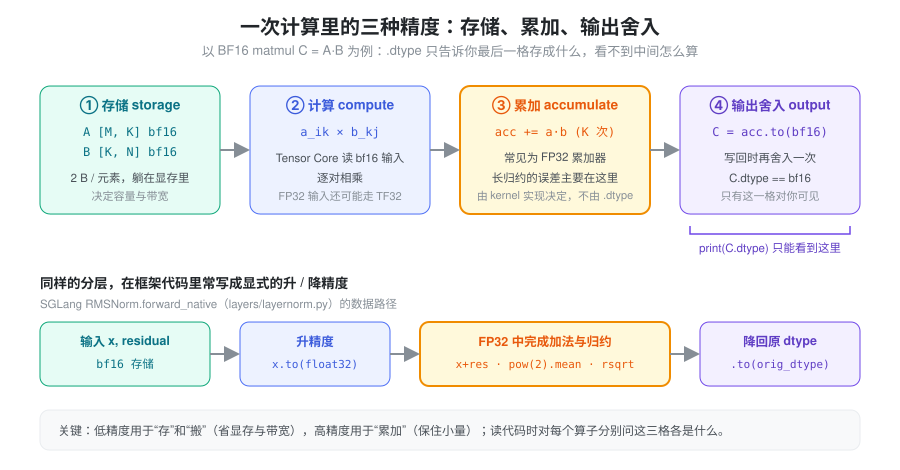
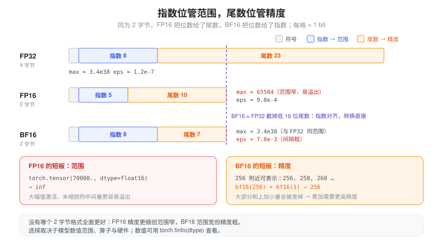
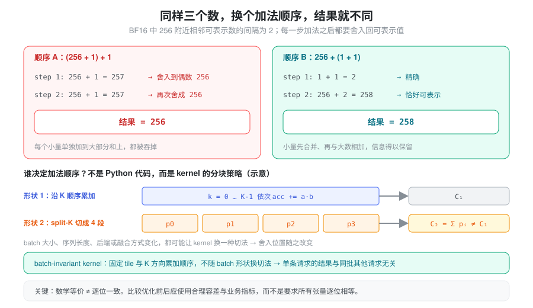

% Torch dtype 与数值精度

- 模型已经 `.to(torch.bfloat16)`，为什么 RMSNorm、logits、softmax 附近还到处是 `.float()`？
- BF16 和 FP16 都是 2 字节，为什么一个更容易溢出、另一个更容易“看不出小差别”？
- 同一个 prompt、`temperature=0`，batch 里多拼了几个请求，贪心输出的 token 却变了——这是 bug 吗？

这些问题背后是同一个误解：把“张量的 dtype”当成“这次计算的精度”。把模型转成 BF16，不代表每一步都以 BF16 完成累加；输入是 FP32，也不代表底层 matmul 一定采用完整 FP32 尾数精度。LLM 推理需要分别看存储格式、算子的执行策略和误差传播。

### 抽象：一次计算里至少有三种“精度”

核心的一句话：**`.dtype` 只告诉你结果被存成什么格式，不告诉你它是怎么算出来的。** 一个算子从读入到写出，至少经过三个可以各自选择精度的环节：

- **存储精度（storage）**：张量在显存里以什么格式躺着，决定字节数和带宽；
- **计算 / 累加精度（compute & accumulate）**：kernel 内部把乘积加起来时用的寄存器格式，决定长归约的误差；
- **输出舍入（output）**：累加结果写回时再次转成存储格式，又舍入一次。



有了这个模型，读代码时就不再问“这个张量是不是 BF16”，而是对 matmul、softmax 和归约分别问：输入是什么 dtype、内部累加是什么精度、最终输出存成什么 dtype？只打印输出的 `.dtype` 推断不出全部计算细节。TF32 则是相关硬件上 FP32 matmul/卷积的一种计算路径，不是常规张量存储 dtype。见 [Numerical accuracy](https://docs.pytorch.org/docs/main/notes/numerical_accuracy.html)。

### 格式本身：指数管范围，尾数管精度

浮点数 = 符号 × 尾数 × 2^指数。**指数位数决定能表示多大、多小的数（范围），尾数位数决定相邻两个可表示数之间有多密（精度）。** 三种常见格式就是在 2 或 4 个字节里对这两者做不同分配：



| 格式 | 每元素字节数 | 符号/指数/尾数 | 最大有限值 | `eps`（1 附近的间隔） |
| --- | --- | --- | --- | --- |
| FP32 | 4 | 1 / 8 / 23 | ≈ 3.4e38 | ≈ 1.2e-7 |
| FP16 | 2 | 1 / 5 / 10 | 65504 | ≈ 9.8e-4 |
| BF16 | 2 | 1 / 8 / 7 | ≈ 3.4e38 | 7.8e-3 |

数值可用 `torch.finfo(dtype)` 查看。BF16 的指数位与 FP32 相同，所以范围接近 FP32、从 FP32 截断转换很直接；代价是尾数只有 7 位，表示相近数值时量化间隔更大。FP16 相比 BF16 尾数位更多，但指数范围小，更容易在大幅值运算中溢出成 `inf`，小幅值也更早进入 subnormal 或下溢。

因此 BF16 并不是在所有数值区间都比 FP16 更准确；应该结合模型激活与权重的数值范围、算子和目标硬件选择格式。FP8 等更低精度格式通常还要配合缩放因子，这已经超出“选一个 dtype”的范畴。

### 类型提升：一个输入就可能改变表达式

```python
import torch

x = torch.ones(4, dtype=torch.bfloat16)
bias = torch.ones(4, dtype=torch.float32)
y = x + bias
assert y.dtype == torch.float32
```

上述逐元素表达式发生类型提升，输出和临时结果可能比预期更大，后续算子也随之在 FP32 上运行。但不是所有算子都接受混合 dtype 并自动提升，例如常规 matmul 的输入通常需要 dtype 匹配。Python 标量、零维张量和有维度张量的提升规则也有差异：零维张量和 Python 标量只在类别更高时（例如整数张量加 Python 浮点数）才改变结果 dtype，同为浮点类别时通常保留有维度张量的 dtype，`bf16_tensor * 0.5` 仍是 BF16。

因此在 residual、mask 加法和辅助张量创建处，应检查实际输出 dtype；不能把“混入一个 Python 浮点数”一概视为强制变成 FP32。规则见 [Tensor dtype promotion](https://docs.pytorch.org/docs/stable/tensor_attributes.html#type-promotion-doc)，可用 `torch.result_type()` 预先确认。

### autocast 是按算子选择策略

`model.to(dtype=...)` 改变参数等浮点张量的**存储**格式；`torch.autocast()` 则按算子的策略选择**执行** dtype，二者不是同一件事。

```python
# model、inputs 由调用方准备，并位于兼容设备上
with torch.inference_mode(), torch.autocast("cuda", dtype=torch.bfloat16):
    output = model(inputs)
```

autocast 区域里的结果不一定都是 BF16。部分算子保留或转用 FP32，一些算子按输入类型提升；原地操作、显式指定 dtype 和 `out=` 调用也有不同的适用规则。进入 autocast 区域不会永久把模型权重全部改写成 BF16。见 [Automatic Mixed Precision](https://docs.pytorch.org/docs/stable/amp.html)。

自定义 CUDA/Triton kernel 是否参与 autocast、是否内部转为 FP32 累加，需要检查实现，不能从外层 context 推断。推理框架往往不依赖 autocast，而是直接以低精度存储权重，并在少数敏感算子里手工升精度（见下文 SGLang 的做法）。

### softmax、归约与误差传播

softmax 通常先减去最大值，再做指数与归一化，以降低溢出风险：

\[
p_i = \frac{\exp(z_i - m)}{\sum_j \exp(z_j - m)}, \qquad m = \max_j z_j
\]

算法稳定性与 dtype 是两层问题：减最大值解决的是“指数会不会溢出”，升精度解决的是“累加会不会丢掉小量”。中间阶段提高精度，不会自动恢复输入已经丢失的信息；最后转换成低精度输出，也会再次舍入。

归约是低精度最脆弱的地方。BF16 在 256 附近相邻可表示数的间隔已经是 2，若累加器本身是 BF16，往一个已经很大的部分和上逐个加小量，小量可能被直接舍掉；累加长度越长，问题越明显。所以 attention、RMSNorm 和长序列归约里，累加长度和内部精度都影响误差，常见做法是“低精度存储 + FP32 累加”。

实现需要按后端确认；例如 SDPA 的不同后端有不同数值路径，math 后端对 FP16/BF16 输入默认保留 FP32 中间量。见 [SDPA 文档](https://docs.pytorch.org/docs/stable/generated/torch.nn.functional.scaled_dot_product_attention)。

### 数学等价不保证逐位一致

浮点加法不满足结合律：

\[
\operatorname{fl}(\operatorname{fl}(a+b)+c)
\neq
\operatorname{fl}(a+\operatorname{fl}(b+c))
\]



一个具体例子：在 BF16 中，`(256 + 1) + 1` 得到 `256`（每一步的 257 都按“舍入到偶数”回到 256），而 `256 + (1 + 1)` 得到 `258`。kernel 不会按 Python 代码的顺序做加法，而是按自己的分块和并行策略组织归约：改变 batch 大小、kernel 后端、split-K 切分或融合策略，都可能改变归约顺序和舍入位置。

所以优化前后比较应同时关注数值误差和业务输出，而不是默认所有张量必须逐位相等。batch 大小影响单条请求输出（batch invariance）以及它与 run-to-run 不确定性的区别，详见 [Nondeterminism](./nondeterminism.md)。

```python
# ref、actual 由对照路径生成；这里的阈值仅为示例
torch.testing.assert_close(actual, ref, rtol=1e-3, atol=1e-3)
```

误差容忍不能统一套一个数字：需要根据 dtype、数值尺度、层数和业务指标选择。top-1 logits 很接近时，小误差也可能改变贪心 token，随后生成轨迹进一步分叉。见 [assert_close](https://docs.pytorch.org/docs/stable/testing.html#torch.testing.assert_close)。

### 引擎落点

SGLang 的做法可以概括为：**权重和激活默认低精度存储，在少数对精度敏感的环节显式升到 FP32。** 几个值得知道的位置（基于 `python/sglang/srt/` 当前代码）：

- **两个独立的存储精度开关。** `server_args.py` 中的 `--dtype` 控制权重和激活的格式（`auto` 对 BF16 模型使用 BF16、对 FP32/FP16 模型使用 FP16），`--kv-cache-dtype` 单独控制 KV cache 的存储格式，`auto` 时沿用模型 dtype。KV cache 用 FP8 存储时，帮助信息提示应通过 `--quantization-param-path` 提供缩放因子，否则默认 1.0 可能带来精度问题——这正是“存储精度”和“计算精度”分离的例子。
- **RMSNorm 的参考实现在 FP32 中完成。** `layers/layernorm.py` 中 `RMSNorm.forward_native` 先记下 `orig_dtype`，把 `x` 和 `residual` 转成 `torch.float32` 再相加、求方差和 `rsqrt`，最后转回原 dtype；`fp32_residual=True` 时 residual 本身也保留 FP32。CUDA 路径调用 `fused_add_rmsnorm` 等融合 kernel，其内部累加精度需要看对应 kernel 实现。
- **logits 在采样前转成 FP32。** `layers/logits_processor.py` 的 `_copy_logits_to_buffer` 要么 `logits.float()`，要么拷进一块预分配的 FP32 buffer（并 `assert logits_buffer.dtype == torch.float`）。随后 `layers/sampler.py` 的 `Sampler` 在其上做 `softmax` / `log_softmax`，避免在 BF16 下计算大词表的归一化。

### 推理排查建议

1. 记录输入、权重、mask、residual、KV cache 与输出 dtype。
2. 确认 autocast、TF32 和归约精度配置，避免依赖版本默认值。
3. 用固定输入分别比较单算子、单层和完整前向，定位误差最早出现的位置。
4. 排查 NaN/Inf，再比较绝对误差、相对误差和 token 输出。
5. 数值稳定后测吞吐与显存，分别报告这几个维度。

### 小结

dtype 是“存成什么”，不是“怎么算”。把一次计算拆成存储、计算/累加、输出舍入三个环节，就能解释为什么 BF16 模型里仍要在 RMSNorm、softmax 和 logits 处升到 FP32，为什么 FP16 与 BF16 各有短板，以及为什么换 batch 或后端会让结果不再逐位一致。低精度推理的关键不是给所有张量套同一个 dtype，而是让存储、内部计算和验证标准彼此匹配；具体后端和版本的精度行为，应以实际文档、配置与测量为准。
