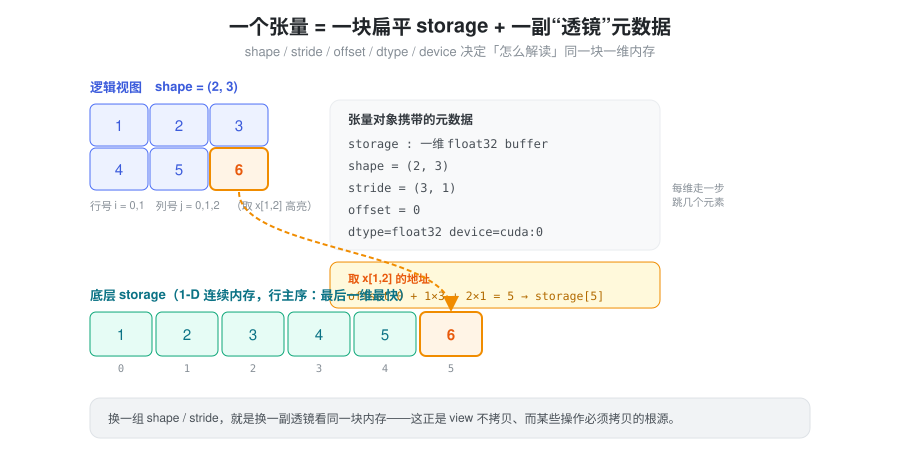
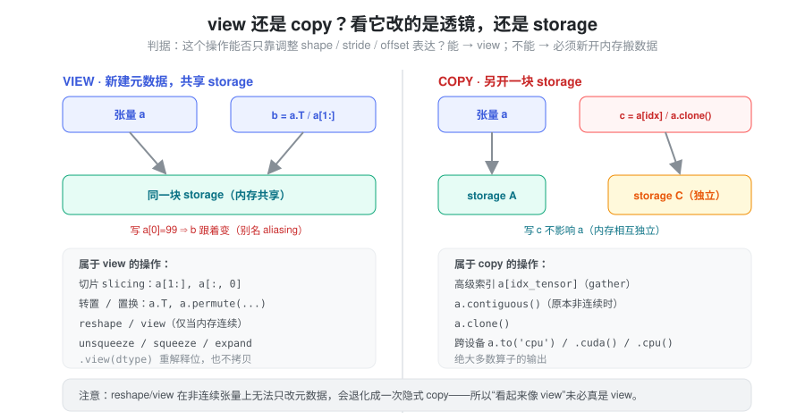
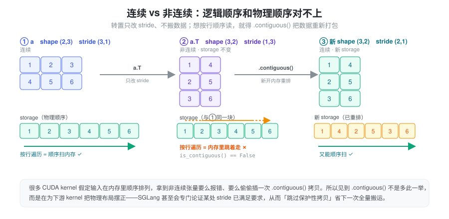
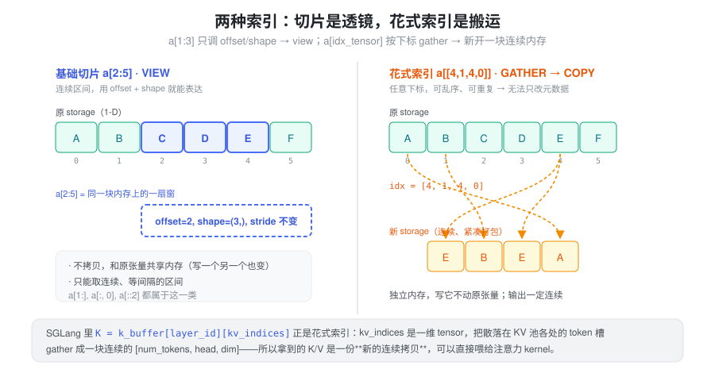
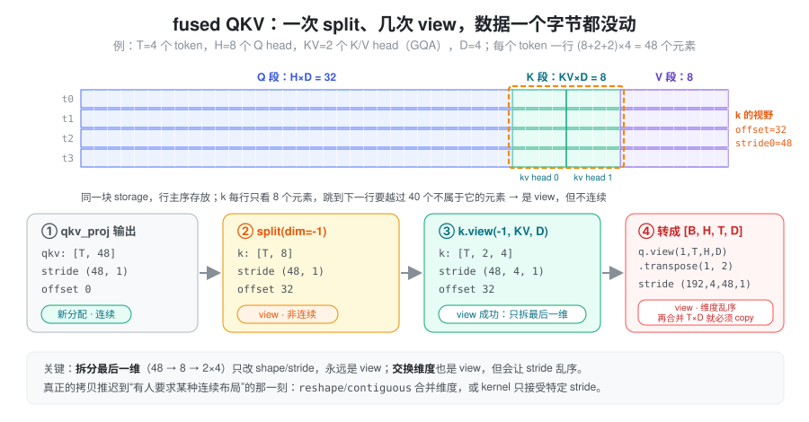
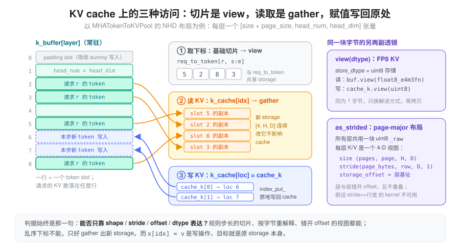
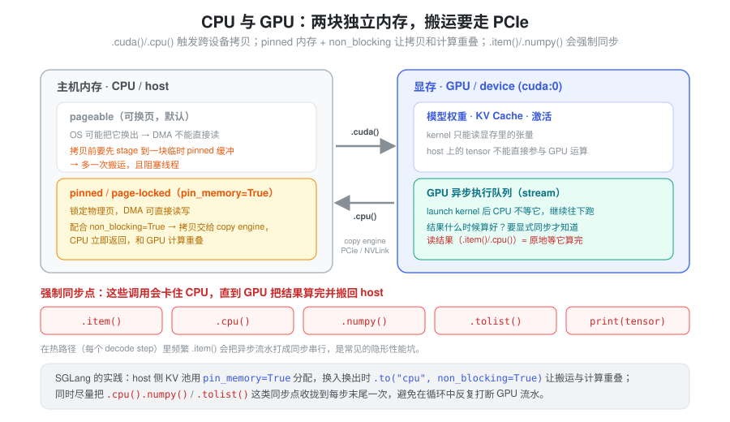

% Torch 张量内存

- `b = a.T` 到底有没有搬数据？`a[1:]` 和 `a[idx]` 看着都是索引，为什么一个共享内存、一个却复制了一份？
- fused QKV 投影之后 `split` 出来的 `k` 明明 shape 对，为什么 `is_contiguous()` 是 False？下游哪一步才真正付出拷贝？
- 一个张量明明 shape 对得上，喂给 kernel 却报 “not contiguous”，`.contiguous()` 加在哪、为什么能省掉？
- `.cpu()`、`.item()` 这种“只是取个值”的调用，怎么就成了性能瓶颈？

这些问题可以从同一套底层模型出发理解：张量如何解释存储、操作是否共享数据，以及执行发生在哪个设备上。本篇以普通 dense strided tensor 为例建立这个模型，再把它落到 LLM 推理里最常见的两处：QKV 的维度变换，以及 KV cache 的读写。稀疏、量化等特殊张量需要另外检查其存储格式。

### 抽象：张量 = 一块扁平 storage + 一副“透镜”

核心的一句话：**张量本身不存数据，它只是一副解读内存的“透镜”。** 数据躺在一块一维、连续的 `storage`（显存或主机内存上的裸 buffer）里；张量对象另外携带一组元数据，决定“怎么把这块一维内存看成多维数组”：

- `shape`：每一维有多长；
- `stride`：每一维走一步，在 storage 里要跳过几个元素；
- `storage_offset`：从 storage 的第几个元素开始看；
- `dtype` / `device`：按什么类型、在哪块设备上解读。

取元素 `x[i, j]` 不是“查表”，而是**一次地址算术**：

```
addr(x[i0, i1, ..., ik]) = storage_offset + Σ i_d × stride[d]
```

这件事是理解后面一切的支点——因为“换一副透镜”（改 shape/stride/offset）几乎免费，而“重排 storage 里的字节”必须真刀真枪地搬数据。



用一个具体算例感受三者如何配合。设 `a = torch.arange(12).view(3, 4)`，stride 为 `(4, 1)`、offset 为 0：

| 表达式 | shape | stride | offset | 取 `[1, 1]` 落在 storage 的位置 |
| --- | --- | --- | --- | --- |
| `a` | (3, 4) | (4, 1) | 0 | 0 + 1×4 + 1×1 = 5 |
| `a[1:, 2:]` | (2, 2) | (4, 1) | 6 | 6 + 1×4 + 1×1 = 11 |
| `a.T` | (4, 3) | (1, 4) | 0 | 0 + 1×1 + 1×4 = 5 |
| `a[:, ::2]` | (3, 2) | (4, 2) | 0 | 0 + 1×4 + 1×2 = 6 |

四个张量共享同一块 12 个元素的 storage，没有一个字节被搬动。切片改的是 offset 和 shape，转置交换 stride，步长切片放大 stride。

有了这个模型，“这个操作要不要拷贝”就有了统一判据：**它能不能只靠调整元数据来表达？** 能，就是 view；不能，就必须新开一块 storage 把数据搬过去。

### 混淆点一：view 还是 copy，以及 aliasing

`view` 新建一组元数据、但和原张量共享同一块 storage——所以**改一个，另一个跟着变**（别名 aliasing），这是 bug 的常见来源，也是零拷贝的来源。`copy` 则另开 storage，两者内存独立。



切片、转置、`permute`、`unsqueeze/squeeze/expand`、`split/chunk/unbind` 通常产生共享 storage 的 view；高级索引读取 `a[idx_tensor]`、`.clone()`、需要重排的 `.contiguous()`、实际跨设备的 `.to()` 则会分配新存储。普通计算算子也通常生成独立输出，但不宜把“新输出”全部称为输入数据的 copy。

这里必须区分 `view()` 与 `reshape()`：`view()` 只在 shape 与 stride 兼容时成功，否则报错，**不会隐式复制**；`reshape()` 则可能返回 view，也可能复制。非连续张量也可能满足某些 `view()` 的 stride 条件，因此不能仅用 `is_contiguous()` 判断是否可 view。`.view(dtype)` 是受元素大小和 stride 约束的位重解释，并不是 `.to(dtype)` 那样的数值转换。见 [Tensor.view](https://docs.pytorch.org/docs/stable/generated/torch.Tensor.view.html) 和 [Tensor Views](https://docs.pytorch.org/docs/main/tensor_view.html)。

**aliasing 让 in-place 写入有了连带效果。** 对 view 执行 `add_`、`copy_`、`x[...] = v`，写的是共享 storage，所有指向这段字节的张量都会“看到”变化：

```python
buf = torch.zeros(8, 4)
row = buf[3]          # view：offset=12, stride=(1,)
row.fill_(1.0)        # buf[3] 也变成全 1——这正是“往预分配 buffer 里写”的方式
tmp = buf[[3]]        # 高级索引读取：新 storage
tmp.fill_(2.0)        # buf 不受影响
```

推理代码大量依赖前一种行为（向常驻 buffer 原地写入），也常被后一种行为坑到（以为写进了 cache，其实写进了临时副本）。反过来，如果一个张量后面还要被读，就不要对它的 view 做 in-place 修改——别名关系在 Python 代码里是不可见的。

### 混淆点二：零步长与重叠内存

stride 不一定是正数的乘积，它可以是 **0**。`expand()` 正是这么实现广播的：被扩展的维度 stride 设为 0，于是该维每走一步，地址都不动。

```python
x = torch.randn(1024, 1)
y = x.expand(1024, 4096)   # stride (1, 0)，逻辑上 4M 个元素，storage 仍是 1024 个
```

零步长意味着“多个逻辑位置指向同一个物理元素”。读没有问题，写就有歧义：`y.add_(1)` 会直接报错 *more than one element of the written-to tensor refers to a single memory location*。需要可写的独立副本时用 `repeat()` 或 `expand(...).clone()`，代价是真实分配。广播规则本身见 [广播与索引](./torch_broadcast_indexing.md)。

`as_strided(size, stride, storage_offset)` 是最底层的透镜：直接手写元数据，PyTorch 不检查它是否合理。它能造出相互重叠的窗口，例如 `torch.arange(6.).as_strided((3, 3), (1, 1))` 得到 `[[0,1,2],[1,2,3],[2,3,4]]`——三行共享四个元素。这在实现滑动窗口、自定义布局时有用，但写入重叠视图的结果不可依赖，越界的 offset/stride 也只会在访问时出问题。业务代码里遇到 `as_strided`，要把它当作“这里有一个手工维护的内存布局约定”来读。

### 混淆点三：连续 vs 非连续

默认 `torch.contiguous_format` 下，“连续”表示张量能按逻辑顺序紧密遍历，通常最后一维变化最快；大小为 `1` 等退化维度有特殊判断规则。常规 `torch.empty(shape)` 创建的张量通常是这种布局，但 `empty_strided()`、指定 memory format 或保留源布局的创建方式不能一概而论。转置或 `permute` 只改变 stride，往往得到非连续张量；退化维度或未改变有效顺序时，也可能仍然连续。连续性还与 memory format 有关，例如 `channels_last` 有自己的判断标准。



`.contiguous()` 在目标布局不满足时，新开内存并按当前逻辑顺序重新打包；满足时返回自身。下游 kernel 有的支持任意 stride，有的要求最后一维连续，有的要求整体连续，也有的内部选择复制或不同算法。因此非连续不一定慢，连续也不保证最快。显式添加 `.contiguous()` 前，应确认 kernel 的真实约束，以及这次搬运是否值得。见 [Tensor.contiguous](https://docs.pytorch.org/docs/stable/generated/torch.Tensor.contiguous.html)。

几个“复制类”方法经常被混用，按“是否新 storage、是否保留 autograd 关系”区分最清楚：

| 方法 | 新 storage？ | autograd | 典型用途 |
| --- | --- | --- | --- |
| `x.detach()` | 否，共享 | 断开 | 拿一个不追踪梯度的别名 |
| `x.contiguous()` | 仅在布局不满足时 | 保留 | 满足 kernel 的布局要求 |
| `x.clone()` | 总是 | 保留 | 需要独立副本、避免别名写入 |
| `x.detach().clone()` | 总是 | 断开 | 快照一份数据 |

同理，`.to()` 在 device、dtype 等条件已经满足且不要求 copy 时可以返回原张量本身。需要独立副本应明确使用 `clone()`，而不是依赖 `contiguous()` 或 `to()` 的“副作用”。

### 混淆点四：切片索引 vs 花式索引

两种“索引”长得像，底层却是两回事。**基础切片** `a[2:5]`、`a[:, 0]` 取的是连续、等间隔的区间，用 offset + shape + stride 就能表达，所以是 **view**，零拷贝、与原张量共享内存。**花式索引**（高级索引）`a[idx_tensor]` 用一个下标张量去取，下标可以乱序、可以重复，没法用一组规则 stride 表达，于是 torch 只能 **gather**：按下标把元素一个个挑出来，塞进一块新的、连续的 storage。



写方向则相反：`buffer[indices] = values` 是 `index_put_`，直接写回原 buffer；而 `buffer[indices].copy_(values)` 先 gather 出临时副本、再修改这份副本，原 buffer 不变。这一读一写的区别在 KV cache 上体现得最明显，见下文与 [广播与索引](./torch_broadcast_indexing.md)。

### 在 LLM 推理中：QKV reshape 里哪一步付出拷贝

Attention 的输入准备是“透镜”模型最密集的使用场景。现代实现把 Q、K、V 三个投影合成一个 GEMM（fused QKV），输出一个 `[T, (H + 2·KV)·D]` 的连续张量，之后全靠元数据变换拆出各自的视图。下图用 T=4、H=8、KV=2（GQA）、D=4 的小例子跟踪每一步的 shape/stride/offset：



- **split 是 view，但不连续。** `qkv.split([q_size, kv_size, kv_size], dim=-1)` 得到的 `k` 形状 `[T, 8]`，stride 仍是 `(48, 1)`、offset 为 32：每行只看 8 个元素，换行要越过 40 个别人的元素。
- **拆最后一维总能 view。** `k.view(-1, KV, D)` 把 8 拆成 2×4，stride 变为 `(48, 4, 1)`，依旧零拷贝；`is_contiguous()` 为 False 并不妨碍这一步。
- **交换维度会把拷贝推迟到下游。** 若需要 `[B, H, T, D]` 布局，`view(1, T, H, D).transpose(1, 2)` 仍是 view，但 stride 变成 `(192, 4, 48, 1)`；此后任何把 `T×D` 合并成一维的 `reshape`/`contiguous`，或只接受连续输入的 kernel，才会真正复制。

**GQA 下 K/V 的 head 维度更小**，这既是显存收益的来源，也是需要留意的布局差异。Q 有 H 个 head，K/V 只有 KV 个；朴素实现用 `repeat_interleave` 把 K/V 扩到 H 个 head，就是一次真实复制。更好的做法是让 kernel 直接理解“每 H/KV 个 query head 共用一个 kv head”的映射，K/V 保持原样。

SGLang 中这条链路的对应位置（基于 `python/sglang/srt/` 当前代码）：

- `models/llama.py` 的 `LlamaAttention.forward_prepare_native()`：`qkv, _ = self.qkv_proj(hidden_states)` 后 `qkv.split([self.q_size, self.kv_size, self.kv_size], dim=-1)`，其中 `q_size = num_heads * head_dim`、`kv_size = num_kv_heads * head_dim`，`num_kv_heads = max(1, total_num_kv_heads // tp_size)`——TP 份数超过 KV head 数时每个 rank 至少保留一个（复制的）kv head。
- `layers/radix_attention.py` 的 `RadixAttention.forward()` 把 K/V 统一 `view(-1, tp_k_head_num, head_dim)`，正是上面“拆最后一维”的那一步。
- `layers/attention/torch_native_backend.py` 用 `movedim` 把 token 维挪到 SDPA 需要的位置（view），并在 `tp_q_head_num != tp_k_head_num` 时传 `enable_gqa=True` 给 SDPA，而不是自己复制 K/V head。
- 写 cache 的路径利用了这种“外层 stride 不规整、内层紧密”的布局：`mem_cache/memory_pool.py` 中 `_set_kv_buffer_impl()` 对 `k.view(-1, row_dim)` 直接调用 `store_cache`；vectorized_5d 布局的注释更明确地写道，写入 kernel 直接使用 `key.stride(0)` 作为 token 步长，只假设每个 token 内部 head/dim 紧密，因而可以省掉“会触发大规模逐层逐元素 kernel 的保护性 `.contiguous()` 拷贝”。

这也说明了一个常见优化方向：**与其在 Python 侧补 `.contiguous()`，不如让 kernel 接受 stride 参数。** 能接受 stride 的 kernel，读写的字节数不变，却省掉一次完整的中间复制。

### 在 LLM 推理中：KV cache 上的 view、gather 与写回

KV cache 是另一个把三种访问方式放在一起的地方：它是一块启动时预分配、整个服务期间常驻的大 buffer，每一步只读写其中一小部分行。



以 `mem_cache/memory_pool.py` 的 `MHATokenToKVPool` 为例（默认 NHD 布局）：

- **按层切出 buffer，是对象引用而非拷贝。** `_create_buffers_normal()` 为每层分配一个 `[size + page_size, head_num, head_dim]` 的张量，存在 `k_buffer` / `v_buffer` 列表中；第 0 个 page 是 padding slot，吸收 CUDA Graph 等场景下 dummy token 的写入。`get_key_buffer(layer_id)` 返回的就是这一层张量本身。
- **按请求取下标，是 view。** `req_to_token[req_pool_idx, start:end]` 是基础切片，与映射表共享 storage。
- **按下标读 KV，是 gather。** `TorchNativeAttnBackend` 中 `k_cache[per_req_tokens]` 是高级索引读取，产生一份独立、连续的 `[n, H, D]` 副本——高性能后端（FlashInfer、Triton 等）则把下标表直接交给 kernel，在 kernel 内部按页/槽位寻址，避免这次物化。
- **按下标写 KV，是原地 `index_put_`。** `set_kv_buffer()` 的朴素回退路径就是 `k_cache[indices] = k`，写回常驻 buffer；CUDA/HIP 上满足条件时改走 `store_cache` kernel，语义相同。

同一块字节上还有两副更“底层”的透镜：

- **`view(dtype)` 做零拷贝的类型重解释。** FP8 KV cache 的 `store_dtype` 被设为 `torch.uint8`（源码注释：`index_put` 不支持 `float8_e5m2`），写入前 `cache_k.view(self.store_dtype)`，读取时 `_get_key_buffer()` 返回 `k_buffer[...].view(self.dtype)`。两者元素大小都是 1 字节，所以只换解读方式，不搬数据。
- **`as_strided` 构造跨层交错布局。** `PageMajorMHATokenToKVPool` 让所有层共用一块 uint8 的 `_raw` buffer，`mem_cache/layout/page_major.py` 的 `build_page_major_mha_views()` 用 `torch.as_strided` 为每层造一个 `(num_pages, page_size, head_num, head_dim)` 视图，stride 为 `(page_bytes/itemsize, k_row_bytes/itemsize, head_dim, 1)`，层与层之间只靠 `storage_offset` 错开。这些视图既不重叠，也不再满足“stride 等于行宽”——所以类注释明确写道，假设逐层连续 3-D 布局的 tiled copy kernel、CPU offload 等路径在这里会直接报错，而不是悄悄按错的步长读写。

这就是“透镜”模型在工程上的分量：**同一块 KV storage，换不同的元数据就能支持不同的布局与 dtype；而每一个只接受特定 stride 的 kernel，都是对这副透镜的隐含约束。**

### 混淆点五：CPU 与 GPU，以及隐形的同步

在常见独立 NVIDIA GPU 的 PyTorch 使用方式下，CPU 张量位于主机内存，CUDA 张量位于设备内存；普通 CUDA 算子通常要求输入位于兼容的设备上。实际跨设备的 `.cuda()`/`.cpu()` 需要传输数据，具体互连取决于硬件。映射主机内存、统一内存和共享内存硬件是另外的机制，不能把“GPU 永远不能访问主机内存”当成硬件定律。这里有两个容易踩的点：



1. **pinned vs pageable**：pageable 内存的传输通常涉及 staging 到锁页缓冲区。pinned memory 配合 `non_blocking=True` 有助于异步 H2D，但计算重叠还需要 copy engine、不同 stream 和独立工作；同 stream 上的计算仍排在拷贝之后。临时 `pin_memory()` 也有成本，异步 H2D 完成前不能覆盖 pinned 源数据。见 [官方搬运教程](https://docs.pytorch.org/tutorials/intermediate/pinmem_nonblock.html)。
2. **异步与同步点**：kernel 通常异步提交，但 CUDA 张量的 `.item()`、`.tolist()` 或打印具体值，需要等待设备结果。默认 GPU 到 CPU 拷贝也会等待；使用异步 D2H 时，CPU 必须在读取前确认完成。默认 `.numpy()` 不能直接用于 CUDA 张量，通常是在 `.cpu()` 后转换；CPU 张量的 `.numpy()` 本身不能一概称为 GPU 同步点。细节与计时方法见 [CUDA 异步执行](./torch_cuda_execution.md)。

### Torch 推理知识的其他层次

内存布局之外，还需要分别理解以下问题：

| 主题 | 需要回答的问题 |
| --- | --- |
| [数据类型与低精度表示](./torch_dtype.md) | 每个元素占几个字节？`.to(dtype)` 与 `.view(dtype)` 有何不同？低精度数据的 scale 存在哪？ |
| [广播与索引](./torch_broadcast_indexing.md) | shape 会怎样扩展？读取副本与写回原存储有什么区别？ |
| [CUDA 异步执行](./torch_cuda_execution.md) | CPU 什么时候等待 GPU？如何建立依赖和正确计时？ |
| [显存管理与生命周期](./torch_memory_management.md) | 谁仍持有 storage？活跃分配、缓存与峰值分别是多少？ |
| [dtype 与数值精度](./torch_numerical_precision.md) | 存储、计算和累加是否使用相同精度？误差如何验证？ |
| [推理模式与状态](./torch_inference_mode.md) | eval、梯度 context 和可变 cache 各由谁管理？ |
| [算子调度](./torch_dispatcher.md) | 一次 Python 调用经过哪些 dispatch 层？自定义算子如何注册？ |
| [kernel 与编译执行](./torch_kernel_compile.md) | 实际调用哪些 kernel？融合、编译和 graph replay 分别优化什么？ |
| [Cuda Graph](./cuda_graph.md) | 图捕获了什么？为什么需要静态地址和私有内存池？ |

### 小结

把 dense strided tensor 理解成“一块 storage + 一组解释存储的元数据（shape、stride、storage_offset、dtype）”，就能用一个判据区分布局变换、共享存储和实际复制：能否只改元数据来表达。split、拆最后一维、转置、零步长 expand、`view(dtype)`、`as_strided` 都只是换透镜；高级索引读取、合并乱序维度、`clone` 才搬数据；而 aliasing 让 in-place 写入波及所有共享 storage 的张量——KV cache 的原地写入依赖它，误写临时副本也源于它。QKV reshape 与 KV cache 读写正是这套模型最密集的落点。读代码时依次问：数据在哪里、谁共享它、有没有复制或分配、哪个 kernel 对 stride 有约束、CPU 是否在等 GPU；再结合具体输入和 profiler 验证。
