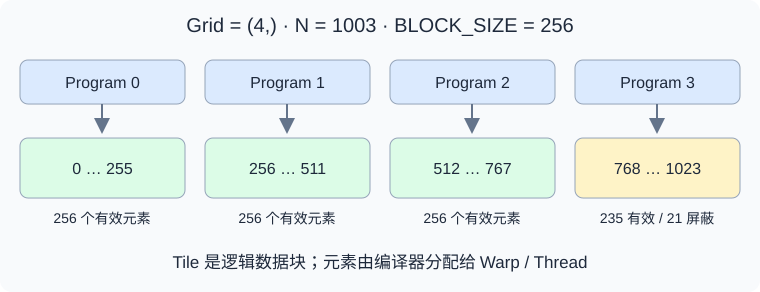
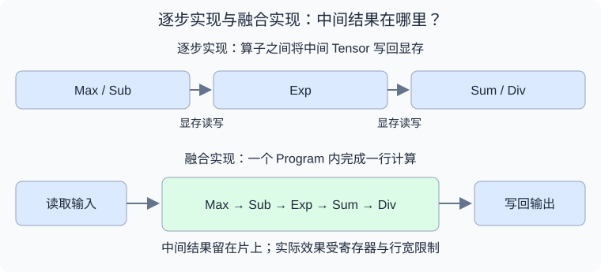
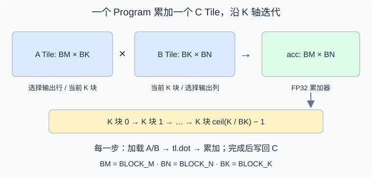

% Triton 基础

从 GPU 编程模型（Programming Model）的角度学习 Triton，最重要的是理解：

1. 计算如何划分：一个 Program 负责哪一块数据？
2. 数据如何访问：Pointer、Offset、Stride、Mask 如何共同描述访存？
3. 计算如何表达：逐元素运算、Reduction、Broadcast、矩阵乘法如何作用于 Tile？
4. 性能如何调整：Tile Size、`num_warps`、`num_stages` 如何影响 GPU 资源？
5. 结果如何验证：边界、数值精度、异步计时和调优如何处理？

建议先阅读 [GPU Arch](./gpu_arch.md)，建立 Thread、Warp、Block、SM 和存储层次的概念。下面以经典 `triton.jit` 与 `triton.language` 编程方式为主，结合 NVIDIA GPU 解释硬件映射。这里的 Triton 指 GPU 编程语言与编译器，与 NVIDIA Triton Inference Server 是不同项目。

## 一、Triton 在 GPU 编程中的位置

Triton 允许用 Python 语法描述 GPU Kernel，但 Kernel 内的代码由编译器生成 GPU 指令，并不是由 Python 解释器逐元素执行。

| 层次 | 程序员主要表达什么 | 需要关注什么 |
| --- | --- | --- |
| PyTorch | 整体 Tensor 运算 | Shape、Dtype、Device、算子组合 |
| Triton | 一个 Program 内的数据块计算 | 分块、地址、边界、归约与资源配置 |
| CUDA C++ | Thread 级逻辑与线程协作 | 线程索引、Shared Memory、同步与指令 |

例如计算 `y = x * scale + bias`，可以把读取、乘法、加法和写回放进一个 Kernel，避免中间 Tensor 的显存读写和额外 Launch。

是否更快，需要结合输入规模、访存模式和已有实现测试；PyTorch 编译后的执行路径也可能已经完成算子融合。

## 二、Program、Grid 与 Tile



Triton 的基本思考方式是：一个 Program Instance 处理一个逻辑数据块（Tile），Grid 指定启动多少个 Program。

| 概念 | 意义 | 常见误解 |
| --- | --- | --- |
| Program Instance | 一份 Kernel 逻辑的执行实例 | 不是一个 CUDA Thread |
| Grid | Program 的一维、二维或三维索引空间 | 不是 Tensor 的 Shape |
| Tile | 当前 Program 处理的数据区域 | 不一定是连续显存区域 |
| `tl.program_id(axis)` | 当前 Program 在某个轴上的编号 | 不是 Thread ID |
| `num_warps` | 参与一个 Program 执行的 Warp 数配置 | 不是数据块的元素数量 |

在常见 NVIDIA 执行路径中，一个 Program 通常映射到一个 CTA（CUDA Thread Block）；编译器负责将 Tile 元素分布到线程及其寄存器。进阶机制可能改变映射方式，因此应把 Program 理解为编程抽象。

例如，一个 Program 处理 1024 个元素，配置 `num_warps=4`，意味着由 4 个 Warp 协作处理这些元素。它不意味着启动 1024 个线程，也不意味着每个线程只处理一个元素。

Grid 中的 Program 可能分批调度到 SM。不同 Program 之间没有默认的执行先后关系，也不能依靠普通 Kernel 中的全局同步实现任意协作。

## 三、Host 代码与 Kernel 代码

一个完整算子通常包含两部分。

| 部分 | 执行位置 | 主要职责 |
| --- | --- | --- |
| Host Wrapper | CPU / Python Runtime | 检查输入、分配输出、计算 Grid、启动 Kernel |
| `@triton.jit` Kernel | GPU | 计算地址、加载数据、执行运算、写回结果 |

Host 可以使用 PyTorch 分配 Tensor；Kernel 内使用 `tl.load`、`tl.store` 等 Triton 操作。不能把任意 Python 库或 PyTorch 运算直接放进 Kernel。

`BLOCK_SIZE: tl.constexpr` 表示编译期参数，常用于 Tile Shape。不同编译期参数可能生成不同版本的 Kernel，首次调用可能包含编译开销。

Tensor 作为 Kernel 参数传入时转换为数据指针。Kernel 不会自动获得它的完整 Shape、Stride 和布局信息，因此需要由 Wrapper 显式传入相关参数。

## 四、第一个 Kernel：向量加法

下面的示例限定为同一 CUDA Device 上的一维、连续、相同 Shape 和 Dtype 的浮点 Tensor。

```python
import torch
import triton
import triton.language as tl


@triton.jit
def vector_add_kernel(X, Y, Z, N, BLOCK_SIZE: tl.constexpr):
    pid = tl.program_id(0)
    offsets = pid * BLOCK_SIZE + tl.arange(0, BLOCK_SIZE)
    valid = offsets < N
    x = tl.load(X + offsets, mask=valid, other=0)
    y = tl.load(Y + offsets, mask=valid, other=0)
    tl.store(Z + offsets, x + y, mask=valid)


def vector_add(x, y):
    assert x.is_cuda and y.is_cuda and x.device == y.device
    assert x.ndim == y.ndim == 1 and x.shape == y.shape
    assert x.is_contiguous() and y.is_contiguous()
    assert x.dtype == y.dtype and x.is_floating_point()
    z = torch.empty_like(x)
    n = x.numel()
    if n == 0:
        return z
    grid = lambda meta: (triton.cdiv(n, meta["BLOCK_SIZE"]),)
    vector_add_kernel[grid](x, y, z, n, BLOCK_SIZE=256, num_warps=4)
    return z


x = torch.randn(1003, device="cuda", dtype=torch.float32)
y = torch.randn_like(x)
z = vector_add(x, y)
torch.testing.assert_close(z, x + y)
```

这里启动 4 个 Program，每个处理 256 个逻辑位置。最后一个 Program 只有 235 个位置有效，剩余位置通过 Mask 屏蔽。

`tl.arange(0, BLOCK_SIZE)` 生成当前 Program 内的逻辑索引；它不等于 CUDA 的 `threadIdx.x`。该写法使用 2 的幂作为 `BLOCK_SIZE`，输入长度本身不需要是 2 的幂。

这个例子的启动方式和指针传递规则可对照 [官方 Vector Addition 教程](https://triton-lang.org/main/getting-started/tutorials/01-vector-add.html)。

## 五、Pointer、Stride 与 Mask

### 1. 指针运算按元素计数

对于指向 `float32` 的 `X`，`X + 1` 指向下一个元素，而不是下一个字节。

二维 Tensor 的地址可以写成：

\[ \text{offset}(i,j)=i\times \text{stride}_0+j\times \text{stride}_1 \]

例如，构造一个二维数据块：

```python
rows = pid_m * BLOCK_M + tl.arange(0, BLOCK_M)
cols = pid_n * BLOCK_N + tl.arange(0, BLOCK_N)
ptrs = X + rows[:, None] * stride_m + cols[None, :] * stride_n
valid = (rows[:, None] < M) & (cols[None, :] < N)
tile = tl.load(ptrs, mask=valid, other=0)
```

`rows[:, None]` 的 Shape 为 `[BLOCK_M, 1]`，`cols[None, :]` 为 `[1, BLOCK_N]`，通过广播形成 `[BLOCK_M, BLOCK_N]` 的地址块。

是否支持转置、切片等非连续输入，取决于地址公式是否正确使用 Stride，而不是取决于是否使用 Triton。

### 2. Mask 保护访存

Mask 应作用在 `tl.load` 和 `tl.store` 上。先读取越界地址，再用 `tl.where` 丢弃结果，不能保证访存安全。

Masked Load 的 `other` 还决定无效位置如何参与后续计算：

| 后续操作 | 常用填充值 | 原因 |
| --- | --- | --- |
| 求和 | `0` | 不改变有效元素之和 |
| 求最大值 | `-float("inf")` | 不抬高最大值 |
| 求最小值 | `float("inf")` | 不降低最小值 |
| 矩阵乘法 K 轴补齐 | `0` | 不增加乘积贡献 |

相关操作的定义见 [triton.language API](https://triton-lang.org/main/python-api/triton.language.html)。

## 六、Reduction 与 Softmax

Reduction 把一个轴上的多个元素合并为更少的结果，例如 `tl.sum(x, axis=0)` 和 `tl.max(x, axis=0)`。

对于一行数据，稳定 Softmax 的数学形式是：

\[ m=\max_j x_j,\quad p_j=\exp(x_j-m),\quad y_j=\frac{p_j}{\sum_k p_k} \]

下面是每个 Program 处理一行的 Kernel 片段，要求 `N > 0`，Host 设置 `BLOCK_SIZE = triton.next_power_of_2(N)`，并以 `(M,)` 启动：

```python
@triton.jit
def row_softmax_kernel(X, Y, N, stride_x, stride_y,
                       BLOCK_SIZE: tl.constexpr):
    row = tl.program_id(0)
    cols = tl.arange(0, BLOCK_SIZE)
    x = tl.load(X + row * stride_x + cols,
                mask=cols < N, other=-float("inf")).to(tl.float32)
    shifted = x - tl.max(x, axis=0)
    numerator = tl.exp(shifted)
    denominator = tl.sum(numerator, axis=0)
    tl.store(Y + row * stride_y + cols,
             numerator / denominator, mask=cols < N)
```

这里假设行内元素连续，输入为有限浮点值。FP32 中间计算有助于控制误差，最终写回时会转换为输出类型。



融合的关键是让中间结果留在片上，减少显存流量。理想情况下，每行只读取一次输入、写回一次输出；但如果行太长，寄存器压力、Spilling 和驻留并行度会使性能下降，需要进一步分块。

归约仍然需要底层线程协作。Triton 编译器根据数据布局生成相应操作，不能理解为所有元素都由一个线程顺序处理。可进一步参考 [官方 Fused Softmax 教程](https://triton-lang.org/main/getting-started/tutorials/02-fused-softmax.html)。

## 七、矩阵乘法：从元素到 Tile

对于：

\[ C\_{M\times N}=A\_{M\times K}B\_{K\times N} \]

一个 Program 可以负责 `C` 的一个 `[BLOCK_M, BLOCK_N]` 输出块，沿 K 轴逐步加载输入块并累加。



核心计算可以概括为以下伪代码：

```python
acc = tl.zeros((BLOCK_M, BLOCK_N), dtype=tl.float32)
for k_tile in range(triton.cdiv(K, BLOCK_K)):
    # 根据当前 K 块构造地址，对 M、N、K 边界分别 Mask。
    a = tl.load(a_ptrs, mask=a_valid, other=0)
    b = tl.load(b_ptrs, mask=b_valid, other=0)
    acc = tl.dot(a, b, acc)
    # 更新 a_ptrs / b_ptrs，前进到下一个 K 块。
# 将 acc 转为输出类型，并按 M、N 边界 Mask 写回。
```

| 参数 | 增大时可能获得什么 | 可能付出什么代价 |
| --- | --- | --- |
| `BLOCK_M` / `BLOCK_N` | 更高的数据复用 | 更大的累加器与寄存器压力 |
| `BLOCK_K` | 更少的循环迭代 | 更大的输入块与片上资源需求 |
| `num_warps` | 更多线程参与计算 | 资源占用与协作成本变化 |
| `num_stages` | 加载和计算的流水线重叠机会 | 更多缓冲与资源占用 |

`tl.dot` 是否使用 Tensor Core，以及具体采用哪种指令，取决于目标 GPU、输入类型、Shape、布局和精度设置。FP32 输入也需要关注 `input_precision`，不能默认所有路径都等价于严格 FP32 乘法。

除了 Tile Shape，Program 的遍历顺序也影响相邻输出块能否复用 L2 中的输入数据。完整实现和分组调度见 [官方 Matrix Multiplication 教程](https://triton-lang.org/main/getting-started/tutorials/03-matrix-multiplication.html)。

## 八、性能优化与 Autotune

优化前先确定瓶颈。

| 现象或算子 | 优先分析什么 |
| --- | --- |
| 大向量逐元素运算 | 有效带宽、合并访存、显存读写量 |
| 小输入 | Launch 开销、融合机会 |
| 行归约 | 行宽、寄存器压力、Program 数量 |
| GEMM | 数据复用、Tensor Core、流水线、边界浪费 |
| 非连续 Gather | 地址分布、缓存命中、负载均衡 |

Tile 越大、Warp 越多、Stage 越多，都不保证更快。它们改变了单个 Program 的工作量和资源需求，也影响 SM 同时能驻留多少 Program。

Autotune 可以在给定的候选集合中测量配置，例如在向量加法 Kernel 上添加：

```python
@triton.autotune(
    configs=[
        triton.Config({"BLOCK_SIZE": 256}, num_warps=4),
        triton.Config({"BLOCK_SIZE": 1024}, num_warps=4),
    ],
    key=["N"],
)
@triton.jit
def vector_add_kernel(X, Y, Z, N, BLOCK_SIZE: tl.constexpr):
    # 与前面的向量加法 Kernel 使用相同函数体。
    ...
```

使用这个版本时，Host 保留依赖 `meta["BLOCK_SIZE"]` 的 Grid，并移除 Launch 中显式指定的 `BLOCK_SIZE` 和 `num_warps`，由候选配置提供。

调优会重复执行 Kernel。对于原子累加、原地更新等有副作用的算子，需要使用 `reset_to_zero`、`restore_value` 等机制保护输入输出状态。`key` 应覆盖会影响选择的关键维度，具体行为见 [triton.autotune 文档](https://triton-lang.org/main/python-api/generated/triton.autotune.html)。

## 九、正确性验证与性能测量

### 1. 先验证地址与边界

至少覆盖：

- 很小的输入、刚好整除 Tile 的输入、不能整除 Tile 的输入。
- Wrapper 允许的空输入与非连续输入。
- 支持的 Dtype、不同数值范围、归约长度。
- 多个 Program 是否重复写同一个输出位置。

矩阵边界错误往往来自 M、N、K 的 Mask 混用；非连续 Tensor 的错误往往来自把 Shape 当作 Stride。

### 2. 数值正确不等于逐位一致

浮点归约顺序、累加精度、近似数学函数和 Tensor Core 精度路径都可能带来误差。对比 PyTorch 或高精度参考时，应根据算子和 Dtype 设置合理的 `atol`、`rtol`，并观察误差随输入规模的变化。

### 3. 正确计时异步执行

GPU Kernel Launch 通常是异步的。直接用 CPU 时间包围一次调用，可能主要测到提交开销。

完成正确性检查并预热后，可以使用：

```python
import triton.testing

# 先调用，排除首次编译与调优。
vector_add(x, y)
ms = triton.testing.do_bench(lambda: vector_add(x, y))
```

这个测量包含 Wrapper 和输出分配路径。对比其他实现时应采用相同口径；只测 Kernel 时，可以预分配输出并直接启动 Kernel。

向量加法的有效带宽可以估算为：

\[ BW\_{\text{effective}}=\frac{3N\times \text{element size}}{t} \]

其中包含两次输入读取和一次输出写入。它是按逻辑数据量计算的有效带宽，不等同于硬件计数器测得的实际 HBM 流量。

当前示例用于编程模型学习，没有封装反向传播。训练场景还需要实现梯度并与 PyTorch Autograd 接入。

## 十、把 Triton 基础映射到 LLM 算子

| 算子 | 基础能力 | 进一步需要理解什么 |
| --- | --- | --- |
| Activation / Residual | 逐元素计算、Mask、融合 | 带宽与 Launch 开销 |
| RMSNorm / LayerNorm | Reduction、Broadcast | 长行分块、数值稳定性 |
| Linear / GEMM | 二维 Tile、`tl.dot` | Tensor Core、流水线、数据复用 |
| Attention | GEMM、归约、Mask | Online Softmax、因果边界、IO 优化 |
| Paged Attention | 指针、Stride、Gather | 页表、KV Cache 布局、负载均衡 |
| MoE | 多组 Tile 与调度 | Token Routing、Grouped GEMM |
| Quantization | 类型转换、归约、缩放 | Scale 粒度、布局与精度 |

建议按向量加法、融合逐元素算子、行归约、Softmax、矩阵乘法、Attention 的顺序学习。每一步都同时回答三个问题：当前 Program 负责哪些数据，数据如何在显存和片上移动，以及什么资源限制了执行效率。

掌握这些概念后，再学习 Tensor Descriptor、TMA、Warp Specialization 和更显式的布局控制，会更容易理解它们解决的实际问题。这些进阶能力与 Triton 版本、后端和 GPU 架构相关，应以对应环境的文档为准。
