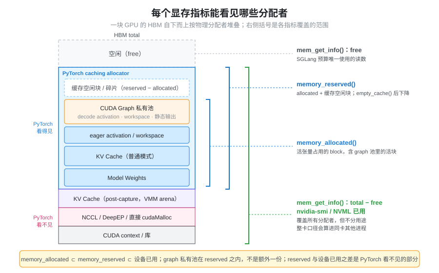
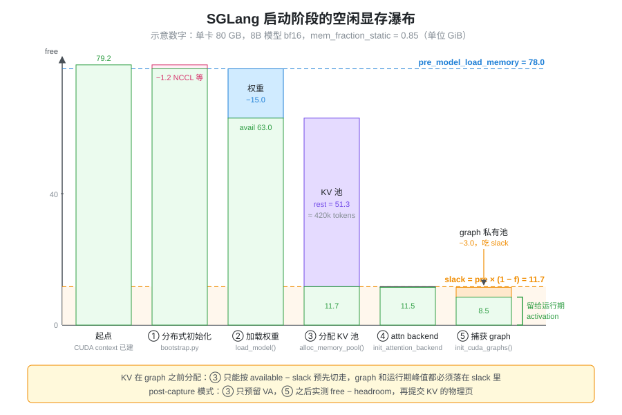

% 显存预算与统计口径

- 启动日志里每个阶段都打印了 `mem usage`，加起来却和 `nvidia-smi` 对不上，差的那部分去哪了？
- `--mem-fraction-static=0.85` 是不是说 85% 的显存给了权重和 KV cache？
- [VRAM Usage](./vram_usage.md) 把显存分成七类，为什么不能把七类各自估一个数再相加？

本篇是 [VRAM Usage](./vram_usage.md) 的展开：那一页回答“显存被用来做什么”，这一页回答“这笔账该怎么记、怎么测”，以及 SGLang 启动时怎样从一块 GPU 的总显存一步步算出 KV cache 能放多少 token。分配器内部的 block、碎片和 CUDA Graph 私有池细节见 [显存管理与生命周期](./torch_memory_management.md)，这里不重复。

### 问题：同一块显存可以被记两次，也可能一次都没记

做显存预算时最自然的做法是列清单：权重多少、KV 多少、activation 多少、CUDA Graph 多少，相加得到总量。这个做法会在两个方向上出错。

**重复计算。** 七类是按“逻辑用途”划分的，而显存是按“谁调用了分配接口”实际占用的。一个 decode activation 张量如果是在 CUDA Graph capture 期间分配的，它就躺在 graph 私有池里——它既是 activation，也是 CUDA Graph 显存，也属于 PyTorch allocator 的 reserved。分别估算三类再相加，同一块显存会被算三次。

**漏算。** 反过来，有一些显存根本不经过 PyTorch：CUDA context、NCCL 的通信 buffer、第三方库直接 `cudaMalloc` 的区域、用 CUDA VMM 接口自己映射的内存。只看 `torch.cuda.memory_reserved()` 的人会觉得“明明还有很多空闲”，直到驱动拒绝下一次分配。

所以问题不是“七类各占多少”，而是：**每一字节显存由哪个分配者持有、活多久，以及我们手上的指标能看到哪些分配者。**

### 抽象：两个维度记账，用“空闲显存的差分”测量

把每一笔显存放进一个二维表里：

- **逻辑用途**（七类）：回答“为什么需要它”，用于理解和优化；
- **物理分配者**：PyTorch caching allocator 的普通池、CUDA Graph 私有池、NCCL/通信库、直接 `cudaMalloc`/VMM、CUDA context；回答“谁持有它、哪个指标看得见它”。

一个逻辑类别可能分散在多个分配者里（KV cache 通常走 PyTorch allocator，开启 post-capture sizing 时走 VMM），一个分配者里也混着多个逻辑类别（graph 私有池里同时有 activation、workspace 和静态输出 buffer）。**预算应按物理分配者加总，用途只用来解释每个分配者里装了什么。**

那么怎么测？只有一个指标能覆盖所有分配者：驱动报告的设备空闲显存（`cudaMemGetInfo`，即 `torch.cuda.mem_get_info()`）。它不区分用途，但任何一次分配——无论走不走 PyTorch——都会让它变小。于是关键的工程手法是：**在每个初始化阶段前后各测一次空闲显存，把差值记给这个阶段。** 阶段顺序是确定的，差值之和加上最后剩余，正好等于起点时的空闲量，账一定能对平；而阶段之内装了什么，再用 allocator 指标或 snapshot 细分。



图里最需要记住的是两条包含关系：`memory_allocated ⊂ memory_reserved ⊂ 设备已用`，而 graph 私有池在 `memory_reserved` 之内、不是额外的一份。`memory_reserved` 和“设备已用”之间的差，就是 PyTorch 看不见的那部分。

### 七类显存落在哪个分配者里

把 [VRAM Usage](./vram_usage.md) 的七类映射到物理分配者，重叠和盲区就一目了然：

| 逻辑类别 | 典型物理分配者 | `memory_reserved` 能否看到 | 相加时的陷阱 |
| --- | --- | --- | --- |
| Model Weights | PyTorch allocator（普通池） | 能 | 量化权重的 scale、packed 布局也在这里 |
| KV Cache | PyTorch allocator；post-capture 模式下是 VMM arena | 普通模式能；VMM 模式不在常规池里 | KV 的大小由“剩余量”反推，不是独立输入 |
| CUDA Graph | allocator 的 graph 私有池 | 能（属于 reserved 的一部分） | 和 decode activation、workspace 是同一块 |
| Runtime Workspace | allocator 缓存块，或库自管 | 部分能 | 走 allocator 的部分和 activation 共享缓存 |
| Activation | allocator 普通池，或 graph 私有池 | 能 | eager 的峰值与 graph 内的 activation 不能同时计 |
| Allocator 开销 | allocator 缓存与碎片 | 能（reserved − allocated） | 它本身就是前几类的“包装损耗” |
| Context / 通信 | 驱动、NCCL、DeepEP、直接 `cudaMalloc` | 不能 | 只能通过设备空闲显存的差分看到 |

可以看出，第 3、5、6 类大量重叠，第 7 类则完全在 PyTorch 视野之外。这就是 [VRAM Usage](./vram_usage.md) 结尾那句话的含义：显存预算按实际独立分配的物理内存计算，而不是把七类机械相加。

### SGLang 启动时的显存账：从总显存到 KV 容量

SGLang 的启动顺序本身就是一套“阶段差分”记账。按 `managers/scheduler.py` 的 `init_model_worker()` 和 `model_executor/model_runner.py` 的调用顺序，一个 target worker 依次经过：

1. **初始化分布式**（`distributed/bootstrap.py`）：建立 TP/PP/EP 通信组，按需预热 NCCL。阶段末测得的空闲显存记为 `pre_model_load_memory`，它是后面一切预算的基准。
2. **加载权重**（`ModelRunner.load_model()`）：前后各测一次，差值存为 `weight_load_mem_usage`。
3. **分配 KV 池**（`ModelRunner.alloc_memory_pool()` → `KVCacheConfigurator.configure()`）：此时才根据剩余空闲显存算出能放多少 token，然后一次性分配。
4. **初始化 attention backend，捕获 CUDA Graph**（`init_cuda_graphs()` → `model_runner_components/cuda_graph_setup.py`）：prefill 与 decode 的 capture 各自前后测量。
5. **可选：post-capture 调整 KV**（`post_capture_resize_kv_pool()`），见后文。



这个顺序有一个直接后果：**KV 池在 CUDA Graph 之前分配。** KV 的大小必须提前给 graph、activation 和 workspace 留出余量，而这份余量在分配 KV 时还无法实测——这正是 `mem_fraction_static` 要解决的问题。

#### KV 容量怎么算

`mem_cache/kv_cache_configurator.py` 的 `_profile_available_bytes()` 是整套预算的核心，三行就能概括：

```python
slack_gb    = pre_model_load_memory * (1 - mem_fraction_static)  # 留给运行期
rest_memory = available_gpu_memory - slack_gb - mm_reservation_gb  # 留给 KV
# 之后：max_total_num_tokens = rest_bytes // cell_size，再按 page_size 向下取整
```

其中 `available_gpu_memory` 是权重加载完之后测得的空闲显存，`mm_reservation_gb` 是多模态特征传输的额外预留（纯文本模型为 0）。`cell_size` 是一个 token 在所有层上占用的 KV 字节数，由 `model_executor/pool_configurator.py` 按模型类型计算；标准 MHA/GQA 为 `kv_heads × (head_dim + v_head_dim) × layers × dtype 字节数`，FP4、MLA、SWA、混合 Mamba 等各有自己的 configurator。得到的 token 数再经过 `_apply_token_constraints()`：取用户 `--max-total-tokens` 与实测值的较小者，多 PP stage 时在各 rank 间取最小值。

旧版本里这段逻辑叫 `profile_max_num_token`，现在已拆成 `_profile_available_bytes()`（算字节预算）和各个 pool configurator（把字节换成 token），读老文章时注意对应关系。

一个示意算例（数字为说明用，非实测）：单卡 80 GB，Llama-3-8B bf16，`mem_fraction_static=0.85`。

| 量 | 数值 | 说明 |
| --- | --- | --- |
| `pre_model_load_memory` | 78.0 GiB | 分布式初始化后的空闲显存 |
| `slack_gb` | 78.0 × 0.15 = 11.7 GiB | 留给 graph、activation、workspace |
| 权重 | 15.0 GiB | 8B 参数 × 2 字节 |
| `available_gpu_memory` | 63.0 GiB | 权重加载后的空闲显存 |
| `rest_memory` | 63.0 − 11.7 = 51.3 GiB | 全部交给 KV |
| `cell_size` | 8 × (128 + 128) × 32 × 2 = 128 KiB | 8 个 kv head、32 层、bf16 |
| `max_total_num_tokens` | 51.3 GiB ÷ 128 KiB ≈ 420k | 再按 page_size 取整 |

注意 SGLang 日志里的 “GB” 都是 `/ (1 << 30)` 算出来的，实际是 GiB；`nvidia-smi` 报的是 MiB，对账前先统一单位。

如果 `rest_memory <= 0`，`_profile_available_bytes()` 直接抛 `ValueError`，提示把 `mem_fraction_static` 调到大于 `1 − available / pre_model_load_memory`。含义是：权重本身已经吃掉了超过 `f` 比例的显存，KV 一个 token 都放不下。

### `mem_fraction_static` 的真实含义

`server_args.py` 对这个参数的说明是 “(model weights + KV cache pool) / GPU memory capacity”，但实现里的分母不是总容量，而是 `pre_model_load_memory`：

```
静态预算 = pre_model_load_memory × f        （权重 + draft 权重 + KV + 二者之间分配的一切）
运行余量 = pre_model_load_memory × (1 − f)  （CUDA Graph、activation、workspace、之后的通信 buffer）
```

所以回答开头的问题：`0.85` 不是“总显存的 85% 给权重和 KV”。CUDA context、分布式初始化阶段的 NCCL 预热在 `pre_model_load_memory` 之前就已经扣掉，不在任何一边；静态预算里也不只有权重和 KV，凡是在测量 `pre_model_load_memory` 之后、分配 KV 之前占用的显存（例如 speculative decoding 的 draft 模型权重）都从这 85% 里出；而 15% 的余量要装下之后的 CUDA Graph capture 和运行期峰值。`pre_model_load_memory` 在多卡时还是各 rank 的最小值（`distributed=True` 时 all_reduce MIN），一张卡被别的进程占了显存，所有 rank 的 KV 都会跟着缩小——`bootstrap.py` 的 `_check_tp_memory_balance()` 会在某个 rank 低于本地 90% 时打印 “The memory capacity is unbalanced” 警告。

#### 不指定时的默认值

`mem_fraction_static` 默认为 `None`，由 `ServerArgs._handle_gpu_memory_settings()` 按“要给运行期留多少 MB”反推：

```
reserved_mb = 512                                  # 固定底数
            + activation_tokens × 1.5              # 运行期 activation 估计
            + tp × pp / 8 × 1024                   # 并行规模越大，通信与杂项越多
            + reserve_for_graph_mb()               # CUDA Graph，按 cuda_graph_max_bs 等估算
            (+ reserve_for_deepep_a2a_mb())        # DeepEP all-to-all 且开启 decode graph 时 +2048
mem_fraction_static = round((gpu_mem − reserved_mb) / gpu_mem, 3)
```

`activation_tokens` 取 `max(chunked_prefill_size, 2048)`（开启 chunked prefill 时）、`max(max_prefill_tokens, 2048)`，PD 分离的 decode 实例则按 `max_running_requests × draft_tokens` 估；总显存大于 60 GB 时余量至少 10 GiB；拿不到显存容量时退回 0.88，多模态模型另有修正。这里的 `gpu_mem` 是 `nvidia-smi` 报的总容量，而公式最终作用在更小的 `pre_model_load_memory` 上，所以实际留出的余量会比 `reserved_mb` 略少。

这套默认值的本质是**经验估计**：graph 和 activation 的真实大小要到 capture 之后才知道。估大了浪费 KV 容量，估小了在 capture 或高峰期 OOM。

### Post-capture KV sizing：先 capture，再定 KV

既然困难在于“KV 必须在 graph 之前分配”，另一种做法就是把顺序反过来——但 CUDA Graph 回放要求 KV buffer 的地址在 capture 时就固定。SGLang 的实验性方案用 CUDA VMM（虚拟内存管理）把“地址”和“物理显存”拆开：

1. **分配 KV 时只预留虚拟地址。** `memory_pool.py` 的 `_alloc_post_capture_buffers()` 按上限 token 数为每层 K/V 预留一段 VA，底层是 `mem_cache/kv_vmm_backing.py` 的 `KvVmmArena`（经 `CUDAPluggableAllocator` 接入的 bump allocator），只先映射够跑 capture 的一小段前缀。此时日志打印的是 “VA upper bound”，而不是实际占用。
2. **照常 capture CUDA Graph。** graph 记住的是 VA，之后映射多少物理页都不改变地址。
3. **实测空闲显存，再决定 KV。** `kv_pool_runtime.py` 的 `compute_post_capture_kv_resize()` 先 `torch.cuda.synchronize()`，再测一次（多卡取最小值）空闲显存，计算：

   ```python
   headroom = pre_model_load_memory * (1 - mem_fraction_static)  # 部分情况抬高到 pre_capture_activation_reserve_mb
   budget   = max(0, free - headroom - mm_reservation) + pool.post_capture_backed_bytes
   ```

   然后用同一套 configurator 把 `budget` 换成 token 数（上限为第 1 步的 VA 容量），由 `finalize_backing()` 一次性 `cuMemMap` 到位，并相应 `resize` token allocator，必要时下调 `max_running_requests`。

这样 slack 不必再替 graph 预留：graph 已经实际占用、已被 `free` 体现，`_handle_gpu_memory_settings()` 在这一模式下也只保留 `1536 + tp × pp / 8 × 1024` MB。剩下的 headroom 只需覆盖 eager 路径（decode graph 的 max bs 小于 `max_running_requests` 时）和 Mamba 等模型的运行期 activation。

开启条件比较苛刻：环境变量 `SGLANG_ENABLE_POST_CAPTURE_KV_SIZING`（默认关闭），CUDA 设备，非 MLA、非 FP4 KV、非量化 KV，`dcp_size == 1`，未启用 memory saver 和自定义 Mooncake 内存池，decode CUDA Graph 未禁用；draft worker 共享 target 的池，不单独走这条路径。条件见 `server_args.py` 的 `post_capture_kv_sizing_planned()` 和 `kv_pool_runtime.py` 的 `is_post_capture_kv_active()`。

### 统计口径：每个指标看见什么

| 指标 | 来源 | 看得见 | 看不见 / 注意 |
| --- | --- | --- | --- |
| `torch.cuda.memory_allocated()` | PyTorch allocator | 活着的张量占用的 block | 缓存空闲块、context、NCCL、直接 `cudaMalloc` |
| `torch.cuda.memory_reserved()` | PyTorch allocator | allocated + 缓存空闲块，含 graph 私有池 | allocator 之外的一切；`empty_cache()` 后会下降 |
| `torch.cuda.max_memory_allocated()` | PyTorch allocator | 自上次 reset 以来的峰值 | 同 allocated；用于量 activation 峰值 |
| `torch.cuda.mem_get_info()` | `cudaMemGetInfo` | 整卡的 free / total | 不分用途；**其他进程的占用也算进去** |
| `nvidia-smi` / NVML | 驱动 | 每个进程的占用、整卡已用 | 不分用途；单位 MiB；进程级数字含 context |

SGLang 的启动预算只用 `mem_get_info`：`utils/common.py` 的 `get_available_gpu_memory()` 默认先 `empty_cache()` 把 allocator 的缓存块还给驱动，再读 free 值；多卡时对所有 rank 取最小值；集成显卡（`props.is_integrated`）改用 `psutil` 的主机可用内存。这个选择保证了 PyTorch 之外的分配也被计入，但也意味着同卡上的其他进程会直接挤占 KV 容量。

日志里的两类字段由此而来：

- `avail mem=… GB`：该时刻的 `mem_get_info` 空闲值。
- `mem usage=… GB`：同一阶段前后两次 `avail mem` 之差，即这个阶段的显存增量。

按阶段对照的日志行：

| 阶段 | 日志关键字 | 用途 |
| --- | --- | --- |
| 分布式初始化 | `Init torch distributed ends. … mem usage=` | 通信组与 NCCL 预热的开销 |
| 加载权重 | `Load weight end. … avail mem=… mem usage=` | 本 rank 的权重分片大小 |
| 分配 KV | `KV Cache is allocated. … #tokens: … K size: … V size:`，`Memory pool end. avail mem=` | KV 容量与剩余显存 |
| 捕获 graph | `Capture … CUDA graph end. … mem usage=… avail mem=` | prefill / decode / verify 各自的 graph 开销 |
| post-capture | `Post-capture KV sizing: KV cache allocated. …` | 最终 KV 容量 |
| 就绪 | `max_total_num_tokens=… available_gpu_mem=… GB` | 服务开始前的余量 |

最后一行的 `available_gpu_mem` 用的是 `empty_cache=False`，即 allocator 的缓存块不还给驱动；它就是运行期 activation 峰值真正能用的空间（加上 allocator 里已缓存的部分）。

### 排查顺序：对不上账时先看什么

1. **先统一口径。** 日志的 GB 是 GiB，`nvidia-smi` 是 MiB；`mem_get_info` 是整卡，NVML 进程列表是单进程。先确认同卡上没有别的进程。
2. **按阶段读 `mem usage`。** 分布式初始化、权重、KV、各类 graph capture 的增量加上最后的 `available_gpu_mem`，应该约等于起点的空闲显存；哪一段异常大，问题就在哪个阶段。
3. **再把差值拆给分配者。** 阶段增量与该阶段 `memory_reserved` 的变化比较：两者接近，说明大头在 PyTorch allocator 里，可以用 memory snapshot 继续细分（方法见 [显存管理与生命周期](./torch_memory_management.md)）；差距大，说明是 NCCL、DeepEP、VMM 或第三方库的直接分配。
4. **运行期 OOM 看余量而不是 KV。** 启动后 KV 已经常驻，运行期 OOM 来自 activation、eager 路径的 workspace 或碎片。对策是降低 `mem_fraction_static`（直接加大余量），或减小 `chunked_prefill_size` / `cuda_graph_max_bs`（降低峰值需求）；`--max-total-tokens` 也能通过 `_apply_token_constraints()` 截小 KV、间接留出余量，但它不随卡型和并行规模自适应，不如前两者直接。
5. **启动期报 `rest_memory <= 0`。** 权重加上 slack 已经超出可用显存：要么调高 `mem_fraction_static`，要么增大 TP/EP 让每卡权重变小。

### 小结

显存预算有两个维度：七类逻辑用途解释“为什么需要”，物理分配者决定“谁持有、哪个指标看得见”。七类之间大量重叠（graph 私有池、activation、workspace、allocator 缓存），又有一类完全在 PyTorch 视野之外（context、NCCL、直接 `cudaMalloc`、VMM），所以只能按分配者加总，并用设备空闲显存的阶段差分来测。

SGLang 启动正是这套记账：分布式初始化后测得 `pre_model_load_memory`，加载权重，再用 `available − pre × (1 − f)` 一次性分配 KV，最后 capture CUDA Graph。因为 KV 在 graph 之前分配，`mem_fraction_static` 的 `1 − f` 必须预先为 graph 和运行期峰值留出余量，默认值也只是按 batch、chunk、并行规模的经验估计；post-capture KV sizing 用 VMM 先固定地址、capture 后再提交物理页，把这份估计换成了实测。读启动日志时，`avail mem` 是 `mem_get_info` 的空闲值，`mem usage` 是阶段增量，二者配合 `memory_reserved` 和 snapshot，就能把每一 GiB 落到具体的分配者上。
