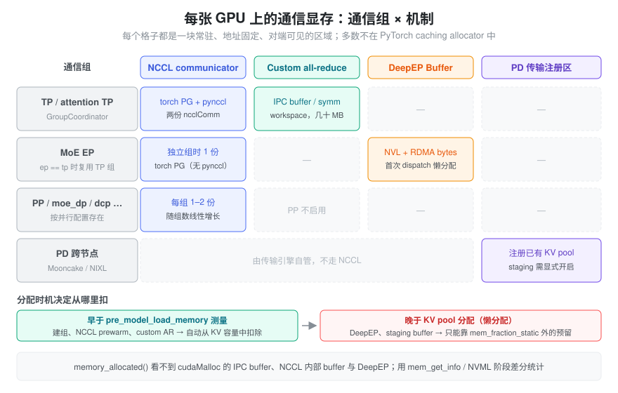
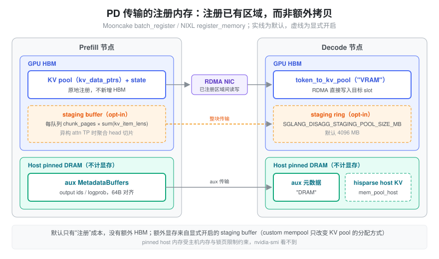

% 通信与传输显存

- `memory_allocated()` 只有几十 GB，`nvidia-smi` 却多出好几个 GB——多出来的这部分去哪了？
- 同样的模型，把 TP 从 4 改成 8、或者打开 DeepEP，KV cache 容量为什么会掉一截？
- custom all-reduce、DeepEP、Mooncake 这些通信组件各自占了多少显存？是启动时就占好，还是第一次通信才分配？
- PD 分离时 KV 要跨机传输，是不是还得再准备一份同样大的“发送缓冲区”？

这些问题都指向同一类容易被忽视的显存：**通信与传输显存**。它不属于模型计算，却和权重、KV cache 一样常驻；它大多不经过 PyTorch caching allocator，所以 `torch.cuda.memory_*` 系列接口经常看不到它。本篇是 [VRAM Usage](./vram_usage.md) 的子页，覆盖其中第 6 类（Communication Memory）、第 7 类里与通信库相关的 context 开销，以及 3A（MoE buffer）与 3C（PD 传输内存）。通信算子本身的选择逻辑见 [多 GPU 通信与执行](./torch_multi_gpu.md)，通信抽象见 [Communicator](./communicator.md)，PD 传输协议见 [PD Design](./disaggregation_design.md)，这里只算“显存账”。

### 问题：通信 buffer 为什么不能随用随还

普通激活张量的生命周期由 caching allocator 管理：forward 时申请，引用计数归零就把块还给缓存池，下一次可以分给别的张量。通信 buffer 走不了这条路，原因是**对端要按地址访问它**：

- **注册**：RDMA 网卡只能读写事先注册过（pin 住物理页、拿到 memory key）的内存区域；NCCL 的 user buffer registration、NVLS、symmetric window 也都要求 buffer 先注册到 communicator。注册本身有代价，不可能每次通信重新做一遍。
- **IPC 映射**：单机多卡 custom all-reduce 让每个 rank 直接读写其它 rank 的显存。这需要把本地 buffer 的 IPC handle 发给对端、对端再 `cudaIpcOpenMemHandle` 映射进自己的地址空间。映射之后，这块地址就不能被 allocator 挪作他用。
- **CUDA Graph 记住指针**：decode 阶段通常在 CUDA Graph 里执行通信；graph replay 时直接使用捕获时的地址，buffer 必须在整个服务期间保持不变（见 [Cuda Graph](./cuda_graph.md)）。

因此通信库倾向于**在初始化时一次性申请一块固定区域，之后反复复用**，并且常常绕开 PyTorch allocator：直接 `cudaMalloc`、`ncclMemAlloc`、cuMem VMM API，或者由 DeepEP、Mooncake 这类第三方库在内部自行分配。

### 抽象：通信显存 = 通信组 × 机制 的固定区域

可以把每张 GPU 上的通信显存看成一张二维表：行是**通信组**（TP、attention TP、MoE EP、PP、DP……），列是**通信机制**（NCCL communicator、custom all-reduce、symmetric memory、DeepEP buffer、PD 传输注册区）。每个非空格子都是一块常驻、地址固定、对端可见的区域，总量大致等于所有格子之和。

这张表带来三个推论：

1. **按组线性增长**：组越多、每组启用的机制越多，占用越大。并行配置不仅改变计算切分，也改变通信显存的格子数。
2. **大部分在 allocator 之外**：`memory_allocated()`/`memory_reserved()` 看不到 `cudaMalloc` 直接申请的 IPC buffer、NCCL 内部 buffer 和 DeepEP buffer。只有基于驱动的 `torch.cuda.mem_get_info()` 或 NVML 才能看到，口径差异见 [显存预算与统计口径](./vram_budget.md)。
3. **分配时机决定它从哪里扣**：在测量“模型加载前可用显存”之前就分配的部分，会自然地从 KV cache 预算里扣掉；之后才懒分配的部分，必须落在 `mem_fraction_static` 之外的预留空间里，否则就会在 CUDA Graph capture 或第一次请求时 OOM。

### NCCL communicator：每个组一份，懒初始化

每个 NCCL communicator（`ncclComm`）在 GPU 上都有自己的开销：每个 channel、每个 peer 的收发 buffer（大小由 `NCCL_BUFFSIZE` 控制，上游默认 4 MiB），加上 proxy、FIFO 等内部结构；启用 NVLS（NVLink SHARP）时还要额外申请 multicast 内存。这些都由 NCCL 直接向驱动申请，不在 PyTorch allocator 里。具体数值与 NCCL 版本、拓扑、channel 数有关，应以实测为准。

在 SGLang 里，communicator 的数量比直觉多。`distributed/parallel_state.py` 的 `GroupCoordinator` 为每个组创建：

- 一个 `device_group`（`torch.distributed.new_group`，NCCL 后端，即 torch 的 ProcessGroupNCCL）；
- 一个 `cpu_group`（gloo，用于交换 IPC handle 等元数据，不占显存）；
- 当 `use_pynccl` 且 `world_size > 1` 时，再创建一个 `PyNcclCommunicator`。它在 `pynccl.py` 里通过 `ncclCommInitRank`/`ncclCommInitRankConfig` 建立**独立的** `ncclComm`。

所以同一个 TP 组，可能同时持有 torch 和 pynccl 两份 NCCL communicator。不过 SGLang 会尽量复用组，避免格子继续增加：

| 组 | 何时复用 | 不复用时的配置 |
| --- | --- | --- |
| attention TP | `attn_tp_size == tensor_model_parallel_size` 时直接用 `_TP` | 新建 `attention_tp`，不启用 custom AR；只有同步 token ids 或启用 symm mem 时才用 pynccl |
| MoE EP | `moe_ep_size == tp_size` 时直接用 `_TP` | 新建 `moe_ep`，`use_pynccl=False`、`use_custom_allreduce=False` |
| MoE TP | 同上 | 新建 `moe_tp` |
| PP | — | `pp` 组不启用 custom AR |

另外还有 `moe_dp`、`dcp`、`attn_cp` 等组，按并行配置决定是否存在。

**NCCL 的传输资源是懒建立的**：`ncclCommInitRank` 之后，与某个 peer 的连接和 buffer 往往要等第一次真正通信时才分配。如果这一步发生在 KV cache 已经按剩余显存分满之后，就可能在 CUDA Graph capture 时 OOM。`distributed/bootstrap.py` 的 `init_torch_distributed()` 因此按以下顺序操作：

1. 记录 `before_avail_memory`，然后 `_init_parallel_groups` 建组；
2. 可选 `_prewarm_nccl`（`--pre-warm-nccl`，默认只在 AMD GPU 上开启）：在 TP `device_group` 上做一次 `all_reduce`，强制完成初始化；
3. 若启用 TP lm_head all-to-all，调用 `_prewarm_tp_lm_head_all_to_all()`。源码注释写得很直接：在模型显存记账之前把 PyNCCL P2P 资源物化出来，*so its persistent transport allocations are included in later KV-cache sizing instead of appearing during capture*；
4. 用 `get_available_gpu_memory(..., distributed=world_size > 1)` 测出 `pre_model_load_memory`（底层是 `torch.cuda.mem_get_info`，能看到非 torch 分配），并由 `_check_tp_memory_balance` 检查各 rank 是否失衡（低于本地 90% 时告警 *memory capacity is unbalanced*）。

几个影响 NCCL 显存的环境变量，由 `entrypoints/engine.py` 的 `_set_envs_and_config` 设置：

- `NCCL_CUMEM_ENABLE`：用户未设置时取 `int(enable_symm_mem)`；启用 symm mem 或多 MNNVL 节点时强制为 1，让 NCCL 用 cuMem VMM 分配内部 buffer。
- `NCCL_NVLS_ENABLE`：取 `int(enable_nccl_nvls or enable_symm_mem)`，默认关闭，因此默认不付 NVLS multicast 显存。
- `NCCL_GRAPH_MIXING_SUPPORT=0`（`dcp_size > 1` 时）与 `CUDA_DEVICE_MAX_CONNECTIONS=8`。
- SGLang 不设置 `NCCL_BUFFSIZE`，沿用 NCCL 默认值；需要压缩通信显存时可以由用户自行调小，但会影响带宽。

### Custom all-reduce：IPC buffer 与 symmetric workspace

TP 组内的小消息 all-reduce 通常不走 NCCL，而是走 custom all-reduce（选择条件见 [多 GPU 通信与执行](./torch_multi_gpu.md)）。它的前提是每个 rank 能直接读写其它 rank 的一块 buffer，所以必须在初始化时把这块 buffer 建好并互相映射。`distributed/device_communicators/custom_all_reduce.py` 的 `dispatch_custom_allreduce()` 在 CUDA 上默认返回 v2 实现（`SGLANG_OPT_USE_CUSTOM_ALL_REDUCE_V2` 默认开启，且 `can_use_custom_all_reduce_v2` 通过），否则回退到 legacy 实现。两者的显存结构不同。

**Legacy `CustomAllreduce`**：`_MAX_CAR_SIZE = 8192 * 1024`（8 MiB，HIP 上 16 MiB），每个 rank 分配三块：

| buffer | 来源 | 大小 | 作用 |
| --- | --- | --- | --- |
| `meta_ptrs` | `create_shared_buffer` | `ops.meta_size() + max_size` | 跨 rank 同步用的信号区 + 中间结果 |
| `buffer_ptrs` | `create_shared_buffer` | `max_size` | 预注册的 IPC 输入区，eager 模式下先把输入拷进来 |
| `rank_data` | `torch.empty(..., uint8)` | `max_size` | 存放已注册 buffer 的指针表 |

`create_shared_buffer` 直接调用 `CudaRTLibrary().cudaMalloc`，**绕过 PyTorch allocator**，再用 `cudaIpcGetMemHandle` 导出 handle，经 `all_gather_object` 交换后由对端 `cudaIpcOpenMemHandle` 打开。注意映射对端 buffer 不消耗本卡的物理显存，本卡真正付出的只是自己那几块，量级是几十 MB。CUDA Graph 模式下，`capture()` 结束时调用 `register_graph_buffers()`，把 graph 里实际使用的输入地址注册给对端，避免 eager 模式那次额外拷贝。

**`CustomAllReduceV2`**（`custom_all_reduce_v2.py`）：

- 最大消息大小由 `SGLANG_CUSTOM_ALL_REDUCE_V2_MAX_SIZE_KB` 决定（默认 16 × 1024 KB，即 16 MiB），可以用 `SGLANG_FORCE_CUSTOM_ALL_REDUCE_V2_PULL_SIZE_KB`/`..._PUSH_SIZE_KB` 分别覆盖。
- `_init_workspace` 只做**一次** symmetric 分配（`_SymmetricMemory.empty_strided_p2p` + `rendezvous`），内部布局为 `[2 × world_size 个 push buffer | pull buffer | pull semaphores]`，总量约为 `2W × max_push_size + max_pull_size + 128 × num_pull_blocks` 字节。
- 另有 `graph_params = torch.zeros((131072, world_size), uint64)`，即 `_MAX_GRAPH_INPUTS = 131072` 行的设备指针表。world size 为 8 时正好是 131072 × 8 × 8 B = 8 MiB。这块由 torch allocator 分配，能被 `memory_allocated()` 统计。
- 初始化日志 *All Reduce config: symmetric_memory = X MB, local_buffer = Y MB, multicast = ...* 直接给出了这部分的账。

**symmetric memory pool**：开启 `--enable-symm-mem` 后，`pynccl_allocator.py` 的 `SymmetricMemoryContext` 让 buffer 通过 `ncclMemAlloc` 分配、`ncclCommWindowRegister` 注册。所有组共享同一个 `torch.cuda.MemPool`（`get_nccl_mem_pool()`），所以这部分**会**出现在 allocator 统计里，但属于独立 pool，普通张量用不上。`prealloc_symmetric_memory_pool` 可以按 `SGLANG_SYMM_MEM_PREALLOC_GB_SIZE` GiB 预先占好整块（默认 -1 表示不预分配），调用点在 `model_executor/model_runner_components/cuda_graph_setup.py`。这样做的理由写在注释里：PyTorch mempool 在 OOM 场景下不会做碎片整理，与其在 capture 中途零碎增长，不如一开始就占满。

### DeepEP：dispatch/combine buffer 由模式决定

MoE 在 EP 下用 all-to-all 把 token 分发给专家所在的 rank，再把结果收回来（dispatch/combine 流程见 [多 GPU 通信与执行](./torch_multi_gpu.md) 与 [EP](./expert_parallelism.md)）。DeepEP 把这两个方向需要的空间合成一个 `deep_ep.Buffer`，内部分为两部分：

- **NVL buffer**（`num_nvl_bytes`）：节点内通过 NVLink 互相可见的显存；
- **RDMA buffer**（`num_rdma_bytes`）：跨节点通过 NVSHMEM/IBGDA 访问的对称显存。

`layers/moe/token_dispatcher/deepep.py` 的 `DeepEPBuffer.get_deepep_buffer(group, hidden_size, param_bytes, deepep_mode, num_max_dispatch_tokens_per_rank, num_experts)` 按模式计算两者的大小：

| 模式 | 大小由什么决定 | 计算方式 |
| --- | --- | --- |
| normal | `hidden_bytes = hidden_size × param_bytes`、EP 组大小、dispatch/combine config（`--deepep-config` 或 DeepEP 默认 config） | 对 dispatch/combine 两个 config 分别取 `get_nvl_buffer_size_hint`/`get_rdma_buffer_size_hint`，再取最大值 |
| low_latency | `num_max_dispatch_tokens_per_rank`、`hidden_size`、EP 组大小、`num_experts` | `Buffer.get_low_latency_rdma_size_hint(...)` |
| auto | 两者都要支持 | 两套都算，`num_rdma_bytes` 取较大值 |

关键参数：

- `param_bytes` 硬编码为 2（按 BF16 预留）。
- `num_max_dispatch_tokens_per_rank` 来自 `SGLANG_DEEPEP_NUM_MAX_DISPATCH_TOKENS_PER_RANK`（默认 128，断言不超过 1024）。源码注释提醒 *A large value will lead to large memory occupation*。low-latency 模式要为“每个 rank 最多收到这么多 token、每个 token 可能发往任一 local expert”预留空间，所以它的 buffer 与 `num_experts` 和这个上限都成正比。
- QP 数 `num_qps_per_rank`：normal 取 `num_sms`，low_latency 取 `num_experts // group.size()`，auto 取两者最大值。它影响的是网卡侧资源，而不是 HBM 大小。

**分配时机**：buffer 是进程级单例，存在 `get_resources().buffers["deepep_ep_state"]` 里，**第一次 dispatch 时**通过 `_get_buffer()` 懒创建，之后一直复用。也就是说它发生在 KV cache 分配之后，只能从 `mem_fraction_static` 之外的预留空间里出。`server_args.py` 的 `reserve_for_deepep_a2a_mb()` 专门为此预留：非 prefill 节点、decode CUDA Graph 开启且 `moe_a2a_backend == "deepep"` 时多留 2 GiB（注释：*DeepEP all-to-all buffers captured in the decode graph are real extra allocations*）。这 2 GiB 在 `_handle_gpu_memory_settings` 自动推导 `mem_fraction_static` 时加到 `reserved_mem` 上，见 [显存预算与统计口径](./vram_budget.md)。如果手动指定了 `--mem-fraction-static`，这层保护就不再生效，需要自己估算 DeepEP 的大小。

### PD 分离：注册已有 KV pool，而不是再拷一份

PD 分离要把 prefill 节点算好的 KV 传给 decode 节点（协议与流程见 [PD Design](./disaggregation_design.md)）。一个常见误解是：传输需要一份和 KV cache 等大的“发送缓冲区”。SGLang 的默认做法正好相反：**把已有的 KV pool 直接注册给传输引擎，RDMA 从 KV pool 原地读写**，不额外占 HBM。

**Mooncake**（`disaggregation/mooncake/conn.py`）：

- `_registerable_regions()` 收集三类区域并去重：`kv_args.kv_data_ptrs/kv_data_lens`（每层 KV buffer）、`aux_data_ptrs/lens`（prefill 产出的 output ids、cached tokens、logprob 等元数据）、`state_data_ptrs/lens`（Mamba/SWA 等状态）。
- `register_buffer_to_engine()` 调用 `self.engine.batch_register(ptrs, lens)`，退出时 `batch_deregister`。注册只是 pin 住页面、生成 memory key，不复制数据。

**NIXL**（`disaggregation/nixl/conn.py`）：`register_buffer_to_engine()` 按内存类型分组调用 `self.agent.register_memory(addrs, mem_kind)`。KV 区域按实际位置标为 `"VRAM"` 或 `"DRAM"`，aux 固定为 `"DRAM"`，state 为 `"VRAM"`。

注册区里有两类**不在 HBM 上**：

- **aux 元数据**：`disaggregation/utils.py` 的 `MetadataBuffers` 默认 `device="cpu"`（Ascend 上为 NPU，只有 `SGLANG_MOONCAKE_CUSTOM_MEM_POOL == "INTRA_NODE_NVLINK"` 时放 CUDA）。它很小，但每条记录都按 RDMA 最小 64 字节对齐（注释 *The minimal size for RDMA is 64Bytes, so we pad*）。
- **hisparse 下的 decode KV**：`disaggregation/decode.py` 在启用 hisparse 时把传输目标设为 `hisparse_coordinator.mem_pool_host`，内存类型为 `"DRAM"`；否则是 `token_to_kv_pool` 的 `get_contiguous_buf_infos()`，类型为 `"VRAM"`。

这些是 pinned host memory，会占主机内存、受 `ulimit -l` 等限制，但**不计入显存**，`nvidia-smi` 也看不到。

真正额外占 HBM 的只有两种显式开启的情况：

1. **staging buffer**（`SGLANG_DISAGG_STAGING_BUFFER=1`，默认关闭）。`disaggregation/common/staging_buffer.py` 的说明是：prefill 与 decode 的 attention TP 不同（异构 TP）时，每个 token 的 head 切片在对端是分散的，逐 token RDMA 太碎；先在 GPU 上把切片聚合到连续的 staging buffer，再整块传输。`staging_handler.py` 中：
    - prefill 侧 `init_staging_buffers` 为每个传输队列分配一块 `max(1, chunked_prefill_size // page_size) × sum(kv_item_lens)` 字节的 buffer，大小随 chunk 大小和每页 KV 字节数增长；
    - decode 侧 `init_staging_allocator` 分配一个 `SGLANG_DISAGG_STAGING_POOL_SIZE_MB`（默认 4096 MB）的环形缓冲区。
    
    两者都通过 `torch.empty` 分配（可放在 custom mempool 中）并注册给传输引擎。它们发生在 KV pool 之后，同样要从预留空间里出。
2. **custom mempool**（`SGLANG_MOONCAKE_CUSTOM_MEM_POOL=NVLINK` 或 `BAREX`）。`disaggregation/mooncake/utils.py` 的 `init_mooncake_custom_mem_pool` 用 `NVLinkAllocator`/`BarexAllocator` 构造 `torch.cuda.MemPool`，经 `mem_cache/utils.py` 的 `maybe_init_custom_mem_pool` 让 KV pool 本身从这个 pool 分配。它改变的是 KV pool 的**分配方式**（让它可被 NVLink/Barex 直接访问），而不是新增一份 KV。

### 统计与排查：怎么把这笔账算出来

通信显存大多在 allocator 之外，排查时要靠“阶段差分”而不是单个指标：

| 观察点 | 能看到什么 |
| --- | --- |
| `init_torch_distributed` 结束时的日志 *Init torch distributed ends ... mem usage=X GB* | 建组 + NCCL prewarm 消耗的显存，即本卡 `before_avail_memory - local_gpu_memory` |
| custom AR v2 的 *All Reduce config: symmetric_memory = ... MB, local_buffer = ... MB* | 自定义 all-reduce 的 symmetric workspace 与本地 buffer |
| CUDA Graph capture 前后 `torch.cuda.mem_get_info()` 的差 | graph pool + 懒分配的 DeepEP buffer、NCCL 连接资源的合计 |
| `memory_reserved()` 与 `nvidia-smi` 进程占用之差 | CUDA context、NCCL、`cudaMalloc` 直接申请的 IPC buffer、DeepEP 等非 torch 分配的总和 |

常见症状与对应的格子：

- **TP 各 rank 可用显存不一致**，触发 *memory capacity is unbalanced*：往往是某些 rank 额外创建了组（例如 attention TP 与 TP 不等时），或同机有其它进程占卡。
- **capture 阶段 OOM、请求阶段正常**：懒分配的通信资源（DeepEP、P2P transport）没有被预留覆盖。可以降低 `mem_fraction_static`，或确认是否走了 `reserve_for_deepep_a2a_mb` 的自动推导。
- **custom AR 初始化失败**：日志提示 *Setup Custom allreduce failed ... specify --disable-custom-all-reduce*，通常与 IPC/P2P 不可用有关。关闭后会退回 NCCL，省掉几十 MB，但小消息延迟变高。
- **开启 DeepEP low-latency 后 KV 容量大降**：检查 `SGLANG_DEEPEP_NUM_MAX_DISPATCH_TOKENS_PER_RANK` 与专家数。它们决定 RDMA buffer 的大小，而且这块 buffer 会在每个 EP rank 上各占一份。

### 小结

通信与传输显存的共同点是**地址固定、对端可见、一次分配长期复用**。所以它不能像激活那样随用随还，大多也不在 PyTorch caching allocator 里。可以把它理解成“通信组 × 机制”的一张表：

- 每个 NCCL 组各有一份 communicator 开销，SGLang 的 TP 组还可能同时有 torch 和 pynccl 两份；
- custom all-reduce 用 `cudaMalloc` 的 IPC buffer（legacy）或一块 symmetric workspace（v2），量级为几十 MB；
- DeepEP 的 buffer 大小由模式决定：normal 取决于 hidden 大小与 config，low-latency 取决于每 rank 最大 token 数与专家数。它在第一次 dispatch 时懒分配，靠 `reserve_for_deepep_a2a_mb` 的 2 GiB 预留兜底；
- PD 分离默认把已有的 KV pool 注册给 Mooncake/NIXL，不额外占 HBM。aux 元数据和 hisparse 下的 KV 在 pinned host memory 上，不算显存。只有 staging buffer 和 custom mempool 这类显式开启的选项才改变 HBM 账。

做预算时要分清两条线：在 `pre_model_load_memory` 之前分配的部分，自动从 KV 容量里扣除；之后懒分配的部分，必须由 `mem_fraction_static` 之外的预留空间兜住。前者影响 token capacity，后者决定 OOM 边界。
