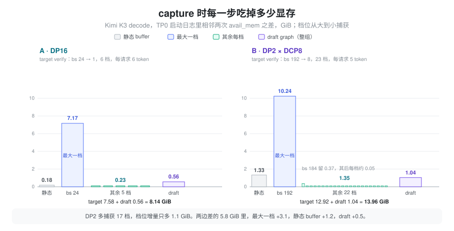
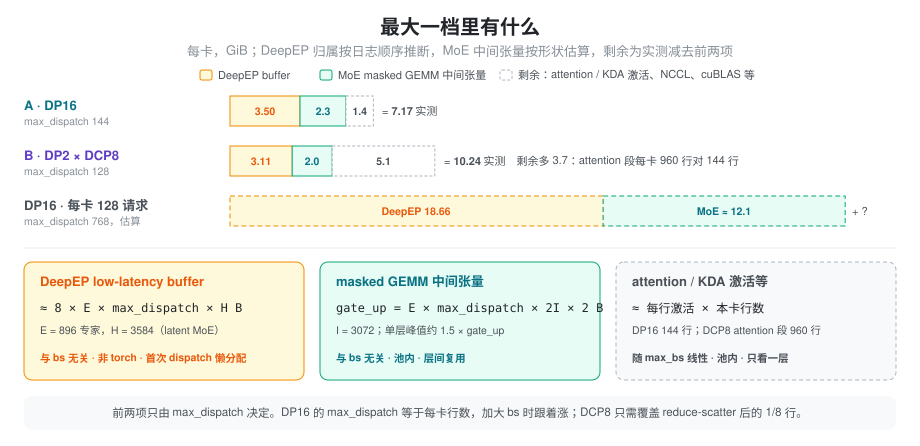

% CUDA Graph 显存：怎么算、怎么测

[运行时显存](./vram_runtime.md) 讲过，CUDA Graph 把 capture 时的峰值变成了常驻占用；[Cuda Graph](./cuda_graph.md) 讲了私有池和倒序捕获为什么能让多张图共用一份临时区。本篇回答剩下的问题：这块常驻到底有多大，由哪几项组成，每一项随什么参数变化，以及怎么从启动日志里把它们量出来。例子是 Kimi K3 在 2 机 16 卡 B200 上的两套 decode 部署：DP16 和 DP2 × DCP8，两者的整体对比见 [K3 Decode：DP16 vs DP2×DCP8](./kimi_k3_decode_dp16_vs_dp2.md)。

### 问题：启发式差了一个数量级

不指定 `--mem-fraction-static` 时，SGLang 用 `server_args.py` 里的两个函数给 graph 预留显存（单位 MB，公式见 [运行时显存](./vram_runtime.md)）：`reserve_for_graph_mb()` 大致是 `max_bs × 2 + max_bs × dp_size × 3`，`reserve_for_deepep_a2a_mb()` 在 decode 开 DeepEP 时固定再加 2048。把 K3 两套部署的参数代进去，和 TP0 启动日志里 target、draft 两组 graph 的实测占用对比：

| 每卡 | A · DP16 | B · DP2 × DCP8 |
| :--- | ---: | ---: |
| decode 最大 capture bs | 24 | 192 |
| `reserve_for_graph_mb` | 24 × 2 + 24 × 16 × 3 = 1200 MB | 192 × 2 + 192 × 2 × 3 = 1536 MB |
| `reserve_for_deepep_a2a_mb` | 2048 MB | 2048 MB |
| 启发式合计 | 3.2 GiB | 3.5 GiB |
| 实测（target + draft graph） | 8.14 GiB | 13.96 GiB |

启发式只到实测的 25%~40%。两份脚本都手动指定了 `--mem-fraction-static`，所以这个公式没有生效，但它说明了一件事：graph 显存不能按「每个 bs 几 MB」来估。这块显存又直接和 KV cache 抢空间，DP2 的 13.96 GiB 相当于它每卡 MLA KV 池（34.6 GiB）的 40%。想调大 `--cuda-graph-max-bs`，或者在固定显存下多放 KV，都需要先知道这十几 GiB 由什么组成。

### 抽象：一块与 batch 无关的底，加最大一档，加每档一点

先看 SGLang 捕获一组 graph 的过程。档位按 bs 从大到小排列，每一档做三件事：

1. 用这一档的形状跑 2 次 eager warmup，每次后面跟一次 `synchronize` 和 TP `barrier`；
2. 进入 `torch.cuda.graph(...)`，它会先 `synchronize` 再 `empty_cache`，把 warmup 期间 PyTorch 申请又释放掉的块还给驱动；
3. 在进程共用的 graph 私有池里捕获一次 forward。

日志进度条 `Capturing batches (bs=… avail_mem=…)` 打的是每一档开始时的剩余显存，相邻两档之差就是这一档**留下来没还**的显存。按这个差值，graph 显存可以拆成三层：

- **静态 buffer**：capture 之前、在池外按最大档分配，比如输入 id、位置、attention 元数据，以及 `GraphSharedOutput` 那块 `(max_bs × 每请求 token 数, vocab)` 的 FP32 logits。随最大 bs 线性增长，不随档位数增长。
- **最大一档**：第一张图。它包含三类东西：
  - 池内单层最宽处的临时激活。层与层之间复用，所以只看一层，不乘层数；大小随「本卡这一段 forward 的行数」线性增长。
  - 池内**形状由配置而不是由 batch 决定**的中间张量。最典型的是 DeepEP low-latency 之后 masked GEMM 的输入输出，它们按最坏情况开，batch 小了也不会变小。
  - warmup 触发的**懒分配**：DeepEP buffer、NCCL 按需建立的连接和 buffer、cuBLAS workspace 等。它们在第一次被用到时才分配，而第一次 forward 往往就是最大档的 warmup。这些分配不经过 PyTorch allocator，`empty_cache` 不会还掉它们，于是它们和 graph 本身无关，却被记进了「最大一档」。
- **每多一档**：这张图的输出张量和图对象本身（93 层、每层几十个 kernel 节点）。倒序捕获时，小档的临时激活落进最大档留下的空洞，几乎不再新增。

核心结论是：**档位数几乎不影响总量，决定总量的是最大一档，而最大一档里常有一大块和 batch 无关。** 实测的两套部署正好说明这一点：



DP2 比 DP16 多捕获 17 档，档位增量只多 1.1 GiB；两边 graph 显存差的 5.8 GiB 里，最大一档占 3.1 GiB，静态 buffer 占 1.2 GiB，draft graph 占 0.5 GiB。

### 计算：每一项怎么估

#### 静态 buffer：logits 可以直接算

`GraphSharedOutput` 的 logits 缓冲是 `行数 × vocab × 4 B`，行数由 `ModelRunner.max_decode_logits_rows()` 算出，等于最大 capture bs 乘每请求 token 数。K3 的词表是 163840：

- DP16：24 × 6 = 144 行，0.09 GiB；
- DP2：192 × 5 = 960 行，0.59 GiB。

实测的静态段（`Capture ... begin` 的 avail 减第一根进度条的 avail）是 0.18 和 1.33 GiB。logits 是其中能直接算的一项，其余是各种按最大档预分配的输入 buffer，这里没有逐个拆。

#### 与 batch 无关的 MoE 缓冲：只看 `num_max_dispatch_tokens_per_rank`

DeepEP low-latency 的接收区按最坏情况开：每个专家都可能从每个 rank 收到 `max_dispatch` 个 token（`max_dispatch` 即 `SGLANG_DEEPEP_NUM_MAX_DISPATCH_TOKENS_PER_RANK`）。本卡有 `num_experts / ep_size` 个专家、每个专家要给 `ep_size` 个来源各留 `max_dispatch` 行，乘起来是 `num_experts × max_dispatch` 行，和实际 batch 无关。两块东西都按这个行数开：

- **DeepEP buffer**：dispatch 和 combine 各一份 BF16 接收区，再加双缓冲，约 `8 × num_experts × max_dispatch × hidden` 字节。精确值用 `deep_ep.Buffer.get_low_latency_rdma_size_hint(max_dispatch, hidden, ep_size, num_experts)` 算。它不走 PyTorch allocator。
- **masked GEMM 中间张量**：`layers/moe/moe_runner/deep_gemm.py` 里 gate_up 的输出是 `(num_local_experts, ep_size × max_dispatch, 2 × moe_intermediate)` 的 BF16，随后量化成 FP8 给 down GEMM，down 的输出又是一份 BF16。它们在池内，层间复用，峰值按单层算。

K3 的 MoE 是 latent 结构，进 DeepEP 的是 `routed_expert_hidden_size = 3584`，不是模型的 hidden 7168（`create_moe_dispatcher` 取的是 `moe_runner_config.hidden_size`）。代入 896 个专家、moe_intermediate 3072：

| max_dispatch | 对应部署 | DeepEP buffer | gate_up 输出 | MoE 单层峰值（估算） |
| ---: | :--- | ---: | ---: | ---: |
| 128 | DP2（每卡 192 × 5 / 8 = 120 行） | 3.11 GiB | 1.31 GiB | ≈ 2.0 GiB |
| 144 | DP16（每卡 24 × 6 = 144 行） | 3.50 GiB | 1.48 GiB | ≈ 2.3 GiB |
| 768 | DP16 每卡 128 请求（128 × 6） | 18.66 GiB | 7.88 GiB | ≈ 12.1 GiB |

单层峰值按「FP8 接收 + BF16 gate_up 输出 + FP8 down 输入」同时存活估算。最后一行说明，DP16 想把每卡 bs 从 24 调到 128，先撞上的是这块按 `max_dispatch` 开的底：仅这两项就约 31 GiB，和 attention 激活无关。

#### 懒分配：DeepEP 被记进了最大一档

`DeepEPBuffer.get_deepep_buffer` 只在 dispatcher 第一次 dispatch 时由 `_get_buffer()` 调用，结果作为进程级单例缓存在 `get_resources().buffers["deepep_ep_state"]` 里。DP16 的 TP0 日志中，KV pool 分配完到 `Capture target verify CUDA graph begin` 之间只有 attention backend 初始化和 kernel 编译，没有 forward，所以第一次 dispatch 发生在 bs 24 那一档的 warmup 里，DeepEP 的 3.50 GiB 落在这一档的 7.17 GiB 之内。这是从日志顺序推出来的，没有直接打点；draft graph 的第一档只有 0.55 GiB，和单例被复用的推论一致。

NCCL 也有同样的现象。DP16 的 target capture 期间，日志里有一个 16 rank 的 NCCL communicator 刚开始 `Init`；[Kimi K3 B200](./kimi_k3_b200.md) 里记录过，draft 里的 all-to-all 会让 NCCL 在 capture 中按需建立 per-peer P2P 连接，每个 peer 约 0.4 GB。

#### 最大一档的拆分

把上面几项放进实测的最大一档：

| 每卡 | A · DP16 | B · DP2 × DCP8 |
| :--- | ---: | ---: |
| 最大一档实测 | 7.17 GiB | 10.24 GiB |
| DeepEP buffer（推断在内） | 3.50 | 3.11 |
| MoE masked GEMM 峰值（估算） | ≈ 2.3 | ≈ 2.0 |
| 剩余：attention / KDA 激活、NCCL、cuBLAS 等 | ≈ 1.4 | ≈ 5.1 |



剩余项 DP2 多出 3.7 GiB，方向上和「本卡 attention 段的行数」一致：DP16 每卡 24 个请求 × 6 个 token = 144 行；DCP8 的 attention 段每卡要处理整个 DP 的 192 个请求（Q 在 8 卡间复制，每卡算全部 96 个 head 对 1/8 token 的 attention），192 × 5 = 960 行。同样是实例 384 并发，DCP8 每卡 attention 段的行数是 DP16 的 6.7 倍。这一项没有再往下拆，需要用 memory snapshot 才能分到具体张量。

#### 两种布局各自随什么涨

把每一项写成参数的函数，就能看出两种布局加大 bs 时各自先撞哪面墙：

```text
graph 显存 ≈ 静态 buffer(max_bs)
          + MoE 固定项(max_dispatch)          # DeepEP buffer + masked GEMM 中间张量
          + 懒分配                            # NCCL、cuBLAS 等，与 bs 关系不大
          + 每行激活 × 本卡行数(max_bs)
          + 每档增量 × (档位数 − 1)
          + draft graph（结构相同，通常小一个数量级）
```

- **DP16**：本卡行数和 `max_dispatch` 都等于「每卡请求数 × 每请求 token 数」。每卡 bs 每加 1，MoE 固定项按 `max_dispatch` 一起涨，而这一项的系数很大（上表 144 → 768，从 5.8 GiB 涨到约 31 GiB）。
- **DCP8**：`max_dispatch` 只需要覆盖 reduce-scatter 之后的 1/8 行，MoE 固定项涨得慢 8 倍；但 attention 段和 logits 按整个 DP 的行数涨，相同实例并发下，每卡承担的请求数是 DP16 的 8 倍。

所以「DCP8 的 graph 更贵」只在实例并发相同时成立。比较两种布局能开多大的 bs，要分别算这两条斜率，不能只看档位数。

### 测量：从日志读出每一项

1. **读进度条。** 每组 graph 的 `Capture ... CUDA graph begin. avail mem=X` 减第一根进度条的 avail 是静态 buffer；第一根减第二根是最大一档；第二根到 `... end. avail mem=Y` 是其余档位的增量。日志里的 GB 按 2^30 计。DP2 的 target verify 一组读出来是 22.33 → 21.00 → 10.76 → … → 9.41，即静态 1.33、最大一档 10.24、其余 22 档 1.35 GiB。
2. **两次启动求斜率。** 其他参数（包括 `max_dispatch`）都不变，只改 `--cuda-graph-max-bs`，最大一档之差除以行数之差就是「每行激活」。不同布局之间不能这么拟合，因为固定项不同。
3. **分开 torch 与非 torch。** 在最大一档 capture 前后分别记录 `torch.cuda.memory_reserved()` 和 `torch.cuda.mem_get_info()`。前者的增量是池内张量，两者增量之差是 DeepEP、NCCL 这类懒分配。
4. **拆到具体张量。** 对最大一档打开 `torch.cuda.memory._record_memory_history()`，capture 后导出 snapshot，能看到池内每个块是哪一行代码申请的。

每档增量还有一个细节：DP2 第二档（bs 184）留下了 0.37 GiB，之后每档 0.03~0.08 GiB。倒序捕获能复用空洞，但第一次在池里换形状时仍会有一些新块。

### 在 SGLang 中

- **捕获循环**：`model_executor/decode_cuda_graph_runner.py` 把档位倒序排列（注释是 *Reverse so cuda graphs share memory better*），逐档调用 backend。`model_executor/runner_backend/full_cuda_graph_backend.py` 的 `capture_one` 先跑 2 次 warmup，再在 `torch.cuda.graph(cuda_graph=graph, pool=self._pool, stream=...)` 里捕获；`_graphs` 和 `_outputs` 按形状保留每张图和它的输出。
- **共用池**：`model_executor/runner_utils/pool.py` 的 `get_or_create_global_graph_memory_pool` 让进程内的 graph backend 共用一个池，target 和 draft 的临时区也能互相复用。这是 draft graph 只有 target 的十分之一左右的原因之一。
- **logits 缓冲**：`model_executor/graph_shared_output.py`，行数来自 `ModelRunner.max_decode_logits_rows()`。
- **DeepEP buffer**：`layers/moe/token_dispatcher/deepep.py` 的 `DeepEPBuffer.get_deepep_buffer`，low-latency 模式下大小取 `Buffer.get_low_latency_rdma_size_hint`；`hidden_size` 由 `layers/moe/fused_moe_triton/layer.py` 的 `create_moe_dispatcher` 从 `moe_runner_config` 传入。
- **启发式与后置测量**：`server_args.py` 的 `reserve_for_graph_mb()` 和 `reserve_for_deepep_a2a_mb()`。`SGLANG_ENABLE_POST_CAPTURE_KV_SIZING` 可以等 capture 完再按实测剩余显存定 KV pool，但对 MLA 和 `dcp_size ≠ 1` 不生效（见 [显存预算与统计口径](./vram_budget.md)），K3 两套部署都用不上，只能手动定 `--mem-fraction-static`。

影响 graph 显存的开关，按它们作用的那一项排列：

| 开关 | 作用的项 | 说明 |
| :--- | :--- | :--- |
| `SGLANG_DEEPEP_NUM_MAX_DISPATCH_TOKENS_PER_RANK` | MoE 固定项 | 设到刚好覆盖本卡 dispatch 行数即可，DP2 用 128 覆盖 120 行 |
| `--cuda-graph-max-bs` | 静态 buffer、激活 | DCP8 下要按整个 DP 的行数估 |
| `--cuda-graph-bs` 档位数 | 每档增量 | 每档约 0.05 GiB，影响最小 |
| `SGLANG_ENABLE_STATIC_AUX_HIDDEN_CAT_BUFFER=1` | 每档增量 | 各 graph 共用 aux hidden 拼接 buffer，每个 graph 省约 40 MB |
| `SGLANG_DSPARK_LM_HEAD_VOCAB_ALL_GATHER=1` | 懒分配 | 避免 draft capture 里 NCCL 按需建 per-peer 连接 |
| `--mem-fraction-static` | 全部 | 启发式不准时，按本篇的拆法反推一个值 |

### 小结

graph 显存可以拆成静态 buffer、最大一档和每档增量三层，总量几乎只由最大一档决定。最大一档里又藏着与 batch 无关的部分：DeepEP low-latency 的接收区和 masked GEMM 中间张量按 `num_experts × max_dispatch` 开，DeepEP buffer 还因为懒分配被记进了第一次 warmup。所以估算时先算 MoE 固定项，再按本卡行数估激活，最后才轮到档位数。对 K3 来说，DP16 加大每卡 bs 会先被 `max_dispatch` 拉高的 MoE 固定项卡住，DCP8 加大 bs 则会先被整个 DP 行数的 attention 激活和 logits 卡住。要拿到准确的斜率，用两次只改 `--cuda-graph-max-bs` 的启动读进度条。
