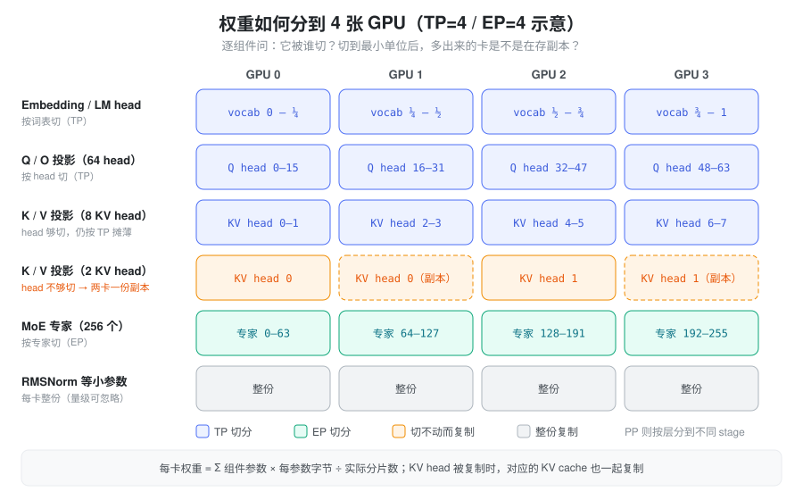
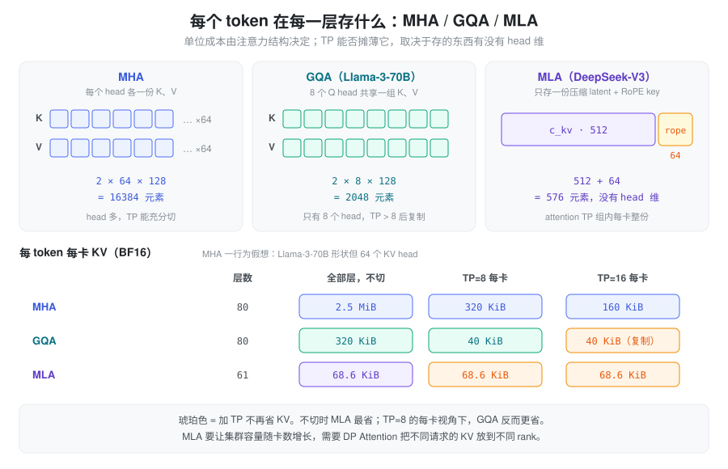

% 常驻显存：权重与 KV Cache

- Llama-3-70B 在 TP=8 下每卡权重约 17.6 GB，那每卡 KV cache 能装多少 token？为什么这个数要等权重加载完才能确定？
- 把 TP 从 8 加到 16，GQA 模型每卡 KV 容量为什么不再翻倍？MLA 模型为什么加 TP 根本不省 KV？
- 日志里 `#tokens` 是怎么来的？它和 `--mem-fraction-static` 是什么关系？

[VRAM Usage](./vram_usage.md) 把推理显存分成七类。本篇只讲其中最大、也最可预测的两类：**模型权重**和 **KV cache**。它们都在启动时一次分配、整个服务生命周期常驻，加起来通常占掉显存的绝大部分；其余几类（CUDA Graph、workspace、activation、通信 buffer）都要从剩下的余量里挤。

### 问题：常驻显存决定了能同时服务多少 token

推理服务的吞吐上限，最终落在“同一时刻能装下多少 token 的 KV”上：batch 能开多大、长上下文能撑多长、prefix cache 能留多少，都受这个数约束。而这个数并不是配置出来的，是**算出来的**——显存总量减去权重和各种余量，剩下的全部给 KV，再除以每个 token 的 KV 字节数。

所以要回答“为什么这台机器只能装这么多 token”，需要两本账算得清楚：

- 权重占多少——取决于参数量、每参数字节数和分片方式；
- 每个 token 的 KV 占多少——取决于注意力架构、KV dtype 和分片方式。

直觉上容易犯两个错误：一是以为“加卡就等比例省权重和 KV”，实际上有些部分会被复制；二是只看总参数量，忽略了注意力结构对 KV 的决定性影响——两个参数量相近的模型，每 token KV 可以相差几倍到几十倍。

### 抽象：两本字节账，一本按参数，一本按 token

把常驻显存拆成两个乘积，各自看清“乘的是什么、除的是什么”：

```text
每卡权重  =  Σ_组件 参数量 × 每参数字节 ÷ 该组件的分片数        （与请求无关，固定）
每卡 KV   =  token 容量 × 每 token 每卡 KV 字节                  （容量是被解出来的）
每 token 每卡 KV 字节 = 层数 × 每层每 token 存的元素数 ÷ 分片数 × 每元素字节
```

两本账有一个关键差别：权重是**固定成本**，KV 是**单位成本**。启动流程正是利用这一点——先装权重，测出剩余显存，再用“剩余 ÷ 单位成本”解出 token 容量。因此权重每多占 1 GB，KV 容量就按 `1 GB ÷ 每 token 字节` 减少；每 token 字节减半（例如 BF16 → FP8 KV），容量就翻倍。

另一个贯穿两本账的问题是：**分片数并不等于卡数**。一个组件只有在“被某种并行切开”时才按卡数摊薄，否则每张卡各存一整份。读并行配置时要逐组件问：它被谁切？切到最小单位后还能不能再切？

### 权重账：参数量 × 每参数字节 ÷ 分片

每参数字节由权重 dtype 决定：BF16/FP16 为 2，FP8 为 1，FP4 打包后为 0.5（表示方式见 [数据类型与低精度表示](./torch_dtype.md)）。难点在“÷ 分片”——不同并行方式切的维度不同，而且总有一些部分不切。



| 组件 | TP | EP | PP |
| --- | --- | --- | --- |
| Embedding / LM head | 按词表切，每卡一段 vocab | 不涉及 | 只在首 / 末 stage |
| Attention 的 Q、O | 按 head 切 | 不涉及 | 按层分到各 stage |
| Attention 的 K、V | 按 KV head 切；KV head 数少于 TP 时**复制** | 不涉及 | 按层 |
| Dense MLP | 按 intermediate 维切 | 不涉及 | 按层 |
| MoE routed experts | 若启用 MoE-TP，按 intermediate 切 | 按专家切 | 按层 |
| Norm、小参数 | 每卡整份 | 每卡整份 | 按层 |

几个容易漏算的点：

- **KV head 不够切。** GQA 模型 KV head 很少（Llama-3-70B 只有 8 个）。TP 超过 KV head 数后，每卡至少保留 1 个 KV head，多出的卡存的是副本——K/V 投影权重和后面的 KV cache 都不再随 TP 摊薄。
- **Embedding 与 LM head 很大。** 大词表模型的这两块各有 1B 左右参数。是否 tie（共享一份）由模型配置决定，例如 Llama-3-70B 不共享，两份都要算。
- **Norm 每卡整份复制**，但每层只有 `hidden_size` 个参数，量级可忽略。
- **EP 只切 routed experts。** Attention、dense 层、shared expert 是否被切，取决于 attention 侧的 TP / DP 配置，不由 EP 决定。

#### 量化的额外开销：scale 也是常驻显存

量化权重除了低精度数据本身，还要存 scale。它的占比取决于“多少个元素共用一个 scale”：

| 格式 | scale 粒度 | 额外开销 |
| --- | --- | --- |
| FP8 block-wise（DeepSeek-V3 式） | 每 128×128 块一个 FP32 | 4 B / 16384 元素，约 0.02%，可忽略 |
| MXFP4 | 每 32 元素一个 E8M0（1 B） | 平均 4.25 bit / 元素，比纯 4 bit 多 6.25% |
| NVFP4 | 每 16 元素一个 E4M3（1 B）+ 每张量一个 FP32 | 平均约 4.5 bit / 元素，多 12.5% |

所以 FP4 权重不是 FP8 的“一半”，而是一半再加 6%–12%。此外，量化模型常有部分层不量化（如 embedding、LM head、router gate、某些 attention 投影），这些仍按 BF16 计。

#### 算例：Llama-3-70B 与 DeepSeek-V3

**Llama-3-70B**（公开 config：80 层，`hidden_size=8192`，64 个 Q head，8 个 KV head，`head_dim=128`，`intermediate_size=28672`，词表 128256，不 tie）：

- 每层 attention：Q、O 各 `8192×8192`，K、V 各 `8192×1024`，合计约 151M；每层 MLP：`3×8192×28672` ≈ 705M；
- 80 层约 68.4B，加上 embedding 和 LM head 各 1.05B，共约 70.6B 参数；
- BF16 下约 141 GB，TP=8 时每卡约 17.6 GB（norm 的复制量可忽略）。

**DeepSeek-V3**（公开 config：61 层，前 3 层为 dense，`n_routed_experts=256`，`moe_intermediate_size=2048`，`hidden_size=7168`；技术报告给出总参数 671B）：

- 每个 routed expert 是 `3×7168×2048` ≈ 44M 参数，58 个 MoE 层 × 256 专家 ≈ 654B——**routed experts 占了总参数的 97% 以上**；
- 官方权重为 FP8（1 B / 参数），EP=8 时每卡 32 个专家 / 层，routed 部分约 82 GB；其余约 17B 参数的分摊方式取决于 attention 的并行配置。

两个模型说明了同一件事：MoE 的权重账几乎完全由 EP 决定，dense 模型则由 TP 决定。

### KV 账：每 token 字节由注意力架构决定

每个 token 在每一层留下的“记忆”是什么，决定了 KV 账的单位成本。三种主流结构存的东西完全不同：

- **MHA**：每个 head 各存一份 K 和 V，每层每 token `2 × num_heads × head_dim` 个元素；
- **GQA / MQA**：多个 Q head 共享一组 K/V，只存 `2 × num_kv_heads × head_dim`；
- **MLA**：不存每个 head 的 K/V，只存一个压缩后的 latent `c_kv`（`kv_lora_rank` 维）加一段解耦的 RoPE key（`qk_rope_head_dim` 维），每层每 token 共 `kv_lora_rank + qk_rope_head_dim` 个元素，而且**只有一份**，没有 head 维度（原理见 [MLA](./mla.md)）。



#### 分片：TP 切的是 head

TP 对 KV 的摊薄作用来自“每卡只算一部分 head”，因此：

- **GQA**：每卡 KV head 数是 `max(1, num_kv_heads ÷ TP)`。Llama-3-70B 有 8 个 KV head，TP=8 时每卡 1 个；TP=16 时仍是每卡 1 个，两张卡存同一个 head 的副本——**每卡每 token KV 不再下降，集群总 KV 反而翻倍**。
- **MLA**：latent 没有 head 维可切，attention TP 组里每张卡都要存完整的 latent。TP 加多少，每卡每 token KV 都不变。这正是 MLA 模型通常配合 [DP Attention](./data_parallelism.md) 使用的原因：把 attention 的 TP 组缩小，让不同 DP rank 各存不同请求的 KV，集群容量才能随卡数增长。

#### 算例：每 token 每卡占多少

| 模型（BF16 KV） | 每层每 token 元素数 | 全部层合计 | TP=8 时每卡 |
| --- | --- | --- | --- |
| 假想 MHA（Llama-3-70B 形状，64 个 KV head） | 2×64×128 = 16384 | 2.5 MiB | 320 KiB |
| Llama-3-70B（GQA，8 个 KV head） | 2×8×128 = 2048 | 320 KiB | 40 KiB |
| DeepSeek-V3（MLA，512 + 64） | 576 | 68.6 KiB | 68.6 KiB（不随 TP 下降） |

换成容量直觉：每 10 GB 空闲显存，Llama-3-70B（TP=8）每卡能装约 24 万 token；DeepSeek-V3 在 BF16 KV 下约 14 万，FP8 KV 下约 28 万。单看“全部层合计”，MLA 是 GQA 的约五分之一；但在 TP=8 的每卡视角，MLA 反而更贵——比较 KV 效率时必须带上并行配置。

KV dtype 对单位成本是线性的：FP8 KV 让字节减半；FP4 KV 打包后为 0.5 B / 元素，但还要加上 block scale（每 16 元素一个），实际略多于四分之一。FP8 / FP4 KV 的表示与 scale 存放见 [数据类型与低精度表示](./torch_dtype.md)。

### 不按 token 线性增长的部分：SWA、线性注意力与索引元数据

上面的公式默认“每层都为每个 token 存一份”。混合架构打破了这个假设，账本要分池计算。

**滑动窗口（SWA）层。** SWA 层只需要最近一个窗口的 KV，理论上不必为所有 token 保留。实现上通常把 full 层和 SWA 层放进两个池，SWA 池按 full 池 token 数的一个比例开：

```text
每 token 字节 = full 层每 token 字节 × full 层数  +  r × SWA 层每 token 字节 × SWA 层数
```

`r` 越小，同样显存下 full token 越多，但 SWA 池更容易被占满。这里的关键是：SWA 层的成本被“打折”而不是“清零”。

**线性注意力 / Mamba 层。** 这类层不存每 token 的 KV，而是每个请求维护一个固定大小的状态（conv state + SSM state），与序列长度无关。它是“按请求”的账：要先为最大并发数预留状态池，剩下的才给 full attention 层的 KV。所以这类模型的 `max_running_requests` 可能被状态池卡住，而不是被 KV 卡住。SGLang 在未显式指定状态池大小时，按 `--mamba-full-memory-ratio`（默认 0.9）把剩余显存的 `0.9 / 1.9` 划给状态池，其余给 KV。

**索引元数据。** KV 池本身之外，还有“请求 → token 槽位”的映射表 `req_to_token`（结构见 [Memory Pool](./memory_pool.md)）。它是一张 `int32` 的二维表，形状约为 `[最大并发请求数, 最大上下文长度]`，按最坏情况整块预分配。量级不小：2048 个请求 × 128K 上下文 × 4 B ≈ 1.07 GB。它不随实际使用量缩小，长上下文、高并发配置下值得留意。token 级的空闲列表等其余元数据通常在 MB 量级。

### 在 SGLang 中：从剩余显存解出 token 容量

SGLang 的启动流程就是“先付固定成本，再按单位成本解容量”（基于 `python/sglang/srt/` 当前代码）：

1. **记下起点。** `distributed/bootstrap.py` 在分布式初始化之后、加载权重之前，用 `get_available_gpu_memory()` 测一次空闲显存，记为 `pre_model_load_memory`。此时 CUDA context、NCCL 等已经占掉了一部分，不在这个数里。
2. **加载权重。** `ModelRunner` 加载完成后打印 `Load weight end ... mem usage=X GB`，这个 X 就是本卡权重账的实测值。
3. **算 KV 预算。** `mem_cache/kv_cache_configurator.py` 的 `_profile_available_bytes()` 再测一次空闲显存，减去留给运行时的余量 `pre_model_load_memory × (1 − mem_fraction_static)`（多模态模型还要再扣一份预留），剩下的全部作为 KV 预算。线性注意力模型在这里先由 `_handle_max_mamba_cache()` 扣掉状态池。
4. **选单位成本公式。** `model_executor/pool_configurator.py` 的 `create_memory_pool_configurator()` 按架构选择 configurator：DeepSeek-V4 用 `DSV4PoolConfigurator`，混合 SWA 模型用 `HybridSWAPoolConfigurator`（或其子类 `SWAChunkCapPoolConfigurator`），其余 MHA / MLA / DSA / FP4 模型走 `DefaultPoolConfigurator`。
5. **解出容量。** `calculate_pool_sizes()` 计算 `max_total_num_tokens = KV 预算 // cell_size`，再向下对齐到 `page_size` 的整数倍。这就是日志里 KV cache 的 `#tokens`。
6. **按容量建池。** `memory_pool.py` 中的 `MHATokenToKVPool`、`MLATokenToKVPool`、`SWAKVPool`、`HybridLinearKVPool` 等按这个容量逐层分配 buffer；`ReqToTokenPool` 按 `resolve_max_num_reqs()` 给出的并发数分配 `req_to_token`。

第 3 步可以化简出一个好用的直觉：设起点空闲为 `P`、权重为 `W`，则 KV 预算 ≈ `P × mem_fraction_static − W`。也就是说，`mem_fraction_static` 规定的是“权重 + KV”的总额度，权重多占一分，KV 就少一分；而 `1 − mem_fraction_static` 那部分留给之后的 CUDA Graph、activation 和 workspace。如果权重本身就超过了总额度，`_profile_available_bytes()` 会直接报错并给出建议的最小值，报错信息特别注明投机解码的 draft 权重也会计入。

#### cell_size：每 token 字节的代码形态

`DefaultPoolConfigurator._compute_cell_size()` 正是前文公式的实现，两个分支的差别值得对照着读：

- **MHA / GQA 分支**：`get_num_kv_heads(attn_tp_size, attn_dcp_size) × (head_dim + v_head_dim) × 层数 × 元素字节`。`configs/model_config.py` 的 `get_num_kv_heads()` 返回 `max(1, 总 KV head 数 ÷ (tp ÷ dcp))`——前面说的“TP 超过 KV head 数就复制”，就是这里的 `max(1, ...)`。权重侧对应 `layers/linear.py` 中 `QKVParallelLinear` 的 `num_kv_head_replicas`。
- **MLA 分支**：`calculate_mla_kv_cache_dim() × 层数 × 元素字节`，其中维度默认就是 `kv_lora_rank + qk_rope_head_dim`。这一支**没有任何 TP 相关的除数**，与“latent 不可按 head 切”一致；DSA 模型还会额外加上 indexer 的 KV。
- **层数**取本 PP stage 实际持有的层；对 Mamba 混合模型只数 full attention 层。
- **低精度 KV** 在两支里都有修正：FP4 先把字节减半，再加每 16 元素一个的 scale；`mxfp8` 加每 32 元素一个的 scale。

KV buffer 的具体形状也印证了“单份 latent”：MHA 池（默认布局）每层 K、V 各是 `(size + page_size, head_num, head_dim)`，MLA 池每层是 `(size + page_size, 1, kv_cache_dim)`——head 维固定为 1。多出的 `page_size` 个槽位用于接收 CUDA Graph padding 产生的无效写入，与容量相比可忽略。

#### req_to_token 的大小从哪来

`resolve_max_num_reqs()` 在用户未指定 `--max-running-requests` 时，按 `token 容量 ÷ context_len × 512` 估算，并夹在 2048 到 4096 之间，同时不超过 `token 容量 ÷ 2`。`ReqToTokenPool` 再按 `(并发数 + 1, context_len + 少量余量)` 分配 `int32` 表——第 0 行同样是给 CUDA Graph padding 用的哑行。由于下限是 2048，长上下文模型即便实际并发很低，这张表也会按 2048 行预分配；需要省这部分显存时，可以显式调小 `--max-running-requests`。

### 小结

常驻显存是两本账：权重是固定成本，按“参数量 × 每参数字节 ÷ 分片”算；KV 是单位成本，按“层数 × 每层每 token 元素 ÷ 分片 × 元素字节”算，token 容量是用剩余显存除出来的。看懂一个部署的显存，关键是逐组件问“它被谁切、切到底后是否被复制”：embedding 按词表切，attention 按 head 切但 KV head 不够时复制，MoE 专家由 EP 切，MLA 的 latent 在 attention TP 组内永远整份。SGLang 把这套推导直接写在启动路径里——`mem_fraction_static` 给出“权重 + KV”的总额度，`cell_size` 给出单位成本，二者相除就是日志里的 `#tokens`；要扩大容量，只能减权重、降 KV 精度，或者换一种让 KV 真正被摊薄的并行方式。
