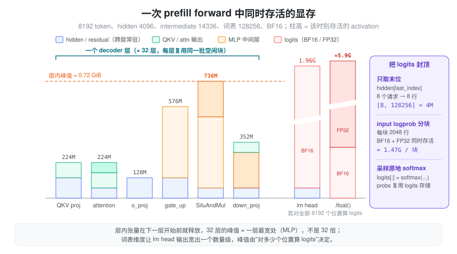
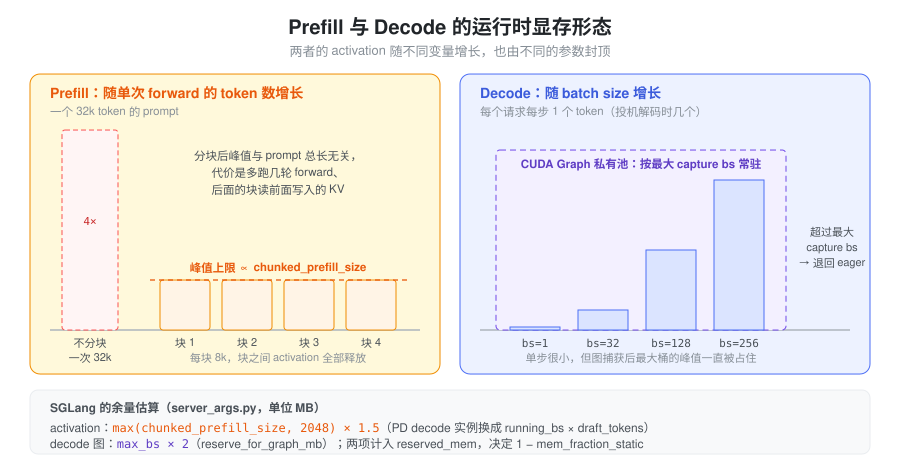

% 运行时显存：激活、Workspace 与峰值

- 权重和 KV cache 都是启动时一次分配好的，为什么服务跑到某个长 prompt 时还会 OOM？
- 同一个 8k token 的 prefill，只取最后一个 token 的 logits 和要返回每个位置的 input logprob，显存差距为什么能到几个 GB？
- decode 每步只算一个 token，为什么 batch 一大也要给它留出可观的显存？

[VRAM Usage](./vram_usage.md) 把推理显存分成七类。其中权重、KV cache 属于启动时就确定的 persistent 部分；本篇讨论剩下那些**随每次 forward 出现又消失**的部分：activation（中间张量）、kernel workspace，以及被 CUDA Graph 固定下来的运行时峰值。它们单个不大，却决定了 OOM 边界，因为它们必须塞进 persistent 部分用剩的那点余量里。

### 问题：运行时显存不能等用到时再算

推理引擎启动时要先决定 KV cache pool 有多大：KV cache 越大，能同时服务的 token 越多。但 KV pool 一旦按“剩余显存的绝大部分”分配下去，后面每次 forward 产生的中间张量、kernel 临时空间都只能用剩下的部分。

朴素做法有两种，都不行：

- **把每个中间张量的大小加起来作为预留**：会严重高估。一次 forward 有几十层、上百个中间张量，但它们绝大多数不会同时存活。
- **只按“一个 hidden state 多大”估计**：会严重低估。MLP 中间层比 hidden 宽好几倍，lm head 输出的维度是词表大小，还会被转成 FP32。

真正需要的是：**一次 forward 在最坏时刻同时存活的显存是多少**，以及这个最坏时刻由什么输入规模决定。

### 抽象：按“谁决定大小、活多久”给显存分类

把运行时显存按两个问题分开：大小由什么决定？生命周期多长？

| 类别 | 例子 | 大小由谁决定 | 生命周期 |
| --- | --- | --- | --- |
| Activation | hidden states、QKV、MLP 中间层、logits | 本次 forward 的 token 数 × 模型宽度 | 产生后被下一个算子消费，引用释放即可复用 |
| Kernel workspace | attention 的 split-KV 缓冲、GEMM 的 scratch、MoE 的中间缓冲 | kernel 实现和输入规模 | 有的启动时预分配并长期持有，有的每次调用临时申请 |
| 图固定的显存 | CUDA Graph 私有池里的中间张量、静态输入/输出缓冲 | capture 时的最大 batch | 图存活期间一直保留 |

activation 是**模型计算本身的逻辑张量**，换一个 kernel 实现它依然存在；workspace 是**某个 kernel 为了完成计算需要的草稿纸**，换一个实现可能就不需要。两者都可能经过 PyTorch caching allocator，也都可能被 CUDA Graph 捕获，所以在 `memory_allocated()` 里分不出来，只能从“它属于哪个算子”来区分。

分类的意义在于选对控制手段：activation 的峰值靠**限制单次 forward 的 token 数**来封顶；预分配的 workspace 是**固定开销**，只能计入预算；图固定的显存则由**最大 capture batch** 决定。

### 峰值看的是同时存活，不是总和

一次 forward 逐层执行。每一层产生的中间张量在该层结束、Python 引用释放后，就回到 caching allocator 的空闲块里，下一层直接复用。因此几十层模型的 activation 峰值，大致等于**单层内最宽的那一刻**加上跨层常驻的 hidden/residual，而不是层数乘以单层用量。



以一个 8B 量级的 dense 模型（hidden 4096、intermediate 14336、GQA 32/8 头 × 128、词表 128256、BF16、TP=1）做一次 8192 token 的 prefill 为例：

| 张量 | shape | 大小 |
| --- | --- | --- |
| hidden_states / residual | [8192, 4096] BF16 | 各 64 MiB |
| fused QKV 输出 | [8192, 6144] BF16 | 96 MiB |
| MLP `gate_up_proj` 输出 | [8192, 28672] BF16 | 448 MiB |
| MLP 激活后（`SiluAndMul`） | [8192, 14336] BF16 | 224 MiB |
| 全部位置的 logits | [8192, 128256] BF16 | 约 1.96 GiB |
| 同上转为 FP32 | [8192, 128256] FP32 | 约 3.91 GiB |

decoder 层内最宽的一刻是 MLP：`gate_up` 输出和激活结果同时存活，约 0.7 GiB，加上 hidden/residual 也不到 1 GiB，并且每层都复用同一批空闲块。真正的大头在最后：**词表维度让 lm head 的输出比任何一层都宽一个数量级**，如果对每个位置都算 logits，还要再做一次 FP32 转换，BF16 原件和 FP32 副本会短暂同时存活。

这张表说明了两件事：activation 与 token 数成正比，所以限制单次 forward 的 token 数就能封顶它；而 logits 是否覆盖全部位置，决定了峰值是否会多出几个 GB。

### logits：只为需要采样的位置计算

生成下一个 token 只需要每个请求**最后一个位置**的 logits。一个 8192 token 的 chunk 里若有 8 个请求，只算 8 行，FP32 logits 只有约 3.9 MiB，比全部位置小三个数量级。

SGLang 在 `layers/logits_processor.py` 里做了这个裁剪：`LogitsProcessor._get_pruned_states()` 在 extend 模式且不需要 input logprob（`extend_return_logprob` 为 False）时，用 `torch.cumsum(extend_seq_lens) - 1` 求出每个请求的末位下标 `last_index`，再 `hidden_states[last_index]` 取出这些行，后面才进 lm head。也就是说**裁剪发生在乘词表矩阵之前**，被丢弃的位置连 BF16 logits 都不会产生。

需要返回 input logprob 时，裁剪就失效了：每个要求 logprob 的位置都得算出完整词表分布。这时 `layers/logprob_processor.py` 的 `InputLogprobProcessor` 默认按块处理（`SGLANG_ENABLE_LOGPROB_CHUNK` 默认开启，`SGLANG_LOGPROB_CHUNK_SIZE` 默认 2048 行），把一次几 GB 的 logits 拆成若干个几百 MB 的块逐块算完再释放，峰值从“全部位置”降到“一个块”。

还有一个容易漏掉的细节：lm head 的 matmul 通常以模型 dtype 输出，`_copy_logits_to_buffer()` 随后会转成 FP32（有 CUDA Graph 共享缓冲时 `copy_` 进去，否则 `.float()`）。所以 logits 的真实开销是“BF16 原件 + FP32 副本”，而不是只按 FP32 估。采样阶段 `layers/sampler.py` 则刻意写成 `logits[:] = torch.softmax(logits, dim=-1)`，注释是 “In-place op to save memory”，让 probs 复用 logits 的存储而不是再开一份 `[bs, vocab]`。

### Prefill 与 Decode：两种显存形态

prefill 和 decode 跑同一个模型，但 activation 随之变化的变量不同：



- **Prefill 的 activation 与本次处理的 token 数成正比。** 一个 32k 的 prompt 如果一次算完，MLP 中间层就是 8k 时的 4 倍。chunked prefill 把长 prompt 切成不超过 `chunked_prefill_size` 的块，块与块之间 activation 全部释放，于是**prefill 的 activation 峰值被这个参数封顶**，与 prompt 总长度无关。代价是长 prompt 要多跑几轮 forward，且后面的块要读前面块写入的 KV。
- **Decode 的 activation 与 batch size 成正比。** 每个请求每步只贡献一个（投机解码时几个）token，单步 activation 小，但它随 running batch 线性增长，并且 decode 通常走 CUDA Graph，按最大 capture batch 一次性占住。
- **KV cache 读写方式不同，但都写进预分配的 pool**，不属于运行时增量；attention workspace 则取决于各自的 kernel（见下一节）。

`chunked_prefill_size` 在 `server_args.py` 中默认为 `None`，由 `_handle_gpu_memory_settings()` 按显卡显存大小填入：小于 20GB 为 2048，小于 60GB 为 4096，60–160GB（H100、H20、H200 等）为 8192，更大的卡（B200、MI300）为 16384；设为 `-1` 表示关闭 chunked prefill，此时长 prompt 只能一次算完：`max_prefill_tokens`（默认 16384）约束一个 prefill batch 的 token 数，但按其帮助文本，真实上限取它与模型最大上下文长度中的较大者，activation 峰值也随之失去封顶。

### Workspace：预分配还是按需

workspace 是否计入固定预算，取决于它在何时分配：

| Workspace | 分配方式 | 对显存账的影响 |
| --- | --- | --- |
| FlashInfer attention workspace | 后端初始化时一次 `torch.empty` 出一块 `uint8` 缓冲，进程内按名字共享 | 固定开销，与请求无关 |
| cuBLAS / cuBLASLt workspace | 由 PyTorch 按 handle/stream 管理，经 caching allocator 分配后缓存 | 小而固定，但计入 `memory_reserved()` |
| MoE 中间缓冲 | 每次调用按 `num_tokens × topk` 临时 `torch.empty` | 随 token 数增长，属于 activation 性质的峰值 |

**FlashInfer** 是典型的预分配：`layers/attention/flashinfer_backend.py` 通过 `runtime_context.get_buffer("flashinfer_workspace", ...)` 取得一块大小为 `SGLANG_FLASHINFER_WORKSPACE_SIZE` 的缓冲。该环境变量在 `environ.py` 中默认 384MB；后端会为 Qwen2/Qwen3/MiMo 等架构把它调到 512MB，开启 deterministic inference 时调到 2GB。`get_buffer` 是进程级的 get-or-create 注册表，所以多个 attention wrapper 共享同一块，而不是各分配一份。full CUDA Graph 的 prefill 路径另有一块按最大桶算出的 `full_cg_prefill_workspace_buffer`，同样在初始化时分配。

**MoE** 则相反。`layers/moe/moe_runner/triton_utils/fused_moe.py` 每次调用按 `total_tokens = num_tokens * topk (+ padding)` 分配 `intermediate_cache1`（宽 `N`，即 gate+up）和 `intermediate_cache2`（宽 `N/2`，激活后）。路由把 token 复制了 `topk` 份，所以同样的 token 数，MoE 层的中间缓冲往往比 dense MLP 更宽；它和 dense MLP 的中间层一样受 chunked prefill 封顶。融合 SwiGLU 的路径（`fuse_swiglu_interleaved`）直接写半宽结果，省掉了 `intermediate_cache1`。

预分配的好处是不会在运行中途因分配失败而 OOM，也容易被 CUDA Graph 捕获（地址固定）；代价是即使用不满也一直占着。按需分配则把开销交给峰值估算。

### CUDA Graph 把 capture 时的峰值钉住

CUDA Graph 捕获的 kernel 记录了它们读写的地址，所以 capture 期间产生的中间张量必须在图存活期间一直有效。PyTorch 把它们分配在图的**私有内存池**里，不还给普通分配器。结果是：**decode 在最大 capture batch 下的 activation 峰值，从“每步临时出现”变成了“启动后一直占用”**。

SGLang 按 batch 从大到小捕获，多张图共享同一个私有池，因此占用大约等于最大桶的峰值，而不是所有桶之和。lm head 的输出也不例外：`model_executor/graph_shared_output.py` 的 `GraphSharedOutput` 为所有 graph runner 准备一块 `(max_rows, vocab)` 的 FP32 logits 缓冲，`max_rows` 由 `ModelRunner.max_decode_logits_rows()` 按“最大 capture batch × 每请求 token 数”算出。以 batch 256、词表 128256 为例，这一块就是约 125 MiB。

私有池的机制和显存账见 [显存管理与生命周期](./torch_memory_management.md)，捕获与重放的约束见 [Cuda Graph](./cuda_graph.md)。这块常驻具体由哪几项组成、怎么从启动日志里量出来，见 [CUDA Graph 显存：怎么算、怎么测](./vram_cuda_graph.md)。

### 在 SGLang 中：给运行时显存留多少余量

KV cache pool 的大小由 `mem_fraction_static` 决定：它被定义为（权重 + KV pool）占总显存的比例，剩下的 `1 - mem_fraction_static` 就是留给本篇这些运行时显存的。用户不指定时，`server_args.py` 用一个启发式公式反推它（单位 MB）：

```text
activation_tokens = max(chunked_prefill_size, 2048)      # 普通/prefill 模式
                  = max(running_bs × draft_tokens, 2048)  # PD 分离的 decode 实例
reserved_mem = 512                                        # attention 元数据等常量
             + activation_tokens × 1.5                    # activation 余量
             + tp_size × pp_size / 8 × 1024               # 并行规模的额外开销
             + reserve_for_graph_mb()                     # CUDA Graph
             (显存 > 60GB 时至少 10GB)
             + reserve_for_deepep_a2a_mb()                # DeepEP 通信缓冲
mem_fraction_static = (gpu_mem - reserved_mem) / gpu_mem
```

这个公式和本篇的抽象一一对应：activation 余量**只看单次 forward 的 token 上限**（prefill 看 `chunked_prefill_size`，decode 实例看 running batch），而不看 prompt 总长或 KV 容量；CUDA Graph 余量 `reserve_for_graph_mb()` 按 decode 最大 capture batch 计（每个 batch 约 2MB，DP attention 时更多），prefill graph 则注释为“只计非 torch 显存，torch 显存由 capture 复用”。系数 1.5 是经验值，源码注释也承认将来应按模型类型、hidden size 或一次 dummy run 来估。

估算总会有偏差，所以还有一条可选路径：开启 post-capture KV sizing（`SGLANG_ENABLE_POST_CAPTURE_KV_SIZING`）时，`reserved_mem` 跳过 activation 与 graph 两项，等 CUDA Graph 捕获完成后再按实测剩余显存调整 KV pool，详见 [显存管理与生命周期](./torch_memory_management.md)。

### 排查运行时 OOM 的顺序

1. **先确定 OOM 发生在哪个阶段**：启动 capture、prefill 还是 decode。启动时 OOM 多是图或 workspace；运行中 OOM 多是 activation 峰值。
2. **prefill 中 OOM**：看这一批的实际 token 数是否超过预期（chunked prefill 是否被关闭、`max_prefill_tokens` 是否过大），以及是否有请求要求 input logprob 让 logits 覆盖了全部位置。
3. **MoE 模型**：把 `num_tokens × topk` 当作 MoE 层的有效 token 数，再估中间缓冲。
4. **decode 中 OOM**：看 running batch 是否超过 capture 上限而退回 eager 路径，eager 路径的临时分配不在私有池里。
5. **调参方向**：降低 `chunked_prefill_size` 直接压 prefill 峰值；降低 `mem_fraction_static` 给所有运行时显存让出空间，代价是 KV 容量变小。

### 小结

运行时显存的关键不在“有哪些张量”，而在“最坏时刻同时存活多少”。逐层复用让几十层模型的 activation 峰值只相当于一层最宽处，真正的大头是词表维度的 logits；只为采样位置算 logits、按块算 input logprob、chunked prefill 限制单次 token 数，分别从不同方向把峰值封顶。workspace 要区分预分配（固定开销）和按需（计入峰值），CUDA Graph 则把 decode 最大 batch 的峰值变成常驻。SGLang 的 `mem_fraction_static` 启发式正是按这几个封顶量来给运行时留余量的，理解它们，就能判断一次 OOM 是该调 KV 容量，还是该限制单次 forward 的规模。
