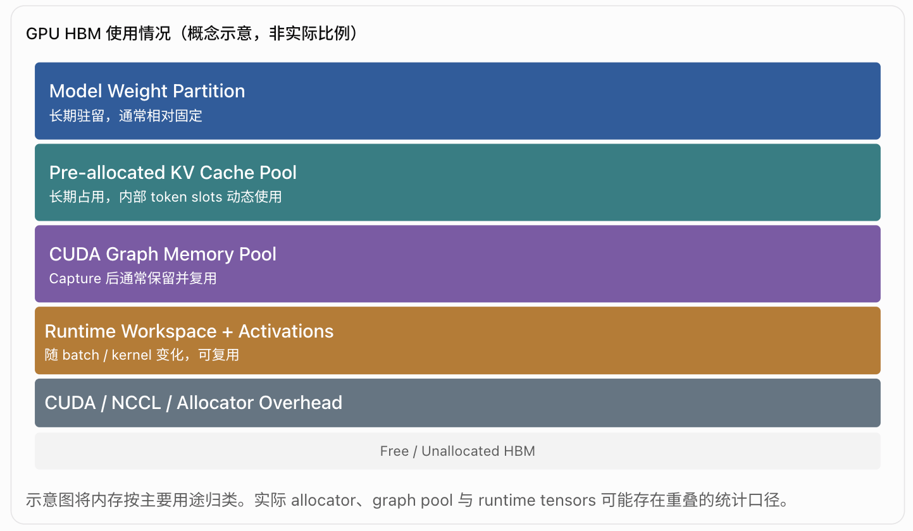

% VRAM Usage

你列出的四类基本正确，已经覆盖了 LLM inference 中主要的显存消耗。不过从 SGLang / vLLM / TensorRT-LLM 的工程实现来看，我建议进一步拆分成 7 类，尤其要区分 persistent allocation、runtime workspace 和 allocator reserved memory。

## 1. LLM Inference 显存分类

| 分类                                        | 显存内容                                        | 生命周期                  | 主要影响因素                               |
| ----------------------------------------- | ------------------------------------------- | --------------------- | ------------------------------------ |
| 1. Model Weights                          | 模型权重及其分片                                    | Persistent            | 参数量、dtype、TP/EP/PP                   |
| 2. KV Cache                               | 预分配 KV Cache Pool                           | Persistent            | token capacity、KV dtype、attention 架构 |
| 3. CUDA Graph                             | Graph private memory pool、capture 相关 buffer | Persistent            | capture shapes、batch sizes、graph 数量  |
| 4. Runtime Workspace                      | Attention、GEMM、MoE、通信等临时 buffer             | Temporary / Reusable  | batch size、token 数、kernel 实现         |
| 5. Activation / Intermediate Tensors      | forward 中间张量、hidden states、logits           | Temporary / Reusable  | token 数、hidden size、执行计划             |
| 6. Framework & Allocator                  | PyTorch caching allocator、内存碎片、预留块          | Persistent / Reusable | allocator 策略、分配模式                    |
| 7. CUDA / Library / Communication Context | CUDA context、cuBLAS、NCCL、通信 buffer          | Mostly Persistent     | GPU 架构、CUDA 库、TP/EP 通信               |

这里有两个容易混淆的地方：

- Runtime Workspace 和 Activation：前者一般是 kernel 或 library 执行需要的 scratch space，后者是模型计算产生的逻辑张量。两者可能共用 allocator，也可能被 CUDA Graph 捕获。
- CUDA Graph 和 Allocator：CUDA Graph 的 private pool 本身也属于 allocator 管理的显存，不能简单把 `memory_reserved()`、graph pool 和 activation 占用相加，否则可能重复计算。

各类显存的细节见以下子页：

| 子页 | 覆盖内容 |
| --- | --- |
| [显存预算与统计口径](./vram_budget.md) | 启动时从总显存推导 KV 容量；`allocated`/`reserved`/NVML 各统计什么；逻辑用途与物理分配 |
| [常驻显存：权重与 KV Cache](./vram_persistent.md) | 权重分片的字节账；不同 attention 架构每 token 的 KV 字节 |
| [运行时显存：激活、Workspace 与峰值](./vram_runtime.md) | 激活与 workspace 的区别；Prefill/Decode 峰值；CUDA Graph 对峰值的影响 |
| [CUDA Graph 显存：怎么算、怎么测](./vram_cuda_graph.md) | graph 显存的三层拆分；与 batch 无关的 MoE 固定项；从启动日志读出每一项 |
| [通信与传输显存](./vram_communication.md) | NCCL、custom all-reduce、DeepEP buffer；PD 分离的注册内存 |

## 2. 从显存生命周期理解



## 3. 还有哪些容易遗漏的显存？

在你实际做的大模型推理场景中，我会特别关注以下几项。

### A. MoE 相关 buffer

尤其是 EP 和 DeepEP 场景：

- Token dispatch / combine buffer
- All-to-all communication buffer
- Expert routing metadata
- Permutation / unpermutation buffer
- Quantization scale / intermediate buffer

其中有些 buffer 是初始化时分配的，有些与当前 token 数量有关。

### B. Prefill / Decode 的显存结构不同

|                       | Prefill                | Decode                 |
| --------------------- | ---------------------- | ---------------------- |
| Weights               | 相同分片策略下基本一致            | 相同分片策略下基本一致            |
| KV Cache              | 持续写入                   | 持续读取和追加                |
| Activation            | 通常更大，随 chunk tokens 增长 | 通常较小，随 active batch 增长 |
| Attention workspace   | 取决于 prefill kernel     | 取决于 decode kernel      |
| CUDA Graph            | 不一定使用                  | 通常更依赖                  |
| Communication buffers | 受 TP/EP 和 token 数影响    | 受 TP/EP 和 batch 影响     |

### C. PD Disaggregation 专用内存

Prefill / Decode 分离时，还需要考虑：

- KV transfer staging buffer
- RDMA / NVLink transfer buffer
- Registered memory
- Transfer metadata
- 双缓冲（double buffering）

需要注意，RDMA 注册内存不一定是 GPU HBM，也可能是 pinned host memory，因此不能全部算进显存。

## 4. 显存统计的一个重要陷阱

在 PyTorch 中：

```python
torch.cuda.memory_allocated()
torch.cuda.memory_reserved()
```

这两个值不能代表完整的 GPU 显存使用量。

例如：

- PyTorch allocator 管理的权重和 activation 通常可以统计。
- CUDA context、NCCL、第三方直接调用 `cudaMalloc` 的分配可能不在其中。
- `memory_reserved()` 包含已分配给张量的内存，并不是额外的一份显存。
- `nvidia-smi` / NVML 能看到更接近进程级的实际显存占用，但无法直接区分各个用途。

所以在 profiling 时，最好同时记录 PyTorch allocator 指标、NVML 指标，以及各个初始化阶段的显存增量。

## 5. 我建议最终采用的分类

如果你想形成一套适合 SGLang / vLLM 源码阅读、显存预算和 OOM Debug 的知识体系，可以按以下结构组织：

```
LLM Inference GPU Memory
│
├── 1. Model Persistent Memory
│   ├── Model Weight Partition
│   ├── Quantization Scales / Metadata
│   └── Persistent Model Buffers
│
├── 2. KV Cache Memory
│   ├── KV Cache Pool
│   ├── KV Index / Page Metadata
│   └── KV Transfer Buffers (PD)
│
├── 3. CUDA Graph Memory
│   ├── Graph Private Pool
│   └── Static Input / Output Buffers
│
├── 4. Runtime Tensor Memory
│   ├── Activations
│   ├── Intermediate Tensors
│   └── Logits / Sampling Buffers
│
├── 5. Kernel Workspace
│   ├── Attention Workspace
│   ├── GEMM Workspace
│   └── MoE Workspace
│
├── 6. Communication Memory
│   ├── NCCL Buffers
│   ├── DeepEP Buffers
│   └── RDMA / Transfer Buffers
│
└── 7. System & Allocator Overhead
    ├── CUDA Context / Libraries
    ├── Allocator Cached Blocks
    └── Fragmentation
```

最重要的工程区分是：显存的逻辑用途与物理分配方式是两个不同维度。

例如，一个 activation tensor 可能由 PyTorch caching allocator 分配，也可能位于 CUDA Graph private pool；一个 DeepEP buffer 可能是初始化时永久分配的，并不属于动态 runtime allocation。

因此，在做显存预算时，应该按实际独立分配的物理内存计算，而不是机械地将上述七类相加。

对于你做的 MoE + PD 分离推理，最值得深入研究的是：KV Cache Pool、CUDA Graph Pool、MoE/DeepEP Communication Buffer，以及 Runtime Peak Activation。这四项往往是模型权重之外，决定实际可用 token capacity 和 OOM 边界的关键因素。
