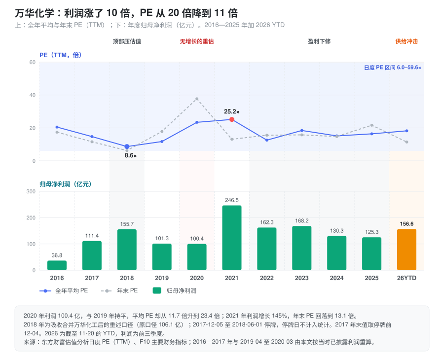
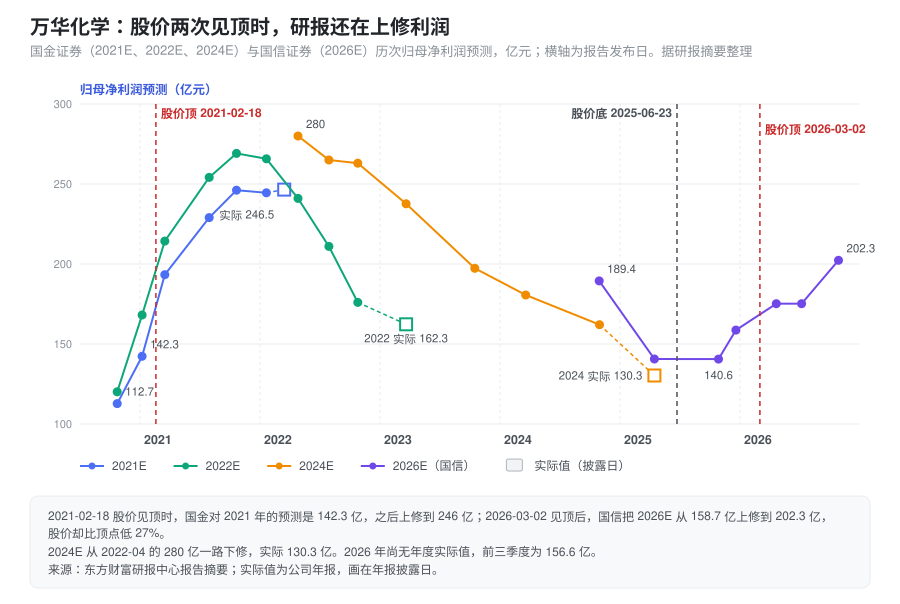
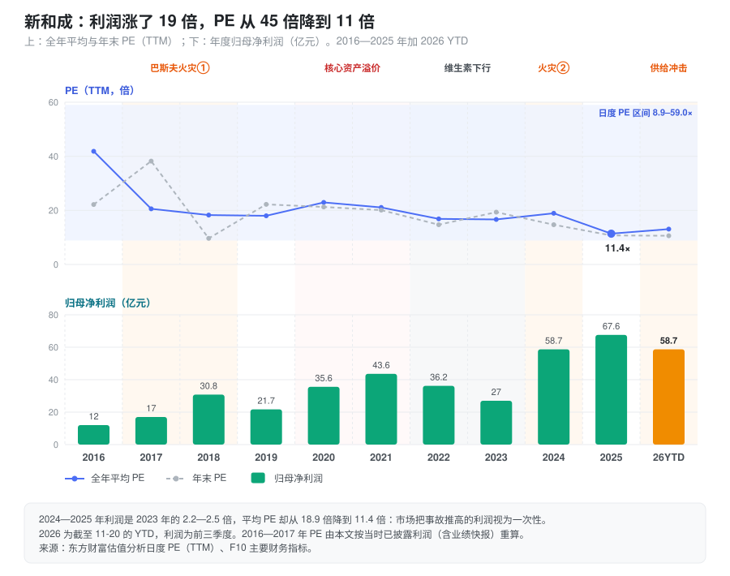
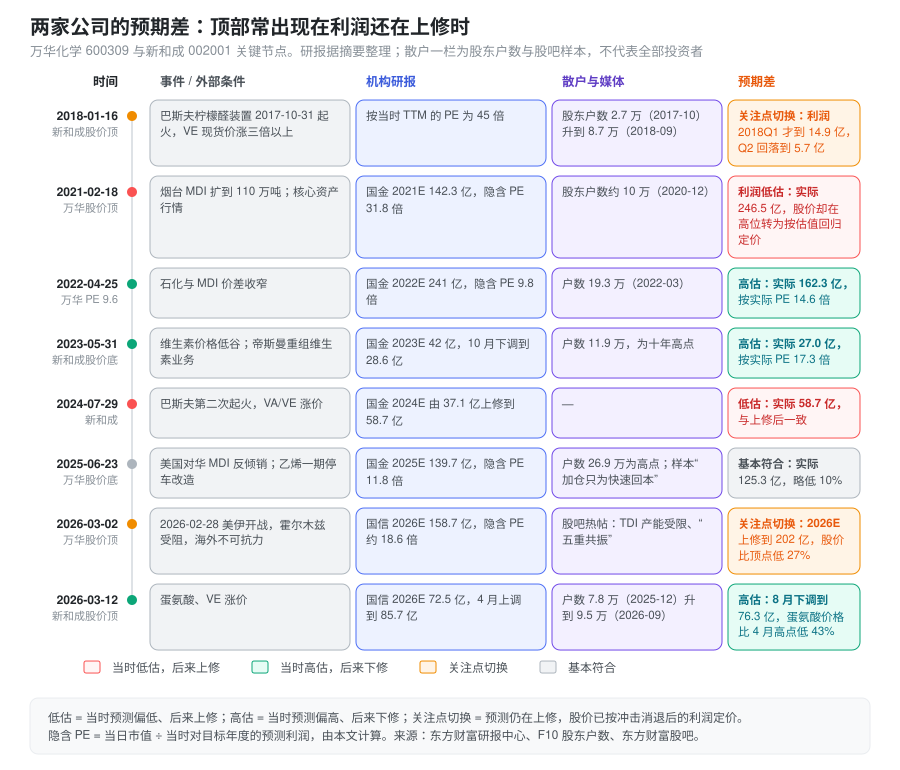

% 万华化学与新和成：2016—2026 年历史定价、护城河与竞争格局

万华化学（600309.SH）和新和成（002001.SZ）是 A 股化工里两类不同的龙头。万华靠 MDI 的成本和规模，新和成靠维生素、蛋氨酸和香料的一体化产业链。十年下来两家的路径很像：利润涨了一个数量级，PE 却被压到十年低位。

**核心结论：过去十年，两家股价的上涨主要来自利润增长，估值是净拖累。市场一直按“冲击消退后的正常化利润”定价，股价两次见顶都发生在研报还在上修当年利润的时候。**

- **十年收益。** 2015-12-31 至 2026-11-20，后复权累计收益万华 4.89 倍（年化 15.7%），新和成 3.84 倍（年化 13.1%）。同期万华 TTM 利润增长到 10.8 倍，PE 从 20.7 倍降到 11.4 倍；新和成 TTM 利润增长到 19.2 倍，PE 从 45 倍降到 10.6 倍。
- **两次估值泡沫。** 2020 年到 2021 年 2 月，万华 PE 升到 59.6 倍，新和成升到 28.4 倍，这期间利润基本没增长。万华此后用了四年多才跌到底，最大回撤 54.5%。
- **2026 年行情。** 霍尔木兹海峡受阻带来供给冲击。万华 2026-03-02、新和成 2026-03-12 见顶，都早于利润。此后万华利润被上修，市场却已开始按冲击消退后的利润定价。截至 11-20，两家 PE（TTM）都在 11 倍左右，PB 处于 2018 年以来 5%—10% 分位。
- **护城河。** 万华的 MDI 护城河是真实的，行业最差的 2022—2025 年聚氨酯毛利率仍有 24%—27%；但石化业务没有护城河，资本开支又重，ROE 从 42.5% 降到 12.4%。新和成产品层面的护城河较窄，利润高点常靠竞争对手事故推动；但资本开支轻，最差年份 ROE 也有 11%。
- **当前价格隐含的假设。** 按 14—18 倍的历史常见 PE 倒推，万华市值对应 120—155 亿元的正常化利润，新和成对应 43—55 亿元，都不高于 2022—2025 年均值。市场没有为 2026 年的高利润付钱。本文不构成投资建议。

### 研究范围与数据边界

- **标的与期间：** 万华化学 A 股（600309.SH，上交所）、新和成 A 股（002001.SZ，深交所）。研究期间为 2016—2025 十个完整年度，加上 2026 年截至 11-20 的 YTD。提取日 2026-11-23，信息截止日 2026-11-20 收盘。
- **行情：** 腾讯日 K 线。不复权价格用于计算市值和 PE，后复权价格（含分红再投）用于计算收益。
- **估值：** 东方财富估值分析（`RPT_VALUEANALYSIS_DET`）日度 PE（TTM）。2016—2017 年由本文自行计算：当日不复权收盘价 × 当时股本 ÷ 当时已披露的最近四季度归母净利润，业绩快报视为已披露。全年平均为当年有效交易日日度 PE 的算术平均，没有非正 PE 样本。
- **财务：** 东方财富 F10 主要财务指标、股本变动、股东户数、现金流量表和主营构成，与公司定期报告口径一致。单季利润由累计值相减得到。
- **研报：** 东方财富研报中心的报告摘要，下文统一注明“据摘要整理”。研报列表里的结构化 EPS 字段经核对会错位（例如国金 2024-03-19 那篇填的其实是 2026E），所以只采用摘要正文中的数字。
- **万华的特殊处理：**
  - 2017-12-05 至 2018-06-01 停牌，吸收合并控股股东万华化工。停牌日不计入统计，2017 年末值取停牌前最后一个交易日 12-04。
  - 吸收合并按同一控制下合并处理，2018 年利润被重述：原口径业绩快报 106.10 亿元（2019-03-01），年报重述口径 155.66 亿元（2019-04-23）。
  - 东方财富在 2019-04 至 2020-03 把原口径年报和重述后的季度数据混用，TTM 被低估（例如应为 99.05 亿元，显示为 49.49 亿元）。这段时间本文按重述口径重算。
  - 2019-02-12 新股上市后到 04-23 年报披露前，市值已是合并后的，可当时公开的利润仍是合并前口径，PE 偏高。本文保留这段数据，因为它反映当时投资者看到的数字。
- **散户与媒体：** F10 股东户数；东方财富股吧按点击量抽取万华两个时间窗的帖子标题。股吧列表经过筛选，帖子很少，新和成在关键日期没有抽到帖子。**样本，不代表全部投资者。**
- **行业数据：** 产能份额来自行业媒体与公司公告，部分为二手资料，未核实处单独注明。
- **未能核验：** 没有取到 Wind、Choice 等一致预期快照，文中只呈现单家券商的预测轨迹。新和成 VA/VE 的单一企业全球份额，诺伟司、住友等蛋氨酸厂商份额，均未核实。

### 十年总览

| | 万华化学 600309 | 新和成 002001 |
| --- | --- | --- |
| 后复权累计收益 / 年化 | 4.89 倍 / 15.7% | 3.84 倍 / 13.1% |
| 最大回撤 | −54.5%（2021-02-18 → 2025-06-23） | −44.8%（2021-03-01 → 2023-05-31） |
| 市值峰值 | 4,521 亿元（2021-02-18） | 1,208 亿元（2026-03-12） |
| 市值：2016-01-04 → 2026-11-20 | 364 → 2,167 亿元（×5.95） | 171 → 775 亿元（×4.53） |
| TTM 归母净利润 | 17.57 → 190.28 亿元（×10.8） | 3.80 → 73.11 亿元（×19.2） |
| PE（TTM） | 20.73 → 11.39 | 45 → 10.61 |
| 现价 / PB / PB 分位 | 69.22 元 / 1.86 / 5%（区间 1.68—9.27） | 25.23 元 / 2.12 / 10%（区间 1.84—5.0） |
| PE 分位 / 2018 年以来中位数 | 13% / 15.91 | 10% / 18.47 |

PB 和 PE 分位按 2018 年以来的日度序列计算。新和成利润增长倍数高于市值，原因有两个：股本从 10.9 亿股增至 30.7 亿股（主要是送转，另有 2017 年定增），同时 PE 被压缩。

### 万华化学：年度 PE 与利润

| 年份 | 交易日 | 平均 PE | 最低 PE / 日期 | 最高 PE / 日期 | 年末 PE | 年末收盘（元） | 年末市值（亿元） | 年度涨跌（后复权） |
| --- | --- | --- | --- | --- | --- | --- | --- | --- |
| 2016 | 244 | 20.49 | 15.86 / 02-29 | 26.90 / 08-02 | 17.41 | 21.53 | 466 | — |
| 2017 | 225 | 14.70 | 10.84 / 11-03 | 21.58 / 02-13 | 11.54（12-04） | 37.94 | 1,037 | +96.0% |
| 2018 | 137 | 8.63 | 6.00 / 10-29 | 11.67 / 07-23 | 6.20 | 27.99 | 765 | −20.3% |
| 2019 | 244 | 11.71 | 6.10 / 01-03 | 17.80 / 12-31 | 17.80 | 56.17 | 1,764 | +90.8% |
| 2020 | 243 | 23.39 | 12.19 / 03-23 | 38.09 / 11-16 | 37.71 | 91.04 | 2,858 | +57.0% |
| 2021 | 243 | 25.15 | 12.31 / 11-29 | 59.64 / 02-18 | 13.09 | 101.00 | 3,171 | +11.3% |
| 2022 | 242 | 12.53 | 9.62 / 04-25 | 15.67 / 12-09 | 15.54 | 92.65 | 2,909 | −5.3% |
| 2023 | 242 | 18.41 | 15.09 / 12-13 | 21.29 / 07-31 | 15.74 | 76.82 | 2,412 | −13.6% |
| 2024 | 242 | 15.13 | 13.07 / 02-05 | 17.92 / 10-08 | 14.73 | 71.35 | 2,240 | −3.7% |
| 2025 | 243 | 16.39 | 13.61 / 01-10 | 21.74 / 12-24 | 21.63 | 76.68 | 2,400 | +6.9% |
| 2026 YTD | 213 | 18.20 | 11.20 / 11-13 | 26.61 / 03-02 | 11.39（11-20） | 69.22 | 2,167 | −5.8% |

| 年份 | 营收（亿元） | 归母净利润（亿元） | 同比 | 毛利率 | 经营现金流 | 资本开支 | ROE |
| --- | --- | --- | --- | --- | --- | --- | --- |
| 2016 | 301.0 | 36.79 | +128.6% | 31.1% | 73.5 | 41.1 | — |
| 2017 | 531.2 | 111.35 | +202.6% | 39.7% | 107.1 | 59.5 | — |
| 2018 | 728.4 | 155.66（重述；原口径 106.10） | — | 35.5% | 228.8 | 105.5 | — |
| 2019 | 680.5 | 101.30 | −34.9% | 28.0% | 259.3 | 178.1 | 25.4% |
| 2020 | 734.3 | 100.41 | −0.9% | 23.9% | 168.5 | 232.4 | 22.2% |
| 2021 | 1,455.4 | 246.49 | +145.5% | 26.3% | 279.2 | 270.0 | 42.5% |
| 2022 | 1,655.7 | 162.34 | −34.1% | 16.6% | 363.4 | 326.6 | 22.8% |
| 2023 | 1,753.6 | 168.16 | +3.6% | 16.8% | 268.0 | 431.0 | 20.4% |
| 2024 | 1,820.7 | 130.33 | −22.5% | 16.2% | 300.5 | 358.3 | 14.3% |
| 2025 | 2,032.3 | 125.27 | −3.9% | 13.6% | 331.1 | 307.1 | 12.4% |
| 2026 前三季 | 1,858.7（+28.9%） | 156.58（+71.0%） | — | 16.5% | 209.2 | — | — |

2017—2018 年 ROE 受重述影响，不作比较。资产负债率在 2020 年后一直处于 61%—65%。

分部毛利率说明了利润结构的变化：

| 分部 | 2017 | 2020 | 2021 | 2022 | 2023 | 2024 | 2025 | 2026H1 |
| --- | --- | --- | --- | --- | --- | --- | --- | --- |
| 聚氨酯 | 55.4% | 43.5% | 35.1% | 24.4% | 27.7% | 26.2% | 26.9% | 27.0% |
| 石化 | 12.5% | 4.3% | 17.1% | 3.7% | 3.5% | 3.5% | 0.6% | 6.8% |
| 精细化学品及新材料 | — | — | — | — | — | 12.8% | 10.5% | 16.3% |

2025 年聚氨酯收入 750.6 亿元，石化 842 亿元，精细化学品及新材料 331.9 亿元。石化收入已超过聚氨酯，毛利却接近零。海外收入占比从 2016 年的 20.7% 升到 2025—2026 年的约 47%。

### 万华化学：拐点与定价阶段

#### 乘法分解：市值 = TTM 利润 × PE

| 节点 | 市值（亿元） | TTM 利润（亿元） | PE | 相对上一节点 |
| --- | --- | --- | --- | --- |
| 2016-02-29 低点 | 279 | — | 15.86 | — |
| 2017-10-10 | 1,189 | 71.73 | 16.57 | 市值 ×4.26 = 利润 ×4.08 × PE ×1.04 |
| 2018-10-29 低点 | 741 | 123.45 | 6.00 | 盈利高峰时 PE 最低 |
| 2020-03-23 | 1,207 | 99.05 | 12.19 | — |
| 2021-02-18 顶点 | 4,521 | 75.80 | 59.64 | 市值 ×3.74 = 利润 ×0.77 × PE ×4.89 |
| 2022-04-25 | 2,371 | 246.49 | 9.62 | 利润 ×3.25，PE ×0.16 |
| 2023-02-21 | 3,353 | 162.39 | 20.65 | — |
| 2025-06-23 低点 | 1,649 | 119.58 | 13.79 | PB 1.68，2018 年以来最低 |
| 2026-03-02 顶点 | 2,953 | 110.97 | 26.61 | 市值 ×1.79，利润略降，PE ×1.93 |
| 2026-11-20 | 2,167 | 190.28 | 11.39 | 市值 ×0.73 = 利润 ×1.71 × PE ×0.43 |

单季归母净利润（亿元）：

| 年份 | Q1 | Q2 | Q3 | Q4 |
| --- | --- | --- | --- | --- |
| 2020 | 13.77 | 14.58 | 25.14 | 46.92 |
| 2021 | 66.21 | 69.09 | 60.11 | 51.07 |
| 2022 | 53.74 | 50.09 | 32.25 | 26.25 |
| 2023 | 40.53 | 45.15 | 41.35 | 41.13 |
| 2024 | 41.57 | 40.17 | 29.19 | 19.40 |
| 2025 | 30.82 | 30.41 | 30.35 | 33.70 |
| 2026 | 37.18 | 63.45 | 55.95 | — |

#### 六个定价阶段

1. **2016—2017 年，利润推动。** MDI 涨价，利润从 36.8 亿元增至 111.4 亿元。PE 维持在 15 倍上下，市值随利润同步上涨。
2. **2018 年，按周期顶部定价。** 利润处在历史高位，PE 压到 6 倍。2018 年三、四季度单季利润（重述口径）降到 30.6 亿元和 20.1 亿元，证实了市场的判断。
3. **2019 年至 2021 年 2 月，为成长叙事付钱。** 2019—2020 年利润每年约 100 亿元，没有增长。2020-11 乙烯一期投产，叠加新材料布局和 2020 年的核心资产行情，PE 升到 59.6 倍。
4. **2021 年 2 月至 2022 年 4 月，利润兑现，估值回落。** 2021-02 烟台 MDI 扩到 110 万吨。2021 年利润翻倍到 246.5 亿元，股价却从顶点跌了 48%。
5. **2022—2025 年，盈利预期持续下修。** 石化毛利率降到 0.6%—3.7%，MDI 价差收窄，资本开支在 2023 年达到 431 亿元的高峰。2025-02 美国对华 MDI 发起反倾销调查，2025-06-23 PB 跌到 1.68。
6. **2026 年，供给冲击先推高估值，再由利润填上。** 2026-02-28 美伊开战，霍尔木兹海峡受阻。股价在 03-02 就见顶，当时利润还没有改善。二、三季度单季利润到了 63.5 亿元和 56.0 亿元，PE（TTM）从 26.6 倍被摊薄到 11.4 倍。

### 万华化学：研报预测轨迹

国金证券覆盖最连续。下表是其对各目标年度归母净利润的历次预测（亿元，据摘要整理）：

| 目标年度 | 历次预测（发布日：预测值） | 实际 |
| --- | --- | --- |
| 2021E | 2020-10-23：112.73；2021-01-07：142.33；2021-03-17：193.3；2021-07-30：229；2021-10-21：246.12；2022-01-20：244.53 | 246.49 |
| 2022E | 2020-10-23：120.14；2021-01-07：168.12；2021-03-17：214.3；2021-07-30：254.1；2021-10-21：269.14；2022-01-20：265.78；2022-04-26：241；2022-07-29：211；2022-10-25：176 | 162.34 |
| 2023E | 2021-04：230.21；2021-10：298.29；2022-04：260；2022-10：228；2023-03-21：194.5；2023-10-16：176.16 | 168.16 |
| 2024E | 2022-04-26：280；2022-07-29：265；2022-10-25：263；2023-03-21：237.6；2023-10-16：197.33；2024-03-19：180.62；2024-10-30：162.05 | 130.33 |
| 2025E | 2023-03：269.3；2023-10：231.87；2024-03：204.31；2024-10：209.51；2025-04-16：139.70 | 125.27 |
| 2026E | 2024-03：219.18；2024-10：229.25；2025-04：146.36；2025-10：146.36 | 前三季 156.58 |

国金之后停在 2025-10。2026E 的其他券商预测：

- **国信：** 189.44（2024-10-29）→ 140.64（2025-04-15）→ 140.57（2025-10-27）→ 158.7（2025-12-19，聚氨酯涨价）→ 175.2（2026-04-21，油价上行与海外不可抗力）→ 175.2（2026-07-07）→ 202.3（2026-10-27；2027E 206.1，2028E 209.8）。
- **开源：** 175.58（2026-04-23）→ 208.83（2026-10-28；2027E 219.63，2028E 242.59）。
- **华安：** 203.88（2026-11-04；2027E 220.49，2028E 249.22）。
- **华鑫：** 168.69（2026-02-28）。

预测隐含 PE（当日市值 ÷ 当时对目标年度的预测利润，本文计算）：

| 节点 | 当时预测 | 隐含 PE | 按事后实际利润的 PE |
| --- | --- | --- | --- |
| 2021-02-18 股价顶 | 2021E 142.33 亿元（国金） | 31.8 倍 | 18.3 倍 |
| 2022-04-25 | 2022E 241 亿元（国金） | 9.8 倍 | 14.6 倍 |
| 2025-06-23 股价底 | 2025E 139.7 亿元（国金） | 11.8 倍 | 13.2 倍 |
| 2026-03-02 股价顶 | 2026E 158.7 亿元（国信） | 约 18.6 倍 | 尚无年度实际 |
| 2026-11-20 | 2026E 202—209 亿元 | 约 10.5 倍 | — |

### 新和成：年度 PE 与利润

| 年份 | 交易日 | 平均 PE | 最低 PE / 日期 | 最高 PE / 日期 | 年末 PE | 年末收盘（元） | 年末市值（亿元） | 年度涨跌（后复权） |
| --- | --- | --- | --- | --- | --- | --- | --- | --- |
| 2016 | 240 | 41.86 | 20.85 / 12-14 | 59.00 / 04-06 | 22.18 | 19.60 | 213 | — |
| 2017 | 244 | 20.59 | 14.85 / 06-01 | 41.33 / 12-25 | 38.22 | 38.06 | 481 | +85.1% |
| 2018 | 243 | 18.26 | 8.88 / 10-29 | 44.96 / 01-16 | 9.65 | 15.01 | 323 | −28.6% |
| 2019 | 244 | 18.01 | 9.06 / 01-03 | 23.72 / 09-03 | 22.24 | 23.26 | 500 | +51.4% |
| 2020 | 243 | 22.96 | 17.77 / 11-02 | 27.80 / 04-15 | 21.26 | 33.68 | 724 | +41.4% |
| 2021 | 243 | 21.08 | 17.07 / 11-03 | 28.44 / 03-01 | 20.09 | 31.12 | 802 | +11.7% |
| 2022 | 242 | 16.87 | 13.36 / 10-25 | 22.17 / 02-25 | 14.70 | 18.75 | 580 | −22.9% |
| 2023 | 242 | 16.66 | 14.69 / 01-04 | 19.75 / 12-13 | 19.34 | 16.96 | 524 | −5.8% |
| 2024 | 242 | 18.94 | 14.27 / 12-05 | 23.84 / 08-08 | 14.70 | 21.97 | 675 | +25.9% |
| 2025 | 243 | 11.40 | 9.49 / 06-26 | 15.12 / 03-27 | 10.75 | 25.19 | 774 | +15.5% |
| 2026 YTD | 213 | 13.09 | 10.60 / 11-02 | 17.09 / 04-16 | 10.61（11-20） | 25.23 | 775 | +2.7% |

| 年份 | 营收（亿元） | 归母净利润（亿元） | 同比 | 毛利率 | ROE |
| --- | --- | --- | --- | --- | --- |
| 2016 | 47.0 | 12.03 | +199% | 45.4% | — |
| 2017 | 62.4 | 17.04 | +41.7% | 50.5% | — |
| 2018 | 86.8 | 30.79 | +80.6% | 53.4% | 20.5% |
| 2019 | 76.6 | 21.65 | −29.7% | 47.1% | — |
| 2020 | 103.1 | 35.64 | +64.6% | 54.2% | 19.6% |
| 2021 | 149.2 | 43.56 | +22.2% | 44.4% | 21.2% |
| 2022 | 159.3 | 36.20 | −16.9% | 36.9% | — |
| 2023 | 151.2 | 27.04 | −25.3% | 33.0% | 11.2% |
| 2024 | 216.1 | 58.69 | +117% | 41.8% | 21.8% |
| 2025 | 222.5 | 67.64 | +15.3% | 44.7% | 21.9% |
| 2026 前三季 | 192.3 | 58.68（+10.3%） | — | 44.3% | — |

2024—2025 年资本开支 16.0 亿元和 19.0 亿元，经营现金流 70.7 亿元和 88.0 亿元。2025 年末资产负债率 27.7%，2026 年三季度末 25.5%。

2025 年收入结构：营养品 147.8 亿元（占 66.4%，毛利率 47.8%），香精香料 38.7 亿元（毛利率 53.1%），新材料 21.1 亿元（毛利率 29.6%）。海外收入占 58%。营养品毛利率 2020 年为 57.8%，2023 年低谷为 29.9%。

### 新和成：拐点与定价阶段

| 节点 | 市值（亿元） | TTM 利润（亿元） | PE | 说明 |
| --- | --- | --- | --- | --- |
| 2016-01-15 | 143 | — | 37.5 | 2015 年利润只有 4.02 亿元 |
| 2018-01-16 顶点 | 566 | 12.58 | 44.96 | 巴斯夫火灾后，股价先于利润上涨 |
| 2018-10-18 低点 | 288 | 31.77 | 9.06 | 利润到了，估值塌了 |
| 2021-03-01 顶点 | 968 | 34.03 | 28.44 | PE ×3.14，核心资产行情 |
| 2023-05-31 低点 | 467 | 30.60 | 15.25 | 维生素价格见底 |
| 2024-10-22 | 759 | 34.25 | 22.14 | 巴斯夫第二次火灾后 |
| 2025-04-07 | 601 | 45.93 | 13.08 | — |
| 2026-03-12 顶点 | 1,208 | 72.00 | 16.78 | 市值 ×2.01 = 利润 ×1.57 × PE ×1.28 |
| 2026-11-20 | 775 | 73.11 | 10.61 | 市值 ×0.64，利润持平，PE ×0.63 |

单季归母净利润（亿元）：2017Q4 8.03 → 2018Q1 14.94 → 2018Q2 5.65；2020 年 9.00 / 13.09 / 7.27 / 6.28；2023 年 6.43 / 8.40 / 6.18 / 6.03；2024 年 8.70 / 13.35 / 17.85 / 18.79；2025 年 18.80 / 17.23 / 17.17 / 14.43；2026 年 18.27 / 21.84 / 18.57。

1. **2016 年，利润追赶估值。** 2015 年利润只有 4.02 亿元，PE 高达 59 倍。2016 年利润增长两倍，PE 降到 22 倍。
2. **2017 年 10 月至 2018 年，事故驱动的脉冲。** 巴斯夫柠檬醛装置 2017-10-31 起火，2018-07-02 才解除不可抗力，期间 VE 现货价涨了三倍以上。股价 2018-01-16 见顶。2018 年一季度利润 14.94 亿元要到 4 月才披露，二季度就回落到 5.65 亿元。
3. **2019 年至 2021 年 3 月，蛋氨酸成长与核心资产溢价。** 利润从 21.7 亿元回到 35.6 亿元，PE 升到 28 倍。
4. **2021—2023 年，维生素价格下行。** 利润从 43.6 亿元降到 27.0 亿元，营养品毛利率降到 29.9%。帝斯曼在 2023 年开始重组维生素业务。
5. **2024 年，第二次事故脉冲。** 巴斯夫 2024-07-29 再次起火，利润翻倍到 58.7 亿元，PE 只升到 22 倍左右。市场已经学会把事故利润当成一次性的。
6. **2026 年，霍尔木兹冲击。** 蛋氨酸和维生素价格上涨，股价 03-12 见顶。二季度起蛋氨酸和 VE 价格回落，单季利润停在 18—22 亿元，股价从顶点下跌 36%。

### 新和成：研报预测轨迹

国金证券（亿元，据摘要整理）：

| 发布日 | 预测 | 目标价 |
| --- | --- | --- |
| 2021-04-01 | 2021E 40.74 / 2022E 43.98 / 2023E 48.64 | 39.80 元 |
| 2021-08-22 | 40.40 / 42.91 / 47.17 | 33.20 元 |
| 2022-04-15 | 2022E 46.21 / 2023E 53.58 / 2024E 59.58 | 41.6 元 |
| 2022-08-25 | 45.82 / 53.08 / 59.68 | — |
| 2023-04-21 | 2023E 42 / 2024E 51 / 2025E 60 | — |
| 2023-10-27 | 28.6 / 35.8 / 40.4（下调约 30%） | — |
| 2024-04-30 | 2024E 37.1 / 2025E 42.02 / 2026E 48.46 | — |
| 2024-10-24 | 58.7 / 65.5 / 70.3（上调 58%、56%、45%） | — |
| 2025-04-17 | 2025E 67.96 / 2026E 71.54 / 2027E 73.25 | — |
| 2025-08-28 | 65.98 / 70.73 / 74.11 | — |

实际值：2021 年 43.56，2022 年 36.20，2023 年 27.04，2024 年 58.69，2025 年 67.64。

国信证券：2024-08-23 给出 2024—2026E 42.46 / 47.56 / 52.49；2025-10-29 为 2025—2027E 67.92 / 72.48 / 77.37；2026-04-16 上调 2026—2028E 到 79.02 / 84.65 / 88.91，理由是蛋氨酸和 VE 涨价、蛋氨酸产能爬坡、ADN—尼龙 66 一期 2027 年投产；2026-04-29 再上调到 85.69 / 93.84 / 100.67；2026-08-21 下调到 76.31 / 83.22 / 92.21，原因是二季度起蛋氨酸和 VE 价格回落；2026-10-28 维持。

预测隐含 PE：2021-03-01 顶点为 23.8 倍（2021E）；2023-05-31 低点按当时 2023E 42 亿元为 11.1 倍，按事后实际 27.04 亿元为 17.3 倍；2026-03-12 顶点按 2026E 72.48 亿元为 16.7 倍；2026-11-20 按 2026E 76.31 亿元为 10.2 倍，按 2027E 83.22 亿元为 9.3 倍。

### 散户与媒体

#### 股东户数

| 万华化学 | 户数（万） | 新和成 | 户数（万） |
| --- | --- | --- | --- |
| 2016-09 | 3.7 | 2017-10 | 2.7 |
| 2017-12 | 12.9 | 2018-09 | 8.7 |
| 2018-12 | 14.6 | 2020-02 | 4.1 |
| 2019-12 | 8.1 | 2021-03 | 6.2 |
| 2020-12 | 10.0 | 2021-09 | 10.0 |
| 2022-03 | 19.3 | 2023-03 至 06 | 11.9（高点） |
| 2023-09 | 11.7 | 2025-12 | 7.8 |
| 2024-12 | 19.0 | 2026-09 | 9.5 |
| 2025-06 | 26.9（高点） | | |
| 2025-12 | 17.9 | | |
| 2026-09 | 24.2 | | |

两家都是户数与股价反向变化：股价越跌，户数越多。万华户数最多的 2025-06 正好是股价底部，新和成户数最多的 2023 年二季度也是股价底部。2021 年初的顶部附近，两家户数都不高。

#### 股吧样本

东方财富股吧 600309 吧，按点击量排序取前列标题。**样本，不代表全部投资者。**

- **2026-03-02 至 03-06（股价顶部）：** 点击量最高的三帖是每日“实盘记录”（7,696、6,385、4,757 次）。话题帖有“中国船只目前可以通过霍尔木兹海峡”（4,013）、“巴斯夫宣布新戊二醇涨价，万华化学总产能 29 万吨”（1,344）、“万华化学入选富时中国 A50 指数”（1,156）、“TDI 供给短期近百万吨产能受限”（505）、“产品涨价+供需紧平衡+地缘催化+业绩/估值修复+资金推动五重共振”（404）。
- **2025-06-19 至 06-25（股价底部）：** 只抽到 2 帖。点击最高的是“加仓万华化学，只为快速回本”（16,585）。

顶部的热帖讨论涨价、地缘和供给收缩，底部的热帖讨论回本。新和成吧在关键日期的筛选列表里没有帖子，所以新和成只用股东户数作为散户旁证。

### 事件与预期差

预期差 = 当时的主流预期 − 后来的事实。

| 节点 | 当时的预期 | 事后结果 | 方向 |
| --- | --- | --- | --- |
| 2018-01-16 新和成股价顶 | 按当时 TTM 的 PE 为 45 倍，市场在为 VE 涨价付钱 | 2018 年利润 30.79 亿元（+80.6%），但单季利润一季度见顶，二季度回落 | 关注点切换（shift） |
| 2020-10-23 万华 | 国金 2021E 112.73 亿元 | 实际 246.49 亿元，是当时预测的 2.2 倍 | 低估（under） |
| 2021-02-18 万华股价顶 | 国金 2021E 142.33 亿元，隐含 PE 31.8 倍 | 利润上修到 246 亿元，股价已转为按估值回归定价 | 关注点切换（shift） |
| 2021-04-01 新和成 | 国金 2021—2023E 40.74 / 43.98 / 48.64 | 实际 43.56 / 36.20 / 27.04 | 2021 年基本符合，2022—2023 年高估 |
| 2022-04-25 万华 | 国金 2022E 241 亿元，隐含 PE 9.8 倍 | 实际 162.34 亿元 | 高估（over） |
| 2022-04 万华 | 国金 2024E 280 亿元 | 实际 130.33 亿元，比两年前的预测低 53% | 高估（over） |
| 2023-05-31 新和成股价底 | 国金 2023E 42 亿元，隐含 PE 11.1 倍 | 实际 27.04 亿元，按实际 PE 17.3 倍 | 高估（over） |
| 2024-04-30 新和成 | 国金 2024E 37.1 亿元 | 巴斯夫火灾后上修到 58.7 亿元，实际 58.69 亿元 | 低估（under） |
| 2025-04-17 新和成 | 国金 2025E 67.96 亿元 | 实际 67.64 亿元 | 基本符合（match） |
| 2025-06-23 万华股价底 | 国金 2025E 139.7 亿元，隐含 PE 11.8 倍 | 实际 125.27 亿元，误差 −10% | 基本符合（match），略偏高 |
| 2026-03-02 万华股价顶 | 国信 2026E 158.7 亿元，隐含 PE 约 18.6 倍 | 2026E 上修到 202—209 亿元，股价比顶点低 27% | 利润低估，股价按冲击消退定价（shift） |
| 2026-03-12 新和成股价顶 | 国信 2026E 72.5 亿元，4 月上调到 85.7 亿元 | 8 月下修到 76.3 亿元，前三季 58.68 亿元 | 高估（over），幅度温和 |

**事后检验要分开看。** 当时判断对的：2018 年给万华 6 倍 PE、2021 年在利润翻倍前就开始压估值、2024 年不给新和成的事故利润高估值。当时合理但后来错的：2022 年研报普遍认为万华 2024 年利润能到 280 亿元，因为新产能会按当时价差放量，后来价差和石化毛利同时塌了；2023 年中市场按 2023E 42 亿元给新和成 11 倍 PE，看起来便宜，事后按 27 亿元实际利润其实是 17 倍。

万华在 2021 年和 2026 年重复了同一个规律：当年利润还在被上修，股价已经见顶，市场交易的是冲击之后利润会回到哪里。新和成在 2018 年和 2026 年也一样，股价顶早于单季利润顶。

### 护城河

| 维度 | 万华化学 | 新和成 |
| --- | --- | --- |
| 核心产品地位 | 2024 年全球 MDI 产能 1,089 万吨，集中在 8 家企业。万华 350 万吨（约 32%），巴斯夫 202 万吨，科思创 177 万吨。福建二期加一期技改后 TDI 合计 142 万吨，约占全球 36% | 中国维生素产量约占全球 89%。固体蛋氨酸 37 万吨，与中石化合资的液体蛋氨酸 18 万吨（宁波镇海，折纯），对应全球 248.5 万吨产能。单一企业的 VA/VE 份额未核实 |
| 护城河来源 | 自主 MDI 工艺；单厂规模大（烟台 110 万吨）；氯碱、CO、乙烯与 MDI 一体化，成本最低 | 柠檬醛中间体一体化，同时供应 VA、VE 和香料；化学合成工艺成本低；寡头格局 |
| 最差年份的证据 | 2022—2025 年聚氨酯毛利率 24%—27%，同期石化只有 0.6%—3.7% | 2023 年营养品毛利率 29.9%，ROE 11.2%，仍明显赚钱 |
| 资本效率 | 2020—2025 年资本开支合计约 1,925 亿元，经营现金流约 1,711 亿元，自由现金流为负；资产负债率 61%—65%；ROE 从 42.5% 降到 12.4% | 资本开支 16—19 亿元，经营现金流 70—88 亿元；资产负债率约 27%；景气年份 ROE 约 22% |
| 弱点 | 石化业务没有定价权；美国对其 MDI 征 87.25% 反倾销税；海外收入近一半 | 利润高点依赖对手事故（2017 年、2024 年巴斯夫两次火灾）；全球蛋氨酸产能 248.5 万吨，需求约 185 万吨 |

产能与份额来源：[Guidechem MDI 产能](https://www.guidechem.com/guideview/indunews/wanhua-chemical-fully-operational.html)、[IndustrialInfo 万华 TDI](https://www.industrialinfo.com/news/article/chinas-wanhua-chemical-aims-to-contribute-36-of-global-tdi-capacity-by-2025--325991)、[新和成 2025 年报](https://money.finance.sina.com.cn/corp/view/vCB_AllBulletinDetail.php?id=12185369&stockid=002001)。万华 32% 为本文按 350 / 1,089 推算。

**判断：** 万华在 MDI 上的护城河很宽，但利润大量再投入到回报较低的石化和新材料项目，股东得到的回报被稀释了。新和成产品层面的护城河比万华窄，价格随行业周期大幅波动，好在资本开支轻、负债低，最差年份 ROE 也有 11%，股东回报的下限更扎实。

### 全球竞争格局

#### 欧洲老牌企业收缩

- 巴斯夫 2023 年 2 月宣布关闭路德维希港 TDI 装置，裁员约 2,600 人。[PlasticsToday](https://www.plasticstoday.com/business/basf-to-shutter-tdi-plant-shed-workers)
- 科思创多尔马根 30 万吨 TDI 装置 2025-07-16 因火灾宣布不可抗力。[科思创年报](https://annualreport.covestro.com/annual-financial-report-2025/en/report/management-report/report-on-economic-position/business-performance-at-a-glance/significant-events/)
- 亨斯迈关闭 7 处设施，主要在欧洲。[Yahoo Finance](https://finance.yahoo.com/news/huntsman-q4-earnings-call-highlights-200140755.html)
- 帝斯曼-芬美意 2024-02-15 宣布剥离动物营养与健康（ANH）业务，2026-02-09 同意以约 22 亿欧元企业价值（约 7 倍 EBITDA）卖给 CVC，自留 20%，预计 2026 年底交割。[dsm-firmenich](https://www.dsm-firmenich.com/anh/news/press-releases/2026/2026-02-09-dsm-firmenich-announces-agreement-to-divest-animal-nutrition-and-health-to-cvc-capital-partners.html)
- 巴斯夫柠檬醛装置两次起火：2017-10-31 至 2018-07-02 不可抗力；2024-07-29 起火，2025-08-07 部分解除。[BASF 2018](https://www.basf.com/global/en/media/news-releases/2018/07/p-18-245)、[BASF 2024](https://www.basf.com/global/en/media/news-releases/2024/08/p-24-263)

#### 中东资本与贸易壁垒

- ADNOC 2024-10-01 同意以约 147 亿欧元收购科思创，欧盟依外国补贴条例附条件批准，2025-12-10 完成交割。[Wolters Kluwer](https://legalblogs.wolterskluwer.com/competition-blog/adnoccovestro-what-can-we-learn-from-the-second-fsr-phase-ii-merger-decision/)
- 美国对华 MDI 反倾销：2025-02-12 陶氏与巴斯夫申请；2024 年美国自华进口 19.88 万吨，万华占 97%；2026-04-08 商务部终裁；2026-06-25 发布反倾销令，万华税率 87.25%，中国其他企业 161.61%。[trade.gov](https://www.trade.gov/final-affirmative-determination-antidumping-investigation-methylene-diphenyl-diisocyanate-china)、[联邦公报](https://www.govinfo.gov/content/pkg/FR-2026-06-25/html/2026-12771.htm) 万华有匈牙利 BorsodChem 基地（MDI 40 万吨、TDI 25 万吨），可以部分对冲。
- 2025-04 科威特石油公司以 6.38 亿美元入股万华烟台石化子公司 25%，锁定约 100 万吨/年乙烷供应。[Guidechem](https://www.guidechem.com/guideview/capanews/wanhua-chemical-ethylene-unit-upgrade-2025.html)

#### 中国国内的过剩风险

- 中国占全球 TDI 产能的 48.7%。[Guidechem](https://www.guidechem.com/guideview/capanews/global-tdi-supply-crisis-wanhua-covestro-shutdown.html)
- 2025 年中国蛋氨酸产能 108.4 万吨，增长 47%；全球产量 217.9 万吨，需求约 185 万吨。安迪苏 18 万吨液体蛋氨酸已开工，泉州 15 万吨固体蛋氨酸计划 2027 年投产。[Feed&Additive](https://www.feedandadditive.com/adisseo-launches-180000-ton-per-year-liquid-methionine-project/)
- 万华福建 MDI 扩到 150 万吨的环评已于 2025-10-11 获批。[Everchem](https://everchem.com/wanhua-mdi-expansion-approved/)

#### 2026 年的供给冲击

2026-02-28 美伊开战，霍尔木兹海峡实际封闭。卡塔尔能源 03-03、SABIC 03-26 先后宣布不可抗力。ICIS 统计 2026 年 3 月全球化工品价格环比涨幅创有记录以来最大。布伦特 3 月下旬约 118 美元，04-08 停火后 7 月初回到约 70 美元，7 月下旬至 9 月再度升到 87—109 美元。蛋氨酸价格 4 月见顶，Jefferies 统计中国价格较高点回落 43%。[ICIS 价格](https://www.icis.com/explore/resources/news/2026/04/09/11196052/ipex-global-chemical-prices-see-steepest-month-on-month-rise-on-record-in-march-amid-middle-east-conflict/)、[ICIS SABIC](https://www.icis.com/explore/resources/news/2026/03/30/11193220/insight-saudi-sabic-force-majeure-aggravates-global-chemicals-shortage/)、[Reuters](https://ca.finance.yahoo.com/news/analysis-iran-war-chokes-petrochemical-123058067.html)、[Wikipedia](https://en.wikipedia.org/wiki/2026_Iran_war_fuel_crisis)、[Jefferies](https://uk.finance.yahoo.com/news/jefferies-cuts-evonik-middle-east-123011551.html)

**格局的方向：** 成本领先的中国企业在全球拿份额，欧洲企业关停、出售或被中东资本收购。但贸易保护在加强，中国国内又在扩产，份额提升不一定换来更高的利润率。2026 年的冲击是外部事件，持续多久取决于局势，不取决于行业格局。

### 当前价格隐含了什么

估值区间只用于解释“什么条件下给什么定价”，不作为买卖阈值。

**万华化学**（2026-11-20 市值 2,167 亿元，PB 1.86）

| 正常化利润假设 | 对应 PE | 什么情况下成立 |
| --- | --- | --- |
| 205 亿元（2026E 券商区间 202—209） | 10.6 倍 | 2026 年的高利润成为新常态：福建 MDI 扩到 150 万吨，乙烯二期与新材料放量，石化扭亏 |
| 146 亿元（2022—2025 年均值） | 14.8 倍 | 冲击消退，回到近几年水平；这个 PE 接近 2018 年以来中位数 15.9 倍 |
| 125 亿元（2025 年水平） | 17.3 倍 | 石化继续零毛利，关税和国内过剩一起压缩 MDI 价差 |

**新和成**（2026-11-20 市值 775 亿元，PB 2.12）

| 正常化利润假设 | 对应 PE | 什么情况下成立 |
| --- | --- | --- |
| 76 亿元（国信 2026E） | 10.2 倍 | 维生素和蛋氨酸价格守在高位，长约锁定利润，2027 年尼龙 66 投产 |
| 55 亿元 | 14.1 倍 | 蛋氨酸扩产消化过剩，维生素回到周期中枢 |
| 47 亿元（2022—2025 年均值） | 16.3 倍 | 回到 2023 年那样的价格低谷 |

按 2018 年以来的 PE 中位数（万华 15.9 倍、新和成 18.5 倍）倒推，现价对应的正常化利润是万华约 136 亿元、新和成约 42 亿元，都低于各自 2022—2025 年均值（146 亿元、47 亿元）。按 14—18 倍的历史常见 PE 倒推，范围是万华 120—155 亿元、新和成 43—55 亿元。也就是说，市场把 2026 年的利润当成一次性冲击，没有给它估值。

### 尚待验证的问题

万华化学：

- 2026 年四季度单季利润。券商 2026E 减去前三季 156.58 亿元，意味着四季度需要 46—52 亿元。
- MDI 挂牌价与价差，以及布伦特油价、霍尔木兹局势。
- 石化分部毛利率能否稳定在 5% 以上。
- 资本开支能否降到经营现金流以下，让自由现金流转正。
- 美国反倾销令生效后海外收入占比和 BorsodChem 的出口替代。

新和成：

- VA、VE、蛋氨酸价格，以及巴斯夫装置是否全面恢复。
- CVC 接手帝斯曼动物营养业务后，是关停产能还是打价格战。
- 全球蛋氨酸开工率，安迪苏新产能的投产时间。
- 天津尼龙 66 一期能否在 2027-07 按期投产；新材料收入能否保持 20% 以上的增长。

### 最终判断

两家公司都是“利润涨、估值降”的十年。万华的问题不在 MDI，而在资本开支吃掉了 MDI 的超额回报：只要石化不扭亏、自由现金流不转正，市场就不会再给它 2020 年那样的成长股估值。新和成的问题在于利润高点总是来自别人的事故，市场已经两次拒绝为这种利润付高 PE。

复盘得到的规律是：两家股价的顶部出现在研报还在上修当年利润的时候，底部出现在研报还在下修、PB 到历史低位、股东户数最多的时候。当前两家 PE 约 10—11 倍、PB 在十年低位，研报对 2026E 仍在上修（万华）或刚下修完（新和成）。这只描述价格隐含的假设，不构成投资建议。
