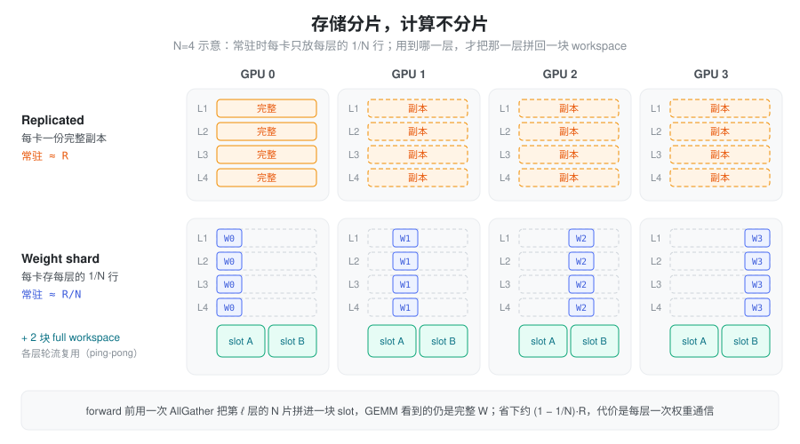
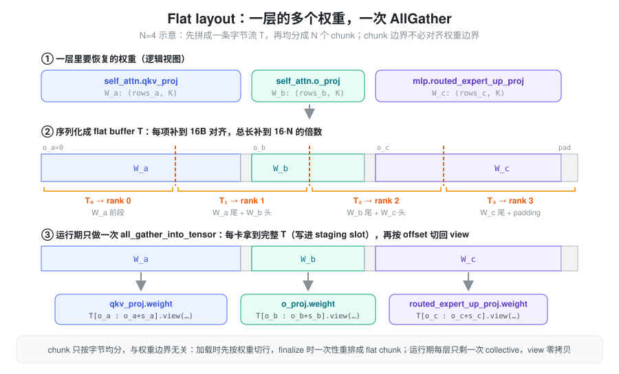
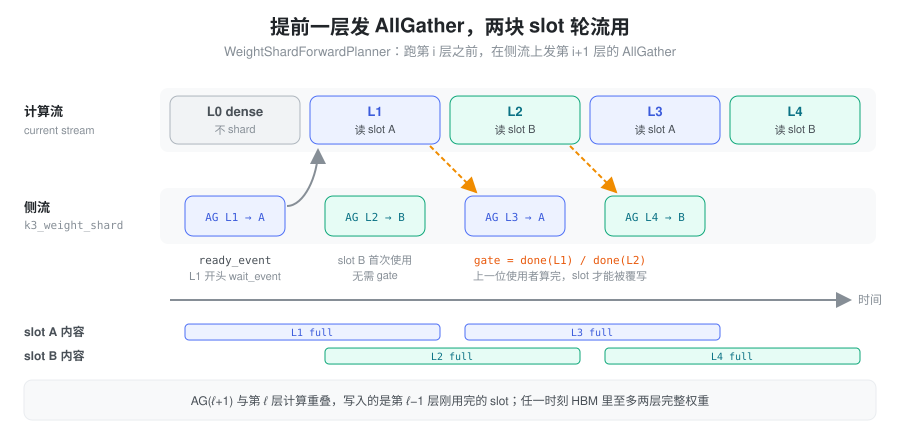
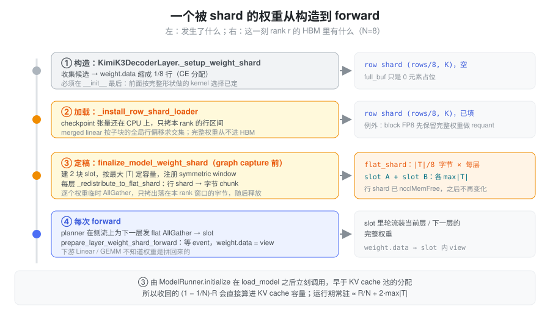

% Weight Sharding

权重 sharding 是一种以通信换显存的推理优化：多个 GPU 不再永久保存同一份完整权重，而是各自保存一片；真正执行计算前，再通过集合通信临时恢复完整权重。

它解决的是 **HBM 容量**问题，不减少 FLOPs。能否提升整体性能，取决于两件事：省下的显存能否变成更大的 batch、更多 KV cache 或更高并发；新增的通信能否被计算盖住。

### 要解决的问题：每张卡上一模一样的权重

并行策略并不会把所有权重都切开。只要某个模块没有落在任何一个切分维度上，它在每张卡上就是一份**逐字节相同**的完整副本。常见的几种：

- **DP attention（attn_tp = 1）**：每张卡是一个完整的 attention 副本，所有 Q/K/V/O 投影都是整份。
- **EP 之外的 MoE 周边权重**：EP 只摊开路由专家；shared expert、latent MoE 的上下投影如果按 TP1 构建，就是每卡一份。
- 其他按 TP1 构建的 `ReplicatedLinear`。

以 Kimi K3 的 decode DP16 部署为例（数据见 [Kimi K3 on B200](./kimi_k3_b200.md)），FP8 下 KDA 投影 28.50 GiB、MLA 4.57 GiB、MoE 周边 15.72 GiB，每张卡都存着这 48.8 GiB 的副本。

直觉上的两种办法都不太合适：

- **改成 TP 切分**。这会改变计算：DP attention 下每张卡处理的是不同的 token，把投影改成 TP 就要求每层对激活做 gather / reduce，重新引入 DP attention 本来要消掉的那部分通信，而且它在关键路径上。
- **只靠量化**。BF16 → FP8 只能减半，副本依然是 N 份。

另一方面，decode 每步的计算很短，GPU 间的 NVLink 大部分时间是空闲的。于是需求变成：**不改计算，只改存储**，用空闲的互联带宽换 HBM。

### 核心抽象：存储分片，计算不分片

关键在于把两件事分开：权重**常驻在哪里**，和计算时**看到的是什么**。

- 常驻形态：通信组里 N 个 rank 各存每层权重的 1/N 行。
- 计算形态：GEMM 看到的仍是完整 \(W\)，算子和数学路径都不变。
- 两者之间：在某一层即将执行时，用一次 AllGather 把 N 片拼回完整权重。

设完整权重 \(W \in \mathbb{R}^{\text{out} \times \text{in}}\) 沿第 0 维（`out_features`）切成 N 片：

\[
W = \begin{bmatrix} W_0 \\ W_1 \\ \vdots \\ W_{N-1} \end{bmatrix},
\qquad
W_i \in \mathbb{R}^{(\text{out}/N) \times \text{in}},
\qquad
\operatorname{AllGather}(W_0, \ldots, W_{N-1}) \longrightarrow W
\]

完整形态只在“这一层正在算”的时候需要，所以它不必每层各占一份，几块 workspace 轮流复用就够了。这也是这个设计成立的前提。



#### 它不等于 Tensor Parallel

同样是“每个 rank 存 1/N 权重”，差别在于计算用的是本地分片还是恢复后的完整权重：

| 方案 | 常驻权重 | 计算时权重 | 计算量 | 主要通信 |
| --- | --- | --- | --- | --- |
| Replicated weight | 完整 \(W\) | 完整 \(W\) | 完整 GEMM | 无 |
| Weight shard + AllGather | 约 \(W/N\) | 恢复完整 \(W\) | 不变 | AllGather **权重** |
| Output-sharded GEMM（TP） | 约 \(W/N\) | 只用 \(W_i\) | 每 rank 局部 | **输出**侧 Gather / AllReduce / ReduceScatter |

所以不能笼统地说“sharding 的代价是 AllReduce”。存储 shard、计算前恢复的方案只做“收集并拼接”的 AllGather，不涉及求和，通信对象是权重而不是激活，因此和当前 batch 的 token 数无关；TP 直接用本地分片计算，通信发生在输出侧，量随 token 数变化。

### 一层一次 AllGather：flat layout

一层里通常不止一个需要恢复的权重。以 K3 的一个 KDA 层为例，`qkv_proj`、`f_b_proj`、`o_proj`、`g_proj` 和 MoE 的 latent 上下投影、shared expert 加起来有七八个。每个权重各发一次 AllGather，就要付出多次 collective launch、多组 stream / event 依赖和多个通信 buffer。

flat layout 的做法是让通信库只看到一条字节流：

1. 把这一层要恢复的权重按顺序拼成一个逻辑 buffer \(T\)，每项补到 16B 对齐，总长补到 \(16 \cdot N\) 的倍数。
2. 把 \(T\) **按字节**均分成 N 个 chunk，rank \(i\) 常驻保存 \(T_i = T[iC:(i+1)C]\)，\(C = |T|/N\)。
3. 运行时只做一次 `all_gather_into_tensor`，每个 rank 得到完整 \(T\)。
4. 按预先记录的 byte offset 对 \(T\) 做 narrow + view，拆回各个权重：\(W_j = \operatorname{view}(T[o_j : o_j + s_j])\)。view 只是重新解释同一块内存，不拷贝。



这里有一个不显眼的地方：chunk 边界只取决于 \(|T|\) 和 N，与权重边界无关。图里 rank 1 的 chunk 同时装着 \(W_a\) 的尾部和 \(W_b\) 的头部。checkpoint 是按权重组织的，加载时最自然的切法是“每个权重切 1/N 行”，和 flat chunk 不是同一种切法，所以实现里要在加载完成后做一次**一次性重排**（见下文实现部分），运行期才能只剩一次 collective。

flat layout 减少的是 collective 次数、NCCL 调度的固定开销和 buffer 管理成本，**不减少总传输字节数**。“一次”指的是同一层的一组权重发起一个 collective，不同层仍各自需要一次。

### 提前一层：lookahead 与 ping-pong slot

AllGather 如果在第 ℓ 层开头才发、发完再等，通信就完整暴露在关键路径上。做法是把它提前到上一层：

- 在第 ℓ 层计算的同时，在一条侧流上发第 ℓ+1 层的 AllGather。
- 第 ℓ+1 层开头等这次 AllGather 的完成 event，再开始计算。
- 完整权重的落脚点只有两块 slot（A / B），按层轮流使用。



两块 slot 带来一个约束：第 ℓ+1 层的 AllGather 写入的 slot，正是第 ℓ−1 层刚用过的那一块。因此它不仅要在侧流上排队，还要等第 ℓ−1 层的计算完成（gate event），否则会覆写一块还在被读的权重。反过来，这也保证了任一时刻 HBM 里至多只有两层的完整权重。

理想情况下 \(T_{\text{allgather}}(\ell+1) \leq T_{\text{compute}}(\ell)\)，通信被完全覆盖。实际效果取决于每层权重大小、互联带宽、与 TP / EP / DP 通信的争用，以及当前层的计算时长：prefill 的 GEMM 重，容易覆盖；小 batch decode 的 GEMM 很瘦，AllGather 更容易露出来。

### 代价：通信量与显存账

#### 通信量

设一层需要恢复的权重总字节数为 \(S\)。ring AllGather 下每个 rank 发送和接收的量都约为

\[
V_{\text{per-rank}} \approx \frac{N-1}{N} \cdot S
\]

N 越大越接近 \(S\)，也就是说**每张卡每层大约要收一整层权重**，而且每次 forward 都要付一次。这个量只和权重大小有关，与 batch 里的 token 数无关：batch 越大，摊到每个 token 上的通信越少，这也是它在大 batch / prefill 下更划算的原因。

#### 显存

设被 shard 的权重总量为 \(R\)：

\[
\text{Replicated: } R
\qquad\longrightarrow\qquad
\text{Weight shard: } \frac{R}{N} + 2 \cdot \max_\ell |T_\ell|
\]

两块 slot 是固定开销，按最大的那一层定容量，与层数无关。层数越多，这部分摊得越薄。省下的约 \((1 - 1/N) \cdot R\) 只有真正变成 KV cache、batch 或并发才算收益；如果它们本来就不受显存限制，省下的显存就只是闲置。

还要分清**运行期常驻**和**加载峰值**。如果加载时先把完整权重读进 HBM 再切，峰值并不会下降，可能在启动阶段就 OOM。实现里 BF16 和 ModelOpt FP8 在加载时就只拷本 rank 的行；block FP8 要先在完整权重上做一次 requant，因此加载峰值不减，只有运行期常驻减少。

#### 适用范围

划算的场景：

- 被复制的权重占显存比例高（DP attention、TP1 的 MoE 周边投影）。
- 部署本来就受 KV cache 容量或并发限制，省出的显存能转化成吞吐。
- 有高带宽、空闲的节点内互联（NVLink），AllGather 能被上一层计算盖住。

需要谨慎的场景：

- 权重很小：通信固定开销占比高，省的显存也不多。
- 小 batch、对单步延迟敏感的 decode：每层计算短，AllGather 容易露出来。
- 互联已经被 TP / EP / DP 通信占满，额外的权重流量会造成争用。
- 跨节点的 shard 组：带宽骤降，几乎不可能覆盖。

评估时至少要看：每层 AllGather 时长与该层计算时长的比值、端到端 TTFT / TPOT 的变化、KV cache 容量和最大并发的变化，以及启动阶段的显存峰值。

### 与 TP、EP 的关系

三者是互补的维度，而不是替代关系。TP 和 EP 改变**计算**的划分，各自带着激活侧通信；weight sharding 只改变**存储**，处理的恰恰是 TP / EP 都没切到、仍然在每张卡上逐字节相同的那部分权重。一个典型组合是：路由专家走 EP，attention 走 DP，二者之外剩下的 replicated 投影交给 weight sharding。

### SGLang 中的实现（Kimi K3）

当前实现服务于 Kimi K3，通用机制都在 `python/sglang/srt/sharding.py`，模型侧只负责声明“哪些权重要 shard”和把 planner 接进层循环。

| 位置 | 作用 |
| --- | --- |
| `sharding.py`：`WeightShardingConfig` | 从环境变量读开关和层范围，frozen，初始化后不变 |
| `sharding.py`：`build_flat_layout` / `FlatLayout` | 计算每项 offset、16B padding 与 chunk 大小 |
| `sharding.py`：`FlatAGStagingPool` | 两块 slot（`seq_idx % n_buffers`），按 layout 生成 typed view |
| `sharding.py`：`FlatAGScheduler` | 每层一个：持有 flat shard，`launch` 发 AllGather，`wait_ready_once` 等完成 |
| `sharding.py`：`WeightShardForwardPlanner` | 层循环里的 lookahead 调度与 gate event 维护 |
| `models/kimi_k3.py` | 各模块的 `weight_shard_targets()`，`KimiK3DecoderLayer._setup_weight_shard()` |
| `models/dflash.py` | draft 模型的 shard 与第 0 层预取 |
| `model_executor/model_runner.py` | `load_model()` 之后调用 `force_weight_shard_finalize()` |

一个被 shard 的权重从构造到 forward 要经过四个阶段：



运行期模型侧的接入只有几行，层本身在 forward 开头调用 `prepare_layer_weight_shard_forward(self)`：

```python
self._weight_shard_planner.reset()
self._weight_shard_planner.pre_dispatch(self.start_layer)
for i in range(self.start_layer, self.end_layer):
    self._weight_shard_planner.maybe_dispatch(i + 1)   # 侧流上发 AG(i+1)，gate = done(i-1)
    hidden_states, residual, sp_sharded = self.layers[i](...)
    self._weight_shard_planner.update_done_event(i, self.layers[i])
```

#### 只 shard 真正 replicated 的权重

`_setup_shard_weight` 要求模块的 tp_size 为 1（`ReplicatedLinear` 视为 1），否则直接报错；行数不能被 N 整除的权重会告警后跳过。目标列表由各模块声明：

- KDA：`qkv_proj`、`f_b_proj`、`o_proj`、`g_proj`。`f_a_proj` / `b_proj`（合并 buffer）、`qkv_conv1d` 和 3-D 融合变体不 shard。
- MLA：`q_b_proj`（或 `q_proj`）、`o_proj`、`g_proj`。`fused_qkv_a_proj_with_mqa` 的加载绕过 `weight_loader`，`kv_b_proj` 吸收进 `w_kc` / `w_vc` 后即释放，都不参与。
- MoE（仅 latent MoE）：`routed_expert_up_proj` / `routed_expert_down_proj`，以及 TP1 构建的 shared expert 投影。

attention 目标只在 `attn_tp_size == 1` 时加入；attention 和 MoE 的目标合进同一个 layout，所以一层仍然只有一次 AllGather。第 0 层是 dense 层，默认范围 `1-92` 不包含它。

#### shard 组：节点内 8 卡 + Copy Engine

`get_weight_sharding_group_info()` 在 TP 组里按 `(tp_rank // 8) * 8` 切出节点内的 8 卡子组。限定在节点内，是因为 AllGather 走的是 NCCL 的 Copy Engine 路径：

- 权重 buffer 用 `ncclMemAlloc` 分配，并通过 `ncclCommWindowRegister(NCCL_WIN_COLL_SYMMETRIC)` 注册为 symmetric window（一个 `load_inline` 的小 C++ 扩展）。
- 要求 NCCL ≥ 2.28.3 且 `NCCL_CTA_POLICY=2`，后者不满足会直接报错。
- CE 搬运不占 SM，因此和计算重叠时不和 GEMM 抢计算资源；代价是只能在一个 NVLink 域内生效。
- window 注册是集合操作，所有 rank 必须按相同顺序调用（按 layer_id 排序后统一注册）。

#### 加载：行 shard 先行，finalize 再重排

完整权重尽量不进 HBM，靠两步完成：

1. **加载时按行切**：构造阶段 `weight.data` 就被缩成 1/N 行，`_install_row_shard_loader` 替换参数的 weight loader，从 CPU 上的 checkpoint 张量里只拷本 rank 的行区间。`QKVParallelLinear` / `MergedColumnParallelLinear` 这类 merged linear 由 `_row_sub_blocks` 给出各子块的全局行偏移，逐块求交集。
2. **finalize 时重排成 flat chunk**：`_redistribute_to_flat_shard` 对每个权重临时做一次普通 AllGather，只拷出落在本 rank 字节窗口 `[rank·C, (rank+1)·C)` 内的部分，随后释放临时张量。峰值只多一个权重的大小。重排完成后行 shard 被 `ncclMemFree`，之后只剩 flat shard。

量化变体：

- BF16 / FP16（`UnquantizedLinearMethod`）：按上面的流程。
- ModelOpt FP8：权重本体参与 flat layout，scale 仍然 replicated、不进 layout。
- block FP8（`Fp8LinearMethod` block quant）：加载后还要做 UE8M0 requant，需要完整权重，所以先保留完整形状（`_k3_requant_then_shard`），到 finalize 才切片。这一类不降低加载峰值。

`finalize_model_weight_shard` 由 `ModelRunner.initialize()` 在 `load_model()` 之后立即调用，早于 KV cache 池的分配，所以收回的显存会被 KV cache 容量的计算直接看到。

#### 与融合优化的冲突

shard 会把 `weight.data` 缩成 1/N，任何依赖完整形状的决策都必须在这之前做完。因此 `_setup_weight_shard()` 放在 `KimiK3DecoderLayer.__init__` 的最后：fused_a_gemm、min-latency q_b、gemm_ag、k3_gemm_ar 这些 kernel 选择都已按完整形状定好。另一类是会改变权重存储的融合，被 shard 的权重不能再参与：开启 sharding 且 `attn_tp_size == 1` 时，KDA 的 full-rank qkvg 融合（`_fuse_full_rank_qkvg`）关闭；MoE 被 shard 托管时跳过 `_merge_front_weights`。

#### CUDA graph 与 draft 模型

所有决策（层范围、targets、layout、slot 归属）在初始化时定死，forward 里只有固定的 launch / wait 序列，可以被 CUDA graph 捕获。`wait_ready_once()` 保证一次 launch 之后当前流最多等一次。

draft 模型（dflash）的第 0 层没有“上一层”可以重叠。实现把它的 AllGather 移出 CUDA graph，放到一条专用流上，与 ReplaySSM commit fold（约 4 ms）重叠：每步调用 `prefetch_first_weight_shard` / `wait_first_weight_shard`，冷启动时退化为 inline launch。不用共享侧流的原因是：共享侧流会让它排在 target 模型各层的 AllGather 之后，实测重叠只有约 25 µs。

#### 集合通信必须对齐

AllGather 是集合操作，shard 组内的每个 rank 每步都必须发起同样序列的 collective。DP attention 下某些 rank 可能当步没有请求；如果它们跳过 forward，其他 rank 就会挂在 AllGather 上。K3 的做法是让空闲 DP rank 跑一次 bs=1 的假 verify，使 graph 与 eager 两条路径的 collective 序列一致，见 [Kimi K3 on B200](./kimi_k3_b200.md)。

#### 开关

| 环境变量 | 默认 | 说明 |
| --- | --- | --- |
| `SGLANG_ENABLE_K3_WEIGHT_SHARD` | `false` | 总开关；旧名 `SGLANG_ENABLE_K3_MOE_WEIGHT_SHARD` 仍可用（deprecated） |
| `SGLANG_K3_WEIGHT_SHARD_LAYERS` | `1-92` | 参与 shard 的层，支持 `all`、`2`、`2,5,7`、`2-10` 及混写 |
| `SGLANG_ENABLE_K3_DRAFT_WEIGHT_SHARD` | `false` | draft 模型是否 shard |

在 K3 B200 的部署上，MoE 周边权重 shard 后（BF16 每层 367 MB，92 层）收回约 31.45 GiB；推广到 attention 和 draft 后每卡约省 42.7 GiB。

### 小结

Weight sharding 用每层一次权重 AllGather，换回 replicated 权重的常驻显存：存储按 rank 切成 1/N，计算仍然看到完整的 \(W\)，算子和数学路径都不变。flat layout 把一层的多个权重压成一个 collective；提前一层发送配合两块 ping-pong slot，让通信藏在上一层的计算后面，同时保证 HBM 里最多只有两层完整权重。它是否划算，取决于省下的 \((1 - 1/N) \cdot R\) 能否变成 KV cache 或并发，以及每层的 AllGather 能否被计算盖住。
