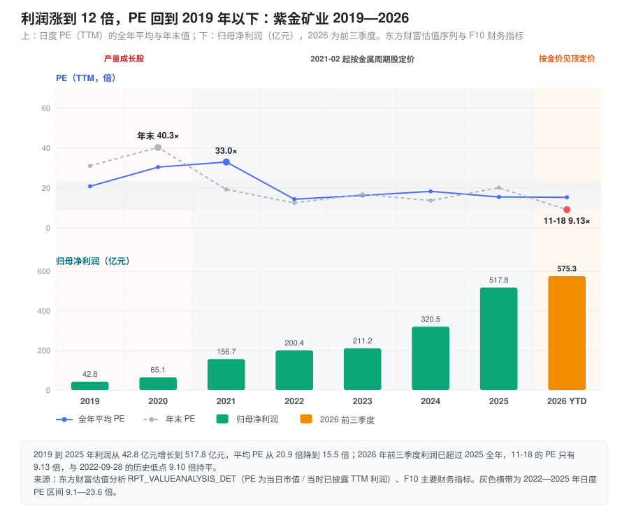
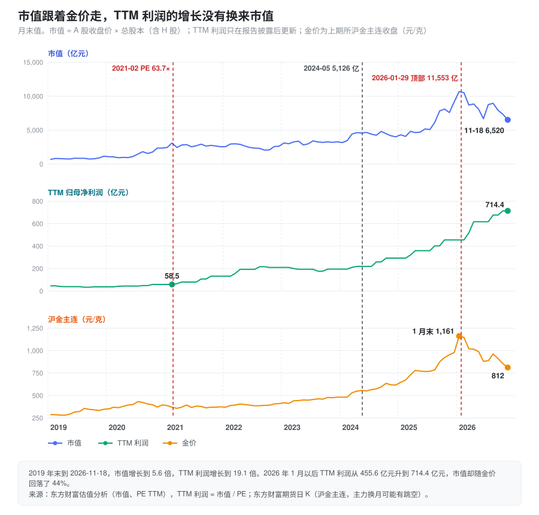
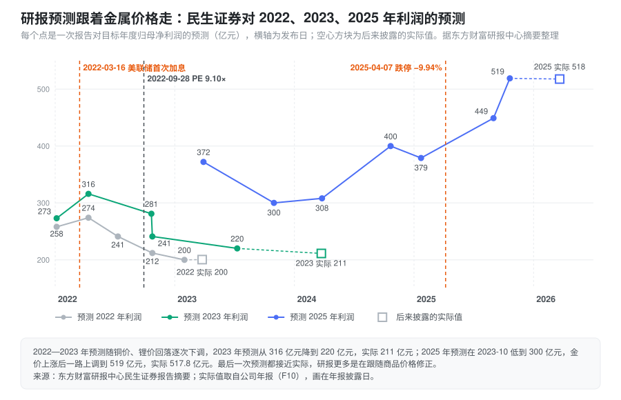
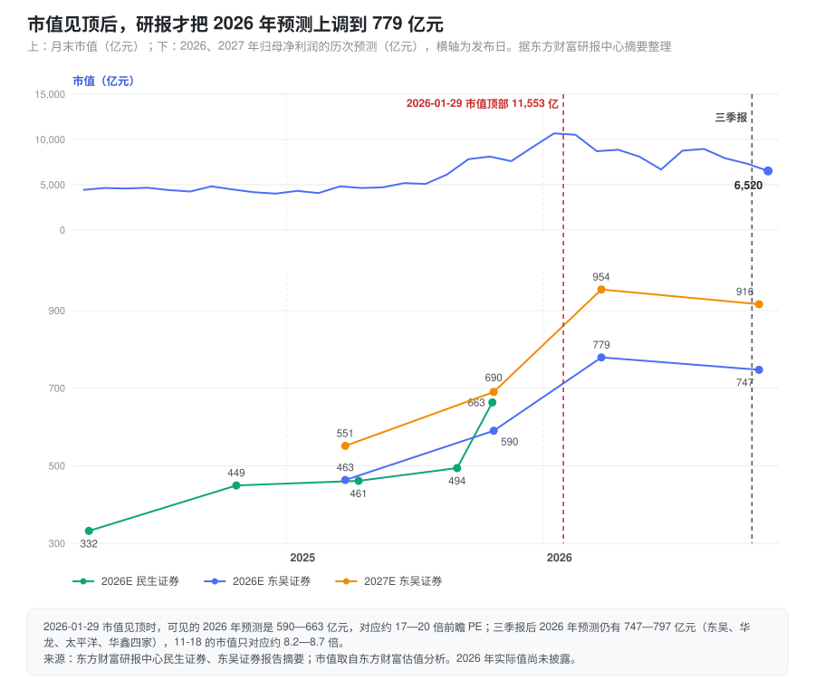
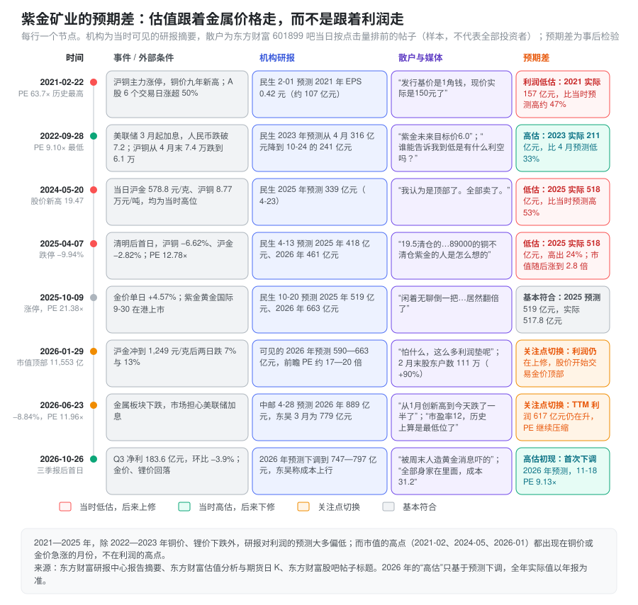

% 紫金矿业：2019—2026 年历史定价、金属价格与预期差

**核心判断：2019—2026 年，紫金矿业的利润增长几乎全部被 PE 压缩抵消，市值的方向由金价和铜价决定。** 2019 年末到 2026-11-18，滚动四季度（TTM）归母净利润从 37.5 亿元增至 714.4 亿元，增长到 19.1 倍；PE（TTM）从 31.1 倍降到 9.13 倍；市值从 1,165 亿元增至 6,520 亿元，只增长到 5.6 倍。

沿时间线看，市场对这家公司提过四个不同的问题：

- **2019—2021-02：产量能增长多快。** 利润基数低，Kamoa、Timok、巨龙等铜矿项目处在建设期，市场为未来几年的矿产铜放量付钱。PE 在 2021-02-22 升到 63.7 倍，是研究期内的最高点。
- **2021-02—2024：金属价格还能维持多久。** 矿产铜从 2019 年的 37 万吨增至 2024 年的 107 万吨，利润增长到 7 倍以上，PE 却回到 12—23 倍区间。股价的高低点与铜价、金价同步，与利润不同步。
- **2025-04—2026-01：金价重估。** 金价和利润同时上涨，PE 从 12.8 倍升到 25.4 倍，市值在 2026-01-29 到 11,553 亿元。
- **2026-01-29 以后：金价是否已经见顶。** 前三季度利润同比增长 51.9%，TTM 利润又增长 57%，市值却下跌 43.6%，PE 回到 2022 年 9 月的低点附近。

机构研报对利润的预测大多跟着金属价格修正：金属涨价时偏低（2021、2024、2025 年），跌价时偏高（2022—2023 年）。2022 年以来，按研报对次年利润的预测计算，隐含 PE 一直在 7—14 倍之间。2026-01-29 的顶部按当年（2026 年）预测计算约 17—20 倍，高于 2022 年初、2025 年初同口径的 10—11 倍。

2026 年全年业绩尚未披露。本文不预测全年结果，也不提供买卖价格。

### 研究范围与数据边界

- **标的**：紫金矿业集团股份有限公司，历史定价以上交所 A 股 **601899.SH** 为主；H 股 **02899.HK** 不单独建估值序列。
- **期间**：2019—2025 七个完整年度，加上 2026 年截至 11-18 的 YTD，与本仓库 [CATL](./CATL.md) 一文的期间一致。数据提取日与信息截止日均为 **2026-11-18**（收盘后）。
- **日度估值**：东方财富估值分析（`RPT_VALUEANALYSIS_DET`），2019-01-02 至 2026-11-18 共 1,910 个交易日，没有缺日，没有非正 PE。收盘价与东方财富不复权日 K 在 2020 年以来的 1,666 个交易日上全部一致。PE（TTM）= 当日总市值 / 当时已披露的最近四季度归母净利润，分母在定期报告披露当日更新，不存在用事后利润回填的问题。文中的“TTM 利润”由市值 / PE 反推。
- **股本与市值**：总股本从 2019 年初的 230.31 亿股增至 2026-11-18 的 265.91 亿股，主要来自 2019-11-15 生效的 A 股公开增发（募资 80 亿元，据万联 [AP202003261376995659](https://data.eastmoney.com/report/info/AP202003261376995659.html) 摘要），股本从 230.31 亿股增至 253.77 亿股。2021 年上半年股本增至 263.28 亿股，2024-06-25 增至 265.78 亿股，这两次变动的原因本文未逐项核实。“市值”是 A 股收盘价 × 全部股本，即假设 H 股也按 A 股价格计价；H 股 11-18 收于 24.24 港元，本文未做汇率换算。跨期比较用市值，不用股价。价格不复权、不含分红。
- **财务**：东方财富 F10 主要财务指标与现金流量表（公司定期报告口径），人民币亿元；单季利润由累计值相减得到。资本开支取“购建固定资产、无形资产和其他长期资产支付的现金”。
- **产量**：取自券商年报点评摘要中引用的公司数据，每项注明报告编号。
- **金属价格**：东方财富期货日 K，上期所沪金主连（元/克）、沪铜主连（元/吨），广期所碳酸锂主连（元/吨，2023-07 起）。主连合约换月可能带来跳空，只用于判断方向和量级。
- **研报**：东方财富研报中心 601899 的 195 篇报告摘要，链接格式为 `https://data.eastmoney.com/report/info/<编号>.html`。只引用摘要中能看到的字段，统一注明“据摘要整理”。绝大多数摘要没有目标价字段。
- **散户与媒体**：F10 股东户数；东方财富 601899 吧在关键日期按点击量排序的帖子标题，链接格式为 `https://guba.eastmoney.com/news,601899,<帖子编号>.html`。**样本，不代表全部投资者。**
- **未能核验**：
  - 没有取得 Wind、Choice 等一致预期快照，只呈现单家券商的轨迹和几家券商的对照。
  - 联网检索在本次分析中不可用，东方财富资讯搜索只能返回近期文章。历史事件主要依据股吧转载的新闻标题与研报摘要，涉及外部消息（国际金价的美元报价、人造黄金传闻、私募减持）的地方标为“据股吧转载标题，未核实”。
  - 2025-04-07 的跌停只记录当日沪铜、沪金的跌幅，没有找到可引用的原因说明，本文不做归因。

### 年度 PE 与利润：利润涨到 12 倍，PE 从 30 倍回到 15 倍

PE 单位为倍。全年平均为当年全部有效交易日日度 PE（TTM）的算术平均，极值附日期，年末值取最后一个交易日。PB 为当年日度 PB（MRQ）的平均。

| 年份 | 交易日 | 平均 PE | 最低 PE / 日期 | 最高 PE / 日期 | 年末 PE | 平均 PB | 年末收盘（元） | 年末市值（亿元） |
| --- | ---: | ---: | --- | --- | ---: | ---: | ---: | ---: |
| 2019 | 244 | 20.85 | 14.62 / 01-29 | 31.08 / 12-31 | 31.08 | 2.26 | 4.59 | 1,165 |
| 2020 | 243 | 30.45 | 20.50 / 03-23 | 40.95 / 12-28 | 40.30 | 3.11 | 9.29 | 2,358 |
| 2021 | 243 | 32.99 | 19.05 / 12-27 | **63.70 / 02-22** | 19.29 | 4.77 | 9.70 | 2,554 |
| 2022 | 242 | 14.39 | **9.10 / 09-28** | 23.61 / 03-03 | 12.52 | 3.31 | 10.00 | 2,633 |
| 2023 | 242 | 16.28 | 12.89 / 01-04 | 19.69 / 09-20 | 16.79 | 3.28 | 12.46 | 3,280 |
| 2024 | 242 | 18.31 | 13.62 / 12-20 | 23.36 / 05-20 | 13.71 | 3.51 | 15.12 | 4,019 |
| 2025 | 243 | 15.50 | 12.78 / 04-07 | 21.38 / 10-09 | 20.12 | 3.88 | 34.47 | 9,165 |
| 2026 YTD | 211 | 15.33 | 9.13 / 11-18 | 25.36 / 01-29 | 9.13（11-18） | 4.44 | 24.52 | 6,520 |

来源：东方财富估值分析日度数据，2026-11-18 提取。

| 年份 | 归母净利润（亿元） | 同比 | 扣非净利润（亿元） | 毛利率 | 经营现金流（亿元） | 资本开支（亿元） | 平均 PE | 关键业务变化 |
| --- | ---: | ---: | ---: | ---: | ---: | ---: | ---: | --- |
| 2019 | 42.84 | +4.65% | 39.97 | 11.40% | 106.66 | 118.96 | 20.85 | 矿产铜 36.99 万吨、矿产金 40.83 吨；11 月 A 股公开增发 80 亿元 |
| 2020 | 65.09 | +51.93% | 63.22 | 11.91% | 142.68 | 138.86 | 30.45 | 矿产铜 45.3 万吨，金价全年均价 +24% |
| 2021 | 156.73 | +140.8% | 146.81 | 15.44% | 260.72 | 201.49 | 32.99 | 矿产铜 58.42 万吨，Kamoa、巨龙陆续投产，铜价均价 +40% |
| 2022 | 200.42 | +27.88% | 195.31 | 15.74% | 286.79 | 247.94 | 14.39 | 矿产铜 87.7 万吨；下半年铜价回落、锂项目投入 |
| 2023 | 211.19 | +5.38% | 216.17 | 15.81% | 368.60 | 304.29 | 16.28 | 矿产铜首次过 100 万吨，碳酸锂价格从高位回落 |
| 2024 | 320.51 | +51.76% | 316.93 | 20.37% | 488.60 | 247.98 | 18.31 | 矿产铜 106.85 万吨、矿产金 72.94 吨，金价均价 +24% |
| **2025** | **517.77** | **+61.55%** | 507.24 | 27.73% | 754.30 | 309.82 | 15.50 | 矿产金 89.54 吨，金价均价 +43%；紫金黄金国际在港上市 |
| 2026 前三季度 | 575.26 | +51.93% | 558.42 | 38.44% | 842.76 | 189.70 | 15.33（YTD） | 矿产铜 81.57 万吨、矿产金 70.13 吨、碳酸锂当量 7.91 万吨 |

财务数据取自东方财富 F10，产量取自券商点评摘要（见下文“产量与金属价格”一节）。2026 年前三季度的对比口径：2025 年前三季度经营现金流 521.07 亿元，资本开支 151.80 亿元。2025 年加权 ROE 33.04%；资产负债率从 2022—2023 年的约 59% 降到 2026 年三季度末的 49.9%。

表中有四个统计特征：

**第一，2019—2021 年的高 PE 来自很低的利润基数。** 2019 年利润只有 42.8 亿元，毛利率 11.4%，PE 年末 31.1 倍；2021-02-22 的 63.7 倍对应的 TTM 利润只有 58.5 亿元。市场是在为尚未投产的矿山定价。

**第二，2022 年以后 PE 进入 9—24 倍的周期股区间。** 2022—2025 年四年的日度 PE 都在 9.10—23.61 倍之间，平均 PE 在 14.4—18.3 倍之间窄幅波动。这四年利润从 200 亿元增至 518 亿元，平均 PE 没有随之上升。

**第三，利润增长的来源在 2024 年以后从“量”转向“价”。** 2019—2023 年毛利率在 11%—16% 之间，利润增长主要来自铜产量从 37 万吨增至 101 万吨；2024—2026 年产量增长放缓（铜 106.85 → 108.51 万吨），毛利率却从 15.8% 升到 38.4%，利润弹性主要来自金价。

**第四，现金流在 2024 年以后明显好于利润。** 2025 年经营现金流 754.3 亿元，是利润的 1.46 倍；资本开支 309.8 亿元，与 2023 年的 304.3 亿元相近。所以 2026 年的 PE 压缩不是利润质量变差造成的，至少从现金流看不是。

### 产量与金属价格：利润弹性从铜转到金

| 年份 | 矿产铜（万吨） | 矿产金（吨） | 沪金均价（元/克） | 沪铜均价（元/吨） | 来源（券商点评摘要） |
| --- | ---: | ---: | ---: | ---: | --- |
| 2019 | 36.99 | 40.83 | 314.3 | 47,674 | 万联 [AP202003261376995659](https://data.eastmoney.com/report/info/AP202003261376995659.html) |
| 2020 | 45.3 | 40.5 | 389.5 | 48,796 | 民生 [AP202103221474697202](https://data.eastmoney.com/report/info/AP202103221474697202.html)（摘要原文写作“45.3 吨”，按上下文应为万吨） |
| 2021 | 58.42 | 47.45 | 375.8 | 68,409 | 国信 [AP202203211554008064](https://data.eastmoney.com/report/info/AP202203211554008064.html) |
| 2022 | 87.7 | 56.4 | 392.7 | 66,898 | 国信 [AP202303271584574278](https://data.eastmoney.com/report/info/AP202303271584574278.html) |
| 2023 | 101 | 67.7 | 450.5 | 68,041 | 国信 [AP202401301619509464](https://data.eastmoney.com/report/info/AP202401301619509464.html) |
| 2024 | 106.85 | 72.94 | 559.4 | 75,054 | 国信 [AP202503231646442836](https://data.eastmoney.com/report/info/AP202503231646442836.html) |
| 2025 | 108.51 | 89.54 | 800.5 | 80,942 | 国信 [AP202603231820690194](https://data.eastmoney.com/report/info/AP202603231820690194.html)；碳酸锂当量 2.55 万吨 |
| 2026 前三季度 | 81.57 | 70.13 | 981.1（YTD） | 104,339（YTD） | 东吴 [AP202611031831373091](https://data.eastmoney.com/report/info/AP202611031831373091.html)；碳酸锂当量 7.91 万吨 |

金属均价为主连合约日收盘的算术平均。2026 年的极值：沪金 01-29 收于 1,249.12 元/克，11-18 为 811.98 元/克；沪铜 09-10 收于 112,200 元/吨，11-18 为 100,950 元/吨；碳酸锂 05-12 收于 205,260 元/吨，11-18 为 91,520 元/吨。2026 年矿产铜含 Kamoa 权益量，剔除后为 73.12 万吨。

2019—2023 年矿产铜增至 2.7 倍，金价只涨 43%，这一段的利润增长以铜放量为主。2023—2025 年矿产铜只增 7%，金价涨 78%，矿产金增 32%，利润增长以金价为主。所以 2026 年金价回落时，利润和估值都比 2022 年铜价回落时更敏感。东吴证券摘要显示，2026 年三季度金锭售价 916.39 元/克，环比 −6.72%；铜精矿 8.80 万元/吨，环比 +5.29%。

### 节点表：股价先动还是利润先动

年度表会掩盖拐点。下表列出关键日期的收盘价、市值、当时已披露的 TTM 利润与 PE。

| 日期 | 收盘（元） | 市值（亿元） | TTM 利润（亿元） | PE（TTM） | 当日涨跌 | 说明 |
| --- | ---: | ---: | ---: | ---: | ---: | --- |
| 2019-12-31 | 4.59 | 1,165 | 37.5 | 31.08 | | 起点 |
| 2020-03-23 | 3.46 | 878 | 42.8 | 20.50 | | 疫情冲击，2020 年最低 PE |
| 2020-12-31 | 9.29 | 2,358 | 58.5 | 40.30 | | 一年市值翻倍 |
| 2021-02-22 | 14.63 | 3,727 | 58.5 | **63.70** | +7.26% | PE 研究期最高，沪铜主力涨停 |
| 2021-03-24 | 9.36 | 2,384 | 65.1 | 36.63 | −7.6% | 一个月回撤 36% |
| 2021-12-31 | 9.70 | 2,554 | 132.4 | 19.29 | | 利润翻倍，PE 减半 |
| 2022-04-14 | 12.74 | 3,354 | 192.9 | 17.39 | | 2022 年股价高点 |
| 2022-09-28 | 7.48 | 1,969 | 216.5 | **9.10** | | PE 研究期最低 |
| 2022-12-30 | 10.00 | 2,633 | 210.4 | 12.52 | | |
| 2024-01-23 | 11.54 | 3,038 | 195.4 | 15.55 | | 2024 年股价低点 |
| 2024-05-20 | 19.47 | 5,126 | 219.4 | 23.36 | | 股价创新高 |
| 2024-12-31 | 15.12 | 4,019 | 293.1 | 13.71 | | |
| 2025-04-07 | 15.41 | 4,096 | 320.5 | 12.78 | −9.94% | 清明假期后首日跌停 |
| 2025-09-30 | 29.44 | 7,824 | 402.6 | 19.44 | | 紫金黄金国际在港上市 |
| 2025-10-09 | 32.38 | 8,606 | 402.6 | 21.38 | +9.99% | 涨停 |
| 2025-12-31 | 34.47 | 9,165 | 455.6 | 20.12 | | |
| 2026-01-29 | 43.45 | **11,553** | 455.6 | 25.36 | | 市值研究期最高 |
| 2026-02-02 | 36.61 | 9,735 | 455.6 | 21.37 | −8.79% | 两个交易日跌 15.7% |
| 2026-03-23 | 30.58 | 8,131 | 517.8 | 15.70 | −3.38% | 年报后首个交易日，分母更新 |
| 2026-06-30 | 25.14 | 6,685 | 616.9 | 10.84 | | |
| 2026-08-21 | 34.74 | 9,238 | 616.9 | 14.97 | | 反弹高点 |
| 2026-10-26 | 27.47 | 7,304 | 714.4 | 10.22 | −4.58% | 三季报后首个交易日 |
| 2026-11-18 | 24.52 | 6,520 | 714.4 | **9.13** | −5.66% | 信息截止日 |

单季归母净利润（亿元，由累计值相减）：

| 年份 | Q1 | Q2 | Q3 | Q4 |
| --- | ---: | ---: | ---: | ---: |
| 2019 | 8.74 | 9.79 | 11.52 | 12.78 |
| 2020 | 10.40 | 13.81 | 21.51 | 19.36 |
| 2021 | 25.11 | 41.38 | 46.53 | 43.70 |
| 2022 | 61.24 | 65.06 | 40.37 | 33.75 |
| 2023 | 54.42 | 48.60 | 58.63 | 49.54 |
| 2024 | 62.61 | 88.24 | 92.73 | 76.93 |
| 2025 | 101.67 | 131.25 | 145.72 | 139.14 |
| 2026 | **200.79** | 190.90 | 183.56 | — |

单季利润在 2026 年一季度到达 200.79 亿元，之后连续两个季度环比下降（−4.9%、−3.8%），但仍比上年同期高 45% 和 26%。市值顶部（2026-01-29）出现在单季利润顶部（2026Q1）所在的季度内，比这份季报的披露早约三个月。2022 年也是同样的顺序：股价 2022-04-14 见顶，单季利润 2022Q2 见顶。

#### 乘法分解：市值 = TTM 利润 × PE

选取相邻的高点和低点，把市值变化拆成 TTM 利润变化与 PE 变化。总股本在 2019—2024 年有几次增加，所以用市值和净利润分解，不用股价和 EPS。

| 区间 | 市值变化 | TTM 利润变化 | PE 变化 | 主导因素 |
| --- | --- | ---: | ---: | --- |
| 2019-12-31 → 2021-02-22 | ×3.20（+220%） | ×1.56 | ×2.05 | 估值为主，利润开始贡献 |
| 2021-02-22 → 2022-09-28 | ×0.53（−47%） | ×3.70 | ×0.14 | 利润增长被估值压缩完全抵消 |
| 2022-09-28 → 2024-05-20 | ×2.60（+160%） | ×1.01 | ×2.57 | 全部来自估值 |
| 2024-05-20 → 2025-04-07 | ×0.80（−20%） | ×1.46 | ×0.55 | 估值压缩超过利润增长 |
| 2025-04-07 → 2026-01-29 | ×2.82（+182%） | ×1.42 | ×1.99 | 估值与利润共同驱动，估值为主 |
| 2026-01-29 → 2026-11-18 | ×0.56（−44%） | ×1.57 | ×0.36 | 估值压缩超过利润增长 |

两个较长的区间：

- 2019-12-31 → 2026-11-18：市值 ×5.60，TTM 利润 ×19.06，PE ×0.29。
- 2021-02-22 → 2026-11-18：市值 ×1.75，TTM 利润 ×12.21，PE ×0.14。

三次上涨中有两次（2022-09 → 2024-05、2025-04 → 2026-01）主要来自 PE，三次下跌全部来自 PE。TTM 利润在每个区间都没有下降，最弱的一段是 2022-09 → 2024-05 的 ×1.01。紫金矿业的股价波动几乎都是倍数的波动，而倍数上升的时段与金价、铜价上升的时段重合，见上图。

这与 [CATL](./CATL.md) 的长期结构相似，都是利润增长被倍数压缩抵消，但原因不同。宁德时代的倍数压缩来自市场对竞争和超额利润持续性的重估；紫金矿业的倍数压缩，按本文的解释，来自市场不愿意按高位金属价格把利润资本化。

### 机构研报：预测跟着金属价格修正

#### 民生证券：覆盖最连续的一条线

民生证券 2021—2025 年共有约 40 篇报告，评级始终为“买入”，口径为归母净利润。下表据研报摘要整理，摘要中没有目标价。“次年隐含 PE”= 报告日（非交易日取前一交易日）总市值 / 该报告对发布年份次年的利润预测。

| 发布日 | 预测（亿元） | 当日 TTM PE | 次年隐含 PE | 摘要要点 |
| --- | --- | ---: | ---: | --- |
| [2021-02-01](https://data.eastmoney.com/report/info/AP202102011456524428.html) | EPS 2020/21/22：0.25 / 0.42 / 0.64 元 | 45.46 | — | 2030 规划；只给 EPS |
| [2022-01-05](https://data.eastmoney.com/report/info/AP202201051538572446.html) | 2021/22/23：166 / 258 / 273 | 19.43 | 9.4 | 巨龙铜矿如期投产 |
| [2022-03-21](https://data.eastmoney.com/report/info/AP202203211553998220.html) | 2022/23/24：259 / 298 / 306 | 18.48 | 9.7 | 年报点评 |
| [2022-04-12](https://data.eastmoney.com/report/info/AP202204121558806743.html) | 274 / 316 / 324 | 15.95 | 9.7 | 一季报，三大铜矿集群 |
| [2022-07-11](https://data.eastmoney.com/report/info/AP202207111576032499.html) | 241 / 277 / 307 | 12.36 | 8.6 | 半年度预告，下调（美联储加息） |
| [2022-10-21](https://data.eastmoney.com/report/info/AP202210211579330237.html) | 244 / 281 / 313 | 9.64 | 7.4 | 底部收购 Rosebel 金矿；次年隐含 PE 研究期最低 |
| [2022-10-24](https://data.eastmoney.com/report/info/AP202210241579402675.html) | 212 / 241 / 268 | 9.94 | 8.7 | “价跌本升 Q3 业绩承压” |
| [2023-03-29](https://data.eastmoney.com/report/info/AP202303291584638332.html) | 2023/24/25：241 / 290 / 372 | 15.78 | 10.9 | 年报深度点评 |
| [2023-07-10](https://data.eastmoney.com/report/info/AP202307101592127856.html) | 220 / 270 / 350 | 15.69 | 11.3 | “业绩略低于预期”，波格拉复产不及预期 |
| [2023-10-30](https://data.eastmoney.com/report/info/AP202310301605642138.html) | 2024/25：246 / 300 | 16.73 | 13.3 | 锂价下跌，下调 2024—25 年 |
| [2024-03-25](https://data.eastmoney.com/report/info/AP202403251628072169.html) | 2024/25/26：254 / 308 / 332 | 19.62 | 13.5 | “飞龙在天” |
| [2024-04-23](https://data.eastmoney.com/report/info/AP202404231631067327.html) | 280 / 339 / 366 | 20.45 | 13.2 | “铜金将迎量价齐升” |
| [2024-07-01](https://data.eastmoney.com/report/info/AP202407011637125288.html) | 282 / 345 / 396 | 21.86 | 13.9 | 勘探增储 + 逆周期并购 |
| [2024-08-27](https://data.eastmoney.com/report/info/AP202408271639469994.html) | 297 / 363 / 414 | 16.49 | 11.8 | 半年报 |
| [2024-10-21](https://data.eastmoney.com/report/info/AP202410211640376409.html) | 325 / 400 / 449 | 16.52 | 12.1 | “历史最佳业绩” |
| [2025-01-22](https://data.eastmoney.com/report/info/AP202501221642451823.html) | 2024/25/26：320 / 379 / 429 | 14.69 | 10.0 | 业绩预告，2024 年实际 320.51 |
| [2025-03-24](https://data.eastmoney.com/report/info/AP202503241646716442.html) | 2025/26：415 / 451 | 14.97 | 10.6 | 年报深度点评 |
| [2025-04-13](https://data.eastmoney.com/report/info/AP202504131655781291.html) | 418 / 461 | 14.22 | 9.9 | 跌停后一周，“真金不怕火炼” |
| [2025-08-31](https://data.eastmoney.com/report/info/AP202508311737229465.html) | 449 / 494 | 15.24 | 12.4 | 半年报 |
| [2025-10-20](https://data.eastmoney.com/report/info/AP202510201765616790.html) | 519 / 663 | 17.36 | 11.9 | “黄金板块迎来重估” |

这条线有三个规律：

**1. 预测的方向与金属价格同步，与股价不同步。** 2022 年 4 月到 10 月，沪铜主连从 04-12 的 7.34 万元/吨跌到 10-24 的 6.38 万元/吨，民生对 2023 年的预测从 316 亿元降到 241 亿元，2023-07 再降到 220 亿元，实际为 211.19 亿元，比 4 月的预测低 33%。2023-10 到 2025-10，沪金月末收盘从约 479 元/克涨到 922 元/克，对 2025 年的预测从 300 亿元一路上调到 519 亿元，实际为 517.77 亿元。每一年最后一次预测都接近实际，误差主要出在一年以前的预测上。

**2. 市场没有为研报的上修付更高的倍数。** 2023—2025 年预测上调了 73%（300 → 519），次年隐含 PE 却一直在约 10—14 倍之间。2024-07-01 的 13.9 倍和 2025-04-13 的 9.9 倍是这一段的两端，分别对应 2024-05 的股价高点之后和 2025-04-07 跌停之后。一种解释是：市场知道预测会随金属价格变化，所以不按上修后的预测给更高倍数。

**3. 两次 PE 最低点，都出现在研报大幅下调之后。** 2022-09-28 的 PE 9.10 倍，前一次下调是 2022-07-11；2026-11-18 的 9.13 倍，前一轮下调是三季报后 10-27 至 11-03 的几篇报告（见下节）。但 2022 年的下调后来被证明是对的（2023 年利润只增 5%），2026 年这一轮对当年预测的下调只有 4%—9%，是否会继续扩大要看金价。

#### 东吴证券与三季报后的对照：2026 年的预测

民生证券 2025-10-20 之后的报告不在摘要样本中，2026 年改以东吴证券为主线，其他券商作对照。

| 券商 | 发布日 | 预测（亿元） | 次年隐含 PE | 摘要要点 |
| --- | --- | --- | ---: | --- |
| 东吴 | [2025-03-25](https://data.eastmoney.com/report/info/AP202503251647269864.html) | 2025/26/27：390 / 463 / 551 | 10.6 | 年报点评 |
| 东吴 | [2025-10-22](https://data.eastmoney.com/report/info/AP202510221766675265.html) | 504 / 590 / 690 | 13.3 | “由于金、铜价格不断上涨”上调 |
| 东吴 | [2026-03-24](https://data.eastmoney.com/report/info/AP202603241820729563.html) | 2026/27/28：779 / 954 / 1,134 | 9.0（2027E） | 年报后大幅上调 2026 年（590 → 779） |
| 中邮 | [2026-04-28](https://data.eastmoney.com/report/info/AP202604281821712104.html) | 889 / 929 / 1,072 | 9.4（2027E） | 一季报后，对 2026 年最乐观 |
| 华龙 | [2026-08-28](https://data.eastmoney.com/report/info/AP202608281828621229.html) | 826.46 / 937.79 / 1,080.69 | 9.8（2027E） | 半年报 |
| 华龙 | [2026-10-27](https://data.eastmoney.com/report/info/AP202610271831038106.html) | 752.29 / 850.89 / 936.13 | 8.7（2027E） | 三季报后下调 |
| 太平洋 | [2026-10-30](https://data.eastmoney.com/report/info/AP202610301831217274.html) | 762 / 911 / 1,101 | 8.1（2027E） | 4-27 为 801 / 1,012 / 1,275 |
| 华鑫 | [2026-10-30](https://data.eastmoney.com/report/info/AP202610301831238738.html) | 796.57 / 865.16 / 929.74 | 8.5（2027E） | |
| 东吴 | [2026-11-03](https://data.eastmoney.com/report/info/AP202611031831373091.html) | 747 / 916 / 1,126 | 8.0（2027E） | “Q3金锂产品价格回落叠加部分产品成本上行”；下调 2026 年 4% |

2026 年的预测轨迹有两个特点：

- **股价见顶时，研报还没上调。** 2026-01-29 市值到 11,553 亿元时，可见的 2026 年预测是民生 663 亿元（2025-10-20）和东吴 590 亿元（2025-10-22），按当年预测计算的 PE 约 17—20 倍。东吴在 2026-03-24 把 2026 年预测提到 779 亿元，中邮在 04-28 提到 889 亿元，这时市值已比顶部低 24%—26%。
- **三季报后的下调幅度小，股价跌幅大。** 10-27 至 11-03，四家券商把 2026 年预测下调到 747—797 亿元，降幅 4%—9%；同期股价从 10-23 的 28.79 元跌到 11-18 的 24.52 元。按 11-18 市值 6,520 亿元计算，2026E 隐含 PE 约 8.2—8.7 倍，2027E（851—916 亿元）约 7.1—7.7 倍。

事后推算（以年报为准）：2026 年前三季度利润 575.26 亿元。如果四季度利润与三季度持平（183.56 亿元），全年约 759 亿元；如果四季度同比增速与三季度相同（+26%），全年约 750 亿元。两种推算都落在券商下调后的区间下沿。11 月中旬沪金约 812 元/克，比东吴摘要中三季度金锭售价 916 元/克低约 11%，如果金价维持在这个水平，四季度利润低于三季度的可能性更大。

没有取到一致预期快照，以上只代表几家券商。从这几家看，三季报后的方向是“小幅下修”，股价的跌幅大于预测的降幅，分歧主要在估值。

### 散户与媒体

#### 股东户数

F10 股东户数（A 股，截至各期末；部分为定期报告外的补充披露）：

| 截止日 | 股东户数 | 环比 | 期末收盘（元） | 同期股价表现 |
| --- | ---: | ---: | ---: | --- |
| 2019-12-31 | 605,932 | | 4.59 | |
| 2020-03-31 | 656,754 | +7.0% | 3.69 | 疫情下跌中户数增加 |
| 2020-12-31 | 467,278 | | 9.29 | 全年股价翻倍，户数下降 |
| 2021-02-28 | 646,061 | +38.3% | 12.19 | PE 顶部附近大幅增加 |
| 2021-03-31 | 830,901 | +28.6% | 9.62 | 顶部之后继续增加 |
| 2021-12-31 | 829,115 | | 9.70 | |
| 2022-03-31 | 530,744 | | 11.34 | |
| 2022-06-30 | 826,609 | +55.7% | 9.33 | |
| 2022-09-30 | 831,777 | +0.6% | 7.84 | PE 最低点附近 |
| 2022-12-31 | 529,531 | −36.3% | 10.00 | |
| 2023-12-31 | 366,730 | | 12.46 | |
| 2024-02-29 | 342,022 | | 13.11 | 2024 年主升前户数最低 |
| 2024-12-31 | 480,641 | | 15.12 | |
| 2025-06-30 | 335,659 | | 19.50 | 主升前户数再次下降 |
| 2025-09-30 | 529,769 | +57.8% | 29.44 | 主升中散户进场 |
| 2025-12-31 | 584,983 | +10.4% | 34.47 | |
| 2026-02-28 | 1,108,965 | +89.6% | 39.55 | 顶部前后户数翻倍 |
| 2026-03-31 | 1,252,002 | +12.9% | 32.72 | 下跌中继续增加 |
| 2026-06-30 | 1,318,365 | +5.3% | 25.14 | **研究期峰值** |
| 2026-09-30 | 1,089,966 | −17.3% | 29.79 | 第一次在高位之后明显减少 |

空白的环比表示上一期数据不连续，未计算。2022 年三月、六月、十二月的户数在 53 万与 83 万之间来回跳动，与股价走势对不上，可能与补充披露的统计口径有关，只作参考。

户数有两种不同的模式：

- **2020、2024、2025 年上半年，户数在主升前下降。** 2020 年股价翻倍时户数从 66 万降到 47 万；2024-02 和 2025-06 户数都降到约 34 万，之后股价开始主升。上涨初期由机构资金推动。
- **顶部前后户数上升，并在顶部之后继续上升。** 2021 年 2 月、3 月的户数在 PE 顶部前后增加了 78%；2026 年 2 月末户数是 2025 年末的 1.9 倍，6 月末到 132 万，峰值出现在顶部之后五个月、股价已经下跌 42% 的时候。

股东户数一季度一次，只作辅助证据。2026 年三季度户数减少 17%，同期股价从 25.14 元反弹到 29.79 元，可能是反弹中的离场，需要结合四季度数据判断。

#### 股吧样本

以下为东方财富 601899 吧在关键日期按点击量排在前列的帖子标题，原文照录（过长的截断处用“…”标出）。**样本，不代表全部投资者。** 新闻转载类标题与个人观点类标题分开标注；每个日期同时列出看多与看空的帖子。

| 日期 | 新闻 / 转载标题 | 个人观点标题 |
| --- | --- | --- |
| 2021-02-22 | “[紫金矿业A股触及涨停 近6个交易日涨超50%](https://guba.eastmoney.com/news,601899,1006293572.html)”；“[最新：上期所沪铜期货主力合约涨停](https://guba.eastmoney.com/news,601899,1006238481.html)” | “[紫金矿业的发行基价是1角钱，现价实际是150元了，还有这么多人进去套牢是可怕的！](https://guba.eastmoney.com/news,601899,1006338003.html)”；“[紫金矿业今年铜产量是56万吨，明年可以达到70万吨…](https://guba.eastmoney.com/news,601899,1006493725.html)” |
| 2022-09-28 | “[强势美元来袭？紫金矿业背后的隐痛](https://guba.eastmoney.com/news,601899,1231954646.html)” | “[广西炮哥8418：紫金未来目标价6.0。](https://guba.eastmoney.com/news,601899,1231624739.html)”；“[人民币兑美元跌破7.26，美国加息的脚步没有停止，紫金将继续下跌…](https://guba.eastmoney.com/news,601899,1232053159.html)”；“[紫金矿业拥有的铜资源量6200万吨，以每吨65000元计算，就值4万亿元…](https://guba.eastmoney.com/news,601899,1232057790.html)” |
| 2024-05-20 | “[沪指涨0.54% 紫金矿业、高争民爆等创历史新高](https://guba.eastmoney.com/news,601899,1428276221.html)” | “[北向资金一直加码紫金矿业…](https://guba.eastmoney.com/news,601899,1427970599.html)”；“[我认为是顶部了。全部卖了。](https://guba.eastmoney.com/news,601899,1428304055.html)” |
| 2025-04-07 | “[中国稀土企业将强化合规贸易；紫金矿业：对外出售资产完成交割…](https://guba.eastmoney.com/news,601899,1536293747.html)” | “[19.5清仓的，一直不理解89000的铜不清仓紫金的人是怎么想的…](https://guba.eastmoney.com/news,601899,1536299868.html)”；“[黄金股今天是买进好时机](https://guba.eastmoney.com/news,601899,1536826229.html)”；“[铜明天还有一个跌停，唉](https://guba.eastmoney.com/news,601899,1536423356.html)” |
| 2025-10-09 | | “[当时也就想着闲着无聊倒一把，可不曾想他居然翻倍了…](https://guba.eastmoney.com/news,601899,1608263854.html)”；“[给孩子涨懵了，这不会是有史以来第一个涨停板吧…](https://guba.eastmoney.com/news,601899,1608360638.html)”；“[为什么主力都跑路了](https://guba.eastmoney.com/news,601899,1608379796.html)” |
| 2026-01-29 | “[紫金矿业计划溢价收购联合黄金](https://guba.eastmoney.com/news,601899,1661452558.html)”；“[赶紧看看吧！美股主要金铜股已全线暴跌](https://guba.eastmoney.com/news,601899,1662308058.html)” | “[恶耗！！！语音未落，黄金现货已暴跌超320美元，已从5598暴跌至5270](https://guba.eastmoney.com/news,601899,1662309707.html)”（未核实）；“[怕什么，这么多利润垫呢](https://guba.eastmoney.com/news,601899,1662325514.html)”；“[已挂跌停，我先走一步](https://guba.eastmoney.com/news,601899,1662308327.html)” |
| 2026-01-30 | “[紫金矿业：拟发行15亿美元零息有担保可转换公司债券](https://guba.eastmoney.com/news,601899,1662492562.html)”；“[紫金矿业成交额突破200亿元 贵州茅台突破100亿元](https://guba.eastmoney.com/news,601899,1662822715.html)” | “[黄金这点跌幅对于业绩根本没有大影响，紫金这个主力就是在洗筹…](https://guba.eastmoney.com/news,601899,1662497194.html)”（节选）；“[我咋天43.06清仓，今天挂39.12重新上车…](https://guba.eastmoney.com/news,601899,1662725063.html)” |
| 2026-03-23 | “[182.58亿元！紫金矿业拟控股赤峰黄金](https://guba.eastmoney.com/news,601899,1683210727.html)”；“[紫金矿业：3月23日首次回购公司A股股份2100万股](https://guba.eastmoney.com/news,601899,1683483318.html)”；“[三箭齐发！回购+分红+巨资收购，紫金矿业年赚500多亿元，现金流仍临考验](https://guba.eastmoney.com/news,601899,1683519097.html)” | |
| 2026-06-23 | “[金属铜概念下跌4.75%，主力资金净流出74股](https://guba.eastmoney.com/news,601899,1730936391.html)” | “[从1月创新高到今天跌了一半了…](https://guba.eastmoney.com/news,601899,1730780784.html)”；“[市场仍然把铜当成是一个简单的周期大宗…如果美元加息再加息，铜…](https://guba.eastmoney.com/news,601899,1730874486.html)” |
| 2026-10-26 | “[邓晓峰、中东资本同步减持矿业巨头！头部私募调仓换股](https://guba.eastmoney.com/news,601899,1787370573.html)”（未核实）；“[日均进账超10亿元！三季报超预期之下，紫金矿业的两个“翻倍”信号](https://guba.eastmoney.com/news,601899,1787377213.html)” | “[被周末人造黄金消息吓的](https://guba.eastmoney.com/news,601899,1786974897.html)”；“[恐怖了！！！](https://guba.eastmoney.com/news,601899,1787411680.html)” |
| 2026-11-18 | | “[紫金矿业的估值比南方铜业和必和必拓低不少…](https://guba.eastmoney.com/news,601899,1797755585.html)”；“[难道你们都不知道他是从3块涨到9块，然后涨到44的么？25的价格竟然觉得便宜！…](https://guba.eastmoney.com/news,601899,1797790051.html)”；“[全部身家在里面，成本31.2，拿到明年能回本吗…](https://guba.eastmoney.com/news,601899,1797722057.html)” |

从样本看有三点：

- **“估值低”是低位最常见的买入理由。** 2022-09-28 有“铜资源量…就值4万亿元”，2025-04-07 有“[市盈率12倍，股价两年底部，严重超跌，必然反弹](https://guba.eastmoney.com/news,601899,1536344791.html)”，2026-06-23 有“[这个地方就是底信不信？市盈率12，历史上算是最低位了](https://guba.eastmoney.com/news,601899,1730637704.html)”，2026-11-18 有“估值比南方铜业和必和必拓低不少”。2022 年和 2025 年 4 月的低点后来都被证明是底部；2026 年 6 月的“最低位”之后 PE 又从 12 倍降到 9 倍。
- **顶部附近的帖子在讨论利润“垫”得住价格。** 2026-01-29 的“怕什么，这么多利润垫呢”和 01-30 的“黄金这点跌幅对于业绩根本没有大影响”，用的都是当时已披露的利润；市场在交易的是金价的方向。
- **散户的注意力集中在金价和美联储。** 2026-06-23、10-26、11-18 的高点击帖子都在讨论加息、美元和金价，很少讨论产量、成本或并购。2026-10-26 的“人造黄金”传闻帖子点击量排在当日前列，本文未找到可核实的来源。

2025-10-09 的帖子说“这不会是有史以来第一个涨停板吧”，但日度数据显示 A 股此前在 2020-07-09、2021-02-18、2021-03-11 都有过涨停。这类说法只反映当时的情绪，不能当作事实。

### 事件与预期差

#### 节点

| 日期 | 类别 | 发生了什么 | 股价与估值反应 | 看法有没有改变 |
| --- | --- | --- | --- | --- |
| 2021-02-22 | 行业 | 沪铜主力合约涨停，铜价九年新高（据股吧转载标题） | 当日 +7.26%，PE 63.70 倍，研究期最高；一个月后跌到 9.36 元 | 2 月末户数 +38%；研报仍按产量增长给估值 |
| 2022-03-16 | 外部 | [美联储宣布加息 25 个基点](https://www.federalreserve.gov/newsevents/pressreleases/monetary20220316a.htm)，开启本轮加息 | 股价 04-14 见顶 12.74 元后下跌，09-28 PE 9.10 倍 | 民生 07-11 下调预测，摘要提到“美联储加息”；股吧讨论美元与人民币汇率 |
| 2023-07-10 | 公司 | 半年度预告略低于预期，波格拉金矿复产不及预期（据民生摘要） | PE 15.69 倍，变化不大 | 民生下调 2023 年预测到 220 亿元 |
| 2024-05-20 | 行业 | 金价、铜价在高位，北向资金持续买入（据股吧转载标题） | 股价新高 19.47 元，PE 23.36 倍，此后 2024 年未再超过 | 民生 2025 年预测 339 亿元，次年隐含 PE 13.2 倍 |
| 2025-04-07 | 外部 | 清明假期后首个交易日，沪铜 −6.62%、沪金 −2.82%；原因本文未核实 | 跌停 −9.94%，PE 12.78 倍，2025 年最低 | 民生 04-13 维持并小幅上调（2025 年 418 亿元）；股吧出现“市盈率12倍…必然反弹” |
| 2025-09-30 | 公司 | 紫金黄金国际在港上市，发行价 71.59 港元，募资约 287 亿港元（据中邮 [AP202510211766162268](https://data.eastmoney.com/report/info/AP202510211766162268.html)、国信 [AP202510221767005218](https://data.eastmoney.com/report/info/AP202510221767005218.html) 摘要） | 10-09 涨停，PE 21.38 倍 | 国信称“上市后有望带来估值提升”；民生称“黄金板块迎来重估” |
| 2026-01-26 至 01-30 | 公司 + 外部 | 计划收购联合黄金；01-29 夜间金价大跌；01-30 公告 15 亿美元零息可转债 | 01-29 市值顶部 11,553 亿元，PE 25.36 倍；之后两个交易日 −7.62%、−8.79% | 研报尚未上调 2026 年预测；2 月末户数 111 万（+90%） |
| 2026-03-21 至 03-23 | 公司 | 2025 年报：利润 517.77 亿元（+61.55%），每股派 0.38 元；回购 15—25 亿元；182.58 亿元控股赤峰黄金 | 03-23 −3.38%，分母更新后 PE 从 18.47 倍降到 15.70 倍；当日沪金 −9.55% | 东吴 03-24 把 2026 年预测上调到 779 亿元 |
| 2026-06-23 | 外部 | 市场担心美联储加息（据股吧帖子）；当日沪金 −2.1%、沪铜 −1.2% | −8.84%，PE 11.96 倍，跌幅远大于金属价格 | 股吧：“从1月创新高到今天跌了一半了” |
| 2026-10-24 | 公司 | 三季报：Q3 净利 183.56 亿元，同比 +25.97%，环比 −3.85%；扣非环比 −9.03% | 10-26 −4.58%，PE 10.22 倍 | 10-27 至 11-03 研报下调 2026 年预测 4%—9% |
| 2026-11-18 | 外部 | [现货金价跌破 3,800 美元/盎司，为 2025-09-30 以来首次](https://finance.eastmoney.com/a/202611163932116250.html)；[市场预期 12-09 加息 25 个基点](https://finance.eastmoney.com/a/202611183933826048.html) | −5.66%，收 24.52 元，PE 9.13 倍 | 股吧同时出现“[记住今天的价！24.22。以后再也买不到这么便宜的了！](https://guba.eastmoney.com/news,601899,1797925826.html)”和“[彻底完了！！！此时此刻，黄金瀑布杀了，即将大破3800](https://guba.eastmoney.com/news,601899,1797529197.html)” |

金价跌破 3,800 美元与加息预期两条来自东方财富转载的澎湃新闻、财联社文章。财联社那篇文章同时提到的“8 月历史高点”与本文的金价序列不一致，本文不引用。

#### 预期差：当时预期与事后检验

预期差 = 当时可见的预测 − 后来的事实。下表的“当时预测”取节点前最近一次民生证券或东吴证券的报告；“事后”是后来披露的年报。

| 节点 | 当时预测（亿元） | 事后实际（亿元） | 误差 | 方向 | 证据 |
| --- | --- | --- | ---: | --- | --- |
| 2021-02-22 | 民生 02-01：2021 年 EPS 0.42 元，约 106.6 | 2021 年 156.73 | +47% | 低估 | 铜价上涨与 Kamoa、巨龙投产叠加；但 PE 一年内从 64 倍压到 19 倍，利润超预期没有换来市值 |
| 2022-04-12 | 民生：2023 年 316 | 2023 年 211.19 | −33% | 高估 | 铜价、锂价回落；PE 比预测更早下行，09-28 到 9.10 倍 |
| 2024-04-23 | 民生：2025 年 339 | 2025 年 517.77 | +53% | 低估 | 金价 2025 年均价比 2024 年高 43%；次年隐含 PE 只有 13 倍 |
| 2025-04-13 | 民生：2025 年 418 | 2025 年 517.77 | +24% | 低估 | 跌停后一周，市场与研报都没有预料到金价全年的涨幅 |
| 2025-10-20 | 民生：2025 年 519 | 2025 年 517.77 | −0.2% | 基本符合 | 四季度前的预测已接近实际 |
| 2026-01-29 | 民生 663 / 东吴 590（2026 年） | 前三季度 575.26，全年未披露 | — | 关注点切换 | 利润还在上修（03 月升到 779），股价开始交易金价顶部 |
| 2026-10-24 后 | 747—797（2026 年，四家） | 全年未披露 | — | 待检验 | 研报首次下调；按前三季度推算全年约 750—760 |

误差 = 实际 / 当时预测 − 1。2021 年的预测由 EPS × 当时总股本 253.77 亿股换算，约 106.6 亿元。

这张表说明了两件事。

**第一，研报对利润的误差，方向几乎都与金属价格的方向一致。** 2021 年和 2024—2025 年金价、铜价上涨，预测偏低；2022—2023 年铜价、锂价回落，预测偏高。研报很少提前判断金属价格，所以利润预期差的根源是商品价格预期差。

**第二，预期差在 2026 年 1 月反向。** 2021—2025 年，“利润被低估”的阶段里，股价最终都会向利润靠拢：2024—2025 年利润超出预测 53%，市值也从 4,019 亿元涨到 9,165 亿元。2026 年不是这样：前三季度利润同比增长 52%，研报对 2026 年的预测从 590—663 亿元上调到 779—889 亿元，三季报后仍有 747—797 亿元，市值却下跌 44%。市场定价的变量从“今年赚多少”换成了“金价会回落多少”。这是关注点切换，不是利润预期落空。

事后检验也有当时合理但后来错了的判断：

- 2022-09-28 股吧的“紫金未来目标价6.0”和“紫金将继续下跌，破7，破6”，当时有美元走强、加息和预测下调的支撑，后来股价没有跌破 7.48 元。
- 2024-05-20 的“我认为是顶部了。全部卖了。”对 2024 年是对的（年末 15.12 元），但对 2025 年是错的（年末 34.47 元）。
- 2026-01-29 的“怕什么，这么多利润垫呢”，利润确实兑现了（前三季度 575 亿元），股价却从 43.45 元跌到 24.52 元。

### 定价阶段

| 阶段 | 利润在变什么 | 估值在变什么 | 市场在为什么付钱 | 什么结束了这一阶段 |
| --- | --- | --- | --- | --- |
| 2019—2021-02：产量成长股 | TTM 利润从 37.5 亿元增至 58.5 亿元 | PE 从 31 倍升到 64 倍 | 铜矿项目投产后的产量（2019 年 37 万吨，2021 年 58 万吨） | 2021-02-22 铜价涨停当天见顶；之后利润兑现，PE 一年内降到 19 倍 |
| 2021-02—2022-09：利润兑现，估值回到周期股 | TTM 利润增至 216.5 亿元（×3.7） | PE 从 64 倍降到 9.1 倍 | 市场开始按当期金属价格给利润定价，美联储加息后预期金属价格回落 | 2022-09-28 PE 最低；2023 年利润只增 5%，但金价开始上行 |
| 2022-09—2025-04：金价上涨，倍数修复但不扩张 | TTM 利润从 216.5 亿元增至 320.5 亿元 | PE 在 9—24 倍之间来回，2024-05 到 23.4 倍，2025-04 回到 12.8 倍 | 金价从 390 元/克涨到 780 元/克，市场每次都按高位金价打折 | 2025-04-07 跌停后，金价和利润同时加速 |
| 2025-04—2026-01：黄金重估 | TTM 利润从 320.5 亿元增至 455.6 亿元 | PE 从 12.8 倍升到 25.4 倍 | 金价新高、紫金黄金国际上市、多项金矿并购；市场开始按“黄金股”给更高倍数 | 2026-01-29 金价见顶，之后两个交易日股价 −16% |
| 2026-01 以后：交易金价顶部 | TTM 利润从 455.6 亿元增至 714.4 亿元（×1.57） | PE 从 25.4 倍降到 9.1 倍 | 市场在为金价回落和美联储加息定价，不为已经兑现的利润付钱 | 尚未结束 |

阶段之间的外部条件有两条主线：

- **美联储的利率方向。** 2022 年加息对应 PE 从 23.6 倍降到 9.1 倍；2026 年加息预期升温（06-23 股吧讨论、11-18 财联社报道 12-09 加息 25 个基点的预期）对应 PE 从 25.4 倍降到 9.1 倍。两次的 PE 低点几乎相同。
- **金属价格的位置。** 2024 年以后，利润对金价的弹性越来越大（毛利率从 15.8% 升到 38.4%），市场给的倍数反而越来越低，说明市场在用更低的倍数对冲更高的价格风险。

### 当前价格隐含了什么

以 2026-11-18 的市值 6,520 亿元为准，换几种利润假设：

| 利润假设 | 利润（亿元） | 隐含 PE | 对照 |
| --- | ---: | ---: | --- |
| 当前 TTM | 714.4 | 9.13 | 与 2022-09-28 的最低点 9.10 倍持平 |
| 2026 年按前三季度推算 | 约 750—760 | 约 8.6—8.7 | 券商下调后的区间 747—797 的下沿 |
| 券商 2027 年预测 | 851—916 | 7.1—7.7 | 研究期内研报次年隐含 PE 的最低值是 7.4 倍（2022-10-21） |
| 回到 2025 年全年 | 517.77 | 12.6 | 2022—2025 年平均 PE 在 14.4—18.3 倍之间 |
| 2022—2025 年平均 PE 的区间 | 357—453 | 14.4—18.3 | 相当于利润回到 2024—2025 年之间 |

所以，当前价格大致对应两种情况之一：利润从 2026 年的约 750 亿元回落到 2025 年的水平甚至更低，市场再按历史中枢给倍数；或者利润维持，市场继续给 2022 年低谷时的倍数。11 月中旬的沪金（约 812 元/克）与 2025 年全年均价（800.5 元/克）相近，而沪铜（约 10.1 万元/吨）比 2025 年均价（8.1 万元/吨）高 25%，碳酸锂产量也比 2025 年大得多。这意味着第一种情况需要金价继续明显下跌，不只是回到 2025 年的均价。这是基于年均价的粗略对照，没有考虑成本上升、并购并表和汇率，只用于说明条件，不作为买卖依据。

### 尚待验证的问题

| 问题 | 看什么 | 什么时候 |
| --- | --- | --- |
| 金价是否继续下跌 | 沪金、伦敦金现货；美联储 12-09 议息结果与后续利率路径 | 2026-12 起 |
| 四季度利润会不会低于三季度 | 2026 年业绩预告或年报中的单季利润；金锭单位售价与单位成本 | 2027-01 至 2027-03 |
| 成本上行能否控制 | 东吴摘要提到的“部分产品成本上行”；矿产金、矿产铜单位销售成本 | 年报 |
| 锂能否成为新的利润来源 | 2026 年碳酸锂当量产量（计划 12 万吨，前三季度 7.91 万吨）与碳酸锂价格（11-18 约 9.2 万元/吨，比 05-12 的高点低 55%） | 年报 |
| 并购是否推高负债与资本开支 | 赤峰黄金（10-22 完成控股）、联合黄金收购进度；资产负债率（三季度末 49.9%）；资本开支 | 每季度 |
| 散户筹码是否继续离场 | 2026-12-31 股东户数（三季度末 109 万） | 年报 |
| 回购与分红能否形成支撑 | 15—25 亿元回购（上限 41.5 元）的执行进度；2026 年分红比例（2025 年为 33%） | 2027 年 |

### 最终判断

紫金矿业的历史定价可以归结为一句话：**市场很少因为利润增长给紫金矿业更高的倍数，而是按金属价格的位置给利润打折。** 2019—2026 年利润增长到约 19 倍，PE 只剩下约三成，市值增长到 5.6 倍。机构研报的利润预测跟着金属价格修正，金属上涨时偏低、下跌时偏高；市场的倍数比研报更早反应金属价格的变化。

2026 年是这个规律最极端的一次：利润和预测都创新高，PE 回到 2022 年的低点。市场在交易“金价已经见顶”。这个判断是否成立，主要取决于金价和美联储的利率路径，其次才是紫金矿业自身的产量和成本。如果金价企稳、四季度利润不明显低于三季度，当前约 9 倍的 PE 意味着市场对利润回落的假设偏悲观；如果金价继续下跌到 2024 年的水平（约 560 元/克），2022—2023 年那种利润回落、预测下调的阶段可能重演。

本文不提供买卖建议。2026 年全年业绩以 2027 年 3 月的年报为准。
